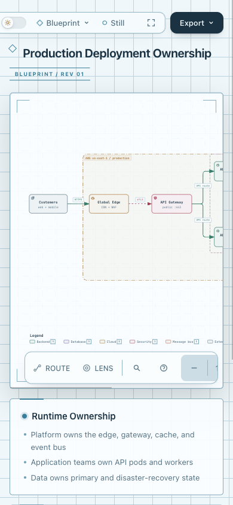
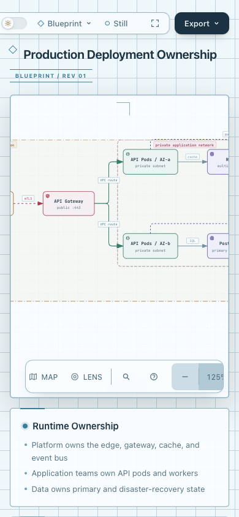

# 390px图内导航：实际横滚核对

先前截图右侧Zoom按钮被裁剪，单张图不足以认定按钮不可用。源码复核确认基线`.diagram-nav`采用单行横向滚动，窄屏按钮保留44px点击区域；它与顶部toolbar分开。

本次在同一Ego浏览器页面以390×844视口打开固定production-deployment基线产物。原生水平滚轮将导航scrollLeft从0移到91，Zoom out/reset/in均可命中；真实点击Zoom in后状态从100%变为125%，scrollLeft仍为91。来源、输入HTML摘要、截图摘要与几何观测见[observation.json](observation.json)。图中为实际Blueprint样式；这是桌面Chromium的mobile视口与滚轮/点击验证，不是物理触屏或用户可发现性研究。

| 初始裁剪 | 横滚并点击Zoom in后 |
| --- | --- |
|  |  |

**结论：没有证据支持为这次裁剪新增布局分支。** 现有toolbar键盘测试覆盖1440/640，export测试中的390px检查主要是尺寸与tabIndex，未完整检查scrollport命中；覆盖空白本身不证明缺陷。本次实际操作通过，未新增测试、控件或状态。独立代理核读源码和观测；协调代理捕获并查看图片。人类验收、物理触屏和滚动可发现性保持未知。
