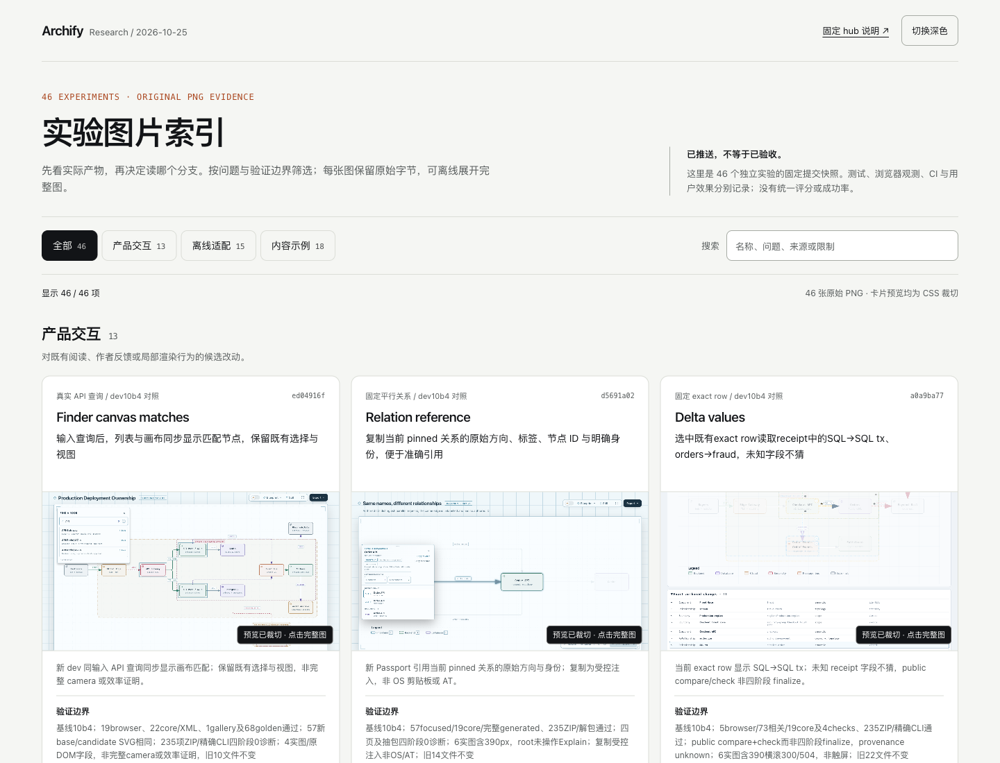
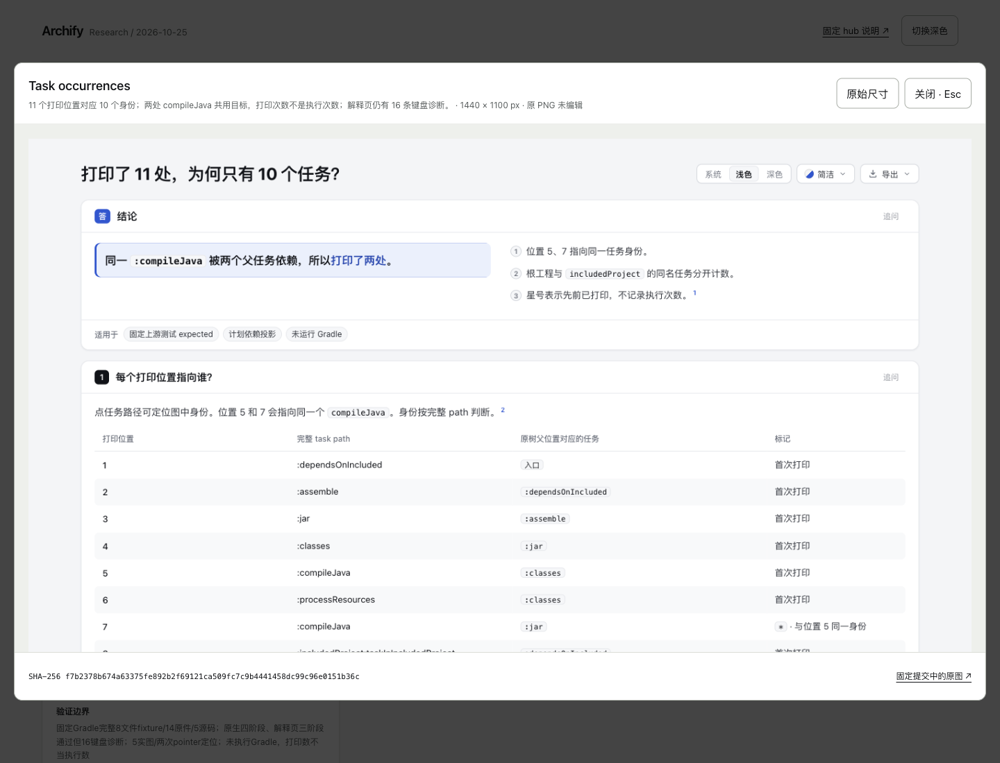
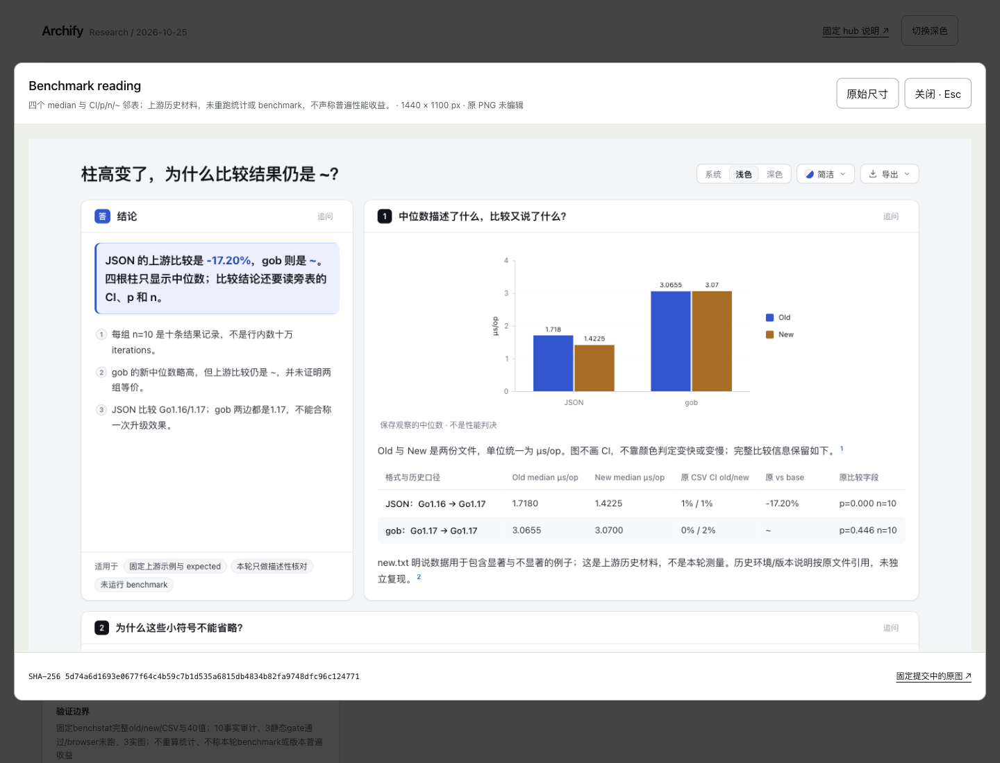

# 离线实验图片索引

直接打开 [index.html](index.html)。页面收录固定 hub 快照中的已推送实验与原始 PNG，可按产品交互、离线适配、内容示例分组筛选并用关键词搜索。数量由实际记录推导，显示于页面与 manifest；Relation return 清晰单列为暂缓，不计入已发布数量。

原 PNG bytes 用 data URI 嵌入，没有下载、编辑、缩图重绘、远程字体、分析或自动网络请求。卡片预览仅以 CSS 裁切并明确标注；点击后可看完整图，切换原始尺寸，或主动打开固定 GitHub 提交中的原图。GitHub 说明同时提供固定提交链接与分支链接。页面不加载别的实验 HTML，也不执行其代码。

每项卡片的价值与验证限制来自固定 hub 表格，原实验 README 用于核对来源与图片语义。[manifest.json](manifest.json) 记录 repo-relative path、完整 commit、Git blob、SHA-256、PNG 原始尺寸与字节数；[selection.json](selection.json) 固定所选图片和分组。没有把 synthetic 改称实测，也没有统一绿色状态、评分、CI 或用户验收声明。

视觉词汇取自本仓 `website/src/styles/site.css`、`index.css` 和 `gallery.css`：浅暖灰底、白色内容面、橙色强调、细边框与系统字体。读取的固定版本及文件摘要在 manifest 中；没有引入网站依赖或动画。

## 复现与更新

仅使用 Python 标准库与现有 Git/Node。参数 `--worktree-root` 是本地输入，指向包含 `lab-*/archify` 的父目录；其实际值不会写入产物。

```sh
python3 docs/research/2026-10-25/gallery/build.py --worktree-root '<worktree-parent>'
python3 docs/research/2026-10-25/gallery/verify.py --node '<node-executable>'
```

构建读取 selection 中固定 hub commit 的表格，逐项要求当前 HEAD、origin 跟踪 revision 与固定提交相同，并核对实际 README/PNG 文件字节与该 Git 对象一致。它不 checkout、fetch、安装或运行其他 worktree 的脚本。HTML 由 [template.html](template.html) 生成；应打开 `index.html`，而非模板。

更新时先明确修改 selection 的固定 hub/实验提交和图片路径，再重新构建。来源仍须是 hub 已发布项。标题、总数、分组按钮、筛选结果与静态核验均从 selection/实际记录计算，不需要在模板里同步维护数字。构建不自动扫描、挑选最新图片，也不把暂缓项加进成功列表。一次构建覆盖本目录的派生 index/manifest；源图片不变。

## 验证边界

[verification.json](verification.json) 是静态字节与语法核验：卡片/PNG/实际分组和按钮数量一致、每张嵌入 PNG 与 manifest SHA 一致、固定提交和分支链接存在、没有外部资源引用、内联 JS 语法有效。构建与静态核验没有打开浏览器，也不证明布局、dialog 焦点、触屏、辅助技术或真人接受；协调 Agent 的实际浏览器检查应另行记录。

各实验自己的失败与未运行阶段保留在卡片及固定来源中。例如 Task review map 的 ZIP unresolved 和键盘遍历失败，不会因为有截图而变为通过。

## 当前46版静态绑定与浏览器观察

本版仅收录固定 hub [`60b748c83470be4c30d8869991e7f2ac82905462`](https://github.com/tt-a1i/archify/blob/60b748c83470be4c30d8869991e7f2ac82905462/docs/research/2026-10-25/README.md) 的46项已发布实验：**13产品交互 / 15离线适配 / 18内容示例**。来源README为57,339 bytes，SHA-256 `1674aabe85f7834466e7e7b0e2d373549448d8d603a2936458077d6a462b38c4`；这是固定Git对象，不跟随研究中心工作树后续文字变化。

新增Edge extras、Line notes、Static uses、Hintful stages、Spatial focus、Maybe initialized、Load filter七项。Line notes仅为实验HTML后处理原型，列为内容示例，不是共享产品能力或正常finalize候选。Spatial focus为产品候选，方向键移动DOM焦点，不提交选择或移动camera；其余六项为内容示例。

Finder canvas、Relation reference、Diagnostic locations、Delta values换用各自固定dev10b4刷新原图；其余35项沿用39版所选PNG的原bytes。所有46张PNG均由固定实验Git对象读取，原始PNG共11,235,152 bytes；没有重新采集、编辑或运行实验页面。旧39版证据原JSON另存为[browser-evidence39.json](browser-evidence39.json)，其历史截图保留于screenshots39，不用于当前页面验收。

卡片价值与验证边界逐项取自上述固定hub表，图片语义对照各固定实验README。Edge的28条、Maybe的48条机器键盘失败保持可见；Line的baseline4条footer失败与后处理审计分开。Static的use边不是执行分支，Hintful的命名中间态不是第三Git提交。Load的来源是URL元数据，不冒称verified snippet或上游插件执行。Diagnostic late-open空iframe边界未修；Delta为public compare/check而非四阶段finalize。图片不会将无CI、未请求browser、受控copy或局部指针操作升级为完整通过、OS剪贴板、AT或真人验收。

正常build及固定Node22.23.2静态verify已完成：46个HEAD/origin、README/PNG工作树字节与固定Git对象一致；分组、筛选数、嵌入PNG SHA、固定链接及JS语法均通过，外部资源引用为0。产物：

- `index.html`：15,099,916 bytes；SHA-256 `85e9877b6386b6dbe884baf549fb28bdad183ef0f3925dd443b8981ba40982dd`
- `manifest.json`：SHA-256 `e624ffe58aeaf9c820a51f5488e99c35fa9419fa8755a1678defa1510be08c0f`
- 模板、builder、verify均未改；模板SHA-256仍为 `bc7d0445a2c11578de09b89afb0a3f57e468d8923dbfcc1d98978b203b7f5ce9`。

## 当前46版实际浏览器观察与明确复用

协调Agent在Ego/Chromium实际检查当前 `85e9877b…982dd` HTML，并逐张查看[screenshots46](screenshots46/)中的六张终版原PNG。[browser-evidence.json](browser-evidence.json)绑定当前静态产物、固定hub README与六图；[observations-summary.json](screenshots46/observations-summary.json)是选字段的公开派生摘要，原始JSON继续留在checkout外，摘要列原文件名/bytes/SHA，不冒充原始收据。

当前新HTML实际重新检查四筛选46/13/15/18、七个新增value无裸URL或Markdown且卡片固定说明链接仍指向对应提交目录、固定hub60b748、1440×1100浅/深色，以及390×844页面宽390。Maybe深色dialog显示原图SHA与天然1440×2829，Escape关闭并回到Maybe opener；空结果0/46，reset回46且query获得焦点。桌面Maybe卡片等待lazy图片complete及natural尺寸确认后重拍；早期未解码空白图仅私有保留，不列为成功截图。移动Maybe卡片PNG按IHDR记录实际尺寸，不由CSS viewport推断整图尺寸。

**十一项完整图/原始尺寸操作明确复用旧页面证据。** root先在上一内容版HTML `350964384a42a24294cc0b2809b688a309291c795daa11261913f7749853ecd1`（hub588dd5）实际逐项搜索七新增/四刷新，各为1/46，打开dialog核PNG SHA/bytes/天然尺寸/固定来源，切原始尺寸后显示尺寸等于天然尺寸，Escape均返回原卡片。旧移动dialog实际wheel从0到159.5。这些动作没有在新HTML上重新做十一遍；其适用性来自模板及46张图片记录逐项不变，仅七value文本与hub绑定变化，新内容与移动dialog另有上述实查。旧八图仍仅属于旧HTML，不作为新页面截图。



[等待图片解码后的Maybe桌面卡片](screenshots46/desktop-maybe-card-light.png) · [当前桌面深色](screenshots46/desktop-overview-dark.png) · [390px Maybe卡片](screenshots46/mobile-maybe-card-light.png) · [390px深色完整图dialog](screenshots46/mobile-maybe-dialog-dark.png) · [390px深色空结果](screenshots46/mobile-empty-dark.png)。

本次没有执行实验HTML、打开外链、写OS剪贴板、读屏器、实体触屏或真人验收；没有完整modal Tab焦点陷阱或跨浏览器声明。gallery展示原PNG不会抵消Maybe48/Edge28等实验自身失败。旧39/35等浏览器观察继续只属于各自固定历史页面。

## 历史 39 版的静态绑定

本次固定 hub 为 [`fc7017426177ad44e213242a2b1756ffba43b9e3`](https://github.com/tt-a1i/archify/blob/fc7017426177ad44e213242a2b1756ffba43b9e3/docs/research/2026-10-25/README.md)：39 项 / 39 张原始 PNG，实际分组为 **12 产品交互 / 15 离线适配 / 12 内容示例**。Relation return 仍为暂缓，不计入已发布数。

本版新增 Notebook occurrences、Config origins、Benchmark reading 和 Task occurrences 四个固定来源内容例，分别区分 source/保存 output、provider 声明/幸存字段/错误归属、median/上游比较结论，以及打印位置/任务身份。它们是上游已提交 fixture、测试或 golden 的阅读内容，不是本轮上游程序执行或真实用户工作负载。Task 的解释页仍有 **16 条键盘诊断**；Notebook、Config 和 Benchmark 的 Explainer 自动 browser 阶段未运行，截图不补成完整 gate 通过。

Finder、Waterfall、Workflow、Keyboard 与 Clipboard 五项主图更新到固定 dev10b4 刷新证据：

- Finder 的可见 UI 本来相同，8 个 description 改善由实际 AX 记录证明；图片不证明发声或真人 AT 验收。
- Waterfall 是构造输入中给定 Error/Cancelled 的文字显示，不是实际操作成功率；首次 XML 缺依赖与后续单独 3 pass 分开保留。
- Workflow 保留原始合法自环 pins；基线真实验证失败且没有 HTML，不虚构 before 图或运行 trace。
- Keyboard 对同一 HTML 继续真实 Tab 到末尾，没有视觉改版。root 的 task47/PR63 与 checker 的48/64属于不同起点/动作，分别记账；这次 checker 结果不回写 Task 内容实验原有16条失败。
- Clipboard 以受控 API 缺失展示完整消息保留；未写 OS clipboard。两页三阶段通过且各保留7条写作 warnings，整体自动 browser 未请求。

其余30项主图保持历史选择；实验输入、失败与未运行边界仍以各固定 README 为准。当前卡片的价值与限制直接读取固定 hub 表格，不将分支已发布解释为合入、release、CI 通过或人类接受；未出现的 CI 检查不当作通过。

一次正常 build 与静态 verify 已完成。39 项的 HEAD、origin 跟踪、README 与 PNG Git blob/原字节全部核对；卡片、过滤按钮和分组数量一致，嵌图解码 SHA、固定链接与 JS 语法核验通过。HTML 为 **11,628,628 bytes**，39 张原 PNG 共 **8,645,160 bytes**，没有远程资源引用。

- `index.html` SHA-256：`f884139c70fb99c2d290d1cbc24613d5d35adbab99d5eed5c12cb36f5eec9fd7`
- `manifest.json` SHA-256：`dffc5cb30f9fbefae49a31b440b44df685c961849e7103416ab11b75b1164785`

模板与历史35版逐字相同，SHA-256 `bc7d0445a2c11578de09b89afb0a3f57e468d8923dbfcc1d98978b203b7f5ce9`。本次未修改 builder、verify 或模板。

## 历史39版的实际浏览器观察

协调 Agent 已在 Ego / Chromium 实际操作当前冻结 HTML，并逐张查看7张原PNG。[browser-evidence39.json](browser-evidence39.json) 绑定 HTML、manifest、verification、selection、模板、README、20项原始观测和7图的SHA/bytes/尺寸；摘要是派生记录，不是delivery receipt。[桌面14项观测](screenshots39/desktop-observations.json)与[响应式6项观测](screenshots39/responsive-observations.json)为原字节安全副本。

1440×1100浅色实际核对四个筛选39/12/15/12；四个新增与五个刷新项目各搜索为1/39，并逐项打开完整图，核实际data bytes摘要等于UI摘要、天然尺寸与固定GitHub来源。九次切到原始尺寸后，实际图片宽度等于天然宽度；九次Escape均关闭dialog并返回原opener。清空后恢复39项，页面宽度1440。

390×844浅色实看Task卡片；深色dialog宽374px、x=8，页面宽390，Escape回Task opener。空结果为0/39，reset回39且焦点在query。随后桌面深色宽度1440、显示39项。这些是本版实际观测，不挪用旧版移动/深色结果。


| Task完整图 | Benchmark完整图 |
| --- | --- |
|  |  |

[Clipboard完整图](screenshots39/clipboard-outcome-dialog.png) · [390px浅色Task卡](screenshots39/task-mobile-light.png) · [390px深色dialog](screenshots39/task-mobile-dark-dialog.png) · [桌面深色](screenshots39/overview-desktop-dark.png)。旧35版截图原文件未删除或覆盖，继续按下节固定历史链接阅读。

本轮没有执行各实验HTML、外链导航、OS clipboard、读屏器或真人验收；dialog里展示的是原PNG，不是重新测试嵌套的产品。未重测原始尺寸End滚动或精细modal Tab遍历，不把Escape返回opener写成完整焦点陷阱验收；CSS视口模拟不代表实体触屏。实验自己的失败/未运行阶段保持，例如Task的16条键盘诊断不因gallery能打开截图而转为通过。

## 历史 35 版浏览器检查

固定 [35版提交 `c23d585c`](https://github.com/tt-a1i/archify/tree/c23d585c6a5aead61ca30198b1fcbecc5fe8595d/docs/research/2026-10-25/gallery) 的 hub 为 `8353da8e412c3a87956a37eb675cf3e34eb29888`，HTML SHA-256 为 `888daa609c7f877751a5cbe08970308a213e2910157a1dc9d5a6693b594fab88`，manifest 为 `d9acc39e1b4f36c8c5ca1e71dbd733a2548a19a9766bb2e24edca322cb13c91d`。当时为35项/35图、分组12/15/8；独立 Agent 隔离重建三份静态派生产物逐字一致。

协调 Agent 当时在1440×1100浅色实际检查35/12/15/8筛选、Source keyboard / Diff / Preview三项关键词各一个结果、完整原图尺寸/固定提交/SHA、三次Esc返回opener，以及清空后35项和页面宽度1440无横向溢出。四张图已实际查看。该轮没有重测390px、深色、原始尺寸End滚动、精细modal Tab遍历或空结果；390px/深色只引用更早34版历史观测，既不是35版重测，也不是当前39版结果。

[35版浏览器摘要](https://github.com/tt-a1i/archify/blob/c23d585c6a5aead61ca30198b1fcbecc5fe8595d/docs/research/2026-10-25/gallery/browser-evidence.json) · [桌面图](https://github.com/tt-a1i/archify/blob/c23d585c6a5aead61ca30198b1fcbecc5fe8595d/docs/research/2026-10-25/gallery/screenshots/desktop-light.png) · [Source keyboard完整图](https://github.com/tt-a1i/archify/blob/c23d585c6a5aead61ca30198b1fcbecc5fe8595d/docs/research/2026-10-25/gallery/screenshots/source-keyboard-dialog.png) · [Diff完整图](https://github.com/tt-a1i/archify/blob/c23d585c6a5aead61ca30198b1fcbecc5fe8595d/docs/research/2026-10-25/gallery/screenshots/diff-line-numbers-dialog.png) · [Preview完整图](https://github.com/tt-a1i/archify/blob/c23d585c6a5aead61ca30198b1fcbecc5fe8595d/docs/research/2026-10-25/gallery/screenshots/preview-dashed-ink-dialog.png)。外链当时只核对未打开，未执行各实验HTML；视口模拟不代表实体触屏、读屏器或人类验收。旧截图即使本目录后续替换，其原字节仍由这些固定历史链接保留。

## 历史 34 版浏览器检查

固定 [34 版提交 `80059967`](https://github.com/tt-a1i/archify/tree/800599678493c33e69179adc7f66d5b17ab3aa63/docs/research/2026-10-25/gallery) 的 HTML SHA-256 为 `71465bb0454f266a0368c3cebd442995930fdb2c909ecb78c2af9902666176f1`，manifest 为 `ffb82caaff39d688cf7150699c5c3701833fd33061a58f9a17b80a5a40848dde`。当时协调 Agent 实际检查 1440×1100 与 390×844 浅/深色、34/11/15/8 筛选、State/Recipe/Byte 各一个关键词结果、三项完整图片的原始尺寸元数据与固定来源、三次 Esc 返回 opener、空结果与清空后查询框焦点。四个视口/主题状态无页面横向溢出；七张图实际查看，19 项观测及图片/原始记录绑定已独立核对。独立 Agent 隔离重建三份静态派生产物逐字一致。

[该版浏览器摘要](https://github.com/tt-a1i/archify/blob/800599678493c33e69179adc7f66d5b17ab3aa63/docs/research/2026-10-25/gallery/browser-evidence.json) · [桌面图片](https://github.com/tt-a1i/archify/blob/800599678493c33e69179adc7f66d5b17ab3aa63/docs/research/2026-10-25/gallery/screenshots/desktop-light.png) · [Byte 完整图](https://github.com/tt-a1i/archify/blob/800599678493c33e69179adc7f66d5b17ab3aa63/docs/research/2026-10-25/gallery/screenshots/byte-views-dialog.png) · [390px 图片](https://github.com/tt-a1i/archify/blob/800599678493c33e69179adc7f66d5b17ab3aa63/docs/research/2026-10-25/gallery/screenshots/mobile-dark.png)。该轮未重测原始尺寸 End 滚动和精细 modal Tab 遍历，未验证实体触屏、读屏器或人类验收；外链未打开，各实验 HTML 未执行。

## 历史 33 版浏览器检查

固定 [33 版提交 `16739d87`](https://github.com/tt-a1i/archify/tree/16739d87811896012fe1827331f322270d8bcfbd/docs/research/2026-10-25/gallery) 的 `index.html` SHA-256 为 `d37bd42fa244011d841877c2bfcf70ff82f7688ac0f758b634e7ecbc5a6f1569`，manifest 为 `55892d8c3b2296d93663f85d6acde33d1a354dabafd7514c7dbb513e6c7eb55e`。协调 Agent 当时实际检查 1440×1100 与 390×844 浅/深色、33/11/15/7 筛选、四个新增项与 DBML 的关键词定位、DBML/Clipboard 完整原图及固定来源、Esc 返回 opener、空结果与清空；390px 没有页面横向溢出。七张图实际查看，独立 Agent 核对摘要与原始观测、图片字节及绑定；隔离重建三份派生产物逐字一致。

[该版浏览器摘要](https://github.com/tt-a1i/archify/blob/16739d87811896012fe1827331f322270d8bcfbd/docs/research/2026-10-25/gallery/browser-evidence.json) · [桌面图片](https://github.com/tt-a1i/archify/blob/16739d87811896012fe1827331f322270d8bcfbd/docs/research/2026-10-25/gallery/screenshots/desktop-light.png) · [复制恢复完整图](https://github.com/tt-a1i/archify/blob/16739d87811896012fe1827331f322270d8bcfbd/docs/research/2026-10-25/gallery/screenshots/clipboard-dialog.png) · [390px 图片](https://github.com/tt-a1i/archify/blob/16739d87811896012fe1827331f322270d8bcfbd/docs/research/2026-10-25/gallery/screenshots/mobile-dark.png)。这轮没有重复原始尺寸 End 滚动和详细 modal Tab 检查，也不代表实体触屏、读屏器或人类验收。

## 历史 29 版浏览器检查

固定 [29 版提交 `a94bd25b`](https://github.com/tt-a1i/archify/tree/a94bd25bdcf33c386f0e920142c61309e1e8b499/docs/research/2026-10-25/gallery) 的 `index.html` SHA-256 为 `7fc4a81cc0d06b31f74588813d784f7361e2e8b4d5e8863793a4c83aba37e959`。当时实际检查了 1440×1100 与 390×844 浅深色、29/9/15/5 数量、两个新项关键词定位、完整图与固定来源、Esc 返回 opener、空结果与清空；390px 无页面横向溢出。六张图已由协调 Agent 查看，独立 Agent 重建并核对固定来源与字节。

[该版浏览器摘要](https://github.com/tt-a1i/archify/blob/a94bd25bdcf33c386f0e920142c61309e1e8b499/docs/research/2026-10-25/gallery/browser-evidence.json) · [桌面图片](https://github.com/tt-a1i/archify/blob/a94bd25bdcf33c386f0e920142c61309e1e8b499/docs/research/2026-10-25/gallery/screenshots/desktop-light.png) · [键盘实验搜索图](https://github.com/tt-a1i/archify/blob/a94bd25bdcf33c386f0e920142c61309e1e8b499/docs/research/2026-10-25/gallery/screenshots/keyboard-result.png) · [390px 图片](https://github.com/tt-a1i/archify/blob/a94bd25bdcf33c386f0e920142c61309e1e8b499/docs/research/2026-10-25/gallery/screenshots/mobile-dark.png)。这些历史观测没有验证实体触屏、读屏器或人类接受，原始尺寸滚动和 native modal 更细 Tab 观测也未在该轮重测。

## 历史 27 版浏览器检查

固定 [27 版提交 `50cc320a`](https://github.com/tt-a1i/archify/tree/50cc320adffef212f046f065eb2e9e702610a27d/docs/research/2026-10-25/gallery) 的 `index.html`（SHA-256 `731877a954e904d3c73a9c7ae754bc75a810b174cd792e8c4fed87774d1f48eb`）曾实际检查 1440×1100 与 390×844、浅/深色、7/15/5 分组、关键词交集、空结果与清空、完整图片、原始尺寸和 Esc 后焦点返回。390px 页面没有横向溢出；长图原始尺寸滚动区可用键盘 End 到达底部。原生 modal 的 Tab 可进入浏览器 chrome，再回到弹窗首控件；没有误称自定义闭环焦点陷阱。这些观测只属于该固定版本，不自动成为刷新后页面的验收。

[历史浏览器摘要与截图绑定](https://github.com/tt-a1i/archify/blob/50cc320adffef212f046f065eb2e9e702610a27d/docs/research/2026-10-25/gallery/browser-evidence.json) 与 builder 静态核验分开；这些是 Chromium 鼠标/键盘和视口模拟观测，未验证实体触屏、读屏器或人类接受。未打开外链或执行各实验产物代码。当时另一位 Agent 独立核对固定 Git 对象/图片字节，并重建出逐字相同的 index 与 manifest。

[历史桌面图片](https://github.com/tt-a1i/archify/blob/50cc320adffef212f046f065eb2e9e702610a27d/docs/research/2026-10-25/gallery/screenshots/desktop-light.png) · [历史 390px 图片](https://github.com/tt-a1i/archify/blob/50cc320adffef212f046f065eb2e9e702610a27d/docs/research/2026-10-25/gallery/screenshots/mobile-dark.png)。

历史 `browser-evidence39.json` 的 `hubReadme` 绑定发布提交 `f2ac641892bf57cce0d30e0a8005008f765ecb37` 中的固定 README Git 对象，表示当次发布快照；研究中心 README 后续更新不要求重建这个固定39项 gallery。
