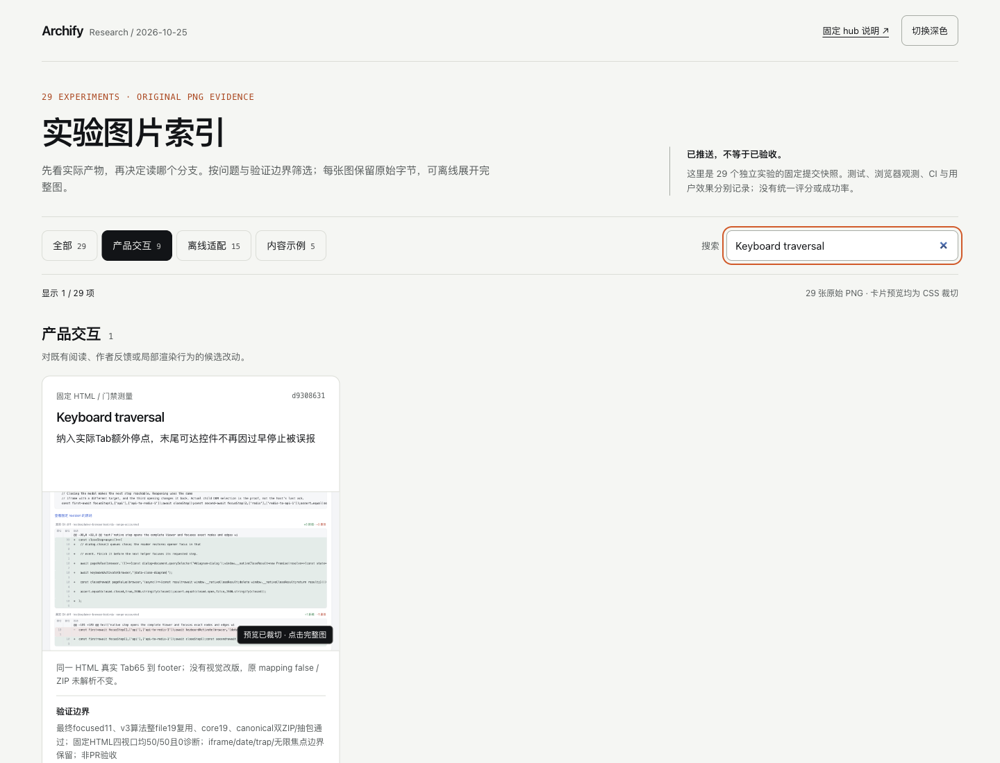

# 离线实验图片索引

直接打开 [index.html](index.html)。页面收录固定 hub 快照中的已推送实验与原始 PNG，可按产品交互、离线适配、内容示例分组筛选并用关键词搜索。数量由实际记录推导，显示于页面与 manifest；Relation return 清晰单列为暂缓，不计入已发布数量。

原 PNG bytes 用 data URI 嵌入，没有下载、编辑、缩图重绘、远程字体、分析或自动网络请求。卡片预览仅以 CSS 裁切并明确标注；点击后可看完整图，切换原始尺寸，或主动打开固定 GitHub 提交中的原图。GitHub 说明同时提供固定提交链接与分支链接。页面不加载别的实验 HTML，也不执行其代码。

每项卡片的价值与验证限制来自固定 hub 表格，原实验 README 用于核对来源与图片语义。[manifest.json](manifest.json) 记录 repo-relative path、完整 commit、Git blob、SHA-256、PNG 原始尺寸与字节数；[selection.json](selection.json) 固定所选图片和分组。没有把 synthetic 改称实测，也没有统一绿色状态、评分、CI 或用户验收声明。

视觉词汇取自本仓 `website/src/styles/site.css`、`index.css` 和 `gallery.css`：浅暖灰底、白色内容面、橙色强调、细边框与系统字体。读取的固定版本及文件摘要在 manifest 中；没有引入网站依赖或动画。

## 复现与更新

仅使用 Python 标准库与现有 Git/Node。参数 `--worktree-root` 是本地输入，指向包含 `lab-*/archify` 的父目录；其实际值不会写入产物。

```sh
python3 docs/research/2026-10-25/gallery/build.py --worktree-root '<worktree-parent>'
python3 docs/research/2026-10-25/gallery/verify.py --node '<node-executable>'
```

构建读取 selection 中固定 hub commit 的表格，逐项要求当前 HEAD、origin 跟踪 revision 与固定提交相同，并核对实际 README/PNG 文件字节与该 Git 对象一致。它不 checkout、fetch、安装或运行其他 worktree 的脚本。HTML 由 [template.html](template.html) 生成；应打开 `index.html`，而非模板。

更新时先明确修改 selection 的固定 hub/实验提交和图片路径，再重新构建。来源仍须是 hub 已发布项。标题、总数、分组按钮、筛选结果与静态核验均从 selection/实际记录计算，不需要在模板里同步维护数字。构建不自动扫描、挑选最新图片，也不把暂缓项加进成功列表。一次构建覆盖本目录的派生 index/manifest；源图片不变。

## 验证边界

[verification.json](verification.json) 是静态字节与语法核验：卡片/PNG/实际分组和按钮数量一致、每张嵌入 PNG 与 manifest SHA 一致、固定提交和分支链接存在、没有外部资源引用、内联 JS 语法有效。构建与静态核验没有打开浏览器，也不证明布局、dialog 焦点、触屏、辅助技术或真人接受；协调 Agent 的实际浏览器检查应另行记录。

各实验自己的失败与未运行阶段保留在卡片及固定来源中。例如 Task review map 的 ZIP unresolved 和键盘遍历失败，不会因为有截图而变为通过。

## 当前 29 版的静态绑定

本次固定 hub 为 `77184273a18d70dd971a384f88b8a2ae0bf8d8d7`：29 项 / 29 张原始 PNG，实际分组为 9 / 15 / 5。新增 Diff line numbers 与 Keyboard traversal；后者是门禁测量修正，显示同一个 HTML 的真实 Tab65 到 footer，不是视觉改版，原 mapping false / ZIP unresolved 保持不变。DBML 更新官方完整输入拒绝的限制说明；Plan actions 改用完整官方 fixture 的实际截图。

当前 `index.html` SHA-256：`7fc4a81cc0d06b31f74588813d784f7361e2e8b4d5e8863793a4c83aba37e959`；manifest SHA-256：`fe7ed7e50e44f43e0053f2b77915abb8fbae6d96c8ae7f45ed6087281d68817e`。每张 PNG、固定 HEAD Git blob、README 与 origin 跟踪提交均已核对；动态数量、29 张嵌入图字节、固定链接及 JS 语法核验通过。HTML 为 9,354,056 bytes，没有远程资源引用。

协调 Agent 已在当前 hash 实际检查 1440×1100 与 390×844 浅/深色、29/9/15/5 数量、两个新项的关键词定位、完整原图及固定来源、Esc 返回 opener、空结果与清空。390px 页宽和内容宽均为390，无页面横向溢出。六张新截图已实际查看，当前绑定见 [browser-evidence.json](browser-evidence.json)。这仍不等于实体触屏、读屏器或人类验收；未打开外链或执行实验 HTML。独立 Agent 复核了29项源字节并隔离重建得到相同 index/manifest/verification。





下面的历史 27 版观测不作为本版本验收；原始尺寸滚动和 native modal 的更细 Tab 观测没有在本轮重复声称。

## 历史 27 版浏览器检查

固定 [27 版提交 `50cc320a`](https://github.com/tt-a1i/archify/tree/50cc320adffef212f046f065eb2e9e702610a27d/docs/research/2026-10-25/gallery) 的 `index.html`（SHA-256 `731877a954e904d3c73a9c7ae754bc75a810b174cd792e8c4fed87774d1f48eb`）曾实际检查 1440×1100 与 390×844、浅/深色、7/15/5 分组、关键词交集、空结果与清空、完整图片、原始尺寸和 Esc 后焦点返回。390px 页面没有横向溢出；长图原始尺寸滚动区可用键盘 End 到达底部。原生 modal 的 Tab 可进入浏览器 chrome，再回到弹窗首控件；没有误称自定义闭环焦点陷阱。这些观测只属于该固定版本，不自动成为刷新后页面的验收。

[历史浏览器摘要与截图绑定](https://github.com/tt-a1i/archify/blob/50cc320adffef212f046f065eb2e9e702610a27d/docs/research/2026-10-25/gallery/browser-evidence.json) 与 builder 静态核验分开；这些是 Chromium 鼠标/键盘和视口模拟观测，未验证实体触屏、读屏器或人类接受。未打开外链或执行各实验产物代码。当时另一位 Agent 独立核对固定 Git 对象/图片字节，并重建出逐字相同的 index 与 manifest。

[历史桌面图片](https://github.com/tt-a1i/archify/blob/50cc320adffef212f046f065eb2e9e702610a27d/docs/research/2026-10-25/gallery/screenshots/desktop-light.png) · [历史 390px 图片](https://github.com/tt-a1i/archify/blob/50cc320adffef212f046f065eb2e9e702610a27d/docs/research/2026-10-25/gallery/screenshots/mobile-dark.png)。
