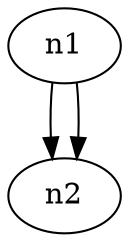

# 代码图交换：多重关系、来源链接与离线阅读

2026-10-25。先对研究中心全部scouts的216个唯一GitHub owner/repo排重；以下8项此前未列入。不按star筛选。对照研究中心前22项实验范围，尤其dependency-map、source-question-tour、relation-reference、symbol-evidence与lineage-evidence，避免再造通用parser或相同报告converter。

结论：本轮没有找到已证实值得实施的产品缺口。只保留两个审查机制：**关系条数、关系身份与关系类型分别核对；离线可见内容与仍依赖外部文件的来源链接分别交付**。现有Archify原生图、Explainer源码片段和证据表已能满足很多场景；增加DOT/GraphML/PlantUML入口会带来语义映射和失败诊断成本，暂不推荐。

本轮仅查公开README、固定源码、测试fixture；没有执行安装脚本、upstream转换器、Graphviz/Java/Perl/Python索引器、PlantUML server或网络渲染服务。表内“输出”是源码/fixture证明的格式，不是本次实跑receipt。没有UI、性能或用户阅读收益验收。

## 8个新来源与固定证据

| 来源、commit / 许可 | 实际输入与输出 | 有价值的机制及不能声称的语义 |
| --- | --- | --- |
| [dagrejs/graphlib-dot](https://github.com/dagrejs/graphlib-dot/tree/8649330a05fd6599929acfc9d5a1cf23f04256bc)，[MIT](https://github.com/dagrejs/graphlib-dot/blob/8649330a05fd6599929acfc9d5a1cf23f04256bc/LICENSE) | DOT↔graphlib图；[writer](https://github.com/dagrejs/graphlib-dot/blob/8649330a05fd6599929acfc9d5a1cf23f04256bc/lib/write-one.js) 按isDirected写graph/digraph，按isMultigraph决定strict；写节点和边的attrs。平行边逐条输出，但edge.name不写进DOT。 | [test](https://github.com/dagrejs/graphlib-dot/blob/8649330a05fd6599929acfc9d5a1cf23f04256bc/test/write-test.js#L75) 证明期望保留两边及不同attrs，不证明原edge name恢复。漂亮相同或edgeCount相同不等于稳定身份相同；也不证明源码关系准确。 |
| [pydot/pydot](https://github.com/pydot/pydot/tree/564a84b49830cb06c34f6f17ba03d63e0ec5171a)，[MIT](https://github.com/pydot/pydot/blob/564a84b49830cb06c34f6f17ba03d63e0ec5171a/LICENSES/MIT.txt)，vendored模块另有Python-2.0许可 | DOT/对象→DOT text，选择create/render路径再调用Graphviz输出图片；[core](https://github.com/pydot/pydot/blob/564a84b49830cb06c34f6f17ba03d63e0ec5171a/src/pydot/core.py) 有Node/Edge/Graph、strict/simplify，属性包括URL/href/edgeURL/id/label/ports等。 | 保留原DOT作为审阅文本可以避免只剩像素；simplify会去重复边，不应默默当无损交换。图片含链接取决于renderer/格式及读取器，属性存在不代表离线目标也存在。MIT须按源码SPDX理解，不能把vendored许可忽略。 |
| [nidi3/graphviz-java](https://github.com/nidi3/graphviz-java/tree/f0c1fdfa37c8b9876ef1dcccec1a6c19219e727e)，[Apache-2.0](https://github.com/nidi3/graphviz-java/blob/f0c1fdfa37c8b9876ef1dcccec1a6c19219e727e/LICENSE) | Java mutable graph/解析DOT→DOT或rendered artifact。[SerializerImpl](https://github.com/nidi3/graphviz-java/blob/f0c1fdfa37c8b9876ef1dcccec1a6c19219e727e/graphviz-java/src/main/java/guru/nidi/graphviz/model/SerializerImpl.java) 保留strict、directed、node/edge属性、record port；未知link target抛IllegalStateException。 | graph model与可读序列化分开有利排错；图形输出可以使用本机dot/J2V8等不同engine，不能笼统叫无依赖。没有任何语言symbol解析或调用语义保证，部署Java渲染器对Archify无明确价值。 |
| [pylint-dev/pylint 的pyreverse](https://github.com/pylint-dev/pylint/tree/7f8835485e92a3c39fecb18dbb27cea76997ceb7)，[GPL-2.0](https://github.com/pylint-dev/pylint/blob/7f8835485e92a3c39fecb18dbb27cea76997ceb7/LICENSE) | Python代码经astroid关系模型→DOT、PlantUML等；[PlantUmlPrinter](https://github.com/pylint-dev/pylint/blob/7f8835485e92a3c39fecb18dbb27cea76997ceb7/pylint/pyreverse/plantuml_printer.py) class/package、attrs/methods、带label关系；ARROWS区分inherits/association/composition/aggregation/uses/type_dependency。 | 同为`-->`的association与uses在目标文本中可能失去类型区别；接口有枚举不等于导出无损。PlantUML只支持LR/TB layout，其余明确ValueError，比默默降级好。GPL分析器不移植；这里研究独立printer和fixture，不新增Python解析。 |
| [demike/TsUML2](https://github.com/demike/TsUML2/tree/e1263b545ce863746fe1170a89a7778ff80beb22)，[MIT](https://github.com/demike/TsUML2/blob/e1263b545ce863746fe1170a89a7778ff80beb22/LICENSE) | tsconfig/glob源文件→nomnoml SVG及可选nomnoml/Mermaid DSL；并非PlantUML输出。模型来自ts-morph；[emitter](https://github.com/demike/TsUML2/blob/e1263b545ce863746fe1170a89a7778ff80beb22/src/core/emitter.ts#L75) 可为类型文本增加 `xlink:href`，路径相对diagram。 | 一个类型点回源码可少一次手工搜索，但源文件没随SVG分享就仍不可读。postprocess以显示名称匹配类型map，不能仅凭图中同名标签声称跨文件唯一定位。已有Archify source preview更适合单文件可分享场景，无立即移植需要。 |
| [iVis-at-Bilkent/cytoscape.js-graphml](https://github.com/iVis-at-Bilkent/cytoscape.js-graphml/tree/fb12e0c872eb3f25ffd89c66c08f0c5482057356)，[MIT](https://github.com/iVis-at-Bilkent/cytoscape.js-graphml/blob/fb12e0c872eb3f25ffd89c66c08f0c5482057356/LICENSE) | Cytoscape.js graph↔GraphML string。[exporter](https://github.com/iVis-at-Bilkent/cytoscape.js-graphml/blob/fb12e0c872eb3f25ffd89c66c08f0c5482057356/src/exporter.js) 写node id、嵌套graph、edge id/source/target及data；[importer](https://github.com/iVis-at-Bilkent/cytoscape.js-graphml/blob/fb12e0c872eb3f25ffd89c66c08f0c5482057356/src/importer.js) 全部data读text，添加元素后运行layout。 | element id与data可携带来源，但不能因此称通用GraphML语义无损。export选项含CSS/position，import却把data都放data、css/position初始为空；不会按导出type重新恢复样式/坐标，嵌套对象也非类型保真。依赖jQuery/Cytoscape，不推荐嵌入Archify。 |
| [hbmartin/graphviz2drawio](https://github.com/hbmartin/graphviz2drawio/tree/0db9579b0744489909eb55688b52375da02c7326)，[GPL-3.0](https://github.com/hbmartin/graphviz2drawio/blob/0db9579b0744489909eb55688b52375da02c7326/LICENSE.md) | DOT/AGraph/path/file→经Graphviz SVG→解析node/edge/cluster→mxGraph XML。[convert](https://github.com/hbmartin/graphviz2drawio/blob/0db9579b0744489909eb55688b52375da02c7326/graphviz2drawio/graphviz2drawio.py#L15) 返回可编辑XML；[errors](https://github.com/hbmartin/graphviz2drawio/blob/0db9579b0744489909eb55688b52375da02c7326/graphviz2drawio/models/Errors.py) 区分missing title/text/identifiers、path、Bezier与无法解析图。 | 保留布局后变可编辑可以少一次手工重画，但代价是形状/路径映射。补充attrs字典key按端点+label构成，相同端点同label不能仅凭它证明每条边独立来源；这里是源码风险点，未实跑证明丢边。Archify已有原生可编辑JSON及导出，不建议为可编辑性走SVG反解析。 |
| [ironcamel/Graph-Easy](https://github.com/ironcamel/Graph-Easy/tree/ededa3d787ad89ac532c578c06390e8a7b270499)，[README声明GPL v2](https://github.com/ironcamel/Graph-Easy/blob/ededa3d787ad89ac532c578c06390e8a7b270499/README)，[LICENSE含ColorBrewer额外条款](https://github.com/ironcamel/Graph-Easy/blob/ededa3d787ad89ac532c578c06390e8a7b270499/LICENSE) | Graph::Easy文本/Perl对象/DOT→ASCII、HTML、Graphviz、GraphML等。[GraphML printer](https://github.com/ironcamel/Graph-Easy/blob/ededa3d787ad89ac532c578c06390e8a7b270499/lib/Graph/Easy/As_graphml.pm) 根据attrs生成key、default、node/data及edge/source/target，未知format明确error。 | 小文本图到终端ASCII可方便检查拓扑；GraphML标准属性与私有扩展需要分清。fixture中edge无稳定id；可见拓扑不等于完整UML、超边、ports或source信息。多年旧Perl链路维护成本高，不建议引入。许可不是简单凭API NOASSERTION得出，单独保留附加条款。 |

## 一手实际输出例子与语义核对

以下来自上游测试fixture或由已读writer逐句直接推出的示意；不冒充本次运行结果。

**Graphlib-dot多重关系。** [现有test](https://github.com/dagrejs/graphlib-dot/blob/8649330a05fd6599929acfc9d5a1cf23f04256bc/test/write-test.js#L75) 建两边：一条默认名attrs `{foo:"bar"}`，另一条名`another` attrs `{foo:"baz"}`。writer对应文本主体为：



上游测试核回读edgeCount=2和attrs集合，**没有核原edge name为another**；[build-graph](https://github.com/dagrejs/graphlib-dot/blob/8649330a05fd6599929acfc9d5a1cf23f04256bc/lib/build-graph.js) 在已有端点边时生成新name。这个例子支持“多重性保留”，不支持“原始身份保留”。未实跑，不扩展为所有DOT语法均正确的结论。

**Pyreverse关系类型。** [真实fields.puml](https://github.com/pylint-dev/pylint/blob/7f8835485e92a3c39fecb18dbb27cea76997ceb7/tests/pyreverse/functional/class_diagrams/relationships/fields.puml) 含：

```plantuml
fields.Association --> fields.P : x
fields.P --* fields.Composition1 : x
fields.P --o fields.Aggregation1 : x
```

这份输出明确显示端点、关系箭头、成员label。它不是调用图；`--*`的端点约定也不能只保留无向连线后靠样式猜“谁拥有谁”。若映射Archify class，应先核原始EdgeType与方向，不能将所有箭头改成Architecture普通依赖。

**Graph-Easy XML字面值。** [t/graphml.t](https://github.com/ironcamel/Graph-Easy/blob/ededa3d787ad89ac532c578c06390e8a7b270499/t/graphml.t) 的预期包含：

```xml
<edge source="A" target="B">
  <data key="d2">train-station &amp; &lt;Überlingen &quot;Süd&quot;&gt;</data>
</edge>
```

这验证的是fixture对XML转义的期望；不证明任意XML/GraphML字段均支持。源码链接若存入data也只是属性，另一reader不一定把它解释成可点来源。

## 深入机制一：交换时分别核身份、多重性、类型

三个维度不能相互代替：

- Graphlib-dot的平行边测试保留数量与attrs，却不保留内部edge name。需要逐边源码证据时，仅按`from/to`对齐会把两次调用或两种依赖合并。
- Pydot有strict与simplify两个不同控制，后者可抑制重复边；这可能是作者意图，也可能损失记录。应报告采用的策略，不能自动称“清理重复”而不说明语义。
- Pyreverse PlantUML把ASSOCIATION与USES都映射到`-->`。图形相同不表示原始关系类型可逆；输出SVG再反推UML会丢失更多信息。

若用户真的已有冻结DOT要在Archify附审阅解释，最低成本可先**并列原图/原文与一个明确选取的原生局部图**，证据表逐条列source edge key、端点、类型、label和未展开项，不做通用导入。这样可省读者拿着一条合并边回原报告搜索两次的步骤；但本轮没观察到这个实际场景，也没有完成收益对照，因此保持研究。

不值得为了“互通”新增任意attrs映射、自动猜Architecture/Class类型或全GraphML parser。ports、cluster、parallel edges、hyperedge、各类UML箭头、undirected/mixed graph、private extension与unsupported字段都要单独处理；本轮只核了上述具体实现，不声称这些格式彼此等价。

## 深入机制二：离线阅读与来源链接不能混称单文件可分享

TsUML2的[postProcessSvg](https://github.com/demike/TsUML2/blob/e1263b545ce863746fe1170a89a7778ff80beb22/src/core/emitter.ts#L83) 按图中的类型文本，输出相对源文件路径的`<a xlink:href>`。这能帮助同一checkout里的读者从类型回文件；把SVG单独发给别人，源文件仍可能缺失。该方法不是把源码嵌入图，也不绑定commit/行范围。其按显示名称建map的方式更提醒：label不能承担唯一身份。

Cytoscape GraphML扩展虽然可导出CSS/data/position，importer把所有`<data>`当string/data重新放入图并运行layout；不能用“可导入导出”推导原位置、类型、图例或source-card全部复原。GraphML文件本身也不提供离线交互reader。Graphviz-java/pydot渲染SVG与链接同理，必须区分渲染器与外部资源。

Archify既有source-question-tour已把固定源码excerpt带入Explainer，source preview/focus在现有能力范围，单文件中真正能读到的内容比一个依赖本地路径的链接更直接。若日后有外部工具图，先把**来源revision、原始文件及局部excerpt**放在现有Explainer，再列“哪些链接需要联网/同目录文件”；不需要新全局source browser或链接修复框架。

## 与既有22项实验对照及下一步门槛

- dependency-map已有严格受限输入、native局部图、视图外/未解析账目；本轮的交换账目只在来源确有edge identity或类型时有增量，不能再做泛化dependency converter。
- source-question-tour及#1015已覆盖SourceCard/peek/focus等阅读；“点图看源码”不是新机会。相对路径链接不能比嵌入excerpt更好就不引入。
- relation-reference等既有工作已处理关系阅读；不能靠换一个外部graph格式重新要求共享Viewer变更。Archify本身有原生JSON与HTML/图片导出，所谓“把图分享出去”不是新发现。
- symbol-evidence报告已提醒多个call-site不能由聚合边逆推；本轮进一步给出交换层上游writer的具体例子，并不因此要求新增call parser。

最多两个可取点已在上面展开。实施前需先有一个实际使用者手中的冻结图，回答：现有Explainer原图+源码片段为何还让他必须手工找边/找文件？能省掉哪一步？若只为将DOT换成Archify样式、而没有新的可核验信息，就不启动转换器。本轮尚无该证据，所以**不建议立即实施**，不运行产品或upstream测试来替代价值判断。

## 证据与限制

引用全部使用一手固定commit和真实源码/fixture路径；许可从README/SPDX及许可文件核对，API识别失败不会被当成无许可。没有复制GPL代码、添加第三方依赖或运行网络执行器。没有声称已发生丢边/XSS/可利用缺陷；风险点是源码可见的信息投影，不是本次运行事故。按CONTRIBUTING的纯研究文档范围检查链接与语义，不跑renderer/fullsuite；只新增本报告，不改hub README、他人文件或shared产品，不commit/push。
