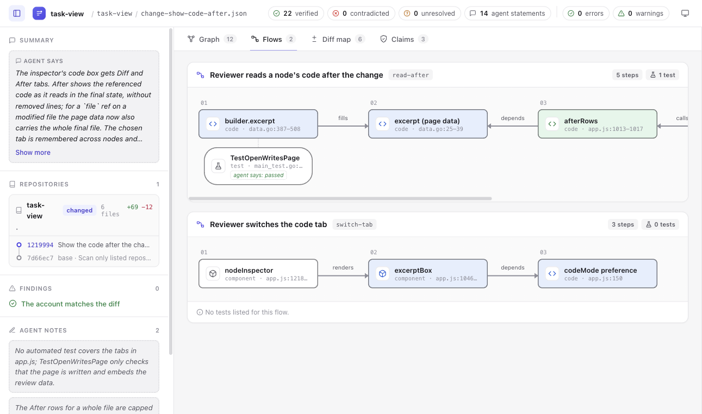

# Upstream browser observation

This is a screenshot of the public [task-view demo](https://gtindo.github.io/task-view/#view=flows), not an Archify experiment output. Captured and visually inspected during this resumed research batch; the page footer identified `main-f27b8be`, generated 2026-10-25. The source remains pinned at [`f27b8bef63ec336b8e3487e90ccd484a2fa7a235`](https://github.com/gtindo/task-view/tree/f27b8bef63ec336b8e3487e90ccd484a2fa7a235).

Actual operations: opened the demo, clicked Flows, captured the page at 1291×762, then selected TestOpenWritesPage. The first flow has five steps and one associated test, labelled `agent says: passed`. The second has three steps and `No tests listed for this flow.` Selecting the test opens its code inspector with location, reference status, and the separate agent account. No upstream tests were executed. No login, account mutation, or local tool installation occurred.

The root MIT notice is retained in [LICENSE.task-view](LICENSE.task-view), © 2026 Yvan Guekeng Tindo. The application's [vendor notices](https://github.com/gtindo/task-view/blob/f27b8bef63ec336b8e3487e90ccd484a2fa7a235/internal/render/assets/vendor/LICENSES.txt) separately cover Cytoscape and ELK; no vendored JavaScript is copied into these experiments. The screenshot shows the Flow view; its horizontally scrollable first path is not a complete capture of all five steps.
