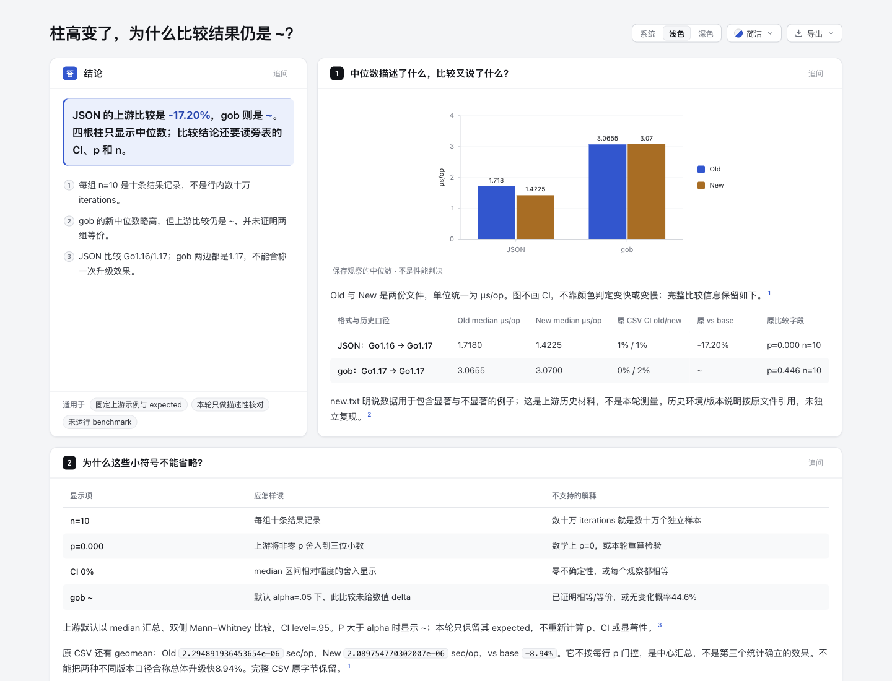
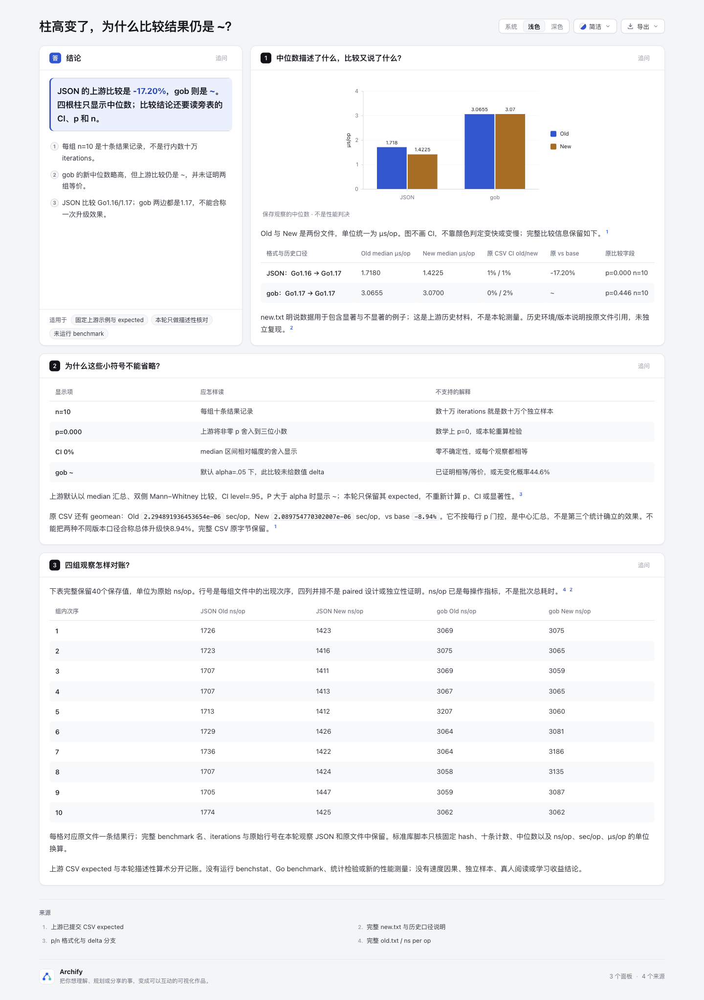

# benchmark-reading：中位数柱高与比较结论

内容实验，基于 Archify dev `10b4dd5c5f2264baa315ee65a9b4cc23c13ea5f0`。仅本目录，复用现有 Explainer bar/表，不新增产品代码、统计 API、误差线、benchmark 平台、parser、依赖或 ZIP。AI 协助：Codex / gpt-6.1-sol 负责调研、内容、标准库描述性核对、自动审计和文档；无真人审阅/学习收益声明。

## 入口与任务

[解释页](explainer.html) 回答：“两个中位数柱高都变了，为什么只有 JSON 给数值 delta，而 gob 为 ~？”

- 四根柱只描述 Old/New 的 median，统一 µs/op；图不呈现 CI，也不用颜色作统计判决。
- 邻表原样保留 CSV 的 CI、p、n、vs base；40 个保存 ns/op 值在第三张表完整显示。
- JSON 的历史口径为 Go1.16→1.17；gob 两边均1.17，不合称一次升级效果。

JSON：1.7180→1.4225 µs/op，上游 expected 为 -17.20% / p=0.000 n=10。gob：3.0655→3.0700 µs/op，上游为 ~ / p=0.446 n=10。n 是每组十条结果记录；iterations 是每条测量的工作重复数，不是样本量或独立性证明。`~` 不证明等价，p=0.000 非数学0，CI 0% 非零不确定性。

完整 CSV 的 geomean -8.94% 在正文保留，但其汇总不按每行 p 门控，不当作第三个统计确立的效果。不同历史版本口径也不能合成总体升级改善。

## 完整固定来源

固定 [golang/perf@be2c69fb417e05de5fec05c732911f4c5f172606](https://github.com/golang/perf/tree/be2c69fb417e05de5fec05c732911f4c5f172606)，完整 BSD-3-Clause [LICENSE](upstream/LICENSE) 保留：1453B / SHA256 `911f8f5782931320f5b8d1160a76365b83aea6447ee6c04fa6d5591467db9dad`。原材料保持 BSD，本目录原创脚本/内容遵循仓库 Apache-2.0。全部原字节、bytes/SHA 见 [source manifest](upstream/source-manifest.json)。

| 完整路径，相对于 upstream/ | bytes | SHA256 |
| --- | --- | --- |
| cmd/benchstat/testdata/old.txt | 1397 | `db60f533bc3496b52bbe654c7b4acac8c0b5da141bc5f0cbf1d44978954eee00` |
| cmd/benchstat/testdata/new.txt | 1598 | `0200be7b5bc8cb0e5edf22051d41895385fc248145db25fb7e646dfed8089ea0` |
| cmd/benchstat/testdata/csvOldNew.stdout | 357 | `935a065791e15d41e4ceb1b10e5766af9891dc3cd20e11eebcbb5d61fee85fc6` |

另保留完整 owning main.go/main_test.go、benchtab/builder.go/table.go、benchmath/anone.go/sample.go：结果行计数、第一列作 baseline、中心与比较分开、格式化和 geomean 汇总。具体证据：main.go L343–361 默认非参数 median/Mann–Whitney；L445–454 的 CI=.95；sample.go L71–74 alpha=.05，L114–137 区间百分比舍入，L164–195 p/n 格式化与 P>Alpha 输出 ~；anone.go L111–133 双侧比较；builder.go L75–105 每结果行追加一值，L285–345 geomean 不按 p 门控。页面的 p/delta 引用仅证明对应格式化分支，默认统计与置信水平以上述独立位置为据。

new.txt 开头明说这是为显著/不显著情况挑选的示例材料，记录上述历史版本口径；没有独立重现其当时环境或命令。保存的 PASS 不是本轮 Go test 通过。这些是上游已提交的 example/golden，不是自然用户工作负载，也不是本轮新 benchmark capture。

## 本轮观察，和未做的事

[observe.py](observe.py) 只读本目录 hash-bound 三文件，向 stdout 输出；没有任意输入入口或文件写入。它限定两种固定 benchmark 行，保留40条原行、原文件行号、iterations 与 ns/op。标准库仅核十条计数、算描述性 median，再与上游 CSV 的 sec/op 中心换算核对。原始 ns/op 已是每操作指标，不再除 iterations。实际 stdout 原字节复制为 [observation.json](observation.json)。

上游 CSV oracle 完整单独保留；CI/p/n/delta/geomean 都只读既有 expected，不计算它们。`medians.csv` 是四个描述性中心的 µs/op 投影，冻结在 HTML 依赖内。没有运行 benchstat、Go benchmark、Mann–Whitney、任何统计检验、benchmark 命令或用户代码；没有因果、独立样本、普遍版本 speedup 或 Archify 性能改善结论。

## 命令与验证

从 repository root 运行：

```sh
PYTHONDONTWRITEBYTECODE=1 python3 experiments/benchmark-reading/observe.py
PYTHONDONTWRITEBYTECODE=1 python3 experiments/benchmark-reading/audit.py
/opt/homebrew/opt/node@22/bin/node archify/bin/archify.mjs render explainer experiments/benchmark-reading/explainer.archify.md /tmp/benchmark-reading-render.html
/opt/homebrew/opt/node@22/bin/node archify/bin/archify.mjs finalize explainer experiments/benchmark-reading/explainer.archify.md experiments/benchmark-reading/explainer.html --json
```

前两命令只输出 stdout；交付命令会替换明确输出。后续重跑按 delivery contract 管理已有 evidence，不冒充历史 receipt；Node 路径只记录本轮环境，不嵌入 HTML。

按 CONTRIBUTING / test-value / archify-tuning 选证据：无共享行为改变，不跑全仓、不写镜像实现测试。[audit-result.json](audit-result.json) 实际10项固定事实与 HTML 审计通过：完整来源 digest、observer 一致、40记录/组内10与iterations分离、4median投影、原CI/p/n/~邻表、全部40渲染值、冻结CSV字节/SHA、实际SVG四点标签与单位、历史口径/geomean边界及私路径。不是统计验证或性能测试。

实际 public render 成功，最终 Explainer finalize validate/deliver/check 三阶段 pass、browser-check not-run、零 diagnostic。首版也通过，但有一个写作限定词 warning；把“历史示例”改为“历史材料”后重生，数值与范围未改。前版完整 MD/HTML/receipts 和原 stdout 外置保留。公开 [portable-summary.json](portable-summary.json) 是派生摘要，绑定原 stdout 与当前文件，不伪装未脱敏 raw receipt。

## 视觉范围

root 已用 Ego / Chromium 在 1440 × 1100、light 条件下实际捕获并逐张目视三张 PNG，无本内容任务阅读阻塞。图片保持原字节；[capture-summary.json](screenshots/capture-summary.json) 绑定 HTML、三完整输入、三图和原字节 [browser-checks.json](screenshots/browser-checks.json)。此观察 JSON 从 root 提供文件直接复制，私路径扫描无命中；capture summary 明确为派生，不冒充 delivery/finalize receipt。

- [首图与邻表](screenshots/overview.png)：1440 × 1100，四根 median 柱与两行 CI/p/n/~ 表同屏。
- [完整解释页](screenshots/full.png)：原 PNG 1440 × 2043，含全部40个保存值与 geomean 边界。
- [来源卡](screenshots/source-card.png)：1440 × 1100；pointer hover 打开上游 CSV 引用元数据，固定 be2c69f URL，Escape 关闭。





DOM 实核四个 median label、µs/op 单位、完整 CI/p/n/~ 两行及40个原始 ns/op 值。图只是点估计，无 CI/error bars；精确比较读邻表。来源卡不是代码 excerpt，未打开外站，也未重跑上游统计。上述实际浏览器检查与 Explainer finalize browser-check not-run 分开，不冒充完整浏览器 gate。root DOM 记录中 chart label 为 null，不据此宣称可访问名称或 AT 验证；也没有读屏、跨浏览器、真人或学习收益验收。
