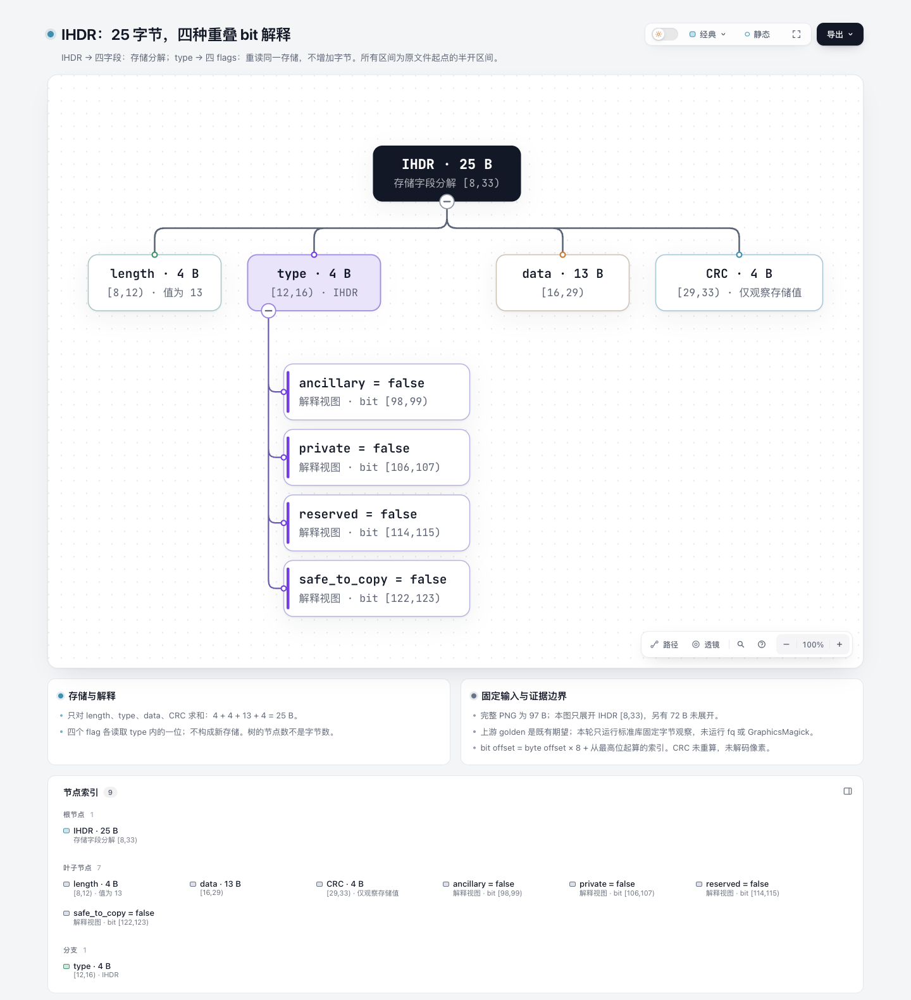
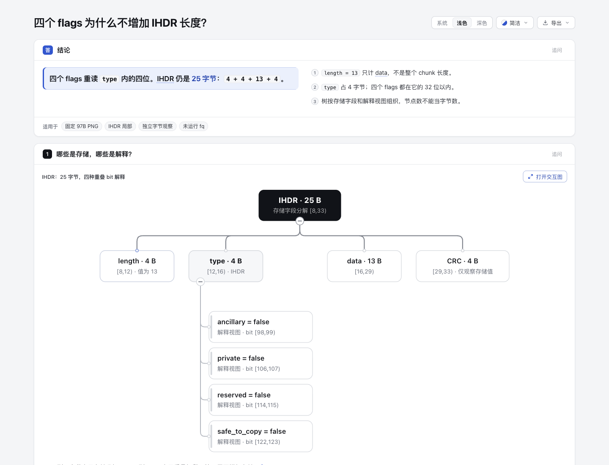

# byte-views：同一存储区间的解释视图

内容实验，基于 Archify dev `67f12389212c54b3122da60e2813c7f8dab7ab2f`。只新增本目录，复用既有 Tree 与 Explainer，不新增 parser、schema、hex UI 或产品代码。AI 协助：Codex / gpt-6.1-sol，负责调研、内容、观察脚本和自动核验；没有真人可用性或学习收益结论。

## 阅读入口

- [解释页](explainer.html)：结论、同一原生图、字段/bit 范围表与证据边界。
- [独立原生图](byte-views.html)：完整显示 IHDR 的四存储字段及 type 内四种解释。
- [唯一图模型](byte-views.tree.json)，由解释页 `@diagram` 直接引用。

问题只有一个：IHDR 的四个 flags 已在 type 内，为何不能再加到长度？物理字段 `4 + 4 + 13 + 4 = 25 B`；四个 flags 是现有 32 bits 内的四个 bit，不增加存储。Tree 中 IHDR 到字段是存储分解，type 到 flags 是重读解释；不是把所有节点当可相加存储。

完整输入为 97 B，本页只展开 IHDR byte `[8,33)`，其余 72 B 未展开但仍完整保留。区间均为原文件起点的半开区间。bit offset 等于 byte offset 乘 8，再加 MSB 起算索引；不是源码行号，也不是十进制带小数字节。

## 来源与许可

固定 [wader/fq@b3645a5ee7ab64316117f2bf9dd0abf63a1a9f1a](https://github.com/wader/fq/tree/b3645a5ee7ab64316117f2bf9dd0abf63a1a9f1a)，保留完整 MIT [LICENSE](upstream/LICENSE)。所有上游原字节及 SHA/bytes 见 [manifest](upstream/source-manifest.json)。本目录原创脚本/文字沿用仓库 Apache-2.0；上游材料继续适用其 MIT 许可。

- 完整 `format/png/testdata/4x4_palette.png`：97 B，SHA256 `508a58c0563252e935d3a0112131f236c81a4db2e161deb203659f0ca1d8cf39`。
- 完整 `.fqtest`：6808 B，SHA256 `fa371aa307933d647567c4c511118f38c00c4322948eb78461fa8b862c2a23c0`。
- 完整 `format/png/png.go` 保留 owning decoder。L87–102 先读 4B type，回退 32 bits 后读取四个 flags，最终回到 type 末端。
- 完整 `pkg/interp/decode.go`、`decode.jq`、`internal/mathx/num.go` 保留 bit 单位、`_start/_len/_stop`、半开包含关系与 `0xc.2` 显示口径。

PNG 与 golden 首次同加于 [bfc977b810b01246e242f1082f111e3196db7cfa](https://github.com/wader/fq/commit/bfc977b810b01246e242f1082f111e3196db7cfa)。golden 第一行有 GraphicsMagick 内置 gradient 生成命令，没有外部图片路径；初版 PNG 与本次固定字节相同。未发现该目录独立第三方许可声明；这不是原创性证明或公有领域结论，完整 MIT notice 保留。上游这是生成测试 fixture，不是真实用户工作负载。

## 本轮实际做了什么

[observe.py](observe.py) 是原创标准库固定输入观察，仅读取自身目录内指定 PNG，先核 97 B 与 SHA，向 stdout 记录字段切片、length 大端值和 MSB bit 值。[observation.json](observation.json) 是实际 stdout 副本。脚本没有参数化 parser、任意文件入口或写文件功能；不执行/导入上游代码。没有运行 fq、GraphicsMagick、CRC 重算、解压、像素解码或 PNG 完整有效性验证。上游 golden 的 CRC valid 仍只是其既有期望，与本轮观察分列。

```sh
python3 experiments/byte-views/observe.py
PYTHONDONTWRITEBYTECODE=1 python3 experiments/byte-views/audit.py
/opt/homebrew/opt/node@22/bin/node archify/bin/archify.mjs render tree experiments/byte-views/byte-views.tree.json /tmp/byte-views-render.html
/opt/homebrew/opt/node@22/bin/node archify/bin/archify.mjs finalize tree experiments/byte-views/byte-views.tree.json experiments/byte-views/byte-views.html --json
/opt/homebrew/opt/node@22/bin/node archify/bin/archify.mjs finalize explainer experiments/byte-views/explainer.archify.md experiments/byte-views/explainer.html --json
```

运行于本实验专属目录，交付命令会替换所指定产物；已有 browser evidence 后重跑按 delivery contract 使用新的 `--out-dir`。观察和审计脚本仅 stdout 输出，不覆盖输入或产物。Node 22 路径仅为本次环境命令，不嵌入 HTML。

选择证据遵循 CONTRIBUTING / archify-tuning / test-value：本次只有 authored 固定输入，无产品行为更改，不跑全仓或新增镜像实现测试。8 项固定事实审计通过，覆盖完整来源 digest、独立观察一致性、struct header/物理分区、case-bit mask/重叠、golden 原文证据、树边语义、解释页内相同 spec、HTML 名称和私路径边界。审计结果见 [audit-result.json](audit-result.json)。

实际 public render 成功；Tree finalize validate/deliver/check/browser-check 四项通过。Explainer validate/deliver/check 通过，browser-check 为 not-run。首次误给 public render 加 `--json`，CLI 拒绝该 option；正确命令重跑成功，没有修改候选内容。成功 raw receipts 外置临时目录；首次 CLI option 错误发生在 receipt 生成前，摘要保存派生错误记录。公开 [portable evidence](portable-summary.json) 是标明派生的摘要，不伪装原始 receipt。

窄 GitHub 查重保留 [dedupe.json](dedupe.json)：PNG、IHDR、byte range、bit field 四次 open 查询；#602/#605 是 WebP 容器验证、#974 是 PNG 导出。未发现同一 IHDR 解释页，不据此证明穷尽查重。PR1102 的解释/drilldown、PR1103 的 Atlas 代码事实不提供此固定字节解释；本页也不复刻新 Viewer。

## 视觉范围

root 已用 Ego / Chromium 实际捕获并逐图目视四张图，未发现阅读阻塞。派生 [capture.json](screenshots/capture.json) 绑定两份 HTML、四 PNG 的 SHA256、实际图片尺寸与观察范围；不是原始浏览器 receipt。

- [解释页首屏](screenshots/explainer-overview.png)：1440 × 1100，light / Clean。
- [解释页完整图文](screenshots/explainer-full.png)：1440 × 2131，light / Clean，含字段与 bit 表。
- [来源卡](screenshots/source-card.png)：1440 × 1100；实际 hover 后显示固定 decoder URL 元数据，Escape 隐藏。
- [独立 Tree](screenshots/tree.png)：1440 × 1580，light / Classic / Still；这是真实 PNG 尺寸，DOM documentHeight 为 1652。





来源卡只有引用元数据，不是代码片段；外部链接未打开。此次浏览器实测与 Explainer finalize 的 browser-check not-run 分开记录。未运行 fq、GraphicsMagick、CRC 重算或解压；没有读屏、跨浏览器、真人阅读或学习收益验证声明。
