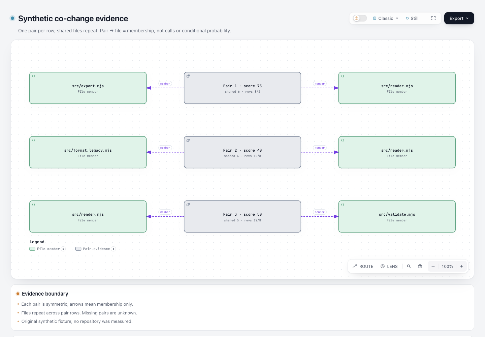

# Code Maat 共变 CSV → Archify 证据图

这是一个离线、小范围数据适配实验：读取 Code Maat 官方 coupling CSV 格式，生成 Archify 原生 Architecture 图和带原始计数的 Explainer。**当前样例是原创 synthetic fixture，未测量真实仓库，也未执行 Code Maat。** 不提供源码分析、调用推断、风险评分或新 Git analyzer。

基准：Archify `82c7e0f0`，分支 `codex/lab-change-coupling`。只新增本目录，没有改 schema、renderer、Viewer、CI、ZIP 或 live Skill。

## 直接查看

- [原生关系证据图](output/coupling.html)
- [图与原始计数解释页](output/explainer.html)
- [结构化原始计数与输入摘要](output/evidence.json)
- [可移植验证摘要](output/portable-validation.json)，这是选择阶段结果与 hash 后生成的摘要，**不是 Archify 原始 receipt**。
- [真实浏览器截图](screenshots/coupling.png)，根协调 agent 捕获本地 HTML。截图仅证明该页面当次显示，不是公开数据分析或产品全面验收。



## 图中含义

每行一个 pair 证据节点，向两侧文件画 `member` 边。箭头只表达“该 pair 包含此文件”，不表达文件调用方向。共享文件会在不同 pair 行重复，因此这张图不是完整共变网络。图例为 File member / Pair evidence，复用现有节点样式，不将文件冒充实际 backend 服务。

degree 是对称共变分数：`floor(200 × shared / (first revisions + second revisions))`；`average-revs` 是双方 revision 平均值向上取整。例：12 次、8 次变更，共享 5 次，score 为 50；不能称作“改 A 时有 50% 概率改 B”。共变不等于调用、因果、条件概率、缺陷或预测影响。

默认四列 CSV 没有 verbose 计数时，shared 和双方 revision 显示 unknown，不反推或补零。没有出现的文件/pair 是 unknown；空报告只说明没有提供 pair，不说明无耦合。报告的时间窗、路径过滤和大提交过滤缺失时也保留 unknown。metadata 中的提供者说明不等于实际执行验证。

## 来源与许可

- [Code Maat README](https://github.com/adamtornhill/code-maat/blob/50537abb8dffa1b1ba4e91a605ee5c558c01b224/README.md)：coupling CSV 四列、`--verbose-results` 三列、时间窗与大changeset过滤。
- [计算语义源码](https://github.com/adamtornhill/code-maat/blob/50537abb8dffa1b1ba4e91a605ee5c558c01b224/src/code_maat/analysis/logical_coupling.clj)：固定 commit `50537abb8dffa1b1ba4e91a605ee5c558c01b224`，项目声明 GPL v3.0。

本实验独立实现 CSV 解析和字段适配，未复制 GPL 源码，未引入 Code Maat/JVM 运行时。fixture 是原创虚构数据，格式和公式依据上述一手资料。Archify 原有项目许可见根 LICENSE。公开数据上的实用性和性能尚未测量。

## 复现

在仓库根运行，使用 Node 22；本次使用 Node 22 可执行程序。首次需要安装根目录与 `archify/` 依赖，不改 lockfile：

```sh
npm ci --ignore-scripts
npm --prefix archify ci --ignore-scripts
node --test experiments/change-coupling/adapter.test.mjs
node experiments/change-coupling/build.mjs
```

`build.mjs` 每次创建全新的 `run-<UUID>/` 产物目录，保留现有样例和其他运行；顺序调用适配器、公共 `render architecture`、公共 `finalize explainer`，把原始 finalize/delivery receipt 放在 checkout 外的临时目录，并打印该目录。提交目录只保留明确标识的 portable summary，含相对命令、产物 SHA-256 与阶段结果。原始 receipt 没有被改写成脱敏 receipt。HTML 中未发现本机用户路径。重新生成页面后应重新截图；现存截图不是每次构建的自动产物。

要读取自己的已有报告：

```sh
node experiments/change-coupling/adapter.mjs report.csv metadata.json output-directory
```

metadata 必须有 `kind: "synthetic"` 或 `kind: "provided-report"`。推荐同时提供 `window`、`filters`、`repository`、`revision`、分析工具版本与命令；原样保存到 `evidence.json`。适配器只读 CSV/metadata，不读其中指向的源码路径，不执行分析命令、不拉仓库。

适配器输出 `coupling.architecture.json`、`coupling.archify.md`、`evidence.json`。要交付自己的输出，再运行：

```sh
node archify/bin/archify.mjs render architecture output-directory/coupling.architecture.json output-directory/coupling.html --quality standard
node archify/bin/archify.mjs finalize explainer output-directory/coupling.archify.md output-directory/explainer.html --json
```

这两条手动命令会生成含本机路径的原始 receipts；分享前保留原始文件在本地，并明确生成 portable summary，不应直接推送原始文件。

## 输入策略与失败边界

- 四个必需列：`entity,coupled,degree,average-revs`；三个 verbose 列必须全有或全无。列序可变；未知列、重复列、列数不符拒绝。
- 支持 UTF-8 BOM、CRLF/LF、带引号字段内逗号、双引号转义；CSV 解析器支持带引号换行，但文件名中的控制符拒绝。未闭合引号或引号后非空白垃圾拒绝。引号和非引号字段内的文件名空白原样保留，header 名称允许外围空白。
- 相同文件对按词典顺序规范化，同时交换双方原始计数。完全相同的正向/反向重复折叠并计数；任一字段冲突报错，不选择“最新”或平均数。
- degree 只接受 0–100 整数。revision 字段只接受不超过 10 亿的整数；average 和双方 revision 必须正数；shared 不能大于任一方。verbose 输入需与上游 degree/average 公式一致，否则报错。
- 自连、空路径、超过 120 字符路径、控制符、backtick 和 pipe 拒绝；这是此实验的显示/Markdown边界，不能声称覆盖所有合法 Git 文件名。路径只是文本，不按本机文件读取。
- 最多 200000 字节、30 数据行、6 个独立 pair；超限失败，绝不静默截断。普通长标签仍可能触发原生布局检查，需根据真实报告进一步验证。
- 只接受尚不存在的输出目录；预存目录、文件或软链接均报错，不覆盖已有产物。输入解析和一致性校验在写入任何产物前完成，错误以 stderr JSON/nonzero 返回。有效输入的三个输出写入不是一个原子事务；磁盘写入失败可能留下部分输出。HTML 的发布仍由原有 `finalize` 负责，不能把适配器写文件称为完整交付。

## 实际验证

本次 13/13 Node 测试通过，0 skipped。覆盖带引号CSV保真、对称交换、unknown计数、重复/冲突、空报告、公式取整、非法数值/结构、控制符、大小限制、文件名外围空白保真，以及 CLI 错误/输出软链接不覆盖已有文件、空报告通过真实公共 renderer。测试检查数据语义和失败边界，不冻结自动布局坐标。[测试输出](output/tests.tap)。

公共 `render architecture --quality standard` 成功；公共 `finalize explainer` 的 validate、deliver、check 成功。browser-check 没有请求；原始收据的 visualReview 为 not-requested。浏览器截图与人工可读性检查由根协调 agent 独立执行，不冒充 finalize 的自动浏览器 gate。

第一轮 render 缺 `meta.output`，第一轮 Explainer 的嵌入图标签溢出，均失败。随后补相对 output 和明确节点尺寸，重跑通过；portable summary 保留这两项历史失败摘要，原始失败JSON保存在本机临时证据目录。

遵循 test-value：局部纯适配器测试保护解析/语义，公共产品路径保护真实输出。没有改产品运行时，因此未扩大到完整 renderer/browser/Windows 套件。没有拿 synthetic 图声称真实仓库收益、速度提升或 Code Maat 集成已验收。下一步最有价值的证据是公开小仓库上真实 Code Maat verbose 报告及读图任务，当前不是已完成事项。

独立 review 复现了预存输出 symlink 会覆盖无关文件的问题，以及未加引号路径被 trim 的身份丢失。两项均已修复并加真实边界回归。输出现在必须是全新目录；仅保留此实验拥有的当次新运行目录，不覆盖旧运行。

## 本轮实际图片与独立复核


[完整解释页截图](screenshots/explainer.png) · [捕获方法与文件 hash](screenshots/capture.json)。解释页内嵌预览明确提示文字缩放限制，并提供完整 Viewer；原生图为主要审阅图片。独立 Codex 复核了 13 项测试、CSV 路径身份、已有文件/symlink 保护及五个产物 hash，修复了首次审查发现的问题。人类验收仍待进行。
