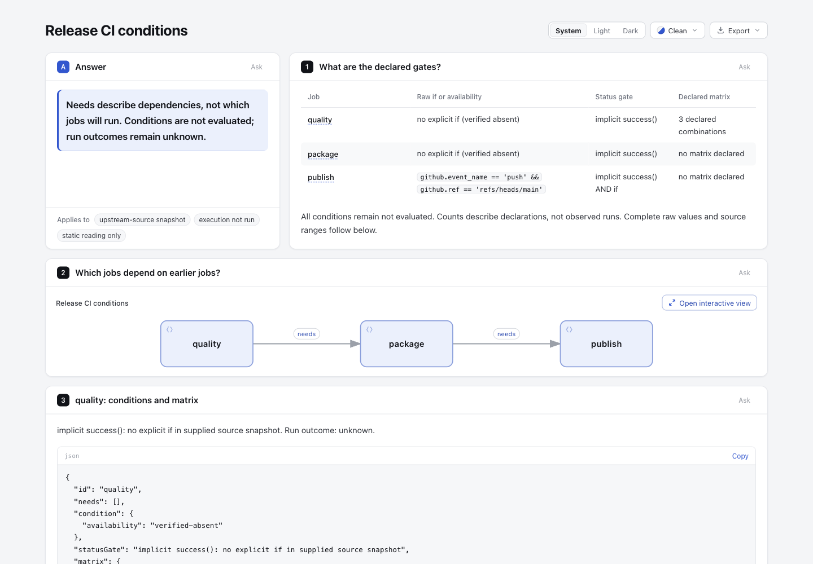
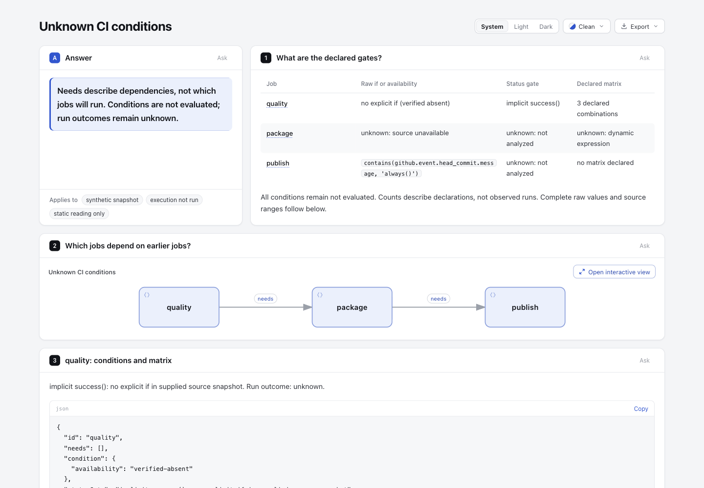

# CI condition reading: needs do not predict execution

Read declared job dependencies beside raw conditions, implicit status gates, literal/dynamic matrix information and coverage omissions. This is a static reading artifact; it never labels a job ran, skipped, successful or approved from a DAG.

Base: `82c7e0f089a02a4d514714adf37dc2061682da5f`. Branch: `codex/lab-ci-conditions`. Node: 22.23.3. Only this experiment directory changes; there is no new runtime dependency, shared schema/runtime change, installation, CI execution or expression engine.

## Fixed sources and license

- Real small fixture: [gha-graph release workflow](https://github.com/feruzkarimovv/gha-graph/blob/d3f156ec59279f134dff38c333f476e177706f9b/examples/realistic-release/.github/workflows/release.yml), commit `d3f156ec59279f134dff38c333f476e177706f9b`. Original YAML is `fixtures/release.yml`; [MIT license](https://github.com/feruzkarimovv/gha-graph/blob/d3f156ec59279f134dff38c333f476e177706f9b/LICENSE) is retained as `fixtures/GHA-GRAPH-LICENSE`.
- Inspiration: gha-graph separates declared needs from dynamic/reusable limits, but its graph JSON does not preserve job `if`. This experiment **does not derive or invent conditions from gha-graph JSON**.
- Semantic reference: official [actions/languageservices if-condition.ts](https://github.com/actions/languageservices/blob/4043eda158e16579cc5fb1b0b07a4bce2a76f0b5/workflow-parser/src/model/converter/if-condition.ts), commit `4043eda158e16579cc5fb1b0b07a4bce2a76f0b5`, [MIT](https://github.com/actions/languageservices/blob/4043eda158e16579cc5fb1b0b07a4bce2a76f0b5/LICENSE). The official implementation uses an expression AST to detect status functions; this experiment does not copy it or claim its full grammar.

No upstream code, workflows, shell/npm steps, action plugins or CI runs were executed. YAML was downloaded as text. Local commands execute only the experiment, its tests and Archify's public render/finalize tooling.

## Explicit snapshot contract

The input is a custom `manual-static-workflow-snapshot`, **not a YAML parser or an upstream export format**. `fixtures/release.snapshot.json` was manually checked against the fixed YAML: job IDs, `needs`, exact job `if`, source ranges and matrix node axis. Focused tests bind its source SHA-256 and recheck those source fields. The converter does not independently authenticate arbitrary snapshots or read paths mentioned inside them.

The snapshot records each condition as:

- `verified-absent`: the snapshot explicitly states the job has no source `if`. The reader shows **implicit success()**, never unconditional.
- `provided`: exact raw source condition. It is retained as literal evidence and is **not evaluated**.
- `unavailable`: original condition was not provided. It remains **unknown**, including whether a status function was present. Missing data is not absence.

Omitting the condition object is invalid; a gha-graph graph report cannot pass this contract. URL, fixed commit and relative source path must agree. Source line ranges are supplied evidence positions, not a claim that every arbitrary snapshot was reparsed.

For `provided` conditions the only recognized syntax is a whole zero-argument `success()`, `failure()`, `cancelled()` or `always()` call, optionally inside `${{ }}`, or context-path comparisons against single-quoted literals joined by `&&`/`||`. The latter grammar has no calls, so it can state the implicit success gate without evaluating values. A quoted string containing `always()` is not treated as a function call. All other expressions retain raw text and receive **unknown status-function analysis**. This is a narrow syntax classification, not a runner-compatible evaluator; no truth values or skip predictions are produced.

Job IDs must be actual strings, not coerced missing/null/boolean values. `needs` must list unique known jobs. Missing targets, duplicate IDs and cycles fail before any output is created. The graph's arrows are dependency declarations, without claiming outcomes or timelines. Source job names remain present even when conditions or matrices are unknown.

The first content panel is a compact overview: job, raw condition or explicit availability, status gate, and declared matrix count/unknown. Raw conditions use existing inline-code rendering. Delimiter-heavy, multiline or long values are explicitly deferred to the complete JSON evidence below, without truncating or silently reinterpreting the source.

## Matrices and coverage

Literal matrices require explicit scalar axes and a declared `modifiers` list. Only a no-modifier literal axis product gets a combination count (the real fixture declares Node 20/22/24: **3 combinations**). A count describes declarations, not observed executions. Products beyond `Number.MAX_SAFE_INTEGER` fail with `ci/matrix-overflow`; no rounded approximate integer is displayed. `include`/`exclude` modifiers are not expanded and make the final count unknown. A dynamic matrix keeps its raw expression and count `null`, never zero. Expression-like `${{ }}` values cannot be passed off as literal axes. A declared no-matrix job is distinct from unavailable matrix source.

Coverage explicitly says: execution **not-run**; step conditions, outputs and reusable-workflow internals **not-inspected**. Job-level reading does not prove that every step or external workflow was covered. Trigger dispatch, permissions, runner availability, cancellation, outputs, defaults, branch protection and actual run state are outside this slice.

`unknown.snapshot.json` is a clearly labeled synthetic mutation of the same baseline: package condition unavailable, a dynamic matrix, and a complex expression with a quoted status-function name. It is not presented as the upstream workflow or as a real run result.

## Reproduce

From repository root, use fresh directories:

```sh
/opt/homebrew/opt/node@22/bin/node --test experiments/ci-conditions/ci-reader.test.mjs
/opt/homebrew/opt/node@22/bin/node experiments/ci-conditions/ci-reader.mjs experiments/ci-conditions/fixtures/release.snapshot.json experiments/ci-conditions/repro
/opt/homebrew/opt/node@22/bin/node archify/bin/archify.mjs finalize architecture experiments/ci-conditions/repro/needs.json experiments/ci-conditions/repro/needs.html --json
/opt/homebrew/opt/node@22/bin/node archify/bin/archify.mjs finalize explainer experiments/ci-conditions/repro/conditions.archify.md experiments/ci-conditions/repro/conditions.html --browser-check --json
/opt/homebrew/opt/node@22/bin/node experiments/ci-conditions/ci-reader.mjs experiments/ci-conditions/fixtures/unknown.snapshot.json experiments/ci-conditions/repro-unknown
/opt/homebrew/opt/node@22/bin/node archify/bin/archify.mjs finalize explainer experiments/ci-conditions/repro-unknown/conditions.archify.md experiments/ci-conditions/repro-unknown/conditions.html --browser-check --json
```

The CLI requires a fresh directory. Exclusive directory/file creation rejects existing paths, input aliases and symlinks. If a later output collides, cleanup removes only inode-matched files created by the current invocation; unrelated victim files remain untouched. It is not a power-loss transaction. Raw expressions/matrix strings remain literal data in code spans or JSON snippets, never evaluated, shell-expanded, fetched or used as commands.

## Actual evidence

- Focused tests: **10 pass, 0 fail, 0 skip** in `evidence/tests.tap`. They cover real source/snapshot consistency, absent-versus-unknown conditions, function names inside strings, dynamic/include/exclude counts, missing needs/cycles/duplicates, non-string IDs, safe matrix count limits, overview literal preservation, dangerous literals through public Explainer rendering, and real victim/partial-output rollback protection. No coordinate snapshots.
- Real fixture outputs: `evidence/needs.html`, `evidence/conditions.html` and editable native JSON/Markdown. Actual public finalize passes validate/deliver/check/browser-check on both. Explainer uses explicit `--browser-check`.
- Synthetic unknown outputs: `unknown-evidence/conditions.html` plus source reading receipt and native needs JSON. The final portable summary records its actual result.
- Actual missing-needs CLI failure is preserved separately; it produces a diagnostic and no output directory. This failure is not concealed by a successful DAG.
- Portable summaries are labeled transcriptions of actual finalize stdout, including SHA-256, bytes, commands and stage results. Original receipts with local paths are stored outside the checkout. No personal paths are included in public text/HTML.
- Original finalize `visualReview: not-requested` remains unchanged. Actual light-theme screenshots and agent observations appear below; human acceptance and dark/mobile visual inspection remain pending.

This prototype is useful for reviewing a small workflow's scheduling questions. Extending it to arbitrary YAML, full expression parsing, step defaults, reusable workflows or exact matrix expansion would add another parser/evaluator maintenance burden; those are intentionally outside this experiment.

## Actual browser images

The overview shows all three jobs, raw if/availability, implicit status gates and declared matrix counts beside the needs graph. The synthetic variant visibly retains unavailable conditions and dynamic matrix counts as unknown. Full-page evidence retains the exact source values. No workflow or expression was executed.





Capture settings and current HTML/image hashes are in [capture.json](screenshots/capture.json). Images were captured and inspected by the coordinating agent; human acceptance remains pending. No measured reader-efficiency benefit is claimed.

AI assistance: Codex and GPT-6.1 Sol subagents performed research, implementation, focused validation, independent review and documentation. This branch is an experiment awaiting repository-owner acceptance.
