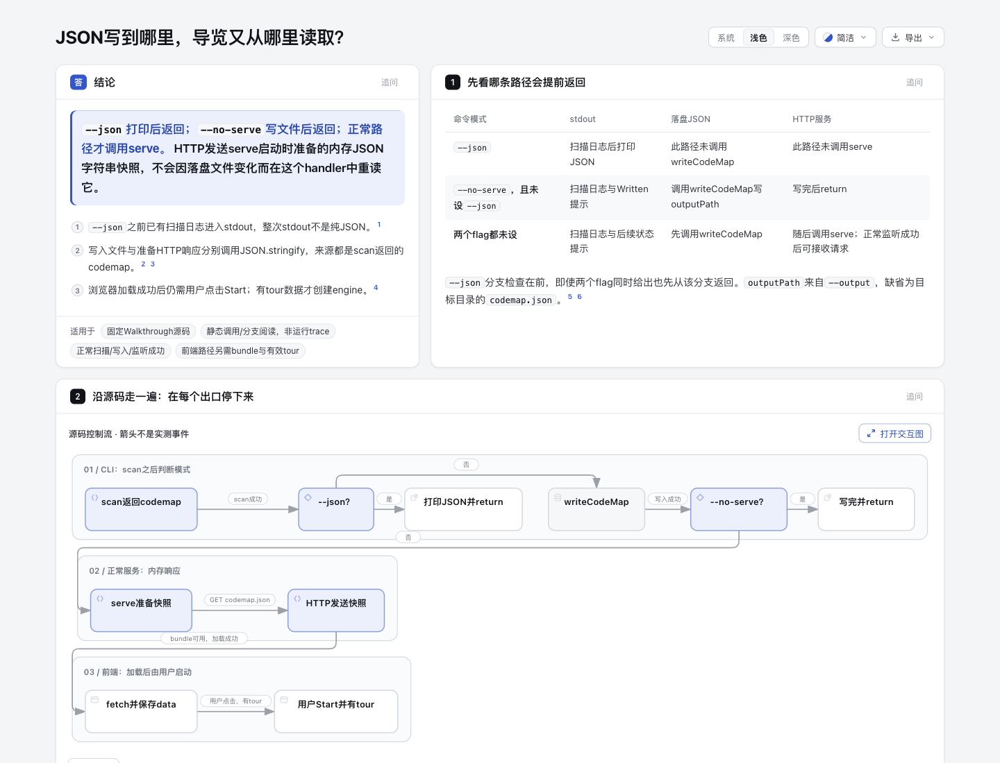
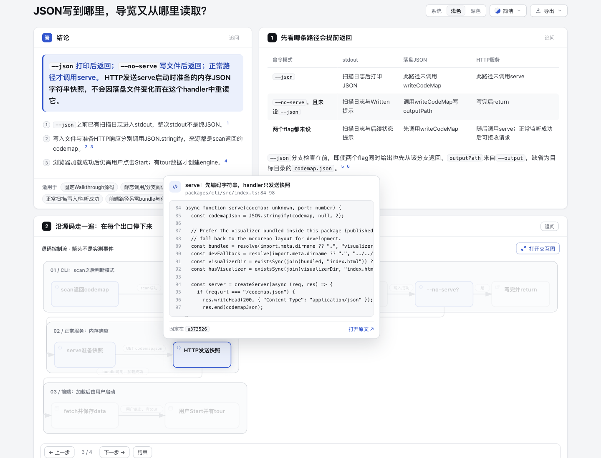

# CLI reading tour：三个出口与两份JSON来源

固定读取 [kyooosukedn/walkthrough @ a373526c92bd1d4c3953370b9a57f19e4fb15d08](https://github.com/kyooosukedn/walkthrough/tree/a373526c92bd1d4c3953370b9a57f19e4fb15d08) 的真实源码，用一个现有Workflow＋Explainer SourceCards回答：`--json`、`--no-serve`和正常HTTP分别走哪里，落盘JSON与HTTP内存快照有什么区别。

[打开阅读页](output/tour.html)。这是**源码静态流程阅读，不是运行trace**，没有执行Walkthrough、它的scanner/server/LLM、用户仓库扫描或上游浏览器界面。节点分组与问题顺序是作者组织，调用、参数、写入与return用固定源码核对。





[完整2318px页面截图](screenshots/full-page.png)；[派生截图绑定摘要](screenshots/capture.json)明确与原始capture区分，图像原字节保留。

## 可以从页面核对什么

- `--json`在打印codemap后return，但此前console.log扫描日志也进入stdout，不能说整次stdout为纯JSON。
- 未设`--json`才调用writeCodeMap。`--no-serve`在写完后return；两个flag同时给出，先命中`--json`分支。
- 正常路径调用serve，先把内存codemap序列化成codemapJson；`/codemap.json` handler发送该字符串快照，不按请求重读outputPath，也不重新scan。
- 浏览器loader fetch、解析和校验后provider保存data；fetch成功不自动开始tour。用户Start回调需有data.tour，Welcome按钮还要求steps非空；随后才new TourEngine与engine.start。
- 正常前端链另需visualizer bundle存在。缺bundle只返回raw HTML；目标不存在、scan/write失败、端口与网络/校验错误均未画为成功结果。scanner内部算法和完整静态资源路由不在本页范围。

页面把三模式表放在前面，图上四步阅读依次定位早退、实际writer、HTTP快照和用户Start。悬停节点查看固定SourceCard，正文来源编号链接固定行范围；不承诺预览节点可Tab聚焦。

## 源码、许可与输入绑定

7份必要完整原文件（含上游MIT [LICENSE](source/LICENSE)）保存在 [source/](source/)，未改字节、未编译：CLI package.json、CLI入口、实际writeFile模块、loader、provider context和App。上游版权归Daniel Purnomo，见原许可。完整路径/固定链接、byte数和SHA256见 [source/manifest.json](source/manifest.json)。本目录复制的上游源码仍按原MIT许可归属，不将其冒称Archify原创。

[唯一草稿](cli-reading-tour.archify.md) 声明11个source ranges，以固定repo URL与40位revision交给既有Explainer。源码卡的sha256/bytes绑定**整文件**；片段的行范围及另算excerpt SHA列在 [source-checks.json](source-checks.json)。SourceCards从固定Git对象读取，而非把工作树字节冒称该commit。

10个native节点全部有source ID，4个step target引用同一生成图中的节点；没有另维护第二套图或目录Tree。[source-checks.json](source-checks.json) 记录每个node→source及11个逐字片段核对。没有新parser、schema、产品运行时或自定义页面框架。

## 复现与实际证据

分支`codex/lab-cli-reading-tour`，Archify基线`3f95f0349c8276db71509ca239461b6fe9d00f9f`，Node `v22.23.3`。旧30个实验的82c7基线证据没有改写，也没有修改live Skill。

渲染需要包含上游固定Git对象的只读checkout供SourceCard取证。完整文件副本便于人工核验，但不是另一个伪造Git仓库。准备好官方checkout及本仓archify依赖后，在仓库根运行：

```sh
node archify/bin/archify.mjs finalize explainer experiments/cli-reading-tour/cli-reading-tour.archify.md experiments/cli-reading-tour/output/tour.html --repo-root <fixed-walkthrough-checkout> --out-dir <private-receipts> --json
```

`<fixed-walkthrough-checkout>` 的origin须对应上述官方repo，包含固定`a373526c…`对象；命令只运行Archify renderer，不执行TS或上游服务。复现会重生目标文件，需要保留原产物时先复制。原始delivery/finalize receipts可能含路径，均留checkout外的`/tmp`；公开 [portable-summary.json](portable-summary.json) 明确是选定阶段、hash和检查结果后的**派生摘要**，不是改写原始receipt。

实际finalize validate/deliver/check通过，零诊断；Explainer自动browser-check未请求，visualReview为not-requested。公开HTML无个人绝对路径，生成字节未后处理。Source原文件/Git对象、11片段/整文件digest、10节点绑定、prepared sourceText与草稿均已静态核对。本实验没有新增通用执行逻辑，不跑全仓suite或上游tests来代替内容验证。

协调agent实际查看首稿完整页/overview，切换阅读步骤到3/4，并悬停HTTP响应节点看到固定CLI84–98源码卡。其检查发现预览节点没有Tabstop，因此将未验证的“悬停或聚焦节点”改为悬停＋来源编号；没有改产品。初版HTML、草稿与raw receipt留在`/tmp`历史，修正仅一句正文。Source/11片段/整个native图逐字未变。最终7814…页也由协调agent重新截图、逐图查看，重复Start→Next两次至3/4、hover response和Escape隐藏；未点击外链或运行上游。最终截图绑定见screenshots/capture.json；这不是人类验收或学习速度研究。

生成HTML的既有尾随空白保留；作者MD/JSON/文档与生成HTML的whitespace检查分别记录，不为消警告重写产物。没有GitHub消息、上游程序执行、用户私数据、LLM调用或部署操作。

AI协助：Codex调查与编写固定内容、运行Archify、核对输入；独立Sol agent核对源码/产物，协调agent统一截图与实际查看。所有自动检查、Agent视觉观察和未知用户效果分开记录。
