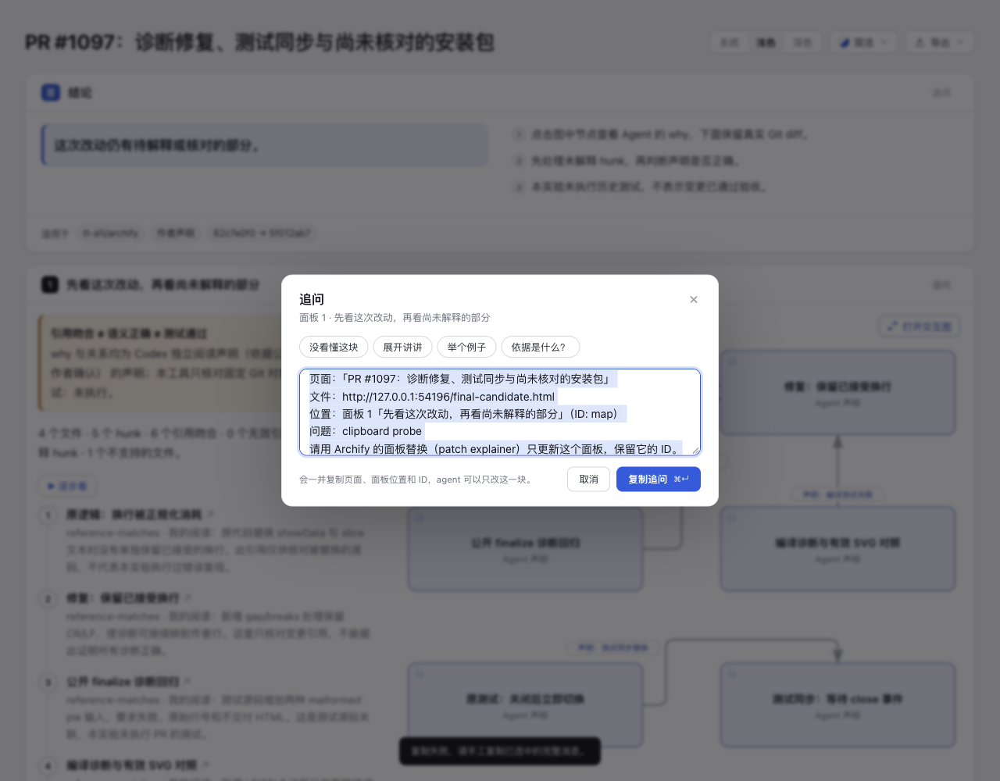
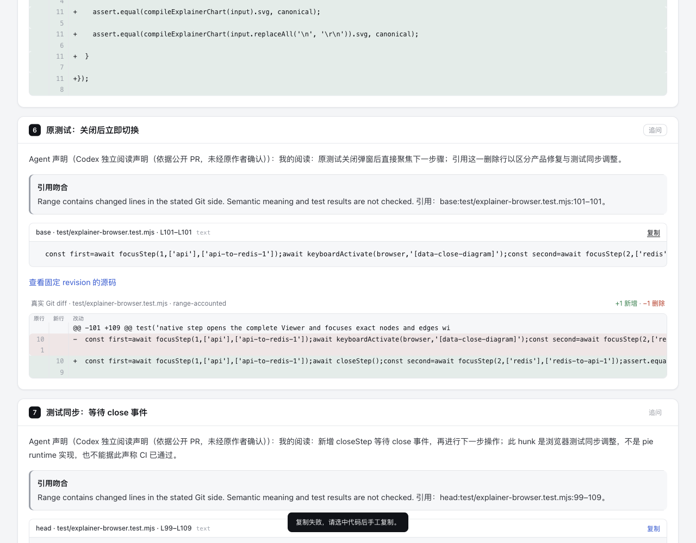

# Explainer 的复制结果与手工恢复

当 Clipboard API 缺失时，旧 reader 的可选调用返回 `undefined`，随后仍进入“已复制”分支。代码按钮误报成功，Ask 则关闭对话框并提示成功。API Promise 拒绝时，旧 Ask 已提供完整消息，但再次点击复制会把整段消息当成新问题重复包装。

这次只改 Explainer 的两个入口：确认 `writeText` 可调用并实际 resolve 后才提示成功；缺失、拒绝或同步抛错均保留失败状态。代码原文仍可手选，Ask 展示并选中完整消息；用户可编辑该全文后重试，重试直接复制当前全文。重开 Ask 会重置这个局部状态。没有新增 fallback 平台、schema 或原生 Viewer 行为；#862 的 `copyReaderText`/focus 路径不在本次 diff 内。

## 固定输入与同源对照

- 基线：`3f95f0349c8276db71509ca239461b6fe9d00f9f`。Root 后续报告 dev 已推进至 `67f12389`；本目录保留冻结身份，未混入后续 source-range/finalizer 变更，其整合影响由 root 另核。
- [输入](input/explainer.json) 是现有 task-review-map 的 PR #1097 authored-layout 输入原字节，SHA-256 `060fe0536b626f480ec3fa3f3bf81f3a41ad0bb76f640db362dc5a8f095dc3d1`。它展示历史 PR 的已声明事实，不是本次重新审查该 PR。
- [基线页](base/review.html)：`0fc95d5983b49e45187fd377fe67d7f95a84d2a4b36ee92ac72e215ee68aa288`。
- [候选页](candidate/review.html)：`b5a926255998d420fadd22904b779e66f74607f057ccbe1fd62c922f4ed8c1f1`。

两页均用固定输入、原 `showcase` profile 和实际 CLI finalize 生成。基线运行时来自该 commit 的 `git archive`，候选来自当前 source；prepared bundle（包括内嵌原生图）完全相同。用候选 reader 替换基线页内的完整 reader 后，两页逐字相同，因此没有以调整图或内容制造对照。

两页的 validate/deliver/check 均通过，保留相同七条既有写作 warnings；没有请求整体 browser-check，不声称该页所有交互或键盘遍历通过。先前用普通 complete 输入和 `standard` profile 的准备尝试在原生图 label overlap 处拒绝；authored-layout 的 `standard` 尝试也拒绝。原始失败记录保留，最终采用现有 authored-layout 的原 `showcase` 条件，没有修图或关闭检查。

## Root 的实际 Ego 对照

Root 在真实浏览器中打开这两份新页面，使用 1280×1000、scale 1、light；注入 API 缺失、Promise 拒绝和 resolve stub。**没有向 OS 剪贴板写入，不代表真实权限、设备或系统剪贴板验收。** 下面三张原 PNG 均由 root 逐图查看，复制文件时保留原字节和时间；绑定见 [派生摘要](evidence-summary.json)。

| 状态 | 基线 | 候选 |
| --- | --- | --- |
| API 缺失 | Code 显示“已复制”，API 调用 0；Ask 关闭并成功提示，调用仍为 0 | Code 保持“复制”并给失败/手工提示；Ask 保持打开，完整消息获得焦点并全选 |
| Promise 拒绝 | Code 失败；Ask 提供完整消息，但编辑后重试会嵌套包装 | Code 失败并保留原文；Ask 全文可选，编辑后 API 恢复重试收到完全相同全文并关闭 |
| resolve stub | Code 原文和 Ask 完整预期消息均 exact，Ask 关闭 | 同样 exact，保留原成功行为 |

缺失 API 下旧 Code 的瞬时“已复制”由 DOM record 证明；初始旧产物的截图捕捉时按钮已重置，不作为该状态的截图证据，也未移入本目录。当前新 pair 的原始观察 JSON、初始探针、标点误判和命令 receipts 均保留在 checkout 外；本目录摘要只是投影。

| Ask：基线误报成功 | Ask：候选保留完整消息 |
| --- | --- |
|  |  |



## 验证范围

官方 Node 22.23.2 / bundled zlib `1.3.1-e00f703`，macOS arm64，真实 Chrome：

- 同一最终 browser test 的八个叶场景覆盖 Code/Ask × success/reject/missing/throw，失败 Ask 中继续覆盖编辑全文后恢复 API 重试。基线两项通过、六项失败；候选八项通过。含父 test 的 TAP 分别为 2 pass / 7 fail 和 9 pass / 0 fail / 0 skip。
- 独立 agent 在冻结 source/test 上复核此 focused suite：9 pass，0 skip。
- 完整 Explainer browser + renderer 邻近选择：32 pass，0 fail/skip；core：19 pass，0 fail/skip。
- `npm run test:generated` 通过。完整 extracted-package smoke 在 checkout 外、不安装依赖的解包目录通过。
- Canonical ZIP 连续构建两次字节一致；224 entries 与基线 inventory 相同，仅 `archify/explainer/reader.js` 内容改变。SHA-256 `46327220748ba97cd1e056cc8b425b4233e80f1c789617baaebb64d74a06c31f`。

四份 `docs/cases/explainer/*.html` 原先均未内嵌完整基线 reader，因此同时做生成 freshness 更新。最终按各自原 `standard` profile 重建，原文 sourceText、解析 document、native child spec 及解析后的全部内嵌 native SVG 均相同。没有保留最初统一 showcase 所导致的 TLS 字号变化。它们的旧、新和重构基线 hash 单独列在摘要中，不能把全部生成差异归因这几行复制修复。Gallery、原生 Viewer template 与其生成链没有修改；此次 reader 文件直接内嵌到 Explainer。`git diff --check` 对这四份生成页报出既有内嵌样式的行尾空格；源码和测试的 scoped diff check 通过，未手工改写生成页以去除这些模板字节。

没有运行全仓测试或 hosted CI，没有合入、发布、安装或用户收益结论。AI assistance：Codex `gpt-6.1-sol` 完成实现、回归、生成与静态配对核对；另一个 agent 独立审查 source/ZIP；root 操作 Ego 并查看三张实际图片。自动结果不等于个人 human-review confirmation。

## 复查命令

按 CONTRIBUTING 配置同 lock 的 root 与 renderer dependencies，并使用上述官方 Node；浏览器测试需要设置 `ARCHIFY_CHROME`。

```sh
node --test --test-name-pattern='Explainer copy outcomes' test/explainer-browser.test.mjs
npm run test:focus -- test/explainer-browser.test.mjs test/explainer-renderer.test.mjs
npm test
npm run test:generated
scripts/build-zip.sh
node scripts/package-smoke.mjs <outside-extracted-archive>/archify
```

要重建对照，先把基线 commit 的 `archify/` 用 `git archive` 展开到临时目录；两次调用各自的 `bin/archify.mjs finalize explainer input/explainer.json <base-or-candidate>/review.html --quality showcase --out-dir <outside-evidence-dir> --json`。输入路径、文件名和相对目录结构保持一致；原始 receipts（含自动产生的 `.delivery.json`）留在 checkout 外。此处保留的是已有产物，不需要改写历史 task-review-map 文件。
