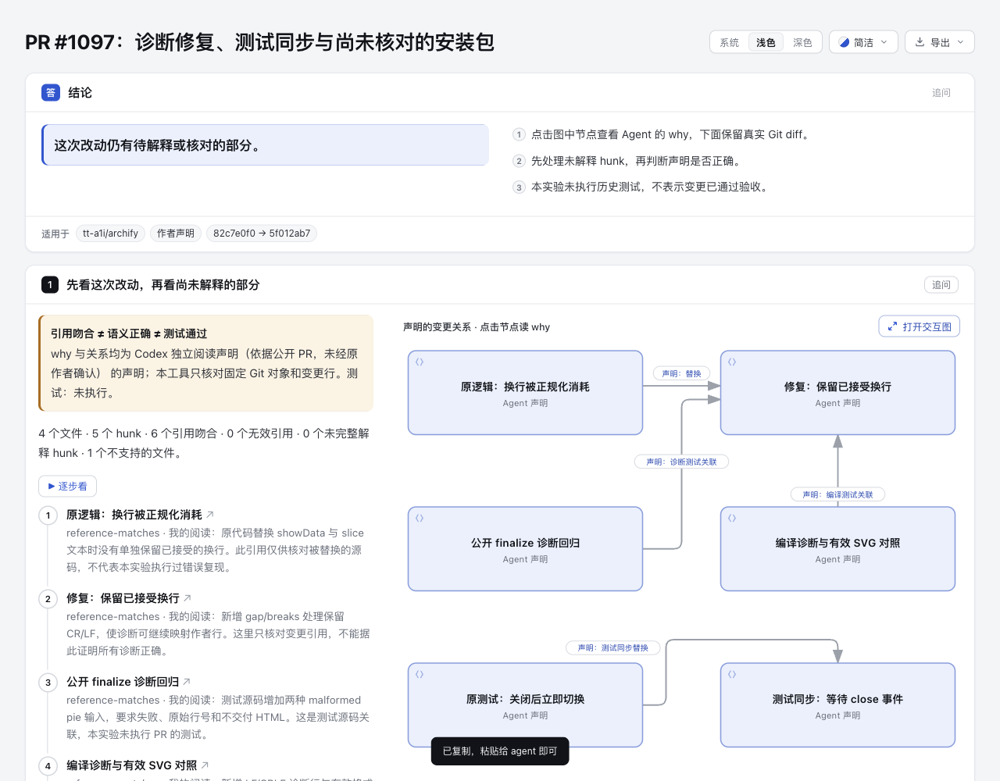
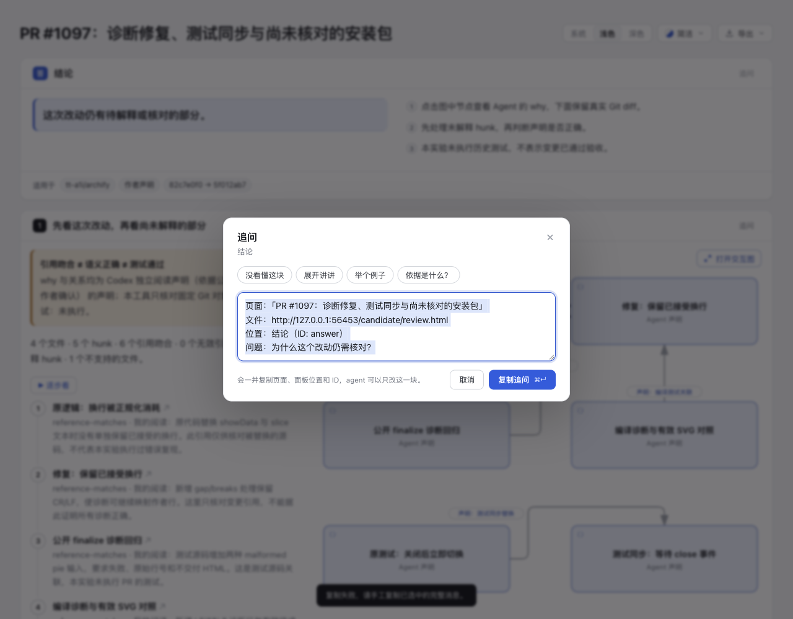
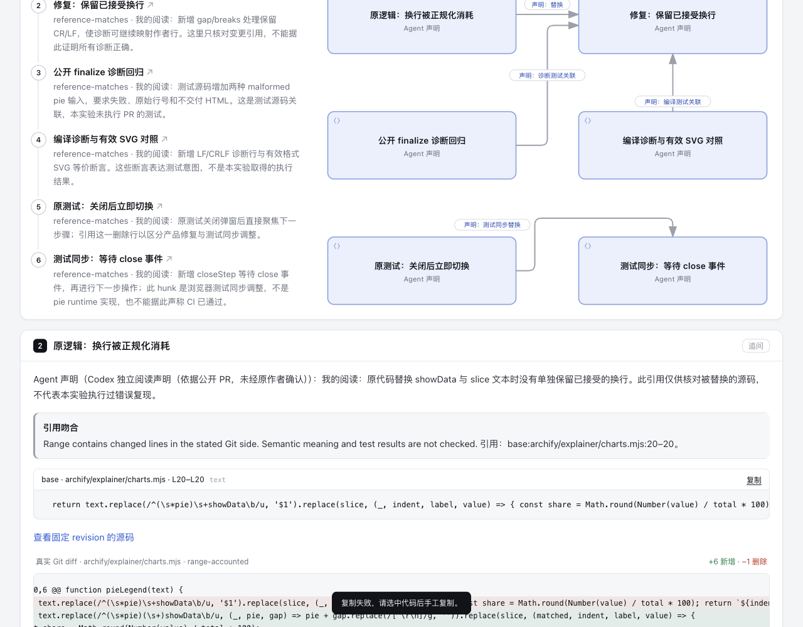

# Clipboard outcome：刷新到 dev 10b4

本目录重做同一输入的新 dev 基线/候选对照，保留旧实验每个文件的原字节。范围仍是 Explainer Code/Ask：API 缺失、Promise 拒绝、同步抛错都不报复制成功；Ask 失败保留完整可选文本，用户编辑全文后恢复 API 重试，不重复包装。没有新增 clipboard 平台或修改 native Viewer 的复制路径。

## 固定身份

从旧候选 `68866954a19cfe3b6599f3c27ff3cb10427f7d44` 正常 `git merge --no-commit --no-ff` 固定 dev `10b4dd5c5f2264baa315ee65a9b4cc23c13ea5f0`，准备整合；最终提交身份以 Git 历史为准。只有 `archify.zip` 二进制冲突；用整合源码按 canonical 流程重建解决。reader 保持旧候选字节，新 dev 的 close 等待测试、来源/交付保护与共享 Viewer 变更保留。

[input/explainer.json](input/explainer.json) 是旧实验固定 PR1097 authored-layout 输入原字节：29,652 bytes、SHA-256 `060fe0536b626f480ec3fa3f3bf81f3a41ad0bb76f640db362dc5a8f095dc3d1`，不是重新审查历史 PR。两页使用该输入和原 showcase profile，以各自运行时正常 finalize：

| 页面 | bytes | SHA-256 |
| --- | ---: | --- |
| [新 dev 基线](base/review.html) | 663050 | `ebd2616a4dc7049d5a27181b7b1d58e0d90df4bec75acc8ef7d74f19fa100427` |
| [整合候选](candidate/review.html) | 663611 | `286ac77f5b3759fa87b7e44456e26f72142f4bf740c782190c856a9d9abe5603` |

两页 HTML 中的 portable prepared JSON 完全相同，含相同 native child；基线完整 reader 换成候选 reader 后，整个 HTML 逐字相同。这不表示原始 delivery receipt 的 `explainer.preparedSha256` 相同：基线 `4e59f1b8…b229201`、候选 `f48a9d84…cd701de` 不同，摘要保留完整值。等同结论只指最终 HTML 内实际嵌入的 portable prepared 对象。

历史目录的八个文件已逐 hash 确认不变，包括旧 base/candidate HTML、输入、截图、README 与派生 summary。它们继续代表原3f95比较，不被重标成10b4。

## 实际验证

官方 Node22.23.2、bundled zlib `1.3.1-e00f703`、macOS真实 Chrome。仅注入受控 Clipboard API stub，不向 OS clipboard 实写，也不代表真实权限或设备验收。

- 同一最终 test 在 archived dev 运行：八叶场景2通过、6失败；含父test的TAP为2 pass / 7 fail。合并候选9 pass / 0 fail / 0 skip。覆盖Code/Ask × success/reject/missing/throw，并在失败Ask中编辑完整文本、恢复API重试核 exact。
- 完整Explainer browser+renderer邻近选择32 pass，core19 pass，均0 fail/skip；新 dev 的异步close等待保留且所在邻近场景通过。
- generated checks全部通过。新页面两边validate/deliver/check通过，保留相同七条既有writing warnings；整体artifact browser-check未请求，不用局部API test宣称整页键盘遍历通过。
- Canonical ZIP连续两次构建字节相同：`d76af4f029fc67807acc0b9069937b7b722618d8fa603cbf5c5504e4915c468a`。235 entries inventory与10b4包相同、CRC通过，只有`archify/explainer/reader.js`内容不同，且逐字嵌入冻结source。checkout外实际解包、不安装依赖的package smoke通过。

四份`docs/cases/explainer/*.html`按原standard profile正常CLI重建。原文sourceText、document、native child spec及SVG均相同；native child HTML更新到新dev共享Viewer，所以这些生成变化不全由复制几行修复造成。没有手改生成HTML，也未修改这些原始输入。生成页的既有模板行尾空格不在本修复内，source/test scoped diff check通过。

临时复用现有依赖的链接已移除，无安装；两套lock的所有实际依赖entry相同，renderer根metadata有版本/许可差异。没有运行全仓suite、hosted CI、live安装、合入dev或发布。

## Root 的实际 HTTP 浏览器对照

Root 在 loopback HTTP 打开两份冻结页面，核服务字节未变；1280×1000、light，注入受控API缺失/拒绝/resolve stub，没有OS剪贴板实写。Root和实现agent均查看了三张原PNG，逐字复制、未裁剪或缩放；[capture-metadata.json](capture-metadata.json)绑定两份HTML、图片hash/bytes/尺寸、原检查记录hash与[安全派生观察](browser-observations.json)。原JSON只留checkout外；公开记录是投影，不冒称“脱敏后的原始receipt”。

| 实际状态 | 新dev基线 | 整合候选 |
| --- | --- | --- |
| API缺失：Code | DOM记录瞬时显示“已复制”，调用0；没有该瞬时状态的最终截图 | 保持“复制”，提示失败及手工复制，调用0 |
| API缺失：Ask | 对话框关闭，成功toast，调用0 | 保持打开，完整114字符消息获得焦点，全选0:114 |
| 编辑全文后重试 | 此轮HTTP补证未跑该基线对照，不外推 | 受控reject后完整125字符文本保留并选中；切resolve后累计第2次调用逐字等于已编辑全文，对话框关闭并成功toast |

计数1/2属于同一次retry序列的累计调用：第一次拒绝，第二次resolve。这里的114/125是本次HTTP地址参与生成的字符串长度，不是产品通用长度；公开摘要仅保留长度、hash与exact布尔值。missing记录时间为2026-10-25T11:11:31.089Z、retry为11:12:43.349Z；PNG时间仅标`writtenAtFromFileMtime`，不称独立截图时钟。

| 基线Ask误报成功 | 候选保留完整可复制消息 |
| --- | --- |
|  |  |



初次file URL驱动检测到页面位置会含私人路径，已中止截图；旧attempt记录留在checkout外，本目录只收最终HTTP三图和安全派生数据。实际HTTP截图不证明AT、真实OS权限/剪贴板、完整browser-check gate或hosted CI。也没有把旧3f95截图重新绑定成新dev证据。

## 证据与复查

[evidence-summary.json](evidence-summary.json) 是公开派生投影；原TAP、finalize/delivery receipts、配对比较、docs freshness与ZIP inventory放在checkout外。Root实际Ego对照见下面的截图与安全派生记录；独立agent已核source/test/pair/ZIP和机器ledger，截图补证再做增量核对。

```sh
node --test --test-name-pattern='Explainer copy outcomes' test/explainer-browser.test.mjs
npm run test:focus -- test/explainer-browser.test.mjs test/explainer-renderer.test.mjs
npm test
npm run test:generated
scripts/build-zip.sh
scripts/build-zip.sh <outside-checkout>/rebuilt.zip
node scripts/package-smoke.mjs <outside-extracted-archive>/archify
```

需按CONTRIBUTING配置root/renderer依赖、官方Node和`ARCHIFY_CHROME`。对照使用`git archive 10b4…`展开真实基线，将相同最终browser test复制到该临时runtime；这只给基线增加测试，不移入候选reader。两运行时分别finalize同一固定input，以`--quality showcase --out-dir <outside-evidence-dir> --json`生成页面，`.delivery.json`也移到外部保留。

AI assistance：Codex GPT-6.1-Sol进行整合、检查与文档；独立agent只读review。Root操作Ego并查看三张原PNG；自动测试与agent检查不等于用户个人确认。
