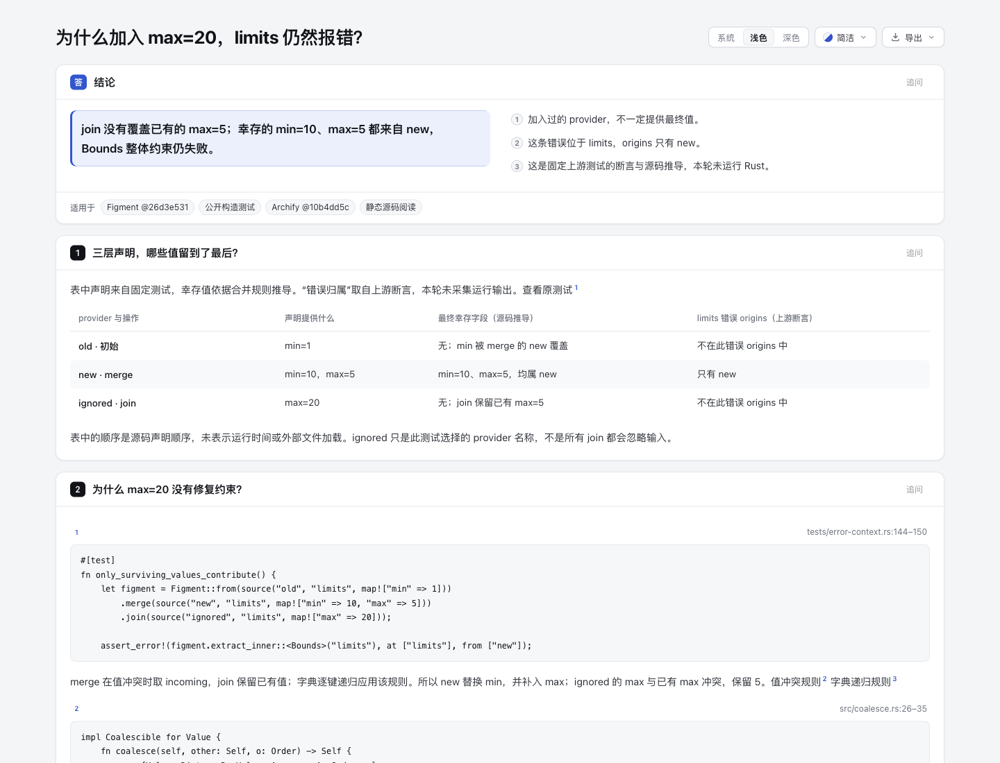
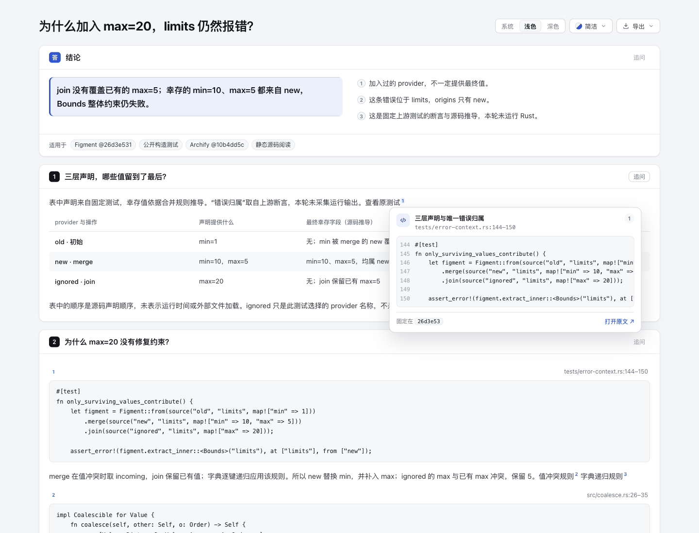

# 为什么加入 max=20，limits 仍然报错？

[打开页面](review.html)。本实验用现有 Explainer 的表格、源码块和 SourceCard，把三个容易混淆的层次并排：provider 声明、规则推导的幸存值、上游测试断言的错误归属。未改产品、schema、ZIP 或 Skills。

固定产品基线 `10b4dd5c5f2264baa315ee65a9b4cc23c13ea5f0`；来源为 [SergioBenitez/Figment@26d3e531c2055bd0ae8524bebc69f31fe3757ba5](https://github.com/SergioBenitez/Figment/tree/26d3e531c2055bd0ae8524bebc69f31fe3757ba5)。这是公开构造测试，不是生产配置或用户事故。**本轮没有运行 Rust、上游测试、provider、环境变量读取或模板求值。**

## 内容及证据

原测试 `tests/error-context.rs:144–150` 声明：old 提供 min=1；merge 的 new 提供 min=10/max=5；join 的 ignored 提供 max=20。结合 `src/coalesce.rs` 的递归合并和冲突规则，幸存 min/max 均来自 new。`Bounds` 在 min 大于 max 时整体失败；原测试断言错误 path 为 `limits`、origins 只有 `new`。不是 min/max 各自的类型错误，也不是三层都成为错误来源。

Mock 的 metadata 只有名称、没有 source。页面中的 Git 路径与行号定位测试源码，不能当成配置文件名或配置键行号。provider 的名称 ignored 也不能泛化为所有 join 都忽略输入。

完整原始文件在 [upstream](upstream)，没有换行正规化或只保留成功片段：

- `tests/error-context.rs`（完整 fixture，14,505 bytes，SHA-256 `b7058b21bda2d134b84d4ef4d0b1529753ba64988f9d8d467a8d974dbfc0658b`）。
- `src/coalesce.rs`（完整冲突/字典规则）、`src/figment.rs`、`src/metadata.rs`（owner 源码）。
- `Cargo.toml` 与完整 [LICENSE-MIT](upstream/LICENSE-MIT)、[LICENSE-APACHE](upstream/LICENSE-APACHE)。Figment 为 **MIT OR Apache-2.0** 二选一，原版权与许可全文保留。未复制到产品代码。

每个文件的完整 hash、bytes、固定上游 URL 见 [source-manifest.json](source-manifest.json)。[explainer.json](explainer.json) 是人工编写的内容输入；不是配置 parser 的输出。页面保留该输入全文与六个核过固定 Git 对象的源码 excerpt，另附两条许可链接。没有为凑图画树、执行顺序或虚构文件来源。

## 实际检查与边界

使用官方 Node 22.23.2，正常 CLI `finalize explainer`，standard profile：validate、deliver、check 均 pass，0 diagnostics；browser-check 未请求。Root 后续通过实际 Ego 捕获并逐图查看三张 PNG；本 agent 也查看原图。该实际浏览器观察仅覆盖下述页面与交互，不把静态 gate 当视觉验收。

[verify-evidence.mjs](verify-evidence.mjs) 只核七份文件原字节、六段内嵌 Git excerpt/hash/line range、完整输入绑定和三行表格保留；它不实现 merge/join 算法，也不运行 Rust。检查通过。初次 finalize 因正文中的 Rust 泛型被当作 raw HTML 拒绝；修正文案后重跑通过。原失败和成功 CLI receipts 均留在 checkout 外。

公开 [evidence-summary.json](evidence-summary.json) 是派生摘要，原 CLI、binding JSON 和 `.delivery.json` 保留在 checkout 外。冻结 HTML SHA-256：`2a6355b64f878ff87e6b4530930bfc4af348ed30dfaeee2cd040e4311ce41b5b`。实现 agent 未运行仓库测试、hosted CI、安装、Rust 或 Ego；实际浏览器由 root 操作。没有据此宣称上游测试通过或用户收益得到验证。

## Root 的实际浏览器观察

1440×1100、浅色，原检查记录 `capturedAt` 为 2026-10-25T10:48:03.414Z。Root 捕获并查看 overview、full、source-card 三张图片；全页 PNG 原始尺寸为1440×3016，另外两张为1440×1100。原 PNG 逐字节复制，没有裁剪或缩放。图片 file mtime 只标为文件写入时间，不冒充独立截图时钟。

[原样复制的安全观察记录](browser-observations.json) 包含三行表与四段源码的 DOM 文本、case source card 的144–150行与固定 GitHub URL、Escape 后 card 不再可见。已与冻结 HTML/输入逐值比较；[capture-metadata.json](capture-metadata.json) 记录 HTML、观察 JSON、每张图的 bytes/hash/尺寸及 rootViewed 绑定。

Root 实际操作的是**指针 hover 打开源码卡、Escape 关闭**。URL 只核其 DOM href，未声称打开外站；没有 AT、键盘全程遍历、深色/窄屏或完整 browser-check gate 验收。源码卡在截图内的长行有横向滚动区域，不能把这张局部图当作完整代码全文均同时可见；DOM原文和下方代码块保留完整case。

| 概览 | 指针悬停源码卡 |
| --- | --- |
|  |  |

[查看完整页面截图](screenshots/full.png)。

## 重建

准备来源的本地只读 Git checkout，origin 为上述 GitHub 仓库，包含固定 commit。源码证据从 Git 对象读取；实验内的副本提供离线复核，不能伪造为产品仓库的 Git 历史。

```sh
node archify/bin/archify.mjs finalize explainer \
  experiments/config-origins/explainer.json \
  experiments/config-origins/review.html \
  --repo-root <fixed-upstream-checkout> --quality standard \
  --out-dir <outside-checkout-evidence-dir> --json
node experiments/config-origins/verify-evidence.mjs
```

CLI 在 HTML 旁生成的 `review.delivery.json` 也移到 checkout 外保留。重建使用原目录/文件名；不要改写来源文件或执行来源仓库。

AI assistance：Codex GPT-6.1-Sol 完成静态研究、内容和 CLI/file 验证；独立 agent 评估内容范围。Root 操作 Ego 并查看三张原 PNG；这不等于用户个人 human-review confirmation。
