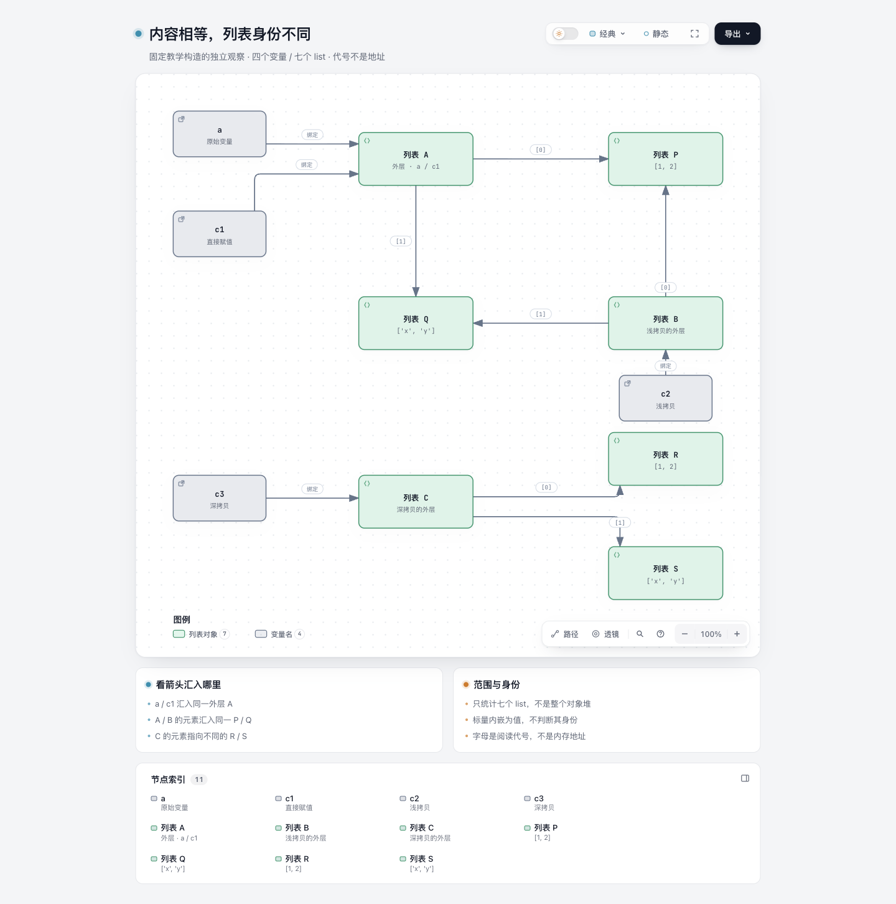
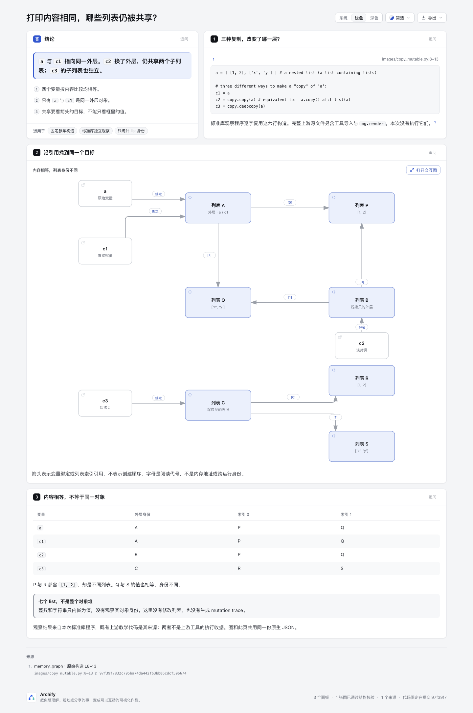
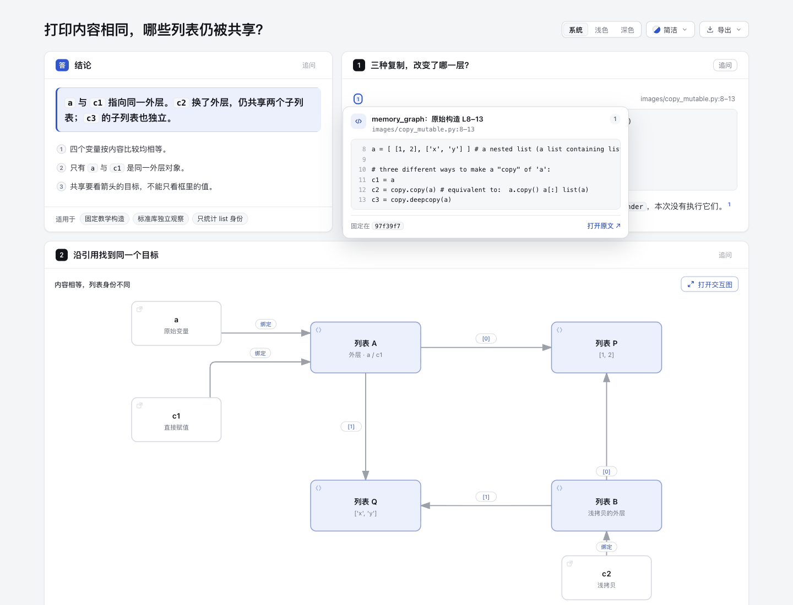

# Copy identity：内容相等，哪些列表仍被共享？

[解释页](output/explainer.html) · [独立引用图](output/copy-identity.html) · [唯一原生图源](copy-identity.architecture.json)

四个变量的内容相等，但共享关系不同：`a/c1`共用外层，浅拷贝`c2`只更换外层，深拷贝`c3`的子列表也独立。这是固定教学构造的独立标准库观察，不是用户工作负载、完整对象堆或上游可视化工具的运行结果。

## 来源、许可与实际执行边界

固定来源为 [bterwijn/memory_graph@97f39f7832c795ba74da442fb3bb06cdcf506674](https://github.com/bterwijn/memory_graph/tree/97f39f7832c795ba74da442fb3bb06cdcf506674)。完整 [images/copy_mutable.py](source/copy_mutable.py) 保留398字节，SHA-256为`ea76c0f64542e239a7ab77e468564d5e3c358d8abdef80ba7b932c69ba2bd31b`；完整原 [BSD-2-Clause许可](source/LICENSE.txt) 与逐文件hash见 [manifest](source/manifest.json)。原示例含Bas Terwijn版权及SPDX，原许可也保留其版权通知，没有改写原文件。

`observe.py`是本实验原创的标准库观察包装。标记区逐字复用源文件L8–13，复用片段保留上游BSD归属；包装其余部分按新dev的Apache-2.0贡献。执行前核完整源SHA和标记区字节，不通过`exec/eval`运行下载文件。原文件的工具import及`mg.render`未执行；没有安装或导入memory_graph、Graphviz或任何上游依赖。

实际命令为`python3 experiments/copy-identity/observe.py`，退出0。[observation.json](observation.json)是该次命令保存的原始JSON stdout，含Python实现/版本、构造SHA、四个变量绑定、七份列表记录、六条索引引用及六对根变量的`is`/`==`结果。它不是手填的预期表。本例保留所有所选列表的强引用，仅观察构造结束时的身份，没有mutation probe或轨迹播放。

## 模型究竟保留什么

| 变量 | 外层列表 | 索引0 | 索引1 |
| --- | --- | --- | --- |
| a | A | P | Q |
| c1 | A | P | Q |
| c2 | B | P | Q |
| c3 | C | R | S |

七个**list对象**为A/B/C/P/Q/R/S，不是整个对象堆共七个对象。整数、字符串只作为值内嵌，不回答它们的身份、驻留或复制策略。六对根变量按内容比较均相等，只有`a/c1`的外层是同一个对象。P/R以及Q/S也分别内容相等、身份不同。

原生Architecture有11个节点：4个变量入口、7个列表节点；10条边为4条变量绑定和6条列表索引引用。边的箭头只表示引用，不表示拷贝操作、调用、执行时间或创建先后。没有把`a→c2/c3`的来源关系冒充对象引用，也没有用Tree复制共享目标。类型配色图例明确为变量名和列表对象，不把它们称为服务。

字母是按本次遍历分配的symbolic labels，不是进程地址或跨运行稳定ID。列表节点即使内容相同也不合并；共享目标即使有多个入口也不复制。

Explainer的`@diagram`读取同一份原生JSON；prepared payload有**一份图依赖与一份Git源文件依赖**，不是两套图模型。SourceCard和`@code`绑定上游固定Git中的L8–13，内容逐字核对。SourceCard的SHA/bytes绑定完整398字节文件；摘录hash另记在派生证据中。它证明来源绑定，不证明上游工具执行或内存快照。

## 验证、修订与证据

基线`3f95f0349c8276db71509ca239461b6fe9d00f9f`，分支`codex/lab-copy-identity`。只新增本实验目录；新dev的软件声明、软件notice、产品代码、schema、Viewer、CI和包均未改，原始生成HTML没有后处理。

- 标准库观察实际退出0；只读`audit.mjs`实际通过6项内容检查，核来源/复用构造、观察记录、4绑定+6索引、同一图依赖、SourceCard和无本机路径。它不是通用对象导入器或模型执行验证器。
- 最终原生图和Explainer实际finalize均通过validate/deliver/check/browser-check，零诊断；其`visualReview: not-requested`与后续协调方实际截图分开。
- 两个显式`--quality showcase`的public render实际退出0。原生render与finalize HTML逐字节相同；Explainer在另一路径render的HTML因交付上下文不同，不声称同字节，仅核同源和命令退出状态。
- 首原生稿误用了schema不支持的`legend.entries.default`，validate失败后删除该属性。首解释页的嵌入图文字为9.34/9.85px，browser gate失败；只移动变量c2并压窄布局，引用拓扑和内容不变，重跑通过。未改validator或降低可读性门槛。
- 内容审计首稿误假设prepared只有图依赖，遇到合法的Git源依赖而失败；已改为分别验证两类依赖，未为凑数删来源。另一次public Explainer render省略quality，默认standard下有两条label-overlap诊断；与最终showcase口径一致后通过，不声称所有初始命令成功。

失败输入、旧HTML、默认delivery侧车及原始finalize/browser receipts保留在checkout外。公开 [portable-evidence.json](portable-evidence.json) 是明确标记的派生摘要，不冒充原始receipt。原生HTML有15处、解释页有12处renderer生成的尾随空白，原字节未改；排除生成HTML后的作者/来源文本检查通过。未新增产品回归测试或跑全仓suite：本次没有改变产品行为，内容完整性审计、实际CLI管线和独立只读复核覆盖所改范围；没有用户阅读速度、跨AT或真实工作负载收益结论。

## 实际截图与SourceCard

协调方已集中使用Ego Chromium截图，并逐图查看：引用图中的四变量、七份list与十条引用清楚可见。截图经 [capture.json](screenshots/capture.json) 绑定上述冻结HTML和原PNG的SHA/bytes。原生图为light/Classic/Still/100%，1440px宽、完整图片高1452px；解释页为light、1440px视口宽，完整图片高2167px。





协调方实际将指针移至原构造citation并等待SourceCard可见；卡片显示固定`97f39f7`的L8–13，再按Escape隐藏，没有打开外链。



第一次focus截图尝试中cardVisible为false，其原图和metadata保持在checkout外，没有冒充成功SourceCard图。这里仅声明实际hover/Escape与agent感知复核；没有Finder交互、焦点返回、读屏、真人验收或学习速度结论。自动browser gate与这些实际截图分别记录。

## 复现

需要已有Archify依赖、Node22和Python标准库，不安装上游包。先在全新临时目录获取固定Git对象，仅用于读取原始SourceCard：

```sh
COPY_EVIDENCE=$(mktemp -d)
git init "$COPY_EVIDENCE/upstream"
git -C "$COPY_EVIDENCE/upstream" remote add origin https://github.com/bterwijn/memory_graph.git
git -C "$COPY_EVIDENCE/upstream" fetch --depth=1 origin 97f39f7832c795ba74da442fb3bb06cdcf506674
git -C "$COPY_EVIDENCE/upstream" checkout --detach FETCH_HEAD
python3 experiments/copy-identity/observe.py > "$COPY_EVIDENCE/observation.json"
cmp experiments/copy-identity/observation.json "$COPY_EVIDENCE/observation.json"
node experiments/copy-identity/audit.mjs
node archify/bin/archify.mjs render architecture experiments/copy-identity/copy-identity.architecture.json "$COPY_EVIDENCE/native.html" --repo-root "$COPY_EVIDENCE/upstream" --quality showcase
node archify/bin/archify.mjs render explainer experiments/copy-identity/copy-identity.archify.md "$COPY_EVIDENCE/explainer-render.html" --repo-root "$COPY_EVIDENCE/upstream" --quality showcase
node archify/bin/archify.mjs finalize architecture experiments/copy-identity/copy-identity.architecture.json "$COPY_EVIDENCE/native-final.html" --repo-root "$COPY_EVIDENCE/upstream" --quality showcase --out-dir "$COPY_EVIDENCE/native-receipts" --json
node archify/bin/archify.mjs finalize explainer experiments/copy-identity/copy-identity.archify.md "$COPY_EVIDENCE/explainer-final.html" --repo-root "$COPY_EVIDENCE/upstream" --quality showcase --browser-check --out-dir "$COPY_EVIDENCE/page-receipts" --json
```

`cmp`还会比较记录中的Python版本；使用不同版本时应保留新stdout并分别核对内容，不修改旧观察记录冒充同次运行。所有复现产物与本机receipt留在该临时目录，不覆盖公开原产物。

AI协助：Codex完成固定来源阅读、标准库独立观察、authored图/解释页、实际CLI及内容审计；另一agent只读复核。协调方负责实际浏览器截图与视觉检查。没有执行上游可视化程序或声称人类学习收益。
