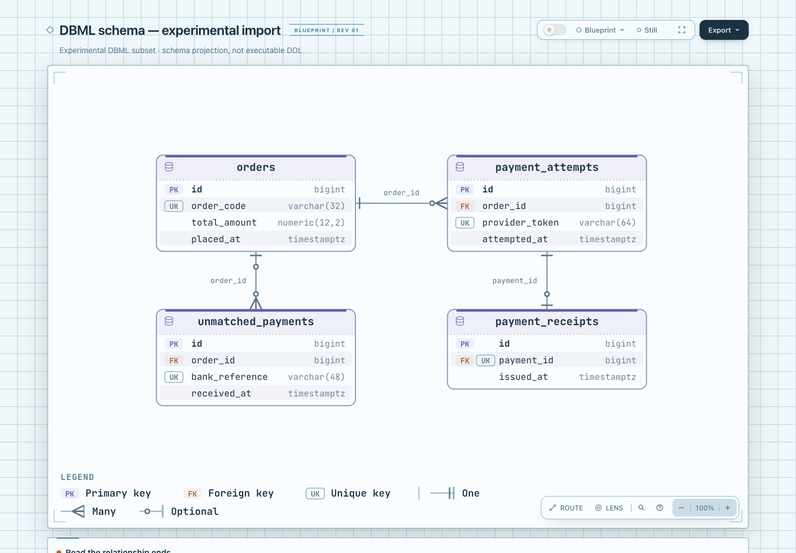

# DBML → native ERD：受限格式实验

把已有 DBML 表、字段与简单引用投影成 Archify 原生 ERD。转换器独立实现，无第三方 runtime 依赖；没有改主 CLI、schema、renderer、Viewer、CI、ZIP 或 live Skill。当前只是实验入口，不宣称完整 DBML/SQL 兼容。

- Archify 基线：`82c7e0f089a02a4d514714adf37dc2061682da5f`，实验分支 `codex/lab-dbml-erd`。
- 格式来源：[DBML 官方文档](https://dbml.dbdiagram.io/docs/)；核查日 2026-10-25。
- 上游固定源码：[holistics/dbml @ 0c34d8514ae7ebb457549531ef4fa5dab839c4fa](https://github.com/holistics/dbml/tree/0c34d8514ae7ebb457549531ef4fa5dab839c4fa)，[Apache-2.0 LICENSE](https://github.com/holistics/dbml/blob/0c34d8514ae7ebb457549531ef4fa5dab839c4fa/LICENSE)。官方网页会变化；本实验未复制其 parser 或示例源码，也未捆绑 DBML 工具链。
- 原生目标合同：[ERD README](../../archify/renderers/erd/README.md)、[schema](../../archify/schemas/erd.schema.json)。实验代码按本仓库 MIT 许可；上游许可是格式调研来源信息，不代表导入其代码。

## 已产生的真实产物

[输入 DBML](fixtures/order-payments.dbml) 是原创 **synthetic** 订单/支付样本，没有真实业务资料。其转换输出包含 4 个实体、15 个字段、3 条关系：

| Ref | 原生 from → to | 最大基数 | 最小基数 / 原因 |
| --- | --- | --- | --- |
| `orders.id < payment_attempts.order_id` | orders → payment_attempts | one → many | from 必选、to 可选：每条 attempt 的 order_id 为 NOT NULL，但订单可尚无 attempt |
| `unmatched_payments.order_id > orders.id` | unmatched_payments → orders | many → one | 两端可选：order_id 未声明 NOT NULL，订单也可没有此类支付 |
| `payment_attempts.id - payment_receipts.payment_id` | payment_attempts → payment_receipts | one → one | from 必选、to 可选：右列是 UNIQUE NOT NULL FK，attempt 可尚无 receipt |

[原生 JSON](output/order-payments.erd.json) → [原生交互 HTML](output/order-payments.html) 已通过 public `render` 与 `finalize --quality showcase`。HTML 是实际转换器输出的渲染结果。成功没有证明真实用户采用、完整数据库建模保真、人工视觉接受或生产部署。

[portable evidence summary](output/order-payments.evidence-summary.json) 明确是**人工结构化的可移植摘要，不是 Archify 原始 receipt**。摘要记录输入/代码/产物 SHA-256、Node 版本、阶段结果和原始 receipt 哈希。原始 finalize/browser/delivery receipts 包含本机绝对路径，完整保留在 checkout 外，由本地执行者持有；不修改原 receipt 后再冒充原件。

截图由主协调另行实际捕获：

- 已生成并查看 [HTML 页面截图](screenshots/order-payments.png)：1440×1000、light、Blueprint、100% 初始 zoom、Still。原文见上面的固定 DBML fixture。
- 本轮未另外捕获 Passport 交互截图；不声称存在字段级点击卡片。
- 截图只能展示布局和当前交互；键、方向、optional 的保真以 JSON/语义测试共同核验。

## 精确支持范围

这是小 tokenizer + parser，逐 token 消耗输入；未知语法不会被过滤后继续。每列和每条 Ref 占一行，空行和 `//` 行尾注释可用，CRLF 可用。声明大小写按文档示例：`Table`、`Ref`；设置/类型小写。

```dbml
Table customers {
  id bigint [pk]
  email varchar(255) [unique]
}
Table purchases {
  id bigint [pk]
  customer_id bigint [not null]
}
Ref customer_orders: customers.id < purchases.customer_id
```

- 未加引号的 ASCII 名称；表/Ref 名必须以字母开头以匹配原生 ID。字段名可下划线开头。单表单字段 PK；可没有 PK，但引用目标必须显式 PK 或 UNIQUE。最多 26 表，按声明顺序两列网格放置；数量上限保护原生 row 范围，不代表 26 表都已做视觉验收。
- 类型白名单：`bigint/int/integer/smallint/uuid/boolean/text/date/timestamp/timestamptz`，`varchar(n)`、`char(n)`，`numeric(p,s)`、`decimal(p,s)`。n/p 正整数，s 为 0..p；FK 与目标类型必须逐字一致，不猜数据库类型同义词。
- 设置只接受 `pk`、`unique`、`null`、`not null`，保留 PK/UK/FK 组合徽章和 `references`。PK + null、重复设置明确拒绝。
- 只接受短形式 `Ref [name]: table.column > table.column`、`<` 和 `-`。保留左右方向；`>` 左侧为 FK，`<` 右侧为 FK，短形式 `-` 的右侧为 FK。FK 只可引用一个目标，不接受自引用。
- `>` / `<` 的 FK 不能同时 PK/UNIQUE，否则与 many 最大基数冲突；应改为 `-`。实验中的 `-` **要求**右侧 FK 显式 UNIQUE 或 PK，避免靠关系符隐含增加 unique。PK+FK 必须显式 `[pk, not null]`，不猜 PK 默认 nullability。
- DBML 缺省列可空；关系中的 FK 只有 `not null` 才设为不可空。Native optional 在端点描述“对端的一行可对应本端零行”：FK 可空决定父表端 optional；父表可以没有子行，因此 FK 所在表端 optional 为 true。不是简单把左列 nullability 写入 fromOptional。
- 原生属性没有一般 nullable 字段：**非 PK、非 FK 的 NOT NULL 明确拒绝**，避免静默丢失额外约束。非关系字段的默认/显式 null 只作为 DBML 缺省语义，本投影不增加列级 nullable 徽章。实验输出是结构阅读图，不能反向生成完整 DDL。

## 明确拒绝的示例

| 输入形状 | 原因 |
| --- | --- |
| `indexes { (a, b) [pk] }` / 多个 `[pk]` 字段 | 不可把复合键拆成独立键 |
| `Ref: t.(a,b) > p.(a,b)` | 不支持复合外键 |
| `default: 1`、反引号表达式、`check`、`increment` | 不可忽略约束或执行表达式 |
| `Ref: a.b > c.d [delete: cascade]` | 不支持删除/更新动作，不静默丢弃 |
| `Ref: a.b <> c.d`、`>?` / `?>` | 不支持 many-to-many、关系显式可选运算符；不可偷换成普通关联 |
| `[ref: > users.id]`、长形式 Ref、schema、alias | 不支持 inline/long Ref 或名称解析扩展 |
| `Enum`、`TablePartial`、`TableGroup`、`Project`、`Note`、Records | 没有本实验的无损映射 |
| quoted names / multiword type / block comment | 子集外，报位置；不提取其中可能的 Table 片段 |
| `name text [not null]`（不是 PK/FK） | 原生属性没有表达此约束的字段 |

CLI 失败返回非零，stderr 为 JSON `diagnostics[]`，含稳定 code、line/column、subject 与 supportedFixes。只报告首个失败，不声称聚合了所有输入问题。某些不支持的结构返回通用 `dbml/syntax`；不会接受后丢弃内容。

## 运行与重新验证

从仓库根目录运行，使用 Node 22。本机验证使用 `/opt/homebrew/opt/node@22/bin/node`（版本见 summary）；下面用 `node` 便于其他机器执行。

```sh
node --test experiments/dbml-erd/dbml-to-erd.test.mjs
```

转换输出采用 `wx` exclusive create：既有文件、目录和符号链接都拒绝，输入路径相同也拒绝。不要删用户文件重跑；选择新的输出路径。下面在新的临时目录复现，原始 receipts 同样留在该目录：

```sh
DBML_LAB_RUN_DIR=$(mktemp -d)
node experiments/dbml-erd/dbml-to-erd.mjs experiments/dbml-erd/fixtures/order-payments.dbml "$DBML_LAB_RUN_DIR/order-payments.erd.json"
node archify/bin/archify.mjs render erd "$DBML_LAB_RUN_DIR/order-payments.erd.json" "$DBML_LAB_RUN_DIR/order-payments.html" --quality showcase
node archify/bin/archify.mjs finalize erd "$DBML_LAB_RUN_DIR/order-payments.erd.json" "$DBML_LAB_RUN_DIR/order-payments.html" --receipt "$DBML_LAB_RUN_DIR/finalize.receipt.json" --out-dir "$DBML_LAB_RUN_DIR" --quality showcase --json
```

`meta.output` 固定为通用可移植 `dbml-erd.html`；上述明确 output 参数选择实际产物位置。转换器只创建 JSON，不调用 renderer 或浏览器；原生 render/finalize 是后续公开入口。

已执行的证据：

- **39 tests passed，0 failed，0 skipped**（10 顶层测试 + 29 子用例）。保护 >/< 左右基数、默认/显式 nullable、NOT NULL、短 `-` 右侧 FK、PK+FK/UK 组合、错误语法拒绝和真实文件保留；不冻结布局坐标或复制 parser 私有数据结构。
- `render erd --quality showcase`：exit 0。
- `finalize erd --quality showcase`：validate/deliver/check/browser-check 全 pass，diagnostics 为空；browser-check 真运行。该门禁不等于人工视觉接受；`visualReview=not-requested`。
- 扫描可公开产物没有本机路径；没有运行全仓库测试，因为共享产品文件没有改动，当前检查针对独立 adapter 与公开渲染路径。

最初 finalize 因缺少 `meta.output` 失败，修正为相对输出后重跑通过；失败原始记录也保留在 checkout 外，不把首次尝试写成成功。

## 成本与下一步边界

依 `test-value` 选择了公共转换结果和失败写出保护，不做 source-string assertions 或布局快照。Focused simplification survey 覆盖 CLI → tokenizer/parser → native JSON → public renderer：一个文件承接转换，不建图模型缓存、插件注册层或 runtime 依赖；没有有价值的进一步删除。未修改 vendored Skills。

剩余限制：只在原创合成输入验收，未拿真实开源 DBML 模型测支持率；不支持多 schema、组合约束、枚举、索引或 SQL 方言。一般 NOT NULL 的原生表达能力有限，真实模型常会被保守拒绝。这些是实验边界，不是静默成功。若未来要接入主 CLI，需要先以真实样本判断使用价值，再单独约定兼容范围、名称解析、完整诊断和交付合同。

## 实际产物图片



[捕获方法及产物/图片 hash](screenshots/capture.json)。独立 Codex 复核 39 项测试、FK 方向/nullability、严格拒绝与输出保护后未发现剩余代码阻塞。以上只是所述子集与样例证据，人类验收仍待进行。
