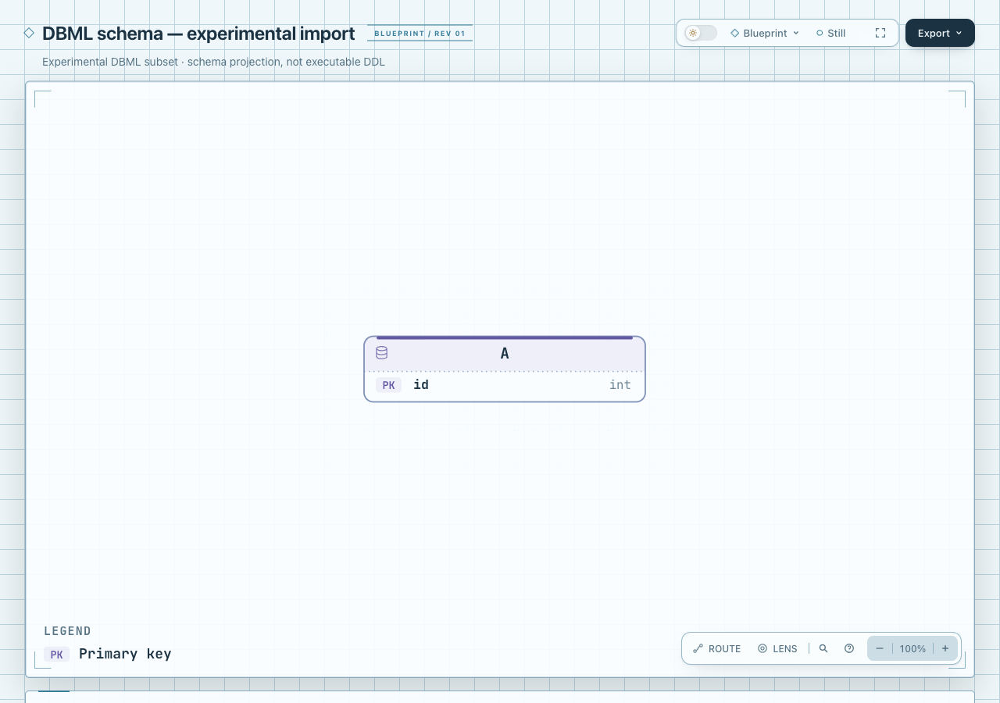

# 完整官方 primary-key fixture：同义写法接受

原始 [primary_key.in.dbml](../upstream-compatibility/primary_key.in.dbml) 固定于 [holistics/dbml @ 0c34d8514ae7ebb457549531ef4fa5dab839c4fa](https://github.com/holistics/dbml/blob/0c34d8514ae7ebb457549531ef4fa5dab839c4fa/packages/dbml-parse/__tests__/snapshots/interpreter/input/primary_key.in.dbml)。完整文件为 36 bytes，SHA-256 `6ecee8c55da3a78b6693a93863ae68af937afbb293586bfe5f0ff1e58771d756`，保持无末尾换行。官方 [column settings 文档](https://github.com/holistics/dbml/blob/0c34d8514ae7ebb457549531ef4fa5dab839c4fa/dbml-homepage/docs/docs.md) 明确 `primary key` / `pk` 同义；原 fixture、来源和 [Apache-2.0 许可](../upstream-compatibility/LICENSE.Apache-2.0) 未改。这是官方回归 fixture，不是生产 schema 或用户采用证据。

## 时间线与边界

- `d0472cc3a5065e2a1c4ba239927ae74a1d2320fd` 记录旧 parser 的实际拒绝；[旧 sources / rejection-summary](../upstream-compatibility/) 五份文件完整保留，当时“只支持 pk”的判断不冒充当前合同。
- 本轮先把 dev `3f95f0349c8276db71509ca239461b6fe9d00f9f` merge 到现有实验，merge commit 为 `73c0014255b1cbfef9047e008a14b7b1dec1cbe2`，没有 rebase 或重建旧历史。
- 新实现尚未提交；[evidence.json](evidence.json) 以 merge 基线和实际 adapter / test SHA 标识候选，不能将 merge commit 冒充实现提交。只有设置列表里的 `primary key` 被归一为 `pk`；没有扩大其他 DBML 语义。

现有去重在归一后执行，因此 `[pk, primary key]` 等仍拒绝；原有 PK/NULL 冲突、组合键、PK+FK 显式 NOT NULL 和关系方向约束不变。残缺 `primary` 或 `primary index` 也不接受。完整 [simple-table.dbml](../upstream-compatibility/simple-table.dbml) 仍因首个不支持的反引号在 5:34 拒绝；裸 varchar、default 和非键 NOT NULL 的完整语义缺口没有顺带放行。

## 实际结果

完整官方文件直接进入 CLI，没有改写输入。实际 [JSON](primary-key.erd.json) 为一个实体 `A`、一个属性 `id: int`、`key=pk`、零关系；[HTML](primary-key.html) 是此 JSON 经 public render / finalize 生成的原生 ERD。模型的通用关系说明是既有 adapter 输出，不表示该 fixture 含有关系。

Focused tests **49 passed / 0 failed / 0 skipped**，含真实官方文件的 CLI 接受与 simple-table 不写出、别名等价、重复、partial/null/composite 与 PK/FK 边界。同一两个新增测试放到旧 parser 后 **2 failed / 0 skipped**，如实记录为预期基线失败。旧订单/支付样本重新转换的 JSON 逐字不变；旧成功产物和所有旧拒绝证据均未修改。

新软件基线的 public `render` exit 0；`finalize --quality standard` exit 0，validate / deliver / check / browser-check 均 pass、零诊断，原生 finalize 自动请求并运行浏览器门禁。HTML 的 `archify-software-notices` 与新软件基线发出的 NOTICE、Apache-2.0 LICENSE、retained LICENSE-MIT 和 THIRD_PARTY_NOTICES 拼接内容一致，没有手工删改。没有重建 ZIP、修改产品代码、运行 DBML 工具链或数据库。

协调者已实际捕获并逐图查看下图：1280×900、light、Blueprint、100%、Still；`A.id int` 的 PK 徽章与 Primary key 图例可见。[简洁 capture](screenshots/capture.json) 是外置原始元数据的明确派生摘要，不含其 SVG style 噪声。实现代理未打开 Ego / TaskSpace。机器 gate 与截图都不代表数据库执行、人类验收、辅助技术或用户收益验证。



```sh
node --test experiments/dbml-erd/dbml-to-erd.test.mjs
node experiments/dbml-erd/dbml-to-erd.mjs \
  experiments/dbml-erd/upstream-compatibility/primary_key.in.dbml '<fresh-output.erd.json>'
node archify/bin/archify.mjs render erd '<fresh-output.erd.json>' '<fresh-output.html>' --quality standard
node archify/bin/archify.mjs finalize erd '<fresh-output.erd.json>' '<fresh-output.html>' \
  --quality standard --out-dir '<private-receipts>' --receipt '<private-finalize.json>' --json
```

输出必须选择新的文件；现有 exclusive-create 保护不变。上面的命令不改原 fixture。实际执行时复用已存在依赖，未安装 live Skill。原始含本机路径的日志/receipts 原字节留在 checkout 外；[evidence.json](evidence.json) 是明确标记的派生摘要，[binding-summary.json](binding-summary.json) 记录公开文件和源码 SHA，不冒充原始 provenance receipt。

原生 renderer 生成的 HTML 含 15 行既有尾随空白，保留原始交付字节，不为 whitespace 检查后处理 HTML。修改的源码、测试和 Markdown 的 `git diff --check` 通过。
