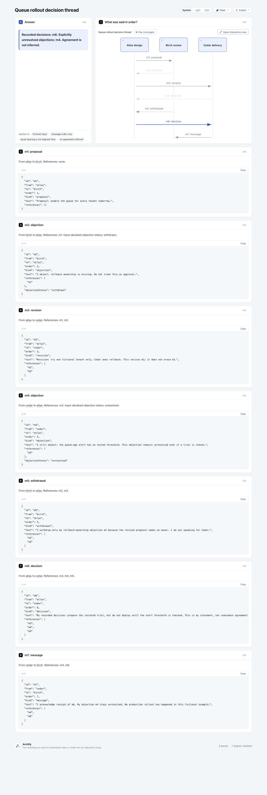
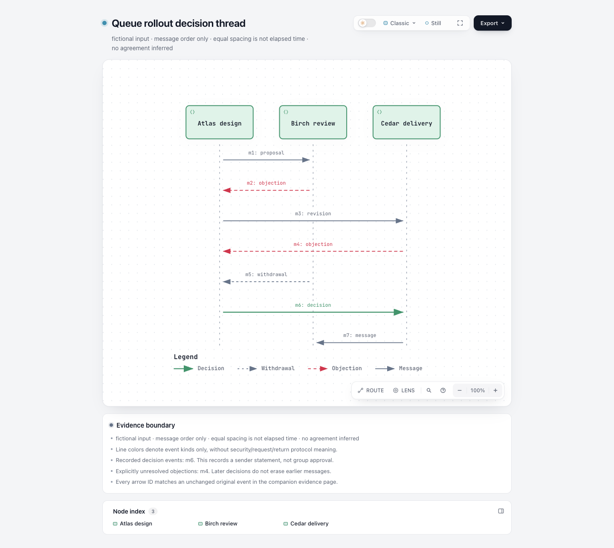

# Decision thread: explicit messages → sequence and evidence

Turn an explicitly supplied fictional or redacted discussion into a native sequence and a companion Explainer. Follow proposal, objection, revision, withdrawal and recorded decision events while retaining every original ID and text. A decision by one sender does not establish group agreement, deployment or acceptance.

Base: `82c7e0f089a02a4d514714adf37dc2061682da5f`. Branch: `codex/lab-decision-thread`. This experiment only adds `experiments/decision-thread/`; no product schema, renderer, Viewer, CI, package or ZIP changes. No runtime dependency. Node used: 22.23.3.

## Inspiration and data boundary

Inspired by [agent-chatter-visualizer](https://github.com/jasmeetsb/agent-chatter-visualizer/tree/87c144adabc5a0a4ad1efd062c9706ffa74c3f4c), fixed commit `87c144adabc5a0a4ad1efd062c9706ffa74c3f4c`, [MIT license](https://github.com/jasmeetsb/agent-chatter-visualizer/blob/87c144adabc5a0a4ad1efd062c9706ffa74c3f4c/LICENSE). The idea borrowed is making inter-agent discussion evidence visible. No upstream code, assets or demo messages were copied or executed.

The fixture is original fiction: Atlas, Birch and Cedar discuss a queue trial. It contains 7 events. Birch's objection m2 is followed by an explicit withdrawal m5; both remain visible. Cedar's m4 is explicitly unresolved even after Atlas records a conditional decision m6. Acknowledgement m7 does not become approval.

Only the exact local file passed to the CLI is read. There is no session discovery, home-directory scan, database access, network fetch, message sending, summarization service or hidden-reasoning extraction. Input requires `declaration: fictional|redacted`; this is a user declaration, **not an automatic redaction feature**. Unknown fields, including reasoning/session payloads, fail rather than being silently imported. Do not put real private messages or credentials in this public experiment.

## Input contract

Version 1 accepts a short plain title, 2–8 explicitly named participants and 1–40 events. Every event has `id`, `from`, `to`, `kind`, `text` and explicit `references` (use `[]` for no references). Supported kinds: proposal, objection, revision, decision, withdrawal and message. Text is literal, 1–2000 characters. IDs are unique ASCII identifiers; participants must exist. Self-messages are rejected rather than redirected.

Supply a positive integer `order` on every event, or a canonical UTC millisecond `timestamp` on every event. All events may carry both, but timestamps must then strictly increase with order. Duplicate order, timestamp ties, invalid dates, inconsistent clocks and partial timestamp/order fields fail. The output is **message order**, with equal visual spacing; it does not show elapsed time, latency or concurrency.

References must identify an earlier event from this same explicit input. Missing context is unknown, so this version refuses the import with `thread/missing-reference`; it does not invent the missing message or assume agreement. Self/forward references fail. Duplicated references also fail.

Every objection requires input-declared `objectionStatus: unresolved|withdrawn|addressed`. This is a supplied annotation, not a status derived from subsequent prose. It does not certify that another participant agrees. Revision/decision/withdrawal events never erase old events or automatically close another objection. Future support for uncertain external references or explicit resolution records would require a separate contract.

## Output and source mapping

`thread.sequence.json` is ordinary native sequence JSON: each arrow has the original event ID and kind. Existing `meta.legend.entries` explicitly labels visual styles as Message, Objection, Decision and Withdrawal. These colors describe event categories, without claiming security operations, protocol returns or main requests. Proposal/revision/general messages share the neutral Message style; their exact kind remains in the arrow label. `thread.archify.md` references that diagram, then gives each event its own evidence panel containing the original event JSON, including exact text and references. Panel IDs are `event-<original-id>`; the Explainer's panel navigation opens those evidence cards. The original event ID is visible in the arrow and panel, without speculative summaries.

`thread.input.json` retains the complete supplied input. `thread.receipt.json` binds its semantic JSON SHA-256 and maps every rendered event to the original array index/JSON pointer, panel ID, participants and references. The hash uses `JSON.stringify(input)` after JSON parsing, not original whitespace bytes. There are no local source paths in the public receipt or HTML.

The CLI requires a fresh output directory. Exclusive `mkdir` rejects existing directories, files, input aliases and symlinks. Every child file is opened with `wx`. On a later write failure cleanup checks inode identity and removes only files owned by this invocation, leaving unrelated collisions/victims intact. This is not a multi-file power-loss transaction. Call the public renderer/finalize separately after conversion.

## Reproduce

From repository root, use a new output name:

```sh
/opt/homebrew/opt/node@22/bin/node --test experiments/decision-thread/thread.test.mjs
/opt/homebrew/opt/node@22/bin/node experiments/decision-thread/thread-to-archify.mjs experiments/decision-thread/fixtures/fictional.json experiments/decision-thread/repro
/opt/homebrew/opt/node@22/bin/node archify/bin/archify.mjs finalize sequence experiments/decision-thread/repro/thread.sequence.json experiments/decision-thread/repro/thread.sequence.html --json
/opt/homebrew/opt/node@22/bin/node archify/bin/archify.mjs finalize explainer experiments/decision-thread/repro/thread.archify.md experiments/decision-thread/repro/thread.html --browser-check --json
```

The negative fixture is `fixtures/missing-reference.json`. Importing it must exit nonzero without creating its output directory; actual evidence is `evidence/missing-reference.failure.json`.

## Actual results and limits

- Experiment tests: **8 pass, 0 fail, 0 skip** (`evidence/tests.tap`). They protect original messages/IDs/references, retained objections, explicit ordering, timestamp conflicts, missing context, literal evidence snippets, rejected hidden fields and real victim protection including a later-output collision. Coordinates are not frozen.
- Both sequence and Explainer actually ran through public `finalize`. Both passed validate, deliver, check and browser-check. Explainer was explicitly run with `--browser-check`. No full-repository suite was run because shared product code is unchanged.
- Public HTML: `evidence/thread.sequence.html` and `evidence/thread.html`. Editable JSON/Markdown and input mapping are beside them.
- `*.portable-summary.json` are clearly labeled transcriptions of actual stdout with hashes and stage results. Original receipts contain personal paths and were kept outside checkout; portable summaries do not masquerade as original receipts.
- Both finalize results report `visualReview: not-requested`. Human review is pending. Browser gate success does not establish usability, group agreement or correctness of user-supplied status annotations.

Actual desktop screenshots are recorded below; user visual acceptance remains pending.

Current limitation: input annotations may themselves be wrong. This tool preserves and exposes them; it does not authenticate senders, validate authority, determine whether a withdrawal is justified or infer decisions from prose. The 40-event budget keeps this a small discussion evidence artifact rather than a session analytics platform.

## Actual browser images

The native sequence visibly labels Message, Objection, Decision and Withdrawal. The Explainer preserves all seven event cards and identifies m4 as unresolved despite m6. The inline preview uses existing muted secondary arrows; the native view provides clearer event styling. Equal spacing is not elapsed time.





Capture settings and current HTML/image hashes are in [capture.json](screenshots/capture.json). These are agent-captured and agent-inspected images; human acceptance is pending. Original finalize visualReview fields remain unchanged.

AI assistance: Codex and GPT-6.1 Sol subagents performed investigation, implementation, focused validation, review and documentation. The repository owner has not yet accepted this experimental branch.
