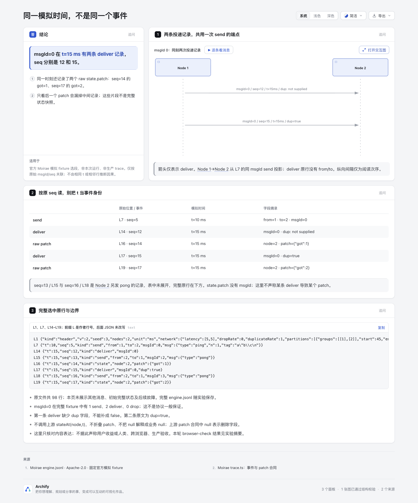
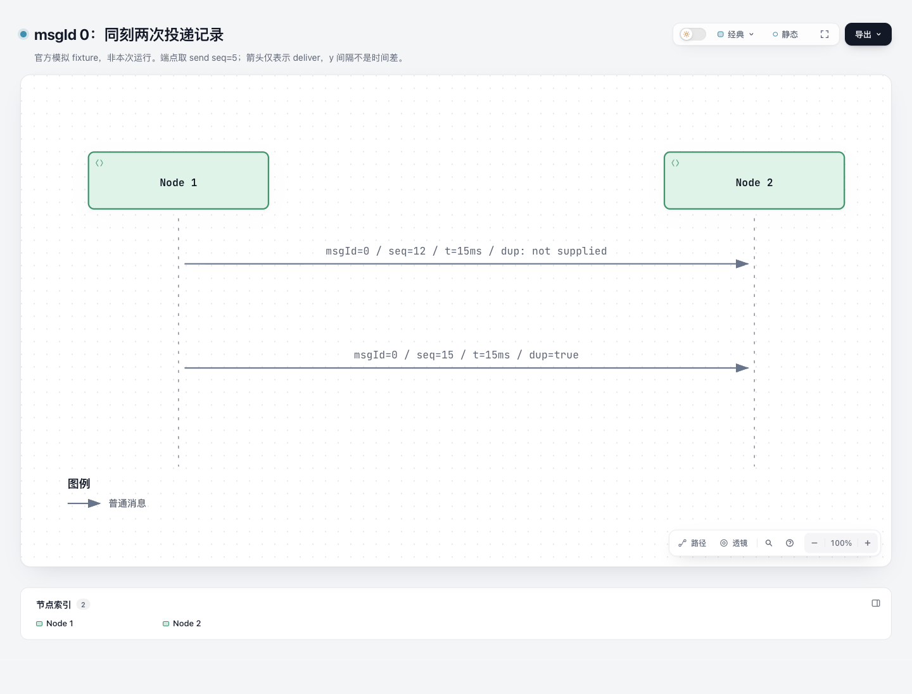

# Delivery witness：同一模拟时间里的两条投递记录

内容实验，基线 `82c7e0f089a02a4d514714adf37dc2061682da5f`。使用已有 native Sequence、Explainer，不改共享 runtime、schema、tests、CI 或 ZIP；没有解析器、采集器、模拟器、状态重建或播放实现。

打开 [witness.html](witness.html) 看原生图、紧凑事件表与完整选中原行；[delivery.sequence.html](delivery.sequence.html) 是同一图的独立 native 版本。生成 HTML 保持 public render/finalize 输出字节，未手工改写。

## 这张图准确说什么

这是 **Moirae 官方模拟 fixture 的选段，非本次运行、非生产 trace**。同 msgId=0 在完整 98 行 fixture 中有一次 send（L7 / seq5 / t10ms）、两条 deliver（L14 / seq12 / t15ms，L17 / seq15 / t15ms），没有 drop。第一条 deliver 未提供 dup 字段，第二条为 dup=true；不能把缺失补成 false。

Sequence 只画两条 deliver 箭头；两者端点都从同 msgId 的 send 原行投影。deliver 原行不含 from/to。纵向间距是阅读次序，不是时间跨度，也不是两次独立发送。

L16 / seq14 的 node2 raw patch 是 `{"got":1}`，L19 / seq17 是 `{"got":2}`，均为 t15ms。它们不是完整状态，也不含 msgId。L15 / seq13 与 L18 / seq16 另发 pong 的原行完整保留在证据区，避免暗示 deliver 与 patch 直接相邻或已证因果。仅有相同 t 或相邻原始记录不能证明因果。

本例不调用上游 `stateAt(node,t)`；该函数按 t 折叠同刻所有 patch，不能称成截至 seq14 的快照。也不实现自己的 fold；上游 patch 的 null 表示删除字段，不能套用一般 JSON “业务 null”含义。

## 来源与字段账目

- 上游：[pchrysostomou/moirae](https://github.com/pchrysostomou/moirae/tree/a289c00cedb8716bd4a6db6b47042b875c22936b)，固定 commit `a289c00cedb8716bd4a6db6b47042b875c22936b`。
- 原文件：[crates/moirae-trace/tests/fixtures/engine.jsonl](https://github.com/pchrysostomou/moirae/blob/a289c00cedb8716bd4a6db6b47042b875c22936b/crates/moirae-trace/tests/fixtures/engine.jsonl)，原样保存在 [source/engine.jsonl](source/engine.jsonl)。SHA-256 `e7443336e0b219938b0d9732b5bbb1333093984a4706f2ac1ce29638af4809b3`。
- 选中完整行：**L1、L7、L14–L19**；[selected-lines.txt](source/selected-lines.txt) 只加作者 `L<n>` 前缀，后面的 JSON 原行未改。
- [projection-receipt.json](projection-receipt.json) 是明确标注的作者字段投影账目，不是解析器生成报告。列出每条箭头的 event 行、seq、端点来源、表中未展开字段与选段外记录；完整原文件始终可复核。
- [NOTICE.md](NOTICE.md) 是本实验编写的来源说明；上游固定 tree 无 NOTICE 文件。Apache-2.0 [许可全文](source/MOIRAE-LICENSE) 原样保留。未复制上游 runtime。

只展示了两个参与方与特定消息。其他消息、初始状态、后续故障未在图中展开；header 的 network 配置只作为完整原行保留，不推断其风险概率或这次选段的运行行为。原 payload 的转义字符保留在证据中，不作为 HTML 执行。

## 复现

仓库根目录，使用 Node 22。不需要安装上游、执行 Moirae 或安装 live Archify。

```sh
node archify/bin/archify.mjs render sequence experiments/delivery-witness/delivery.sequence.json experiments/delivery-witness/delivery.sequence.html
node archify/bin/archify.mjs render explainer experiments/delivery-witness/witness.explainer.json experiments/delivery-witness/witness.html

# Raw receipts 留 checkout 外；不能把含机器路径的 receipts 当 portable 文件提交。
EVIDENCE_DIR="$(mktemp -d)"
node archify/bin/archify.mjs finalize sequence experiments/delivery-witness/delivery.sequence.json experiments/delivery-witness/delivery.sequence.html --json --receipt "$EVIDENCE_DIR/sequence.finalize.json" --out-dir "$EVIDENCE_DIR/sequence"
node archify/bin/archify.mjs finalize explainer experiments/delivery-witness/witness.explainer.json experiments/delivery-witness/witness.html --json --browser-check --receipt "$EVIDENCE_DIR/explainer.finalize.json" --out-dir "$EVIDENCE_DIR/explainer"
```

Public finalize 另会在 HTML 旁生成 delivery sidecar；若含机器路径，应移至同一外部证据目录，保留 HTML 原始生成字节。[validation-summary.json](validation-summary.json) 是本实验明确编写的 portable 摘要，**不是脱敏伪装的原始 receipt**。

## 本轮验证与限制

内容核对检查原文件 SHA / 98 行、全部 msg0 记录、所选完整原行、dup 缺失、两条 patch、两条 native 消息、嵌入/独立 spec 一致、HTML 无本机路径。独立来源与图语义 review 已由另一代理完成：固定上游字节、许可、8 条完整原行、最终 HTML 的嵌入稿/native spec/证据文本核对均无阻塞；它不能替代真实读者验收。

首次输入错误被保留在 checkout 外证据中：Sequence animation=static（应为 none）、height450（最低480）、Explainer callout tone（应为 level）。修正作者输入后渲染成功。首次 Explainer finalize 的 source-document-binding 失败定位为 meta.output 的目录路径与标准化 basename 不一致；改为 `witness.html` 后重新生成/检查，没有修改 runtime 或 HTML。显式 Explainer browser-check 另发现 native 子图的小号 participant sublabel 缩放后仅 8.75px，未通过阅读门槛。修正为把 msgId/seq/t/dup 全放在正常箭头 label，并把端点来源放入 subtitle 与既有 callout；原始行没有删减。两份最终冻结产物的 validate、deliver、check、browser-check 全部通过，diagnostics 均为空。机器 browser-check 不等于 root 视觉验收或用户收益。最终阶段结果与精确产物 SHA 见 portable 摘要。

没有用户收益结论。待问的具体阅读任务是：“msg0 投递几次？两条 got patch 是否处于不同模拟毫秒？”本页只是判断已有 Archify 表达是否足够；不宣称比 Moirae Studio、原始行检索或已有 payload-delta/trace-waterfall 更好，不扩大成产品功能。具体区别是：payload-delta 对照字段 before/after，trace-waterfall 展示区间持续时间；本例只按消息身份关联离散 deliver，并保留 seq 与同 t 重复账目，没有新增 diff 或计时 parser。

## 图片

协调代理已捕获并查看两份最终产物，确认两条箭头采用相同中性样式，标签保留不同seq与dup；[截图记录](screenshots/capture.json)绑定最终HTML和图片。这是代理视觉检查，非人类或跨浏览器验收。





初版为了强调dup而使用primary样式，自动图例却显示“主路径请求”。该错误会暗示不同消息类别，已改为一致的普通消息样式；[初版图片和HTML](screenshots/before-legend-fix/capture.json)按旧hash保留，不作为终版图例证据。

AI协助：Codex负责调研、内容制作、独立来源/语义复核和真实截图；没有声称人工代码或视觉接受。

### Root 图像审查后的图例修正

初版把第二条 deliver 用 emphasis 只作视觉突出，却触发自动图例“主路径请求”，与第一条“普通消息”构成错误类别暗示。已将两条都改为中性 default，dup=true 仍完整保留在第二条标签中；嵌入图同步。旧 HTML 与旧截图作为初版视觉问题证据保留，不冒充终版。未改 runtime；重新生成及检查后的 hash 见 portable 摘要。
