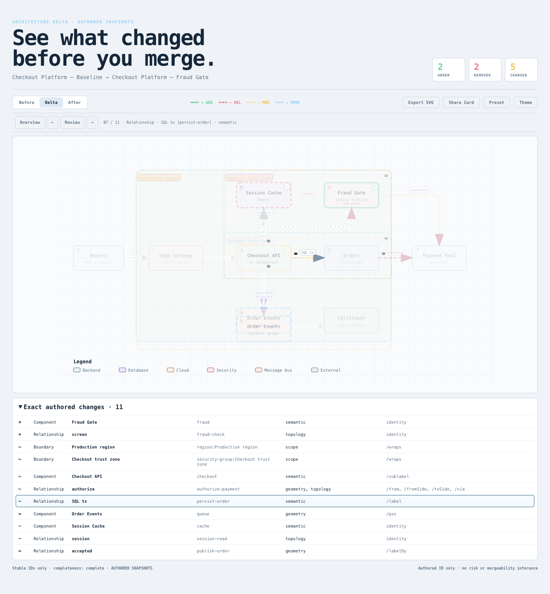
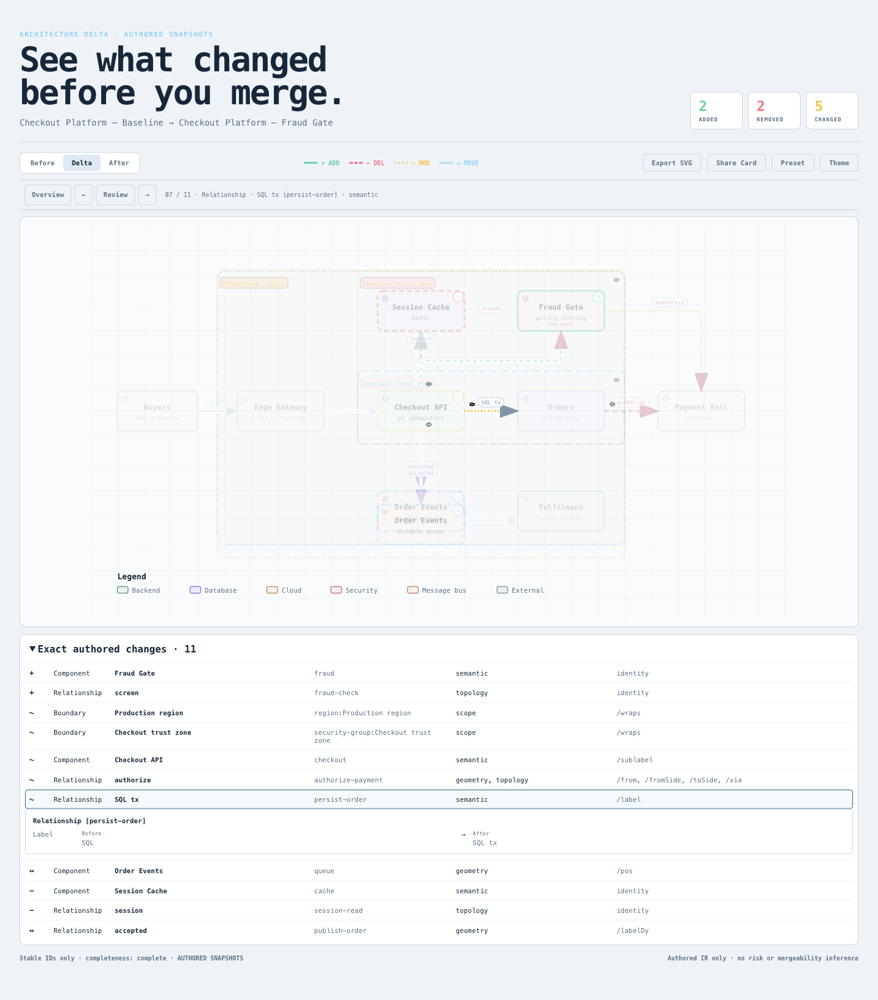

# Delta exact-row values — experimental candidate

Selecting an existing exact change row now shows the old/new facts already
stored in its compare receipt, directly below that row. The fixed Checkout
comparison answers two concrete questions without switching to Before/After:

| Existing row | Baseline row content | Candidate readout |
| --- | --- | --- |
| `persist-order` | `/label` | Label: `SQL` → `SQL tx` |
| `authorize-payment` | `/from, /fromSide, /toSide, /via` | From: `orders` → `fraud`; route-field values explicitly unavailable |

This is a demonstrated information difference, not a measured speed improvement
or user acceptance. It remains an isolated experiment based on
`82c7e0f089a02a4d514714adf37dc2061682da5f`; nothing was merged, released,
deployed or installed.

## Compare it

Open [base.html](base.html) and [candidate.html](candidate.html) at the same
viewport, preset and theme, with motion reduced. The Delta shell starts in dark
mode; use its existing Theme button for light mode (`?theme=` is not supported).
Expand **Exact authored changes**, then choose `persist-order` or
`authorize-payment`. The selected candidate row contains the before/after
readout. Previous/Next use the same existing selection; Overview clears it.
Switching to Before/After hides the readout and returning to Delta shows the
selected record again.

The comparison uses the original
[`checkout-platform.base.architecture.json`](../../archify/examples/checkout-platform.base.architecture.json)
and [`checkout-platform.head.architecture.json`](../../archify/examples/checkout-platform.head.architecture.json)
without edits. [receipt.json](receipt.json) pins input, source, artifact and ZIP
SHA-256 values. The two actual CLI sidecars are [base.receipt.json](base.receipt.json)
and [candidate.receipt.json](candidate.receipt.json): all fields are identical
apart from the artifact's HTML bytes/hash metadata. Parent-session screenshots
are retained in [screenshots/](screenshots/); their filenames identify actual
theme, not a requested URL parameter.

## Scope and preserved boundaries

Only the standalone shell in `archify/delta/architecture-delta.mjs` changes.
It reads the source record already accepted by `validateReview` and
`targetsMatch`, with no second selected-change state. Supported fields are
relationship `from`, `to`, `label` and component labels, shown only when changed
or when an entity was added/removed. The existing receipt has no old/new
sublabel, tag, route or boundary values, so the readout says so explicitly.

- `Empty or not supplied` reflects the producer's existing normalization of
  absent/empty relationship labels. The UI does not invent a distinction.
- `Relationship not present` / `Component not present` identifies an added or
  removed entity's missing side. Invalid or unrecorded values are `Unavailable
  in receipt`.
- Values use DOM text nodes, including CJK, quotes, HTML-like strings, dollar
  sequences and backticks. Identity failure clears the previous readout and
  follows the existing unavailable-review path.
- Before/After explorers, graph geometry, receipt schema, diff classification,
  counts and proof level are unchanged. No camera synchronization, new control,
  locale system, history or dependency was added. The shell retains its existing
  English UI.
- The readout is outside SVG and hidden in print. Canonical SVG bytes and the
  existing Share Card PNG bytes remain unchanged across row selection.

The research inspiration was identity-based graph comparison in
[XFlow's diff utility](https://github.com/antvis/XFlow/blob/faa44bf048c92ac14108f10c0a9a3bffb5e4cd2f/packages/diff/src/util/index.ts)
and [d3-graphviz's DOT handling](https://github.com/magjac/d3-graphviz/blob/355158dc789ff8556549018a0c0f7a567ac0bfc3/src/dot.js).
No implementation code or comparison algorithm was copied.

## Verification

The focused Node delta/literal/marker/browser-runner suites passed **67/67**.
The updated real-browser suite passed **5/5** with no skips; an independent
reviewer repeated the same **5/5**. Browser cases cover 1440×900 and 390×900 in
both themes, actual row clicks, Previous/Next, unsupported fields, normalized
empty labels, absent entities, malformed values, literal rendering, identity
failure cleanup, print, canonical SVG equality and Share Card PNG byte equality.
Synthetic receipt variants exercise unsafe/malformed display boundaries; the
two principal comparison questions use the unchanged real Checkout pair.

### Narrow horizontal-scroll regression

The parent session found a real release blocker after the earlier **4/4** run:
at 390px width, a horizontally scrolled row left the detail panel outside the
visible list area. The old test helper aligned the list back to the left and
therefore missed it. The original failure is preserved in
[mobile-before-fix.html](regressions/mobile-before-fix.html) and the
`screenshots/*mobile*-before-fix.png` captures. Those earlier test passes do not
establish narrow-screen readability.

The narrow layout now gives the existing wide row a matching containing block
and keeps only the new detail panel horizontally sticky within the list's
scrollport. Its width follows the list's own content size; field names sit above
the two Before/After columns. It does not reset horizontal scroll or reformat
the existing table.

At **390×844**, the regression starts with nonzero `scrollLeft`, clicks the
visible part of the row using native pointer input, and checks every text range
and hit target for `Label`, `Before`, `SQL`, `After`, `SQL tx`. Both themes pass
at scroll positions **300** and the rightmost **504** pixels; selection preserves
the scroll position. An independent probe confirmed the same boundaries.
Running that same test against the frozen old HTML fails as expected, with all
five texts outside the visible scrollport:

```sh
ARCHIFY_DELTA_VALUES_SCROLL_BASELINE="$PWD/experiments/delta-values/regressions/mobile-before-fix.html" npm run test:browser -- test/architecture-delta-values-browser.test.mjs
# Expected failure: the horizontal-scroll visibility case detects the old defect.
```

Reproduce the selected checks from the repository root, setting
`ARCHIFY_CHROME` to an executable Chrome/Chromium for the browser command:

```sh
npm run test:focus -- test/architecture-delta.test.mjs test/architecture-delta-literals.test.mjs test/architecture-delta-markers.test.mjs test/browser-gate.test.mjs
npm run test:browser -- test/architecture-delta-values-browser.test.mjs
npm run test:generated
npm test
```

Only the affected checked-in Checkout Delta HTML/receipt and ZIP were rebuilt.
Ordinary Viewer sources, their generated template, bundled examples and Gallery
have no changed authoritative input and were left unchanged. ZIP freshness uses
canonical Node 22.23.2 / bundled zlib 1.3.1-e00f703 and a byte-identical second
tracked-source build. Final generated/core counts are in the receipt. Full
repository, remote CI, cross-platform and human acceptance remain unverified.

## Actual artifact images

| Existing exact row | Candidate old/new values |
| --- | --- |
|  |  |

[Endpoint change](screenshots/candidate-authorize-payment-light.png) · [Dark theme](screenshots/candidate-persist-order-dark.png) · [390px light](screenshots/candidate-persist-order-mobile-light.png) · [390px dark](screenshots/candidate-persist-order-mobile-dark.png)

The parent agent inspected the final real browser captures. In the 390px
captures, selecting the row left the existing horizontal list at `scrollLeft=252`;
the field name and both values remained visible. The list itself still scrolls.
[capture.json](screenshots/capture.json) binds each image to the final HTML.
The earlier failure is preserved with its actual source and images in
[capture-before-mobile-fix.json](screenshots/capture-before-mobile-fix.json).

The fixed inspiration sources are XFlow (MIT) and d3-graphviz (BSD-3-Clause),
with license links in the research report; no upstream implementation was copied.
AI assistance: Codex / gpt-6.1-sol implemented, independently reviewed, and
captured this experiment. Human code, visual and user-benefit acceptance remain pending.
