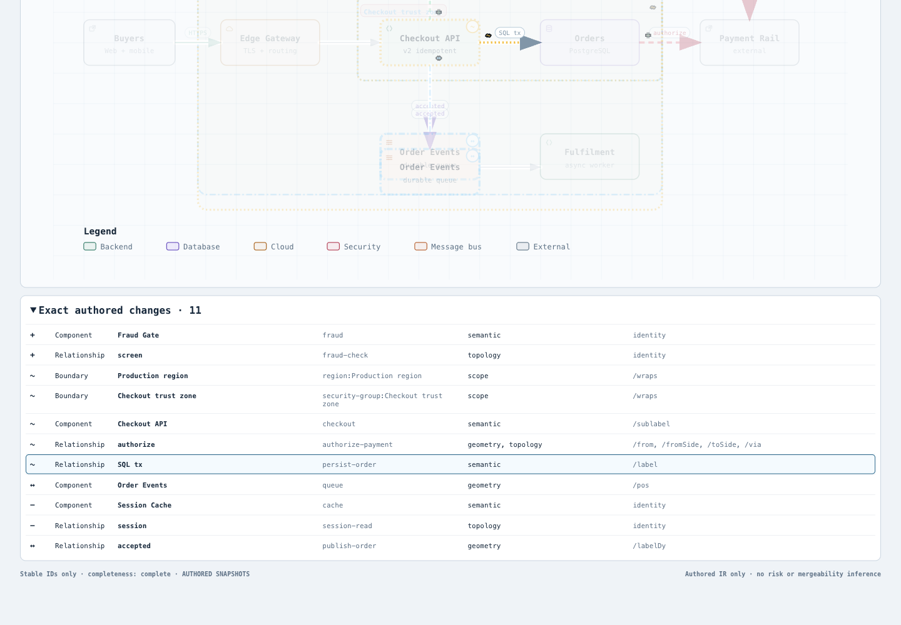
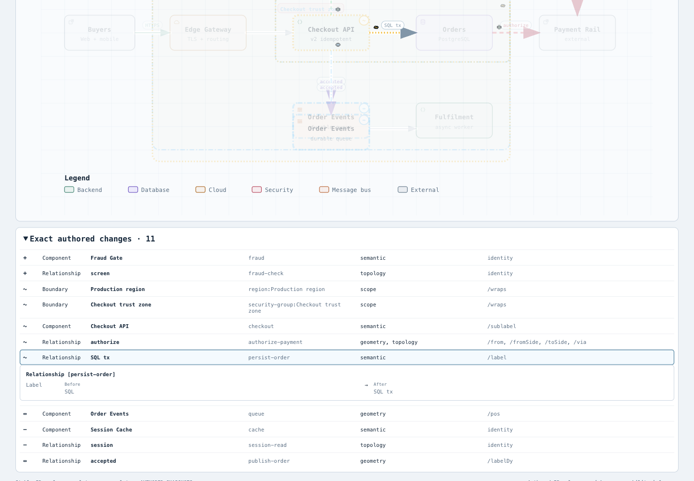
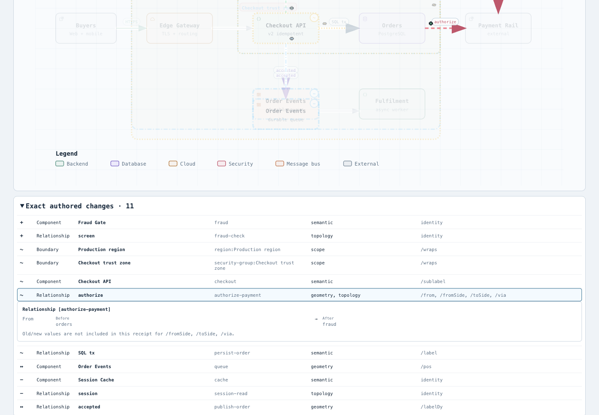
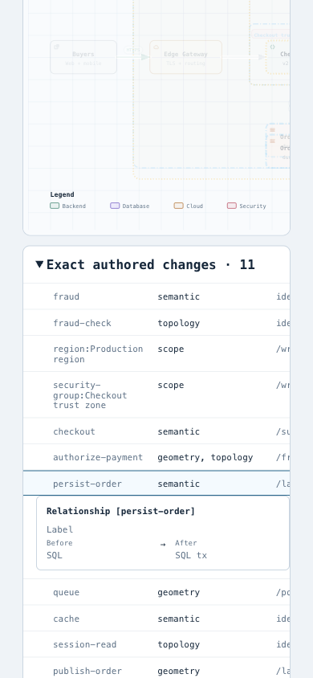
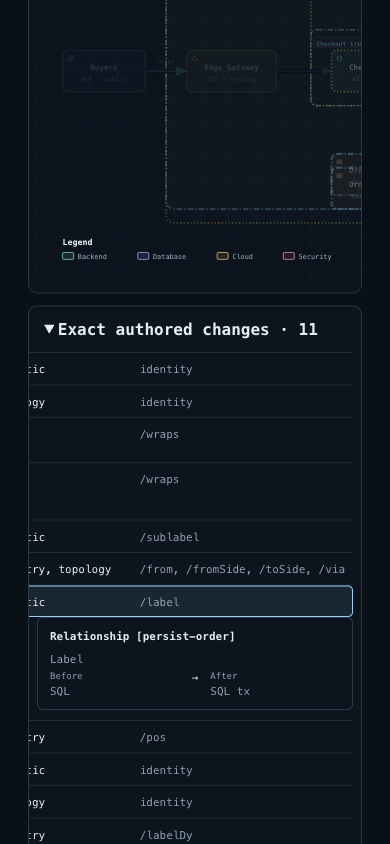

# Delta values：固定 dev10b4 刷新

仍然值得保留的局部问题是：选中 exact change row 后，读者需要就地核对 receipt 已保存的 Before / After，而不只读“这个关系改了”。固定 dev `10b4dd5c5f2264baa315ee65a9b4cc23c13ea5f0` 仍只有 review status，没有 selected values。新 dev 的 `meta.translations` 差异分类并未提供这些值。本次正常合并固定 dev 到原候选 `4c35456b23b5452ca3f620672a8b52545979c945`，保留该分类、原 diff/receipt 合同和新 Viewer 行为。

历史22份实验文件（含原README、截图和失败见证）全部保持原字节；本目录只记录新基线证据，不回填历史通过或把旧图绑定到新HTML。没有新增 schema、parser、差异算法、字段推断或共享平台。

## 同一 Checkout 输入的正常产物

- [dev10b4 base](base.html)：SHA256 `9aa3d75cbdf665bd9e7fc6bc184e39eb15cb687e08ed87573a53caafe6880141`，2429777 bytes。
- [candidate](candidate.html)：SHA256 `65f2bcd7242db14f2e536cac29ade9d0b0558f809570e95af524cbfb0a2d9017`，2433758 bytes。
- 两份未经改写的正常 compare receipts：[base](base.receipt.json) / [candidate](candidate.receipt.json)。删除各自 artifact 摘要后，其余所有字段严格相等，包括输入hash、summary、变化、身份、证明级别和validation。

两臂都通过 public `compare architecture`，使用完整 `archify/examples/checkout-platform.base.architecture.json` 与 `checkout-platform.head.architecture.json`，standard quality。输入逐字对固定 dev 的 Git 对象；base runtime 来自 `git archive` 原 dev，candidate 来自合并后的源码。没有拿旧HTML冒新基线，也没有后处理生成HTML。

具体阅读仍为同一 receipt 的 `persist-order` label **SQL → SQL tx** 与 `authorize-payment` from **orders → fraud**。组件只显示 receipt 的 baseLabel/headLabel；关系只显示实际 base/head 的 from/to/label。空和缺失 label 在现有 producer 已经归一，因此明确显示 `Empty or not supplied`；类型不对或未保留字段显示 unavailable。sublabel、route、via、边界和translation的旧新值不在此合同，不从当前图或源码猜值。

所有值走 textContent，identity mismatch/失败清空旧读数；新增面板不进入 canonical SVG 或 Share Card PNG，也不改变比较结果、camera或导出合同。三项显示能力与未知项边界沿用原候选，未扩字段。

## 当前真实验证

- 完整 selected-value 浏览器 suite **5/5 passed，0 skipped**，46份实际 observation。包含390/1440与浅深色，真实行点击、Previous/Next、空/未提供/缺失实体/畸形值、CJK及HTML样文本、identity失败清空、print、canonical SVG和Share Card像素文件bytes不变。
- **390×844**两主题分别从真实 list scrollLeft=300和最右504开始，不用 scrollIntoView 重置横向位置，native click后 scrollLeft不变；`Label / Before / SQL / After / SQL tx` 每个Range rect在scrollport/viewport内且hit-test成功。不是只检查面板box或零滚动状态。[原始安全observation副本](observations.json)。
- 原 dev 产品代码运行相同最终suite，0pass/5fail：它没有selected-value DOM，四个child和parent失败。这是缺失本候选能力的负对照，不是五个独立缺陷，也不能据提前失败推断后续所有断言都执行过。旧窄屏失败见证仍保存在历史目录，未改写。
- Delta/literal/markers/browser-runner与新 dev translations相关检查最终 **73/73**；core smoke **19/19**。Viewer、brand marks、validators和release identity四项命令通过，没有借此声称全量golden或整个repo通过。
- checked-in `examples/checkout-platform-delta.html` 与receipt以既有 **showcase**合同由正常public compare重新生成。第一次误用默认standard，首选中suite为72pass/1fail（reproducibility）；按原合同修正命令后73pass，未改原断言或减覆盖。错误日志保留。
- 初始准备脚本误以为本WT依赖目录为空；实际已有安装，原目录保留并复用，没有安装、改lock或覆盖依赖。临时base/extracted的链接仅在临时目录。未运行全仓、Windows、hosted CI或AT；没有真人效果或接受结论。

## Compare 与 finalize 的合同边界

本版本 `finalize <type> <input> <output>` 面向单份图/Explainer，**没有 compare/delta finalize 类型**。本例实际执行的是两个public compare和两个public check，后者ok且provenance=unknown；没有写成四阶段finalize成功，没有把单图finalize转借给Delta。public check所见legacy图的7.5px目标未达到、6px硬底满足，两臂相同；它不验证新增读数的视觉质量，相关结果由真实DOM检查与root图另记。

完整原stdout/stderr、compare/check结果、浏览器测试日志与机器观察留在checkout外。[evidence-summary.json](evidence-summary.json)是明确派生摘要，保存原件hash及各阶段边界，不是重写原始receipt。

## Canonical 包与保留范围

唯一内容冲突是正常生成的compare receipt；另有ZIP二进制冲突，均由正常命令重建解决。官方Node **22.23.2** / bundled zlib **1.3.1-e00f703**双构建逐字相同。ZIP共235项、CRC通过，与固定dev inventory一致，仅 `archify/delta/architecture-delta.mjs` bytes变化并等源码。新dev其它包内容、软件notices、Viewer/例子均保留。

精确解包后的CLI再次正常compare成功：完整HTML逐字等本目录candidate，全部非artifact receipt字段也相同。[ZIP摘要](zip-summary.json)。没有把两棵树的包内容混成旧ZIP，也没有对generatedHTML或ZIP做尾空白后处理。只重建直接受影响的checked Checkout Delta HTML/receipt，未借其替其它生成链刷新。

## 实际图片

Root 已在同一 Ego / Chromium 实际点击并逐张查看六张原 PNG。[capture](screenshots/capture.json) 绑定两个冻结 HTML、六图与两份原始安全观测副本。桌面四状态为1440×1000：base persist浅色、candidate persist浅色、authorize浅色、persist深色；展开summary后真实点击row。base没有review-values，candidate按receipt显示SQL→SQL tx与orders→fraud，并明确其它三项几何值未收录。

移动端为390×844：light的scrollLeft300、dark的最右504。先用DOM scrollIntoView/scrollLeft设置可重复压力条件，再在hit-tested可见点真实鼠标点击；选择前后scroll不变，Label/Before/SQL/After/SQL tx五段文字各自Range均可见且hit，页面宽390。**这不是触屏滚动手势测试**；程序化的是准备横滚位置，激活使用真实鼠标，两者分开记录。它不替代自动suite的其它合同，也不称整个compare门禁、OS或AT验收。

| base：只见选中状态 | candidate：同一receipt值 |
| --- | --- |
|  |  |



| 390浅色，横滚300 | 390深色，最右504 |
| --- | --- |
|  |  |

[桌面深色persist](screenshots/candidate-persist-dark.png) · [四桌面观测原字节副本](screenshots/desktop-observations.json) · [两移动观测原字节副本](screenshots/mobile-observations.json)。没有真人视觉、物理触屏、读屏器或跨浏览器结论。旧移动端失败及修复后的历史截图继续绑定原4c35456b候选，不挪给当前版本。

## 复现

使用canonical Node与原项目依赖，输出到新的位置；不要替换已有证据。两份public compare同命令，只换base/candidate runtime及新的输出。

```sh
node archify/bin/archify.mjs compare architecture \
  archify/examples/checkout-platform.base.architecture.json \
  archify/examples/checkout-platform.head.architecture.json '<fresh-delta.html>' --json
node archify/bin/archify.mjs check '<fresh-delta.html>'
ARCHIFY_CHROME='<chrome-executable>' node scripts/run-tests.mjs --require-files test/architecture-delta-values-browser.test.mjs
node scripts/run-tests.mjs --require-files test/architecture-delta.test.mjs test/architecture-delta-literals.test.mjs test/architecture-delta-markers.test.mjs test/browser-gate.test.mjs test/architecture-delta-translations.test.mjs
node scripts/run-tests.mjs --require-files test/core-smoke.test.mjs
bash scripts/build-zip.sh '<first-fresh.zip>'
bash scripts/build-zip.sh '<second-fresh.zip>'
```

本地证据对应下列冻结源码和产物，远端CI另核，不借新dev原CI作为本候选验证。没有执行输入里描述的业务系统，未合入dev、release或live安装。
