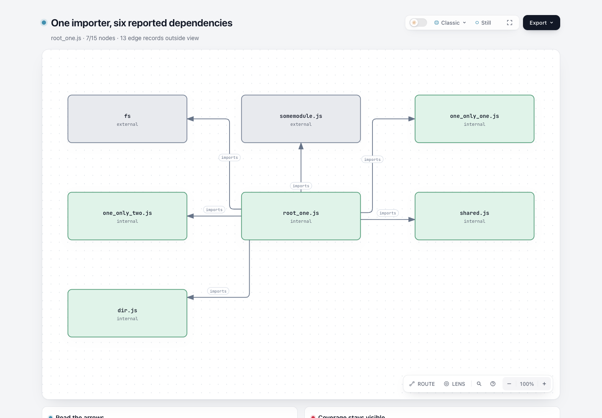
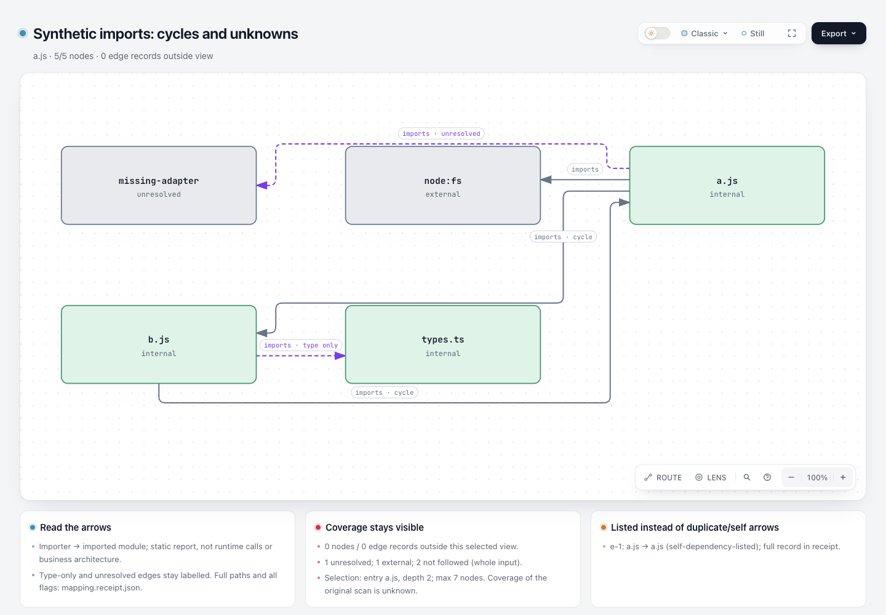

# dependency-cruiser 报告 → Archify 原生局部导入图

这是离线数据转换实验。它消费已有 JSON 报告，生成 `architecture` 原生 JSON、独立 HTML 和完整逐节点/逐依赖映射 receipt。没有扫描器、运行时依赖、服务器或 Viewer 改动，也不运行被分析仓库代码。

基线：Archify `82c7e0f089a02a4d514714adf37dc2061682da5f`。适配器和原创 fixture 按仓库 MIT 许可证提供。上游样例及其 MIT 版权声明位于 `fixtures/`。

## 实际产物

- [官方样例 HTML](artifacts/official/map.html)：从一个 importer 展示六条报告依赖；7/15 节点、6/19 依赖记录在图中，8 个节点和13条记录明确列为视图外。上游这是公开测试示例，并非本轮扫描的生产仓库。
- [官方样例原生 JSON](artifacts/official/map.architecture.json) / [完整 receipt](artifacts/official/mapping.receipt.json)。原报告全部保存在 receipt.originalReport，逐边原始字段在 receipt.edges[].raw。
- [原创 synthetic HTML](artifacts/synthetic/map.html)：双向循环、未解析目标、core external、type-only import，以及显式单列的自依赖。
- [portable 验证摘要](verification-summary.json)：明确为摘录，不冒充原始 finalize/browser receipt。原始收据保留在本机 checkout 之外，由协调者审阅。

协调 Agent 已查看两张实际页面截图：官方样例箭头与节点可辨，synthetic 保留双向循环及未解析/type-only 标签。synthetic 的三条绕行建议仍保留；这只是两个样例的视觉检查，不是人类验收或通用布局证明。独立 Codex 复核了 6 项测试、逐边方向与完整账目，未发现阻止作为受限实验审查的问题。

## 固定来源

官方 JSON 原文：[dependency-cruiser/doc/assets/sample-json-output.json @ 60f8a7ef72cbd69a01f62c61c8efcedd8a67d83c](https://github.com/sverweij/dependency-cruiser/blob/60f8a7ef72cbd69a01f62c61c8efcedd8a67d83c/doc/assets/sample-json-output.json)。输入 SHA-256：`39d507f8ede8dfd12a6b0e0bdea85a61ec5708dde56c892977fb569e0dc490b0`。原样保存，没有重跑工具。该 commit 固定样例文件的来源，**不表示报告当初由此版本生成，也不表示报告里的被分析源码已在此 commit 验证**。

格式依据：[官方输出 schema](https://github.com/sverweij/dependency-cruiser/blob/60f8a7ef72cbd69a01f62c61c8efcedd8a67d83c/src/schema/cruise-result.schema.json) 和 [README](https://github.com/sverweij/dependency-cruiser/blob/60f8a7ef72cbd69a01f62c61c8efcedd8a67d83c/README.md)。许可：[MIT](https://github.com/sverweij/dependency-cruiser/blob/60f8a7ef72cbd69a01f62c61c8efcedd8a67d83c/LICENSE)，本地保留 `fixtures/dependency-cruiser-LICENSE`。样例格式较早，未包含所有当前 schema 的必填字段；本实验校验实际使用的字段子集，既兼容此官方样例，也保留最新 circular/dynamic/typeOnly 等可选布尔字段，**不是完整官方 JSON Schema 验证器**。

## 复现

从仓库根目录运行。实际验证使用 Node `22.23.3`（要求 Node 22），执行器为 Homebrew Node 22。转换不需要 npm install；渲染使用仓库原有依赖（如未准备，按 CONTRIBUTING 的两处 `npm ci`）。不修改 lockfile。

```sh
node --test experiments/dependency-map/convert.test.mjs

node experiments/dependency-map/convert.mjs \
  --input experiments/dependency-map/fixtures/official-sample.json \
  --out experiments/dependency-map/artifacts/reproduced \
  --entry test/cli/fixtures/cjs/root_one.js --depth 1 --max-nodes 7 \
  --title 'One importer, six reported dependencies'

node archify/bin/archify.mjs render architecture \
  experiments/dependency-map/artifacts/reproduced/map.architecture.json \
  experiments/dependency-map/artifacts/reproduced/render.html --quality showcase

node archify/bin/archify.mjs finalize architecture \
  experiments/dependency-map/artifacts/reproduced/map.architecture.json \
  experiments/dependency-map/artifacts/reproduced/map.html \
  --quality showcase --json --out-dir /tmp/archify-dependency-map-reproduced-evidence
```

`--out` 必须是新目录：既有文件/目录/symlink 都拒绝，不提供 force；两个输出文件以 exclusive `wx` 创建。不会递归清理或删除既有路径；IO 中断可能留下本次新建目录中的部分输出，此时退出失败，使用另一个新目录重跑。没有安装/更新任何 live Archify Skill。HTML 的 `meta.output` 使用相对路径；原始带本机路径的 delivery/finalize 收据不纳入公开文件。

`--entry` 精确匹配 report.modules[].source；按 outgoing 报告边 BFS，默认 depth=1，允许0–6；默认 max-nodes=8，允许1–12。不提供 entry 时按 source 字典序选节点；depth 此时不作用于选择。超过上限不会静默截断：receipt 标记 max-nodes 或 outside-entry-depth，逐边记录 outside-selected-view；HTML 显示省略数和选择条件。未入选模块不意味着死代码。

## 保真的边界

- 箭头保持 importer → imported。这里是静态导入报告，不是业务架构、运行时调用、部署拓扑或安全结论。
- 原始每条 dependency 都在 receipt 中。选中节点间的双向循环保留两个有向箭头，不自动断环；报告 circular 标志原样保留，不另写循环检测算法。
- 原生图不绘制自箭头；选中的自依赖在图下卡片逐条明示，receipt 标为 self-dependency-listed。平行导入记录共享一个有向连接，但在卡片/receipt 逐条明示，不假装它们被删除。差异字段以 raw 为准。
- typeOnly/dynamic/unresolved 对绘制的首条连接加可读标签。额外平行记录中的不同 flags 在逐条明示的 receipt 中保留。
- core/npm external、couldNotResolve、followable=false、matchesDoNotFollow、missing target record 均保留。category 是展示分类，原始 flags 可重叠；notFollowedRecords 按 followable/matchesDoNotFollow 统计，可能与 external/unresolved 重叠。
- 源码行号、源代码文本、producer version 和 analyzed commit 不存在时不猜造。输入未提供的扫描覆盖标为 unknown；未扫描文件、动态解析失败不等于无依赖。
- 不生成 #998 code-analysis raw-facts，不复制其扫描/规则/overlay；不与 #1044/#1049 Git-ref snapshot comparison 重叠。
- 这是小图 recipe，自动三列放置可能产生绕行；native finalize 的通过不替代视觉审阅。输入限制32MiB、50k module records、200k dependency records；不是大仓库图平台。

## 验证范围

6个 focused Node tests 覆盖有向语义/循环/自依赖/未知项/平行记录、bounded selection 的完整账目、稳定节点身份、官方输入19条记录、非法报告/参数拒绝、CLI 保留已有输出和 input、拒绝指向已有目录的 symlink。它们保护数据保真和拒绝边界，不冻结布局坐标或私有实现结构。

两个实际产物均运行 public `finalize --quality showcase`；validate、deliver、strict check、真实 browser-check 四阶段结果见验证摘要。另执行 public `render`。未运行全库 test:full：变更只位于独立实验目录，没有共享 renderer、schema、安装、CI 或打包变更。未测试 Windows、生产数据、最新 dependency-cruiser 实际扫描或用户使用收益。图片/独立视觉复审交由协调者完成。

## 本轮实际图片





捕获方法、viewport、产物与图片 hash 见 [capture.json](screenshots/capture.json)。
