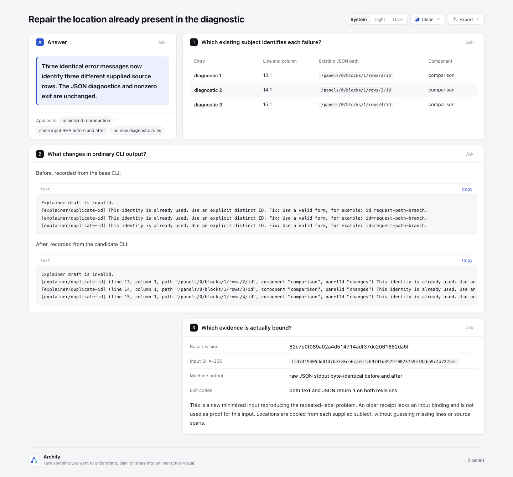

# Diagnostic locations already exist: show them in ordinary text and preview

Three repeated messages can point at three different source subjects. The CLI and preview previously displayed only code, message and fix, so an author reading ordinary output could not tell which supplied row to repair. This change adds a compact location head from the existing diagnostic subject. JSON diagnostics, error identity/count and exit status stay unchanged.

Base: `82c7e0f089a02a4d514714adf37dc2061682da5f`; branch `codex/lab-diagnostic-locations`. Product scope: `archify/bin/archify.mjs`, `archify/bin/preview.mjs`, `archify/renderers/shared/diagnostics.mjs` and refreshed `archify.zip`. No new schema, validation rule, repair engine, source reader or runtime dependency. No version bump, publication or live installation.

## Actual artifact images




Root observed one connected browser session progress from [verified revision 1](screenshots/live-preview-verified.png) to “Needs fix · showing rev 1” after changing only the worker parent. The original Dispatch → Worker graph remained visible; opening the diagnostic displayed `/nodes/1/parent` and `nodeId "worker"`. An initial client that arrived after a failure had no verified revision; that state is not claimed as recovery. The preview process was stopped after capture. [Capture metadata](screenshots/capture.json) binds the static page, current runtime sources and actual screenshots. These are Codex observations, not human acceptance.

## The observed problem and the actual reproduction

The broader payload-delta experiment naturally encountered duplicate first-column labels. Its older receipt retained three subjects, but its original Markdown was later replaced and the receipt had no input SHA. That incomplete old evidence is **not used as a binding for the current input**.

`fixtures/repeated-labels.archify.md` is an explicitly minimized reproduction, **646 bytes**, SHA-256 `fc47419405dd0f47be7e8ce6caebfc6974fd3979f0023759ef82ba9c4a722aec`. Actual public `validate explainer` ran on the same absolute input path and bytes using a base-source copy and the candidate. Both text and JSON commands returned 1. The original machine stdout is byte-identical before/after; its raw hash and actual text hashes are in [binding-summary.json](evidence/binding-summary.json). Original JSON contains local paths and remains outside the checkout; [portable diagnostics](evidence/diagnostics.portable.json) are explicitly derived and omit the input path.

The JSON has three `explainer/duplicate-id` entries with identical messages and distinct subjects: line 13/14/15, column 1, component comparison, row paths 2/3/4. [Before text](evidence/before.stderr.txt) repeats the same message; [after text](evidence/after.stderr.txt) shows each supplied subject. [Comparison page](evidence/comparison.html) presents those actual outputs and input binding.

## Changed presentation and preserved boundaries

Only suitable supplied fields are shown: positive integer line/column, textual path/component/node/nodeId/id/panelId, textual or nonnegative integer block/index. Zero block/index are preserved. Missing, empty or unsuitable fields are omitted; no default line 1, end span, source filename or caret is invented. No file path or URL is opened to enrich an error.

String values are quoted as single-line JSON literals, with control, bidi and Unicode line/paragraph separators escaped. Identical messages with different subjects remain separate. Ordinary messages/fixes remain readable; a diagnostic without a relevant subject keeps its existing text. The JSON data are never mutated by formatting.

Preview uses the existing renderer formatter and then its existing redaction/textContent path. Redaction also recognizes JSON-quoted Windows separators and escaped Unicode path values, so adding a literal head does not bypass existing path masking. Hostile HTML stays text, never an element or executable link. Runtime URL/state/error metadata remain in the preview service, not in the verified diagram artifact.

The CLI intentionally retains its existing self-contained formatter mirror: importing renderer runtime from its bootstrap would prevent `doctor` from inspecting an incomplete installation. The scoped simplification check retained that justified compatibility boundary; preview's duplicate projection was removed by reusing the shared formatter. Existing parity checks and real public CLI tests protect the mirror.

## Fixed research sources and licenses

No upstream implementation or assets were copied. Small mechanisms informed the scope:

- [Codespan diagnostic labels](https://github.com/brendanzab/codespan/blob/b56329354ce0ecbe4afe7c85f7b76417678a5ef8/codespan-reporting/src/diagnostic.rs), commit `b56329354ce0ecbe4afe7c85f7b76417678a5ef8`, [Apache-2.0](https://github.com/brendanzab/codespan/blob/b56329354ce0ecbe4afe7c85f7b76417678a5ef8/LICENSE): preserve supplied locations separately from message text; do not guess byte ranges from a JSON pointer.
- [Miette protocol](https://github.com/zkat/miette/blob/e853bbf9bc78bbe0b225995de54a3108d77dcaf8/src/protocol.rs), commit `e853bbf9bc78bbe0b225995de54a3108d77dcaf8`, [Apache-2.0](https://github.com/zkat/miette/blob/e853bbf9bc78bbe0b225995de54a3108d77dcaf8/LICENSE): separate error facts, labels and help. No Rust dependency is introduced.
- [Pretty TS Errors cache identity](https://github.com/yoavbls/pretty-ts-errors/blob/447966d8f418c9b3e3b13bd50378ce63e1b89e12/packages/vscode-formatter/src/format/getDiagnosticCacheKey.ts), commit `447966d8f418c9b3e3b13bd50378ce63e1b89e12`, [MIT](https://github.com/yoavbls/pretty-ts-errors/blob/447966d8f418c9b3e3b13bd50378ce63e1b89e12/LICENSE): message alone is not location identity; no generic deduplication or external error parser is added.

## Reproduce the public behavior

From the repository root with Node 22:

```sh
node archify/bin/archify.mjs validate explainer experiments/diagnostic-locations/fixtures/repeated-labels.archify.md
node archify/bin/archify.mjs validate explainer experiments/diagnostic-locations/fixtures/repeated-labels.archify.md --json
node scripts/run-tests.mjs --require-files test/diagnostic-locations.test.mjs test/render-failure-diagnostics.test.mjs
node scripts/run-tests.mjs --require-files test/preview.test.mjs '--test-name-pattern=preview: invalid candidates preserve|preview: checker failures'
node experiments/diagnostic-locations/browser-probe.mjs
```

The two validate commands are expected to fail with exit 1. To compare the exact base without replacing the candidate checkout, extract its `archify/` tree into a fresh temporary directory using `git archive 82c7e0f089a02a4d514714adf37dc2061682da5f archify`; run that base CLI and the candidate with the same absolute fixture filename. Keep raw machine outputs outside the checkout because they contain input paths.

For an actual native preview, `node experiments/diagnostic-locations/live-preview.mjs` creates a controlled temporary Tree, waits for verified revision 1, changes its worker parent to a missing parent, then prints PID/loopback URL. It preserves the last verified tree while showing a located failure. Stop that process with SIGINT/SIGTERM when finished. It uses the existing preview service and does not create a browser space or install anything. Runtime descriptors are intentionally not persisted into public evidence.

## Actual validation and package freshness

- Location + renderer diagnostic suites: **29 pass** on Node 22.23.3, including the real three-row public CLI case, missing fields/index zero, controls, unchanged JSON, preview literal rendering, escaped Windows path redaction and incomplete-install doctor.
- Existing preview last-good recovery and checker-detail cases: **2 pass**.
- Core smoke: **19 pass**. The first combined attempt could not import missing `parse5`; it was rerun after read-only reuse of an already present parse5 7.3.0 dependency. No package installation or lockfile change. Initial failed and later successful logs stay outside the checkout.
- A real headless Chrome preview probe passed **7 checks**: both line heads, index zero, literal hostile markup, escaped line separator, no injected element and no executed handler ([probe result](evidence/browser-probe.json)). VM-only checks are not substituted for this browser result.
- The comparison Explainer actually passed public finalize validate/deliver/check/browser-check. [Portable finalize summary](evidence/comparison.portable-summary.json) is explicitly transcribed; raw receipts remain outside checkout. `visualReview: not-requested`; root's screenshots and human acceptance are separate.
- `archify.zip` was rebuilt twice with official **Node 22.23.2 / bundled zlib 1.3.1-e00f703**. Both bytes match the checked-in archive, and the three changed runtime files inside it match current source. Exact extracted-archive package smoke passed on macOS ([ZIP summary](evidence/zip-summary.json)).
- Viewer/template/schema/validator/example sources did not change, so unrelated generated HTML, gallery and validators were not regenerated. No complete repository, Windows, release, deployment or live-install acceptance is claimed.

[Validation summary](evidence/checks-summary.json) records commands and coverage. The scoped test-value check favored observable failure subjects and preview behavior over coordinate or source-line snapshots. No additional diagnostic framework or input parser was justified.

AI assistance: Codex researched, implemented, reviewed and captured this experiment. A separate agent independently reran 6 focused checks and inspected the final source/evidence bindings.
