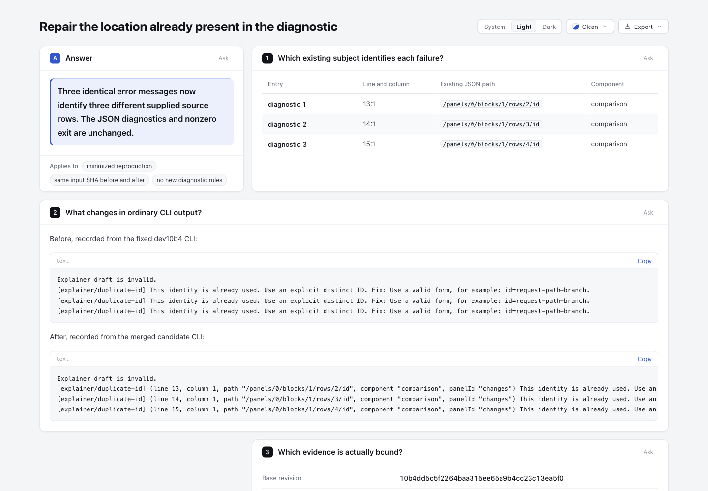
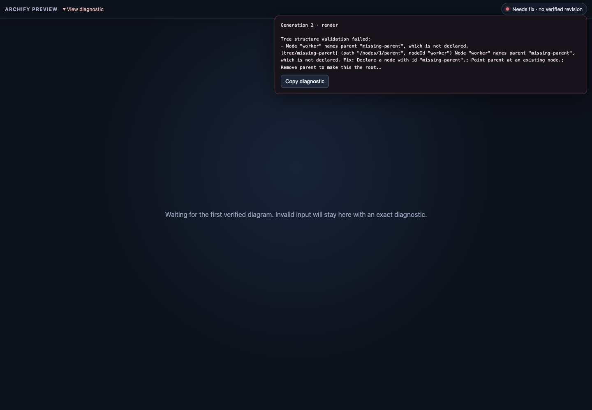
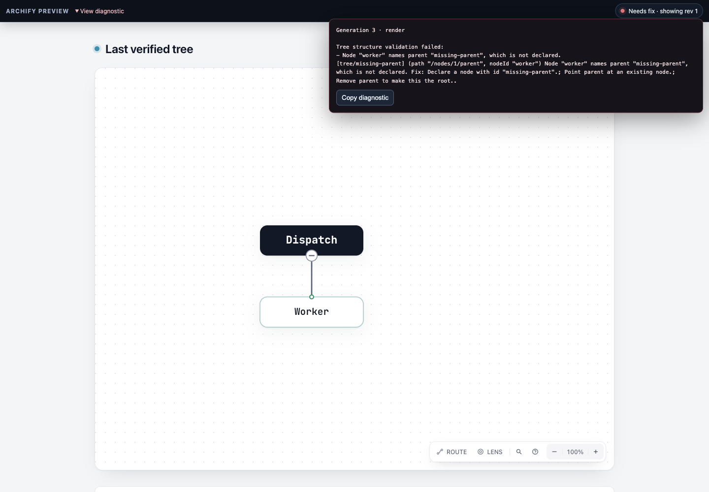

# Diagnostic locations：刷新到 dev10b4

[比较页](comparison.html) 展示同一最小输入的实际新基线与候选 CLI 文本。当前dev仍省略已有subject，因此三个完全相同的duplicate-id消息无法区分行；本候选仍有独立阅读价值，不因#1102已有JSON诊断而重复。没有新增诊断规则、解析器、位置推断或路径打开行为。

## 身份与范围

原分支HEAD `67328d7de5cdf7bd894bfb526682cff9fdc2d10b`，开始时clean；本地origin/dev与`git ls-remote origin refs/heads/dev`均核定完整SHA `10b4dd5c5f2264baa315ee65a9b4cc23c13ea5f0`。正常`git merge --no-commit --no-ff origin/dev`准备整合，仅ZIP二进制冲突，最终按canonical工具链重建解决；提交身份以后续Git历史为准。

相对dev，产品只变三文件：CLI bootstrap formatter镜像、共享renderer formatter、preview调用/quoted-path redaction。保留dev的来源/sidecar/finalize修复，未修改schema、Viewer、layout或检测规则。CLI不直接import renderer以维持不完整安装时doctor可运行，预览复用共享formatter；没有为代码去重破坏该边界。旧实验18份文件（含README与截图）每字节保留。

[固定fixture](fixtures/repeated-labels.archify.md)原bytes：646 bytes、SHA-256 `fc47419405dd0f47be7e8ce6caebfc6974fd3979f0023759ef82ba9c4a722aec`。它是payload-delta编写中重复首列标签问题的明确最小复现，非新生产事故。基线来自真实`git archive 10b4…`；基线和候选用同一绝对fixture路径各运行text和JSON validate，四次均exit1，JSON stdout**逐字相同**。三个diagnostic消息相同，已有subject分别为line13/14/15、column1、不同row path。候选文本才显示这些值。

[base.stderr.txt](base.stderr.txt)、[candidate.stderr.txt](candidate.stderr.txt)是实际stderr原字节（本例不含私人路径）；[diagnostics.portable.json](diagnostics.portable.json)明确为删除subject.input的投影，原JSON留在checkout外。不同错误不因同message合并；缺少、空或不合适的subject值不造默认行号/span/caret。合法0 index/block保留；字符串作为单行literal，preview继续textContent并对JSON引用的Windows路径脱敏。

## 真实预览与浏览器边界

[live-preview.mjs](live-preview.mjs)沿用既有预览流程，在临时目录创建受控Tree，先验证成功revision1，再把worker的parent从root改成missing-parent。实现agent机器runner记录generation2为needs-fix，server保留上一份verified Tree，实际HTML hash与lastVerified一致；这是server机器证据，不声称新打开的客户端已经挂载该图。原native输入与失败输入见[fixtures](fixtures)，[preview-state.portable.json](preview-state.portable.json)记录实际状态。initial输入由runner原声明恢复并按其相同JSON序列化保存，invalid输入从实际临时文件原字节复制；不是从未知日志猜出的生产配置。

Root已用另一个新runner完成实际Ego对照，绑定见下；不以旧截图或先前机器runner的generation2状态冒充新runner后续状态。运行`node experiments/diagnostic-locations/refresh-dev-10b4/live-preview.mjs`会输出私有临时目录和loopback URL，截图完成应停止该进程。原runtime descriptor不放公开记录。

另复用旧browser-probe脚本，在新source上实际运行headless Chrome：7项检查通过（两条line heads、index0、HTML作为literal、line separator转义、无插入元素、无handler执行）。它是受控delivery故障注入，不是自然应用输入；VM检查不冒充浏览器结果，也不宣称AT或完整preview UI验收。

## Root 的新 runner 实际观察

Root 新 runner（PID35621、loopback端口53540）已由root以SIGINT停止。比较页以1440×1000、light捕获；全页PNG原尺寸1440×1406。三行表13/14/15及两段pre DOM分别与实际base/candidate stderr去除末尾LF后的全文相同。长诊断行位于横向滚动代码区，截图不是全文同时可见的保证；DOM原文完整保留。

Native同为1440×1000；预览壳为深色，保留的Tree为浅色，按原图记录，不误写成整页统一light。实际过程：

| 时点 | server实际响应 | 客户端实际状态 |
| --- | --- | --- |
| 晚开：服务先已失败 | g2 needs-fix、revision1、lastVerified存在 | iframe为空，显示“no verified revision” |
| 页面保持打开，恢复同一valid输入 | g2 verified、revision仍1 | 已挂载verified图 |
| 再次改成missing-parent | g3 needs-fix、revision仍1 | 显示“showing rev 1”，保留已挂载Tree；错误含path与nodeId |

晚开空iframe属于已知相邻边界（[#927](https://github.com/tt-a1i/archify/issues/927)、[#930](https://github.com/tt-a1i/archify/issues/930)、[#991](https://github.com/tt-a1i/archify/issues/991)），本轮没有修复，不能把后面的“已打开页面保图”说成late-open restoration成功。旧50738连接被拒绝不计浏览器成功；第一次button CSS定位为0，因为实际披露控件是summary，随后使用实际控件完成展开。记录这些过程，不扩大产品scope。

四张PNG原字节复制，root和实现agent均逐图查看；[capture-metadata.json](capture-metadata.json)记录hash/bytes/IHDR尺寸、HTML及记录绑定。图片时间只标`writtenAtFromFileMtime`，不是独立截图时钟。

| 比较页概览 | 新runner晚开空图边界 |
| --- | --- |
|  |  |



[比较页完整原图](screenshots/comparison-full-light.png)。

`observations/comparison.json`和`late-open.json`是root安全观察记录原字节；`restored-response.json`是实际g2 verified原safe响应，`initial-server-response.json`是root初始g2失败原safe响应。`native-corrected.derived.json`**明确是更正派生记录**：原注释猜测g3/g4，实际为恢复g2、再失败g3；其sourceSha256绑定留在checkout外的错误注释原文件，ui/response字段逐值未改。更正文件没有伪装成originalraw。实现agent先前的`preview-state.portable.json`继续只代表另一个机器runner的初始g2。

没有点击Copy diagnostic或声称OS剪贴板验证，没有AT或完整browser-check gate结论；root实际观察也不等于用户个人human-review confirmation。未重跑未变机器检查，HTML和旧18份文件保持原字节。

## 实际机器验证

- Diagnostic locations与renderer failure selection：29 pass；既有preview保last-good与checker failure：2 pass；core：19 pass。均0 fail/skip。
- generated checks最终全部通过。初次缺simple-icons失败日志保留；仅临时复用已存在、同lock实际依赖entry的renderer依赖，重跑后移除链接。原有root parse5链接未动，无安装或锁文件变化。
- 比较页正常CLI finalize standard：validate/deliver/check通过、0diagnostics；browser-check未请求。[comparison.archify.md](comparison.archify.md)含完整实际before/after文本，不是手改generated HTML。冻结HTML 151318 bytes，SHA-256 `4ac38240359f488ebb28bd887696de46ca6b3b6c6ff90b9f8a81bc1d6abca91b`。
- 官方Node22.23.2 / bundled zlib `1.3.1-e00f703`连续两次ZIP逐字相同：`c8a86faae3858fecd2b0e34085b9b1ca2417831145f27cdb624a7f50717caab2`，235entries inventory与dev包相同、CRC通过，只有三个runtime文件改变且逐字匹配source。
- 实际解包、不安装依赖的package smoke通过。同版本`3.2.1-dev.1`解包CLI再次跑相同fixture，text/JSON均exit1，stdout与stderr逐字等于候选checkout。不是只检查ZIP名称或version字符串。

未运行全仓suite、Windows、hosted CI、发布或活安装；没有拿dev绿色CI替代此整合结果。相关renderer/template/schema源未改变，不重建无关gallery/四例HTML；generated freshness检查用于确认，不能当视觉验收。

## 证据与复查

[evidence-summary.json](evidence-summary.json)公开派生投影绑定输入、三源码、test、CLI原输出hash、ZIP与实际检查。原TAP/finalize/delivery/native state/browser probe和初次准备失败记录保留在checkout外：包括setup遇到既有node_modules后主动停止、生成缺依赖和comparison输入尚未准备的失败；不删失败制造全程通过。

```sh
node archify/bin/archify.mjs validate explainer experiments/diagnostic-locations/refresh-dev-10b4/fixtures/repeated-labels.archify.md
node archify/bin/archify.mjs validate explainer experiments/diagnostic-locations/refresh-dev-10b4/fixtures/repeated-labels.archify.md --json
npm run test:focus -- test/diagnostic-locations.test.mjs test/render-failure-diagnostics.test.mjs
npm run test:focus -- test/preview.test.mjs '--test-name-pattern=preview: invalid candidates preserve|preview: checker failures'
node experiments/diagnostic-locations/browser-probe.mjs
npm test
npm run test:generated
scripts/build-zip.sh
node scripts/package-smoke.mjs <outside-extracted-archive>/archify
```

前两命令预期exit1。需要CONTRIBUTING所列依赖、官方Node及Chrome设置。基线用固定dev归档执行相同绝对fixture；比较页按输入完整正常finalize，raw receipts及delivery sidecar留checkout外。AI assistance：Codex GPT-6.1-Sol评估、整合、验证与记录；自动证据不等于用户个人确认。独立source/machine初审无阻塞；本次截图及ledger交独立reviewer做最终增量核对。
