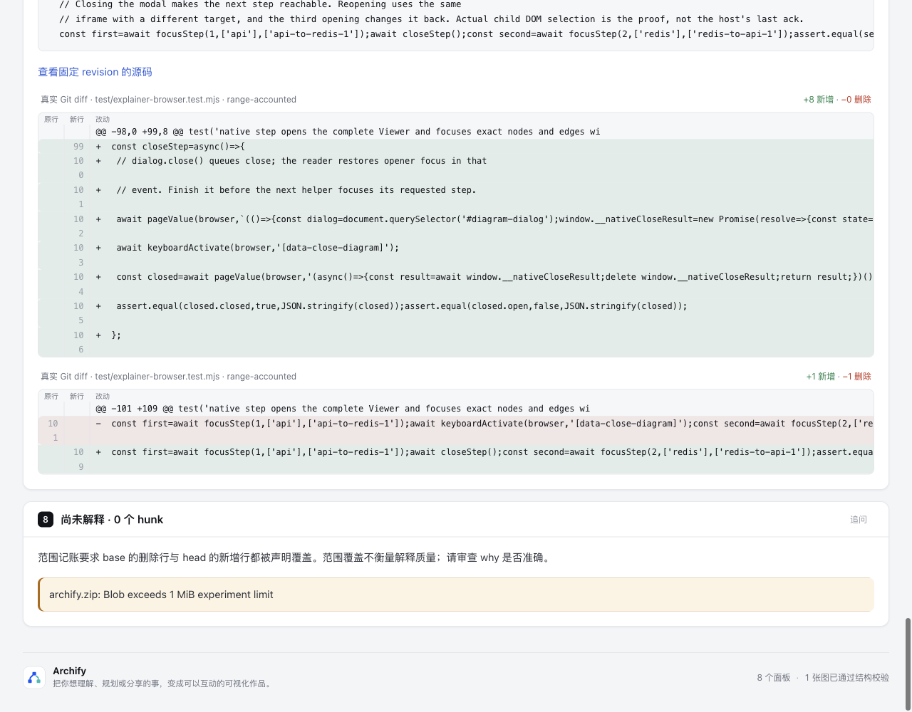
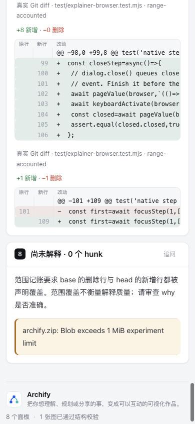

# Diff 行号完整显示 · 局部共享 CSS 修复

真实阅读 PR #1097 的完整 Task review map 页面时，`100`、`101` 和 `109` 等行号被拆成两行。对应的 DOM 数值没有错；共享 Explainer 的通用 `td { overflow-wrap:anywhere }` 与 diff 的窄行号列共同造成了视觉拆分。

- [基线页面](base.html) · [候选页面](candidate.html)
- [完全相同的完整输入](input.explainer.json) · [固定来源](source.json)
- [实际 DOM 观测](browser-observations.json) · [可移植证据摘要](evidence.json)

基线为 `82c7e0f089a02a4d514714adf37dc2061682da5f`。产品源码仅给 `archify/explainer/reader.css` 的 `.diff-code .diff-number` 增加 `white-space:nowrap`，同时刷新 canonical ZIP。没有改 parser、数字值、表格算法、代码换行、普通 comparison table、Viewer、schema 或键盘检查。

行号的最小列宽仍为 36px，左右各 8px padding，三位等宽数字所需空间超过原内容宽度。`nowrap` 让表格为完整数字保留其固有宽度；不为这一次样例硬编码更大的列宽。长代码仍在原 `.diff-scroll` 内横滚。

## 同一真实输入，分别渲染

输入是已公开实验提交 `dcedd53856b82d3e403a9651dca0e15840496942` 中的完整 PR1097 authored-layout Explainer spec，原字节 SHA-256 为 `060fe0536b626f480ec3fa3f3bf81f3a41ad0bb76f640db362dc5a8f095dc3d1`。没有删节点、引用、关系、步骤、长源码或未解析 ZIP，也没有手改生成 HTML。

这里读的是固定 PR `82c7e0f0… → 5f012ab7…` 的源码审阅声明，不是执行该 PR。why 与关系仍为独立 Codex 声明，未经原作者确认；原 Task review map 的 ZIP unresolved 不会变成 pass。两页均由现有 public finalize 生成，validate/deliver/check 通过；**完整 browser-check 未运行**。下面的 focused DOM 检查与该 gate 分开记录，也不声称解决其既有键盘遍历失败。

## 有区分力的实际检查

[check-browser.mjs](check-browser.mjs) 读取实际两页，在 1280px 和 390px、浅深两主题下，使用 Range 文本矩形检查数字是否单行且留在单元格内，并实际改变横向滚动位置，核对长代码末字可达。它不匹配 CSS 源字符串，不复刻 parser，不执行页面中的源码片段。

| 实际结果，每个视口 / 主题 | 基线 | 候选 |
| --- | --- | --- |
| 非空行号数量 | 65 | 65 |
| 视觉拆行行号 | 30 | 0 |
| old/new 行号与完整 diff 文本 | 两页逐项一致 | 两页逐项一致 |
| 最长代码行 | 497 字符，单视觉行 | 497 字符，单视觉行 |
| 横滚后最后一个字符可达 | 是 | 是 |
| 页面宽度 | 等于视口宽度 | 等于视口宽度 |

这个检查在基线必须看到原错误、候选必须全部完整，合计 8 个比较臂；不是把原错误当作一次通过。首次探针错误地假定 URL 的 theme 参数能控制 Explainer，失败后改用既有 CDP `prefers-color-scheme` 设置；该工具设置修正与 CSS 行为修复分开保留。

选择 closest existing checks：`explainer-diff` 与 `explainer-renderer` **25/25**、core **19/19**，均 0 skip；generated 检查通过。没有因单属性改动运行全仓测试，也没有增加镜像 CSS 字符串断言。官方 Node **22.23.2 / zlib 1.3.1-e00f703** 两次 canonical ZIP 构建 byte-identical，包内 CSS 与源码逐字一致；没有 live 安装。

原始 finalize、Chrome、测试、包日志与完整 DOM 回执在 checkout 外；公开 evidence 为选择结果及 hash 的派生摘要，不冒充原始 receipt。协调 Agent 已实际捕获并逐图查看下面的四张截图；物理触屏、辅助技术、用户效果和人类验收未验证。

## 复现 focused DOM 比较

从仓库根执行，使用已有 Chrome 与 Node 22：

```sh
ARCHIFY_CHROME='<Chrome executable>' node experiments/diff-line-numbers/check-browser.mjs \
  experiments/diff-line-numbers/base.html experiments/diff-line-numbers/candidate.html
node scripts/run-tests.mjs --require-files \
  test/explainer-diff.test.mjs test/explainer-renderer.test.mjs
```

两份保存的页面分别绑定基线 / 候选 hash。重新生成候选时，使用同一 input 和新的输出路径运行 public `finalize explainer`；基线应由固定基线源码生成，不能拿候选样式反生成“基线”。

## 已查相关范围

2026-10-25 的 bounded GitHub 查询 `diff in:title` 与 `"diff-number"` 未找到精确匹配；这不等于整个仓库没有相关工作。[PR #1015](https://github.com/tt-a1i/archify/pull/1015) 的宽范围 Explainer polish 同触及 reader.css，但所读 patch 没有修复 `.diff-number`；[PR #1097](https://github.com/tt-a1i/archify/pull/1097) 修的是 pie 诊断的源码行定位，与本次显示代码审阅行号是不同责任。

## 实际前后图

两页均执行同一个 `scrollIntoView` 目标 `#diff-await-close-0`。修复减少了数字折行造成的页面高度，桌面截图受文档底部自然 clamp，锚点 Y 不同；图片没有裁切或编辑来伪装像素对齐。[capture.json](screenshots/capture.json) 保留真实视口、滚动状态、HTML 与图片 hash。[证据账目](ledger.md) 汇总各层绑定。

| 基线 · 1280×1000 | 候选 · 1280×1000 |
| --- | --- |
|  |  |

| 基线 · 390×844 | 候选 · 390×844 |
| --- | --- |
|  |  |

这四张图片是浅色的实际阅读观察；浅深两主题的数字几何及横滚测量见 focused DOM 观测，不拿浅色截图代替深色图片。原 Task review map 的完整键盘 gate 问题不在本次修复内。


## 合入 dev 10b4 后的同输入刷新

上文页面、25/19测试、截图与evidence均保留其82c7/88b历史身份，原字节未覆盖。新比较在 [dev10b4](dev10b4/README.md)：将固定dev `10b4dd5c5f2264baa315ee65a9b4cc23c13ea5f0` 合入本实验分支后，仍仅增加diff行号的nowrap，保留新dev的软件许可与维护行为。canonical ZIP冲突用当前源码正常双构建解决。完整PR1097输入仍为原字节，未执行其中代码或把未解析安装包变成验证通过。

新两页移除唯一nowrap后逐字相等；8臂实际DOM仍为每臂65行号、基线30折行→候选0折行，代码横滚保持。25 focused、19 core、generated通过，均0skip；两页finalize的validate/deliver/check通过，各保留7个相同writing warnings，完整browser-check未请求。公开摘要是外置raw收据的派生记录，不能称零诊断或全浏览器验收。

本轮不顺带刷新四份docs/cases Explainer历史HTML；generated检查不覆盖它们的freshness，也不声称这些旧页面体现候选CSS。已读同dev原参数fresh-render证据，仅用于辨认既有stale差异，未冒充本分支测试结果。
