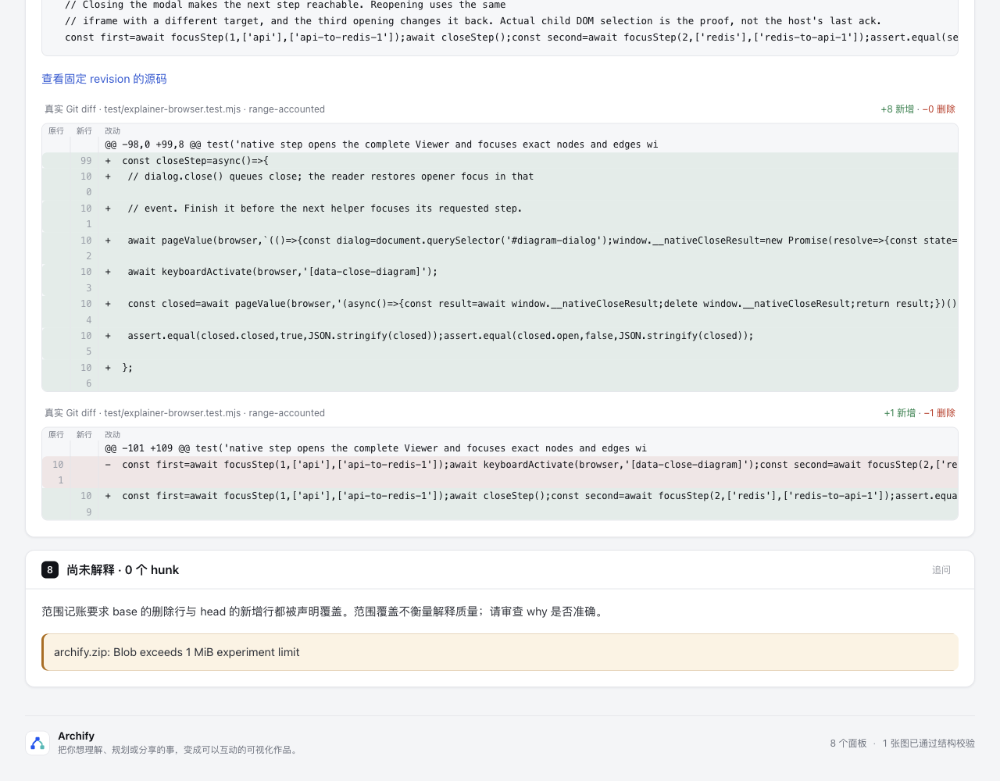
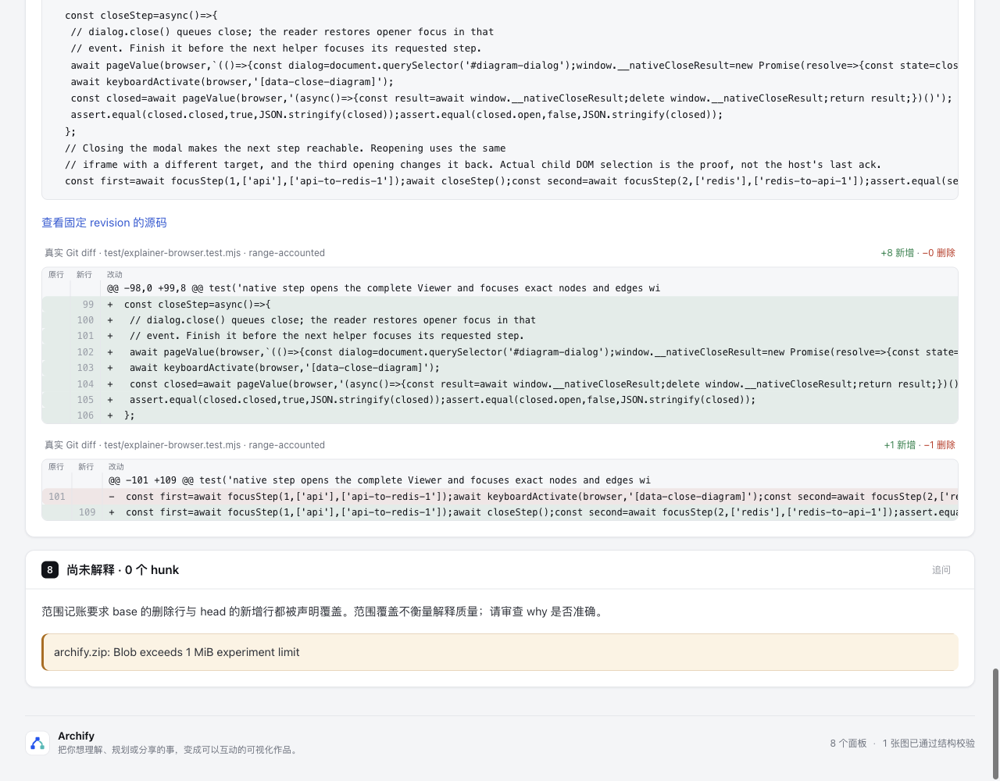
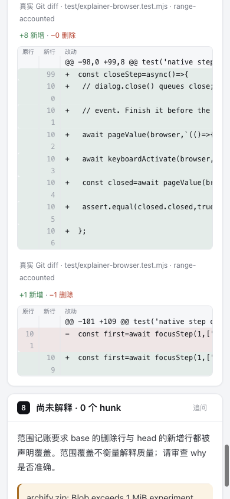

# 合入 dev 10b4 的行号 nowrap 刷新

[新基线](base.html) · [新候选](candidate.html) · [派生证据摘要](evidence.json) · [实际DOM摘要](browser-observations.json) · [证据层级](ledger.md)。完整输入仍是[原始文件](../input.explainer.json)，SHA-256 `060fe0536b626f480ec3fa3f3bf81f3a41ad0bb76f640db362dc5a8f095dc3d1`；[固定公开来源](../source.json)不变。旧页面、原始证据和截图全部保留在上层，不能用新软件身份覆盖旧结果。

基线由固定 `10b4dd5c5f2264baa315ee65a9b4cc23c13ea5f0` 的git archive源码生成。候选是将该dev合入旧候选 `88b0dcb069d89657798e5f1208a90bb2b768fe98` 后的工作树；生成时merge尚未提交，准确身份以evidence中的源码/产物hash为准。唯一冲突archify.zip没有挑任一旧包，按当前源正常重建。软件版本3.2.1-dev.1及Apache-2.0许可来自新dev，不沿用旧MIT软件声明。

产品差异仍仅 `.diff-code .diff-number` 的 `white-space:nowrap`。新两页移除这一个CSS属性后逐字相同；没有删减6节点、6steps、4关系、长代码、独立Codex why/refs或未解析ZIP。来源引用只表示引用吻合，不证明声明语义正确、原PR作者认可、PR测试执行或ZIP内容通过验证。

| 本轮实际检查 | 结果 |
| --- | --- |
| 1280/390px × 浅深色 × base/candidate | 8臂通过；每臂65个行号，base30拆行、candidate0拆行 |
| 内容与局部横滚 | old/new身份与完整代码逐项相同；497字符长行保持单行，尾字符实际横滚可达，页面不横溢 |
| focused：explainer-diff + explainer-renderer | 25通过、0失败、0skip |
| core smoke | 19通过、0失败、0skip |
| generated | 通过；不涵盖docs/cases Explainer freshness |
| 两页public finalize | validate/deliver/check通过；browser-check未请求/未运行；各7个相同writing warnings |
| canonical ZIP | 官方Node22.23.2/zlib1.3.1-e00f703双构建字节相同；全部成员CRC通过、包内CSS等于源码 |
| 实际解包运行 | 同一输入/同相对输出位置由解包CLI finalize前三阶段通过，HTML逐字等于候选；未请求完整browser gate |

没有新增测试或替换门槛。复用上层[check-browser.mjs](../check-browser.mjs)作真实Range矩形/横滚比较；它与完整键盘gate分开。本轮没有重跑旧Task review map的完整browser gate，也不称已修复其遍历限制。两页7个writing warnings保留；为CSS比较未重写原审阅内容。

## 复现与证据口径

候选从仓库根，以Node22执行：

```sh
node archify/bin/archify.mjs finalize explainer \
  experiments/diff-line-numbers/input.explainer.json \
  experiments/diff-line-numbers/dev10b4/candidate.html --json --out-dir '<private receipt directory>'
node experiments/diff-line-numbers/check-browser.mjs \
  experiments/diff-line-numbers/dev10b4/base.html experiments/diff-line-numbers/dev10b4/candidate.html
node scripts/run-tests.mjs --require-files test/explainer-diff.test.mjs test/explainer-renderer.test.mjs
```

基线须由10b4固定源码在同一输入/输出目录结构下生成；不能从候选CSS反造“基线”。`evidence.json`是明确派生摘要：原始命令stdout/stderr、finalize/delivery收据、Chrome完整观测与包日志保存在checkout外，仅发布相对键名与真实hash/bytes。解包初次输出到不同临时目录时，诊断input相对路径不同，HTML因此不逐字同；该原始结果保留，随后按相同相对输出位置核对消除了位置差异，没有改输入/软件凑hash。

四份docs/cases Explainer保留tracked历史HTML，以避免把dev既有stale更新并入单属性修复。只读复用source-keyboard作者的同10b4归档源码、同MD/standard/原输出相对参数fresh-render证据辨认该差异；没有增加--repo-root，不把对方候选或结果当作本分支通过。旧四页不声称反映本CSS；详细hash见evidence.docsCases。

## Root实际前后图

Root在新两页上实际捕获并逐张查看四图；本agent只核文件hash/bytes与摘要绑定，未打开Ego。[capture.json](screenshots/capture.json)记录HTML、PNG、视口、主题、原观测hash与真实滚动值。

| 新dev基线 · 1280×1000浅色 | 新dev候选 · 1280×1000浅色 |
| --- | --- |
|  |  |

| 新dev基线 · 390×844浅色 | 新dev候选 · 390×844浅色 |
| --- | --- |
|  |  |

四图使用同一`diff-await-close-0`的scrollIntoView目标；桌面因候选文档更短、自然末尾clamp，anchorY为base129.27/candidate313.27，没有裁切或编辑来制造像素对齐。Root原观测中100至106七个数字base均2个Range rect、candidate均1个；这是该截图位置的观测，与覆盖全部65数字/两主题的8臂DOM比较分开。图片仅浅色，不能拿它们充当深色图片或完整键盘gate。

物理触屏、辅助技术、读者收益及人类验收均未验证，没有live安装、修改dev/main或推送。
