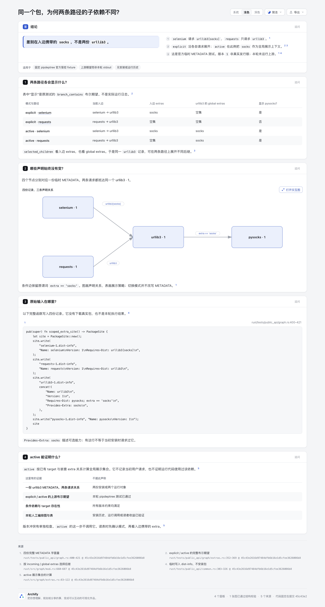
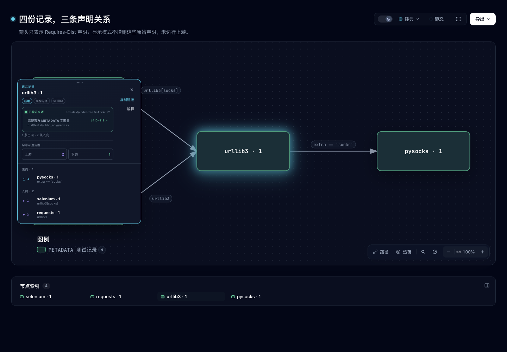

# Edge-scoped extras：同一个包，为何两条路径的子依赖不同？

这是一项有界内容试验，用现有 Architecture 和 Explainer 解释**入边携带的 extra 会影响可见后继**。四份临时 METADATA 只有一个 urllib3；explicit 模式下，selenium 分支展开 pysocks，requests 分支不展开。active 模式的展示策略使两条分支都展开。原声明没有随模式改变。

- [中文解释页](output/explanation.html)：表格比较当前入边、入边 extras、global extras 与布尔期望。
- [独立原生图](output/metadata.html)：四个 METADATA 记录、三条 Requires-Dist 声明/请求关系。
- [唯一图输入](metadata.architecture.json)、[解释页草稿](question.archify.md)、[事实审计](fact-audit.json)。独立图与解释页内嵌图使用同一份 spec；child HTML 与独立 HTML 逐字相同。

这是官方受控测试场景的人工解释，**不是生产安装报告或本轮 pipdeptree stdout**。version=1 是测试值，不是真实发行版。没有执行上游 Rust/Python、安装包或运行被描述的代码；没有验证读者收益。

## 来源与完整输入

上游 [tox-dev/pipdeptree](https://github.com/tox-dev/pipdeptree/tree/45c43e2616d97484dfb6b16e1d5cfee3626086b8)，固定 revision `45c43e2616d97484dfb6b16e1d5cfee3626086b8`，完整 MIT [LICENSE](upstream/LICENSE) 与五个 source/test 文件保持原始字节；[manifest](upstream/manifest.json)列每份完整文件的 SHA256/bytes/固定链接。

- `rust/tests/public_api/graph.rs:400–421`：完整 `scoped_extra_site` 写四份 METADATA；`PackageSite` 在 `common.rs:303–326` 只写临时 dist-info。
- `rust/tests/public_api/graph/extras.rs:352–369`：原测试只断言两模式的 branch_contains 布尔值，没有提交此 case 的完整 JSON export。本页不编造该 export。
- `rust/src/graph/mod.rs:660–687`：选择后继时考虑 incoming extras 与 global extras。
- `rust/src/graph/extras.rs:83–122`：active 依据已有 target 与嵌套 extras 关系计算展示集合。此步骤未调用独立版本冲突检查；不能从 active 推出版本约束正确、当初请求或运行历史。

[input-derived](input-derived/) 四份 METADATA 由原函数的字符串解码/concat 拼接派生，不是执行 PackageSite 或复制安装现场。完整原函数仍可在固定源中复查；提取步骤在 [audit-facts.py](audit-facts.py)，没有通用 resolver/parser 合同。

来源许可与原创叙述分开见 [NOTICE](NOTICE.md)。Archify 运行基线为 `10b4dd5c5f2264baa315ee65a9b4cc23c13ea5f0`（Apache-2.0 及项目 notices）；未修改产品、schema、Viewer、Skill、依赖或 ZIP。第16轮研究的“0 启动”结论保留原样；本阶段在用户既有探索授权内选定一个有界内容试验，不将研究否决改写为早已证明价值。

## 这项内容多解释了什么

Task occurrences 解释多个打印位置对应同一身份。这里除同一身份外，还需保留**当前请求携带的 extra 与显示模式**：同一 urllib3 可以在两个路径位置呈现不同后继。图只画三条原始声明，mode 表独立描述上游展示期望，避免用不同着色/边删除制造两份安装。

现有节点 Passport 和 SourceCard 可核原字符串与固定 Git 片段。不增加开关、播放器、动态解释器、环境探测器或安装分析。active 是 producer 计算策略，不是运行依赖证明。

## 实际验证与保留失败

内容影响仅限本目录。按 test-value 选择完整源字节/派生输入/编译产物审计与公共 CLI finalize；不加产品回归测试，不运行全仓 suite，不因内容新增重建 ZIP。

1. `python3 experiments/edge-extras/audit-facts.py` 实际通过：完整六文件字节、四条 METADATA、两模式原布尔期望、四个节点/三条关系、编译后四行表、全部五个 SourceCard ID/range 集合及原文件上界、全文 hash/excerpt、草稿 sourceText、唯一 spec、child HTML/SVG 与独立产物一致。
2. 独立 Architecture：validate / deliver / check / browser-check **四阶段 pass**，browser requested=true/ran=true，0 diagnostics。
3. Explainer 显式请求 browser-check：前三阶段 pass，browser-check **fail**。finalize 与原始 browser receipt 均为 **28 条 keyboard-traversal**；readability 与 containment pass。stdout只展示8条、另20条省略。未把此失败改称通过，也未混入另分支的检查器修复。
4. 首次缺 `--repo-root`、源码仓库缺 origin、表格重复首列触发 duplicate-id，均在外置收据保留；随后补来源并将首列明确为“模式·路径”。首个可渲染版本的图宽1010，1280 viewport 有9.932px readability失败。只收紧两个节点的 x 坐标到宽920后，再真实 finalize 两份产物；四节点、三条边、全部标签与原声明不变。旧图、草稿及第一次浏览器失败收据未覆盖。
5. 固定 `10b4` 的键盘扫描存在另行研究的预算限制；本目录不修改 gate，也不单凭该背景断言28条全部无害。root 另行完成的实际指针/视觉观察在末节记录，与自动浏览器阶段分开。

Root 对29个 staged 文件核对后运行 `git diff --cached --check`，实际 exit2：仅两份生成 HTML 共35处 trailing whitespace（解释页16处、原生图19处）。这是 CLI 原始输出；为保留产物与收据哈希，没有清理生成字节，也不将该非零检查写成通过。

完整机器收据含本机路径，保留在 checkout 外。[portable-summary.json](portable-summary.json)是明确派生摘要，绑定输入/输出/公开文件和外置收据hash，不冒充未脱敏原件。[ledger.md](ledger.md)区分来源、作者输入、产物与机器阶段。

## 复现命令

Node `22.23.2`。先准备官方固定 revision 的 Git 仓库，核 origin 与 HEAD；Archify 的 `--repo-root` 只用于校验/摘录，不运行上游。`<fixed-upstream-repository>` 是占位符，替换为自己的本地路径。

```sh
python3 experiments/edge-extras/audit-facts.py
node archify/bin/archify.mjs finalize architecture experiments/edge-extras/metadata.architecture.json experiments/edge-extras/output/metadata.html --repo-root <fixed-upstream-repository> --quality showcase --json --out-dir <private-native-receipts>
node archify/bin/archify.mjs finalize explainer experiments/edge-extras/question.archify.md experiments/edge-extras/output/explanation.html --repo-root <fixed-upstream-repository> --browser-check --json --out-dir <private-explainer-receipts>
```

首次生成前运行 audit 会因产物尚不存在而失败；它用于生成完成后的内容绑定复核。finalize 原始 delivery receipt 不应直接发布；复现后留在自己的私有收据目录。未安装或更新任何 live Skill；复用现有依赖的临时 symlink 在收尾时移除。

## 实际图片与交互边界

Root 在 Ego / Chromium 实际操作并逐张 `view_image` 看过以下六张终版图；作者仅逐字节复制，核 SHA256、bytes、PNG 尺寸及冻结 HTML 绑定，没有代称自己运行浏览器。[root-capture-summary.json](screenshots/root-capture-summary.json) 是 root 编写的明确派生观察摘要；原始 observations 含本地 URL，继续保留在 checkout 外。解释页 `65252752…3d7a8` 与原生图 `e40d5795…9312c` 未变。



桌面 viewport 为 1440×1000，整页 PNG 为 1440×2690。实际显示四行模式表与完整 authored code；document 宽1440。Root 从解释页实际按钮打开[深色交互原生图](screenshots/explainer-interactive-dark.png)，随后关闭成功。



Root 在独立原生图实际点击 `#node-urllib3`，Passport 显示1条出向、2条入向、原条件与固定 L410–418。实际点击 Explain 并等待有限动画结束后，[ready 图片](screenshots/native-explanation-dark-ready.png)显示完整 urllib3 METADATA 字段；它们在一个 paragraph 中显示，不声称保留原换行。第一次过渡空面板图未发布，原文件仍在私有目录，hash `f08f6748…7f7c94` 及原因在摘要中保留；没有用它冒充终版。

[手机完整解释页](screenshots/explainer-mobile-light.png)为390×844 viewport、390×3493整页图。表格容器332px，内容586px，不能同时看到全部列。[表格右侧图](screenshots/mobile-table-right-light.png)通过 DOM 设置 `scrollLeft=253.5` 得到，非触摸手势；最右表头与“是／否／是／是”在可见边界内，左列此时被表格 viewport 裁切。手机图缩略字较小，有现有“打开交互图”提示；没有覆盖手机完整原生交互验收。

Root 的 citation 点击只到来源 footer，不声称 SourceCard 弹窗/摘录交互已验证，也未访问外部源链接。先前 `button:text-is urllib3` selector 匹配0、embedded sidebar 点击未呈现 Passport 的尝试均在摘要保留；改读 DOM 后使用真实节点点击才成功，未把 driver 尝试当产品缺陷。

这些指针/视觉观察不能抵消28条机器键盘诊断。没有 root 完整键盘遍历、触摸、辅助技术、跨浏览器、安装正确性、上游执行或读者效率验收。模式表仍是上游 expected，不是 root 执行 pipdeptree 得到的结果。
