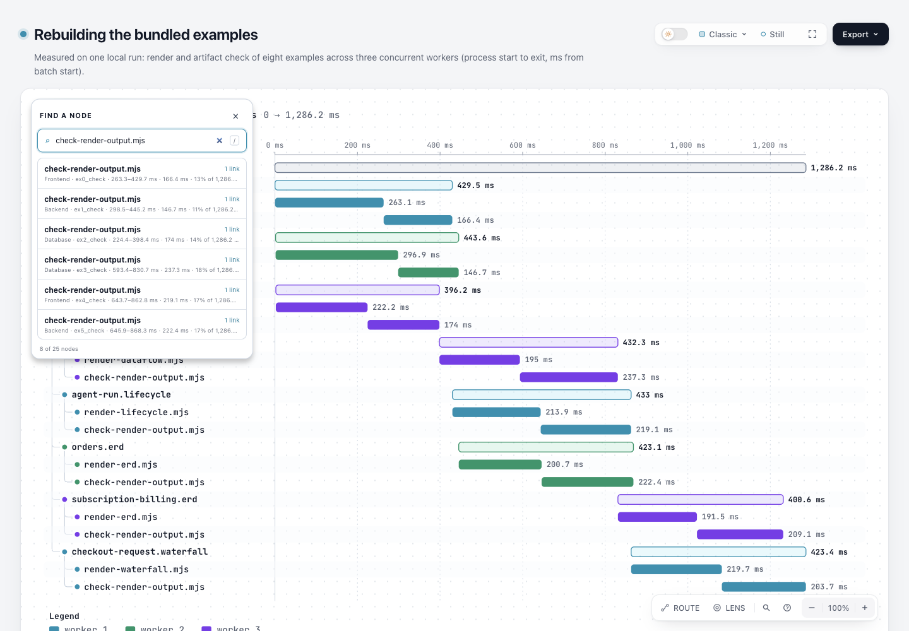

# Finder results expose their existing visible metadata as descriptions

Eight rows in the bundled measured `example-rebuild.waterfall` share the action name “Focus check-render-output.mjs, 1 related connection”. Their visible small text already distinguishes the span ID, type and timing, but those buttons had no accessible description. This patch links each button to that same small element with native `aria-describedby`.

Base: `82c7e0f089a02a4d514714adf37dc2061682da5f`; branch `codex/lab-finder-context`. Product source change is confined to `viewer/node-finder.js`. There is no new state model, context extraction, dependency, schema, localization string or SVG role change. Action names, visible text, tooltip text, ordering and keyboard selection remain unchanged.

## Existing metadata, not a second description algorithm

The description is exactly existing `small.textContent`: localized type, ID, sublabel and tag. Existing `item.context` remains **tooltip-only** in `small.title`; this patch does not append it to the accessible description or claim that every context field is spoken.

Each rendered row receives its own Viewer-namespaced metadata ID and references that same element. Filtering removes previous rows and rebuilds current valid references; the generated description IDs are not a stable node identity or cross-query persistence contract. Empty metadata does not receive a dangling reference. No neighboring row's metadata is copied, and all values still use the existing literal `textContent` path.

## Fixed natural input and actual observations

[Input](input.waterfall.json) is a frozen copy of the existing measured repository example, not a newly measured workload. It remains unchanged at SHA-256 `77d610013a5aab031df739c207b66ebc26e1740371b51da06956ecf06b5e9929`.

- [Base](base.html), SHA `4dc89cfefc54305319f42db08c7f89a40db7f844e311510bb711ab6e3f5eb149`.
- [Candidate](candidate.html), SHA `01818f5c1d96e1d1ac3bbce79999df1938ae3dd1997daceddc125dfa078fe5bf`.
- Authored Waterfall SVG bytes are identical; only the surrounding Viewer script changes. [Binding summary](evidence/binding-summary.json) records source/template/input/artifact hashes.

The coordinator inspected the actual Chromium accessibility tree in its existing browser space at 1440×1000:

- [Base AX](screenshots/base-ax.json): eight result buttons have the same action name and no description.
- [Candidate AX](screenshots/candidate-ax.json): the same eight names remain unchanged; each description contains its own `ex0_check`…`ex7_check` and existing type/timing metadata.
- [Keyboard result](screenshots/keyboard-selection.json): actual ArrowDown, ArrowDown, Enter selects `ex1_check`; the existing Passport shows `worker 2 › agent-tool-call.workflow` and that ID.

[Candidate Finder screenshot](screenshots/candidate-finder.png), [base screenshot](screenshots/base-finder.png) and [keyboard screenshot](screenshots/keyboard-selection.png) were captured and viewed by the coordinator. The images show the UI; **the AX records establish the description change**. [Capture metadata](screenshots/capture.json) binds actual images, source artifacts and observations. A first follow-up selector used `aria-label` while the Passport is named with `aria-labelledby`; that selector miss remains recorded and is not treated as a product failure.

This is Chromium AX and keyboard evidence only. It does not establish VoiceOver/NVDA behavior, cross-AT acceptance, actual speech output, human acceptance or faster task completion.



## Research source and license

The scoped idea follows [Data Navigator's separation of navigation semantics from visual representation](https://github.com/cmudig/data-navigator/blob/fa9ecb416ea209c0fe9d732275dcad4d6a4a3b54/packages/data-navigator/src/rendering.ts#L152-L186), commit `fa9ecb416ea209c0fe9d732275dcad4d6a4a3b54`, [MIT](https://github.com/cmudig/data-navigator/blob/fa9ecb416ea209c0fe9d732275dcad4d6a4a3b54/LICENSE). That source explicitly supplies `semantics.label`; it is not the implementation of this patch. No upstream code/assets or new runtime were copied. The native relationship uses [WAI-ARIA 1.2 aria-describedby](https://www.w3.org/TR/2023/REC-wai-aria-1.2-20230606/#aria-describedby).

## Reproduce and validate

From the repository root with Node 22 and an existing Chrome executable:

```sh
node scripts/generate-viewer.mjs
ARCHIFY_CHROME=/path/to/chrome node scripts/run-tests.mjs --require-files test/finder-browser.test.mjs test/toolbar-keyboard-browser.test.mjs
node scripts/run-tests.mjs --require-files test/core-smoke.test.mjs
node archify/bin/archify.mjs finalize waterfall experiments/finder-context/input.waterfall.json experiments/finder-context/repro.html --json
```

Actual checks on the frozen source:

- Finder/browser and toolbar suites: **13 pass, 0 fail, 0 skip**. Added natural repeated-label Waterfall coverage checks per-row valid unique references, filtering/empty/redraw, no cross-row metadata leakage and keyboard selection of `ex1_check`. Controlled DOM-boundary fixtures check literal hostile values and an empty metadata row; they are not claimed as valid authored schema examples.
- Core smoke: **19 pass**. Existing lock-matching test dependencies were reused read-only; no package installation or lockfile change.
- Viewer, brand marks, generated validators and release-identity checks: exit 0. Final golden checks pass. An initial golden run identified the legacy manual `examples/web-app.html` Finder fragment as stale; it was re-derived only from the changed authoritative Finder fragment, then the check passed.
- Checked-in Gallery and Checkout comparison reproduction: **2 pass**.
- The candidate actually passed public finalize validate/deliver/check/browser-check. Its [portable summary](evidence/candidate.portable-summary.json) is clearly transcribed; original delivery/finalize/browser receipts remain outside the checkout. `visualReview: not-requested` belongs to that automated finalize run, separate from the coordinator's later actual screenshot/AX review.
- Canonical ZIP built twice with official **Node 22.23.2 / bundled zlib 1.3.1-e00f703**; both bytes match `archify.zip`. Its template includes the exact authoritative Finder fragment and all 15 packaged example HTML files match current source. The exact extracted archive passed package smoke on macOS. [ZIP evidence](evidence/zip-summary.json).

[Check summary](evidence/checks-summary.json) records commands and coverage. No full repository, Windows or cross-AT suite was run; no release, deployment or live Skill installation occurred.

## Generated scope and maintenance cost

Required regeneration is limited to the shared Viewer template, 15 development and 15 packaged golden examples, the manual web-app example's affected Viewer fragment, Checkout compare artifact/receipt, Gallery artifacts/manifest/page and canonical ZIP. Their source geometry/content stays unchanged. Unrelated Guide/Start/README GIF, schemas, validator output, brand output and versions were not changed.

The test-value check protects observable description associations and selection rather than freezing particular generated ID strings or coordinates. A separate accessibility graph, copied context state or custom announcement system would add maintenance without evidence of benefit for this gap.

AI assistance: Codex researched, implemented, independently reviewed and captured this experiment. The browser and code evidence are agent checks; human and cross-AT acceptance remain unverified.


## 合入dev10b4后的同输入刷新

旧base/candidate、输入、截图与原证据继续保留原82c7/5b770身份。最新[refresh-dev-10b4](refresh-dev-10b4/README.md)按固定dev10b4正常merge后重建同一完整input，两页和解包CLI四gate均pass；26focused/19core及完整generated通过，31规定HTML正常再生。root新三图及真实8行AX描述/键盘选择均独立绑定，不用新软件身份覆盖旧结果。完整失败尝试、未刷新manual/gallery/docs边界及当前未提交merge身份见新摘要。
