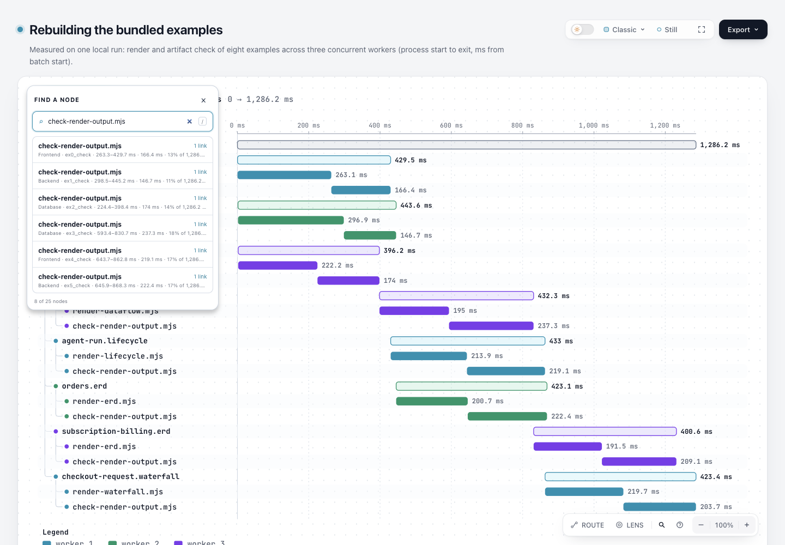

# Finder既有结果描述：合入dev10b4后刷新

同一个完整[测量样例输入](../input.waterfall.json)，八个结果同名，但已有可见type/id/timing元数据不同。本候选只把按钮的`aria-describedby`关联到自己的small元数据；name、可见文本、tooltip-only context、筛选/排序/选中语义不改。没有新提取算法、状态模型、依赖、schema或本地化文案。

- [固定10b基线](base.html) · [合并候选](candidate.html)
- [root真实AX/DOM与键盘派生记录](root-observations.json) · [截图绑定](screenshots/capture.json)
- [派生证据摘要](evidence.json) · [证据层级](ledger.md)



[基线截图](screenshots/base-finder.png) · [键盘选中ex1_check](screenshots/keyboard-selection.png)。Root已在1440×1000/light/Classic/Still实际截取并查看三图。可见UI本来相同，图片本身不能证明accessible description；真正差异来自实际Chromium AX树。它不是VoiceOver/NVDA、实际发声、跨AT、人类验收或任务效率证明。

## 固定身份与历史

产品基线`10b4dd5c5f2264baa315ee65a9b4cc23c13ea5f0`已合#1102。旧实验分支HEAD仍`5b7701c170dabf5d204f3d220ebdb9d39fe178d2`，MERGE_HEAD为该dev；本刷新交付时merge尚未commit，候选由source/template/ZIP/HTML摘要标识，不冒充远端新head。原目录14个非README文件原字节保存，上层README只追加本刷新链接；旧截图/旧base身份不改。

输入4617 bytes，SHA256 `77d610013a5aab031df739c207b66ebc26e1740371b51da06956ecf06b5e9929`，仍是仓库已记录的一次measured workload，不是本轮重新采集。新base从固定dev的git archive正常finalize；候选从合并源正常finalize。两完整HTML仅Finder的index与4行描述关联不同，SVG及其余字节均相同。软件版本3.2.1-dev.1/Apache-2.0及历史MIT/NOTICE保留新dev，旧82c7实验继续属于旧证据。

## 实际验证与范围

| 层 | 本轮结果 |
| --- | --- |
| 同输入public finalize，两页 | validate/deliver/check/browser-check四gate均pass，0diagnostics；原生Waterfall路径，不沿用其他Explainer例的browser未请求状态 |
| 原有focused browser tests | finder-browser + focus-browser，26pass、0fail、0skip；保留新dev IME组合键等既有检查，加上原候选重绘引用/空元数据/literal/选择边界 |
| core | 19pass、0fail、0skip；与最终产品源码一致，后续只正常再生输出 |
| 完整generated | 四项check + test/golden.mjs通过；不是只跑四check。初次真实报告31stale后，按正常renderer再生15×2规定examples及web-app.html，再跑全命令通过 |
| 最终canonical ZIP | 官方Node22.23.2/zlib1.3.1-e00f703双构建逐字相同，235成员CRC正常；包内template/许可与当前源一致，package.json按canonical stage移除开发scripts/devDependencies |
| 解包CLI | 同输入public finalize四gatepass、0diagnostics，实际解包输出HTML逐字等于候选 |
| 实际AX | base八同名按钮无description；candidate八description各等于本行已存在visible metadata，name保持相同 |
| 实际键盘 | root及作者最终探针均从输入ArrowDown两次到ex0/ex1，再Enter选ex1_check，Passport保留worker 2上下文 |

完整公开input没有裁切。元数据仍经textContent字面路径；context只在title，不承诺其被描述或发声。generated的指定范围外，gallery/manual页面与四份docs/cases Explainer保留10b tracked字节，未宣称本轮fresh；不为了窄diff跳过freshness，也不顺带重新发布站点。

## 失败与修正没有隐去

Homebrew Node22.23.3带zlib1.2.12，首次canonical ZIP命令被现有guard拒绝；保留失败日志后换用已有官方Node22.23.2，未修改guard。第一次完整generated真实报31stale；随后正常renderer再生31份HTML，不手改HTML/ZIP或清空diff。31新HTML逐份反向去掉Finder关联后，均与10b对应tracked HTML逐字相同，未改geometry/label/静态输入。

作者额外AX+键盘探针两次只发keyDown/keyUp、没有Enter文本，未获得按钮选择，原始失败和两版probe源码留在checkout外。最终补全CDP Enter文本并记录逐键activeElement，base/candidate均ex0→ex1并选择成功；这是采集驱动修正，未修改产品键盘逻辑，也未关闭失败断言。root独立采集没有这些探针失败，不把作者失败塞到root截图记录中。

## 复现与证据层级

仓库根、已有Chrome及官方Node22可运行：

```sh
node archify/bin/archify.mjs finalize waterfall experiments/finder-context/input.waterfall.json experiments/finder-context/refresh-dev-10b4/new-candidate.html --out-dir '<private receipts>' --json
ARCHIFY_CHROME='<Chrome executable>' node scripts/run-tests.mjs --require-files test/finder-browser.test.mjs test/focus-browser.test.mjs
ARCHIFY_CHROME='<Chrome executable>' node experiments/finder-context/refresh-dev-10b4/check-accessibility.mjs experiments/finder-context/refresh-dev-10b4/base.html experiments/finder-context/refresh-dev-10b4/candidate.html
npm test
npm run test:generated
bash scripts/build-zip.sh
```

基线须从固定10b源生成，不能从候选反删CSS/JS冒充基线。`evidence.json`与capture是明确的可移植派生摘要；raw stdout/stderr/finalize收据/完整AX树/包日志在checkout外，摘要用相对键名保留真实SHA/bytes，不复制个人路径。Root记录以白名单投影，完整AX原树未嵌入公开页面。含本机路径的原delivery sidecar也移至checkout外；公开副本保留原HTML字节，不声明复制后物理文件具有current provenance。根协调agent负责截图/最终整合；作者未使用Ego空间或安装live Skill，未commit/push或把未运行CI称pass。
