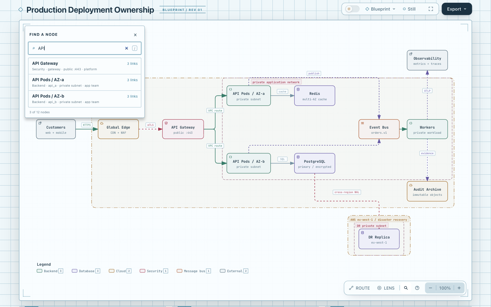
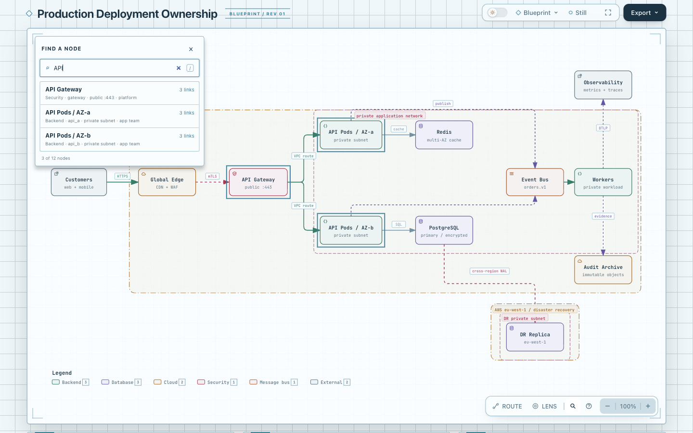
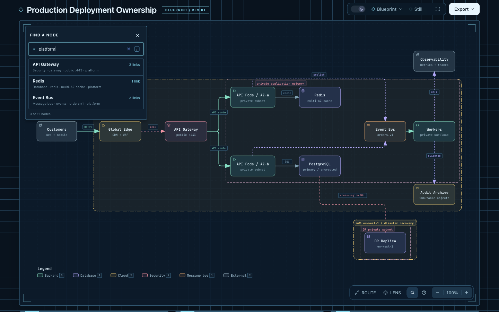
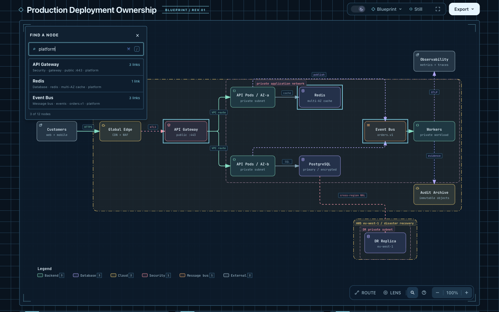

# Finder canvas matches — experimental candidate

Typing a non-empty ordinary Finder query outlines the same node IDs shown in
its result list. The existing graph, authored colors, selection, camera and URL
stay unchanged. Clearing the query, closing Finder, a zero-result query or
switching to an endpoint picker removes the temporary markers. Choosing a
result retains the existing focus-and-reveal behavior.

This is an isolated experiment based on `82c7e0f089a02a4d514714adf37dc2061682da5f`.
It has no merge, release, deployment or live-install acceptance. The visual cue
is inspired by the [Sigma search interaction tutorial](https://www.sigmajs.org/get-started/add-interactivity/);
no external rendering library or source code was added.

## Fixed comparison

Open [base.html](base.html?theme=light) and
[candidate.html](candidate.html?theme=light) in the same browser at 1440×900,
100% browser zoom, initial Fit, Blueprint and Still. Repeat with `theme=dark`.
Use the Find control to enter `API`, then `platform`; also inspect an absent
query and close Finder. Keep the same camera and scroll position between arms.

Both HTML files are rendered from the original
[`production-deployment.architecture.json`](../../archify/examples/production-deployment.architecture.json),
without IR edits. Input and artifact SHA-256 values are in [receipt.json](receipt.json).

| Query/state | Expected ordinary list and candidate canvas IDs |
| --- | --- |
| `API` | `gateway`, `api_a`, `api_b` |
| `platform` | `gateway`, `redis`, `events` |
| absent query | empty result list and no canvas match markers |
| empty input or closed Finder | no canvas match markers |
| Route source/target picker | Route keeps its existing emphasis; no Finder match markers |

The baseline has the same lists and selection behavior, with no query outlines.
The candidate adds one temporary `data-finder-match` marker per result and a
2px outline. It does not dim the rest of the diagram. An existing Focus retains
its own opacity rules; this experiment does not coordinate competing emphasis
systems or override their visual priority.

## Verification and limits

The focused browser checks cover trusted text/pointer input, both themes,
list/canvas equality, unchanged selection/camera/hash, clear/close/outside-click
cleanup, IME Enter guards, contextual lists and Route picking. The export checks
compare canonical SVG against a pristine export while Finder is active and
compare canonical PNG bytes in both themes. The synchronous clone operation
leaves the live SVG unchanged; a completed download can close Finder through
the existing outside-click handler.

Portable observations are in [observations.json](observations.json). Core
product smoke passed 19/19; Viewer generation checks passed as part of the
327/327 initial focused run. The final six-file browser run below passed 60/60
with zero skips. Final generated checks passed after refreshing
the Viewer, both example sets, the `web-app.html` alias, Gallery and ZIP. The
ZIP was rebuilt with official Node 22.23.2 / bundled zlib 1.3.1-e00f703 and
compared byte-for-byte with a second tracked-source build.

Reproduce the selected integration checks from the repository root with an
executable Chrome path in `ARCHIFY_CHROME`:

```sh
npm run test:browser -- test/finder-browser.test.mjs test/export-cleanup-browser.test.mjs test/focus-browser.test.mjs test/route-probe-browser.test.mjs test/semantic-lens-browser.test.mjs test/desktop-reader-browser.test.mjs
npm run test:generated
npm test
```

No full repository suite, cross-platform package run or remote CI was performed
for this local candidate. Screenshots and human visual review are recorded by
the parent review session. There is no evidence of faster node location or
general reader benefit yet.

## Actual browser images

Fixed 1440x900 comparisons show outlines on API gateway and both API pods in light mode, and gateway/Redis/Event Bus for platform in dark mode. Labels and authored colors remain readable. Root also observed zero match markers after an absent query and after closing Finder. No node-location timing study was performed.

Independent review reran Finder/export browser tests: 17/17 passed, 0 skipped; Viewer generation and packaged-template byte equality also passed. This is separate from the author’s 60-test browser run.

**Before · API · light**



**After · API · light**



**Before · platform · dark**



**After · platform · dark**



Capture settings and current HTML/image hashes are in [capture.json](screenshots/capture.json). These are agent-captured and agent-inspected images; human acceptance is pending. Original finalize visualReview fields remain unchanged.

AI assistance: Codex and GPT-6.1 Sol subagents performed investigation, implementation, focused validation, review and documentation. The repository owner has not yet accepted this experimental branch.
