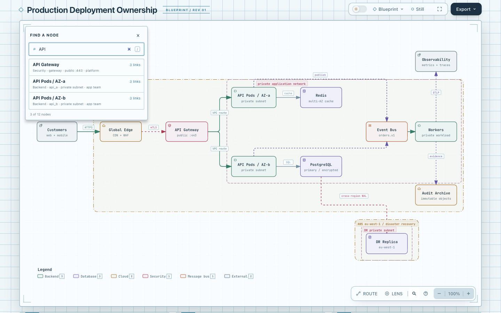
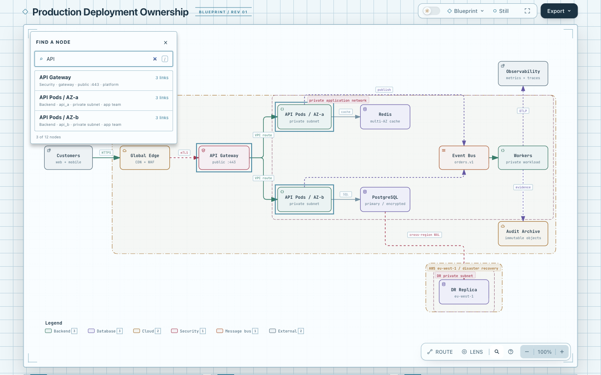
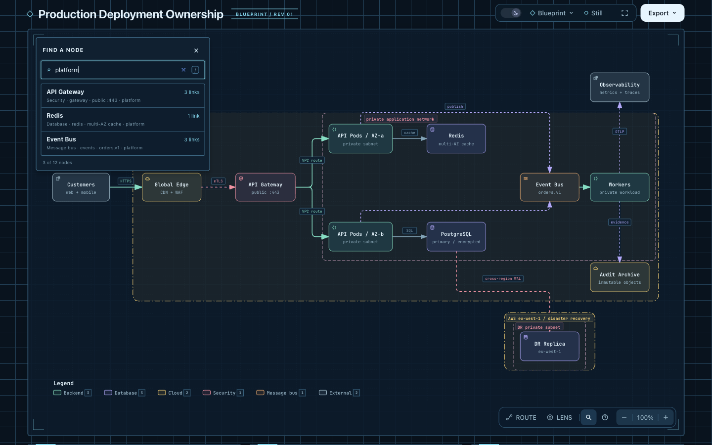
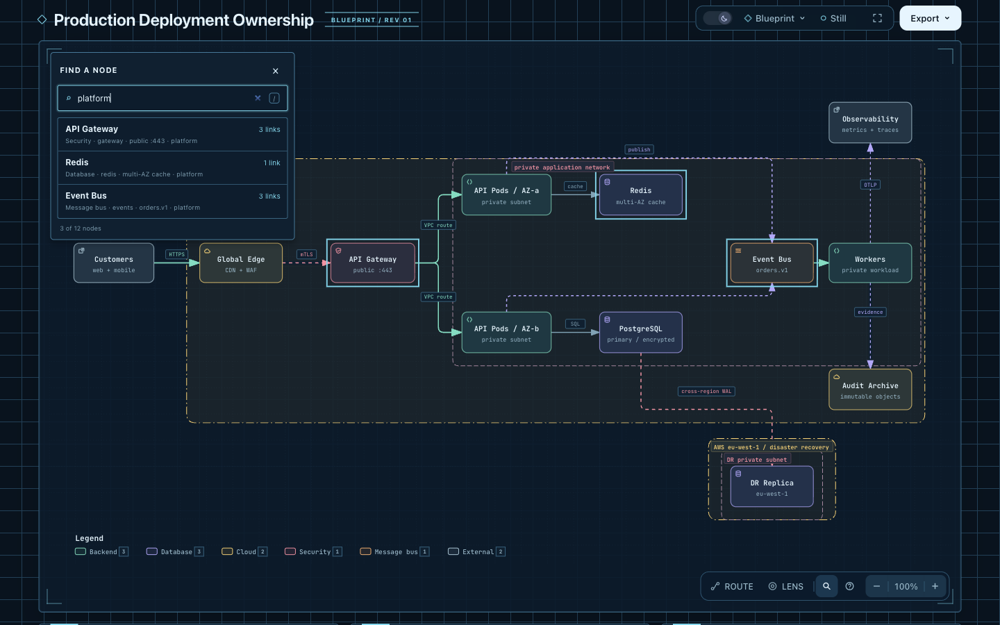

# Finder canvas matches on dev 10b4

This refresh preserves the existing candidate: a non-empty ordinary Finder
query outlines the same node IDs as its result list. Clearing the query,
closing Finder, an absent query or entering a Route endpoint picker removes
these temporary outlines. Selection retains the existing focus-and-reveal
behavior. This is independent of the Finder context-description candidate;
this branch adds no `aria-describedby` metadata.

The fixed base is `10b4dd5c5f2264baa315ee65a9b4cc23c13ea5f0`, merged normally
into the prior candidate `94c165ee6e5213c67e37a75a0b04496564980801`.
The original experiment and its images remain byte-for-byte historical.
The six owner source/test files retain the original small change; the merge
also retains dev's IME shortcut guards and restoration of authored drilldown
links during canonical export. No new search, state or schema was introduced.

## Same complete input

[Input](input.architecture.json) is the complete, unchanged repository-authored
`archify/examples/production-deployment.architecture.json` from fixed dev:
4,734 bytes, SHA-256
`610a5614667e8f108bdcf1769c9d7af5c3ce0fb62be3ea50550b10eb752e4bda`.
It is a shipped illustrative deployment example, not a measured production
trace or a newly extracted system. Both arms use standard quality and the
same full input, with no IR changes.

Open [new dev base](base.html?theme=light) and
[candidate](candidate.html?theme=light) at 1440×900, 100% browser zoom,
Blueprint, Still and initial Fit. Enter `API` in light mode and `platform`
in dark mode, then try an absent query, clear the input and close Finder.

| Ordinary query | Result IDs in both arms | Candidate canvas markers |
| --- | --- | --- |
| `API` | `gateway`, `api_a`, `api_b` | the same three IDs |
| `platform` | `gateway`, `redis`, `events` | the same three IDs |
| absent query | none | none |
| empty or closed | existing list behavior | none |

The baseline has these same lists and no canvas markers. A temporary automatic
Chromium probe observed both themes and all four queries plus close: 20 actual
states. Query changes preserved camera state, selected Focus and URL hash;
active candidate markers computed to a solid 2px outline. Its input events
were programmatic DOM events. Trusted input and keyboard behavior are covered
separately by the existing browser test harness. See
[browser observations](browser-observations.json).

## Root browser capture

Root used normal click/fill actions in the shared Ego browser at 1440×900,
with `API` in light mode and `platform` in dark mode, on these exact HTML
files. All four PNGs were opened and visually checked: the candidate's 2px
outlines are visible. Each of four arms records before, matched, absent,
cleared and closed states in [original observations](screenshots/observations.json).
Both lists contain the same three IDs; candidate markers match those IDs,
while the baseline has none. Absent, clear and close leave no markers.

**Before · API · light**



**After · API · light**



**Before · platform · dark**



**After · platform · dark**



[Capture metadata](screenshots/capture.json) binds the exact input, HTML,
original PNG bytes and observations. The collected root SVG viewBox, parent
style, zoom text and URL hash match before versus matched in each arm. This
supports those DOM fields, not a complete internal-camera proof. These captures
started at initial Fit with no selection; the old `[data-focus]` selector's
empty `selected` arrays do not verify preservation of an existing selection.
The separate automatic probe and browser tests retain their own evidence scope.
These are agent-operated and agent-inspected browser captures, not human or
screen-reader acceptance, and do not measure node-location speed.

## Verification and generated artifacts

[Checks](checks-summary.json) bind original logs outside the checkout;
[finalize summary](finalize-summary.json) is an explicitly portable projection,
not an original receipt. The repository CLI and exact canonical ZIP CLI each
ran `finalize architecture` with `--quality standard --browser-check`: validate,
deliver, check and browser-check all passed, with zero diagnostics and identical
candidate HTML bytes. Automated browser gates are distinct from screenshot
inspection and human acceptance.

Selected checks passed with no skipped tests: Finder/export/drilldown browser
19/19, core smoke plus generated XML 22/22, and Gallery 1/1. Four generation /
release-identity commands and the 68 golden checks also passed. The existing
browser checks cover query/list equality, close/clear/outside-click cleanup,
IME Enter and global shortcuts, contextual Route picking, live-state
preservation, canonical SVG/PNG export, and dev's authored drilldown-href
restoration. No full repository suite, remote CI, cross-platform package run
or assistive-technology acceptance was performed for this candidate. The
successful dev CI is not reused as candidate CI evidence.

The Viewer template, both standard example sets, five drilldown examples in
each set, the root web-app alias, Gallery and ZIP were generated normally.
[Generated comparison](generated-comparison.json) compares 57 HTML pairs
against freshly generated archived dev source with the same parameters:
every inline SVG is byte-identical; each tracked dev file already matched its
fresh baseline. Gallery manifest hashes follow regenerated artifact bytes.
This is static authored-geometry evidence, not complete HTML byte equality.
Other historical HTML outside these selected generators, including docs/cases,
is not claimed refreshed. Ten original experiment files remain exact.

[ZIP summary](zip-summary.json): official Node 22.23.2 with bundled zlib
1.3.1-e00f703 produced two identical archives. All 235 members have valid CRCs;
21 members differ from tracked dev: the Viewer template and 20 packaged example
HTML files. No experiments enter the archive. The extracted template equals
normal source generation, and its public CLI produced the same candidate HTML.

From the repository root, use the canonical toolchain and a Chrome executable
accepted by the existing harness:

```sh
node scripts/generate-viewer.mjs
node archify/bin/archify.mjs render architecture experiments/finder-highlights/refresh-dev-10b4/input.architecture.json experiments/finder-highlights/refresh-dev-10b4/candidate.html --quality standard
node scripts/run-browser-tests.mjs test/finder-browser.test.mjs test/export-cleanup-browser.test.mjs test/drilldown-context-browser.test.mjs
node scripts/run-tests.mjs --require-files test/core-smoke.test.mjs test/generated-artifact-xml.test.mjs test/gallery.test.mjs
node archify/bin/archify.mjs finalize architecture experiments/finder-highlights/refresh-dev-10b4/input.architecture.json experiments/finder-highlights/refresh-dev-10b4/candidate.html --quality standard --browser-check --out-dir /tmp/finder-refresh-review --json
```

Finalization writes a delivery receipt beside the HTML; retain raw receipts
outside a public evidence directory. No install, release or deployment was
performed. No node-location timing study establishes a general reader benefit.
The original Sigma interaction inspiration remains documented in the
[historical experiment](../README.md); no upstream code or dependency was added.
New dev's license and notice files are preserved.
