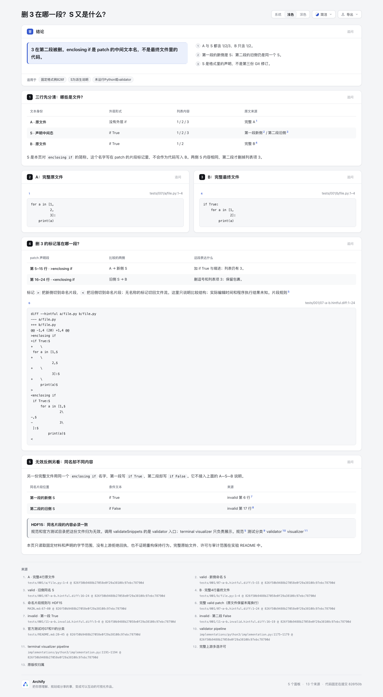
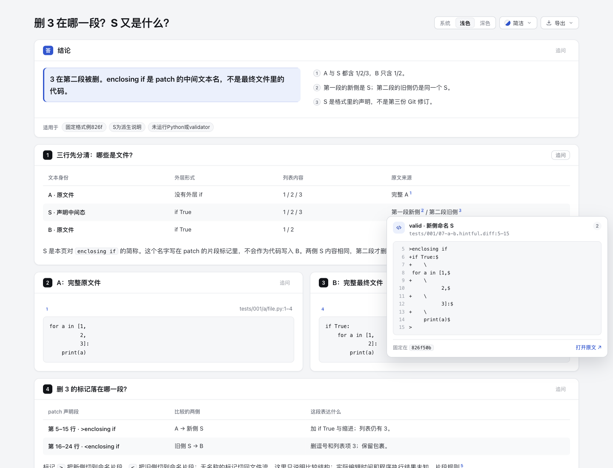
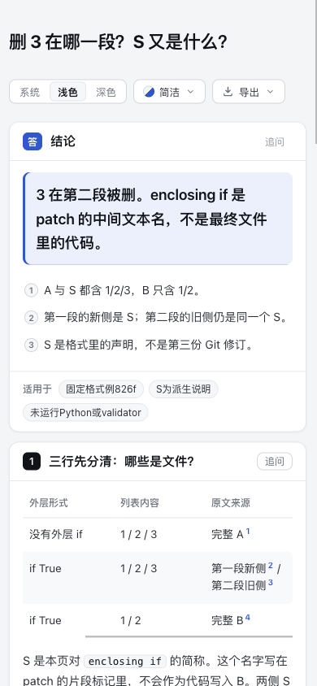

# Hintful stages：删 3 在哪一段？

[打开解释页](explainer.html) · [完整内容输入](explainer.json) · [固定事实与派生范围](facts.json)

`3` 在第二段被删。第一段把 A 比较到名为 `enclosing if` 的新侧 S，第二段再把同名旧侧 S 比较到 B。S 保留列表 1/2/3；B 只保留 1/2。这个名字是 patch 的声明，不是要写入 B 的代码。

这是固定教育内容，不需要生产事故先验，也没有生产效果结论。它只新增本目录，基于 Archify `10b4dd5c5f2264baa315ee65a9b4cc23c13ea5f0`，复用现有 Explainer code、comparison 和 SourceCard。没有 Workflow、任意 patch parser、AST matcher、转换器、diff schema、产品代码、依赖清单或 ZIP 改动。

## 三份文本的身份

| 身份 | 外层形式 | 列表 | 来源 |
| --- | --- | --- | --- |
| A：原文件 | 无外层 if | 1/2/3 | 完整 `tests/001/a/file.py` |
| S：派生的命名片段说明 | if True | 1/2/3 | valid patch 两段声明的相同内容 |
| B：原文件 | if True | 1/2 | 完整 `tests/001/b/file.py` |

S 没有独立的 Git 文件、revision 或上游 source hash。`facts.json` 中的 `derivedText` 是由该 patch 的明确字节范围拼接的说明数据；对整个 facts artifact 的摘要也不变成 S 的上游身份。这不是第三次真实提交、实际编辑时间线、Python 运行日志或行为等价证明。

完整 valid patch 的第5–15行把**新侧**切到 S；第16–24行把**旧侧**切到同名 S。本页用普通 code 展示它，没有把这种格式传给只支持两向 unified/fragment 的 `@diff`。A/B 的 code 块显示完整四行内容；原文件末尾 LF 与所有原字节保留在本地副本和完整文件 hash，不能把代码摘录的显示排版当成文件格式转换。

## 原始材料与许可选择

固定 [svenssonaxel/diff-format@826f50b9488b27058e0f29a38108c97ebc78790d](https://github.com/svenssonaxel/diff-format/tree/826f50b9488b27058e0f29a38108c97ebc78790d)。完整十份 Git blob 均以原字节保存在 [upstream](upstream)，含四个短 fixture、规范、统一实现、测试说明及 harness、原始 LICENSE/CONTRIBUTORS。逐文件 Git blob、SHA256、bytes 见 [source-manifest.json](source-manifest.json)。没有换行正规化或只截取成功片段。

| 完整 fixture | Bytes | SHA256 |
| --- | ---: | --- |
| [A](upstream/tests/001/a/file.py) | 53 | `1e99918f7dbe30fe1d61b00e37310b6096009e3a20b0f95a8c02e685b007b7c1` |
| [B](upstream/tests/001/b/file.py) | 61 | `7a6b16c1108e0ef29bb64112cee106de11206ecd766586b2c82fb46d2c46ebc7` |
| [valid patch](upstream/tests/001/07-a-b.hintful.diff) | 310 | `aaa1abddb4283af03f7af56ca60cbd7a82ecf1f93bb9b21a3e256eef04445f19` |
| [invalid 反例](upstream/tests/001/11-a-b.invalid.hintful.diff) | 311 | `1934717d10df8a8c786a27a47b12a27fd567f9187323177b4e065c6e0d32d634` |

上游 [LICENSE.md](upstream/LICENSE.md) 实际提供多选许可，包括 MIT、Apache-2.0、BSD-3-Clause 等，并非只有 MIT/Apache 两项。本次引用与分发这些材料选择 **Apache-2.0**；保留原 LICENSE 和 [CONTRIBUTORS.md](upstream/CONTRIBUTORS.md) 的版权归属，另附完整 [Apache-2.0 条款](licenses/Apache-2.0.txt)。该标准条款取自 manifest 记录的 Apache 官方 URL，单独标记来源，不冒充这个 Git revision 的文件。没有改写上游材料，也没有把其实现复制进 Archify 产品。新原创内容和审计脚本按本仓 Apache-2.0 条件提供。

## invalid 单列，不接入成功说明

311B 反例沿用同一个片段名，但第一段内容是 `if True`，第二段是 `if False`。HDF15 要求同名片段内容一致；官方 `tests/README.md` 将11号文件归为无效。该反例不是 A—S—B 成功链中的另一步。

`implementation.py` 的 `validate-hintful-diff` pipeline 才调用 `validateSnippets`；`terminal-visualize-diff` 只运行展示和输出。**本轮没有运行 Python、上游 validator、visualizer、测试或 patch 应用，也没有上游拒绝回执。** 这里的“无效”只指规范与官方测试分类。只看到 visualizer 展示了某内容，不能据此说格式已验证。

## 本轮实际证据

- 正常 public CLI `finalize explainer`，standard：validate、deliver、check 通过，零诊断；browser-check 未请求。它证明本页交付，不是上游格式验证。
- 原创 Node [audit.mjs](audit.mjs) 实际通过9项固定事实/字面绑定检查，结果为 [audit-result.json](audit-result.json)。它先核四 fixture 的固定长度/SHA，再核完整来源、A/B、两侧 S、invalid 差异、十一份 Git excerpt、完整输入、三个实际 HTML code 块和三行表格。
- `facts.json` 列的是针对这两个固定 SHA-bound patch 的明确 byte intervals 与 LF 标记。审计只拼接这些范围，不解释操作码、不接受其他 patch 或 CLI 输入，也不执行 Python。A/B 拼接逐字等原文件，两侧 S 逐字相等；invalid 的两侧文字不同。这不是通用解析器或 validator 的替代。
- HTML 保存完整 authored JSON 和十一份固定 Git 摘录。源码摘要绑定整文件，摘录按 inclusive 行范围核对；S 没有被塞进 `preparedSources` 伪装源码。来源卡最多显示14行，较长范围可能带省略号；下方 code 保留所声明完整范围，原文链接另列。
- 只有内容和固定字节审计，没有新增产品回归测试或跑全仓 suite。审计复用项目既有 parse5 读取生成 HTML，未新增依赖；临时依赖 symlink 已移除，没有安装或更改 lock。源 fixture、含空格/标记的 code 和 generated HTML 保留原生字节，不做尾空白后处理。

首轮把 EOF 换行误算为有效第25行，CLI 在源码定位阶段失败，所有 gate 未运行。范围改为真实1–24行后交付通过；随后将一处写作建议改为短句，保持比较/执行边界，最终零诊断。首版审计把行标签 TH 当成 TD，列索引检查失败；修正审计索引后通过，没有改产品或 HTML 来凑数。失败输入、旧 HTML、原 stdout/stderr、原始 receipts 均留在 checkout 外，公开摘要保留其 hash。

[portable-summary.json](portable-summary.json) 是明确派生摘要，不是原始 Archify receipt。原始 delivery/finalize 回执因含本机路径保存在外部；不能将移走后的侧车写成当前物理目录具有 current provenance。本地验证对应冻结源码和产物，远端 CI 需另核，不代表 dev 合入、release、live 安装、上游执行或人类验收。

## 实际图片范围

Root 已用既有 Ego / Chromium 实际捕获并逐张查看五张原 PNG。图片未编辑；[capture-summary.json](screenshots/capture-summary.json) 是明确的派生选取摘要，绑定当前 HTML、五图和五份 checkout 外原始观察 JSON 的 SHA/bytes。原始观察保留在 checkout 外；公开文件为选取字段的派生摘要，保留原件指纹。

- [桌面完整页](screenshots/desktop-light.png)：PNG 1440×2616，实际 viewport 1440×1100、light；三段 code 原文、缩进和标记与冻结摘录一致，三个 code 容器均无横向溢出，pageWidth=1440。
- [valid 来源卡](screenshots/valid-source-light.png)：1440×1100、light；pointer hover 显示固定826f的第5–15行完整声明范围和原文 URL。
- [invalid 来源卡](screenshots/invalid-source-dark.png)：1440×1100、dark；pointer hover 显示固定826f的第16–19行，其中第17行是 False。它是源码卡，不是上游验证器拒绝结果。
- [窄屏完整页](screenshots/mobile-light.png)：PNG 390×3989，viewport 390×844、light，pageWidth=390。
- [窄屏首表右侧](screenshots/mobile-table-right.png)：390×844；实际横滚后来源列显示，左侧身份列移出当前横向视口。





**窄屏首表不是全部列同时可见。** 初始表宽432、滚动容器clientWidth332/scrollWidth432，来源列在右侧。Root真实mouse.move到表内，再mouse.wheel(180,0)，观察scrollLeft=100；来源列可读时左侧身份列移出。其余两表均宽332，三个pre容器clientWidth/scrollWidth均330；页面本身没有横向溢出。这里验证的是实际浏览器鼠标滚轮，不是物理触屏手势。



Root没有打开外链、做键盘遍历、操作OS剪贴板、使用AT或运行上游。上述选择性实际观察与Explainer finalize的browser-check未请求分开；没有完整browser gate、跨浏览器、人类验收或学习收益结论。

## 复现

使用 Node 22 与项目已有依赖；准备包含固定 Git 对象的只读来源仓库，origin 对应上述公开仓库。不要执行其中的 Python 或测试。源码证据从 Git 对象读取，实验副本用于离线复核，不伪造成本产品仓库的历史。

```sh
node experiments/hintful-stages/audit.mjs
node archify/bin/archify.mjs finalize explainer \
  experiments/hintful-stages/explainer.json '<fresh-output.html>' \
  --repo-root '<fixed-source-checkout>' --quality standard \
  --receipt '<external-raw-receipt.json>' --out-dir '<external-evidence-dir>' --json
```

交付命令会写其明确输出，复核使用全新文件/目录。HTML 旁的 delivery 侧车不因 `--out-dir` 自动迁移；如需公开安全摘要，先保留全部原始证据。AI assistance：Codex / gpt-6.1-sol 完成固定来源阅读、原创内容、Node 字节审计与交付；独立 reviewer 和 root 的实际视觉观察另行记录，不当成人类接受。
