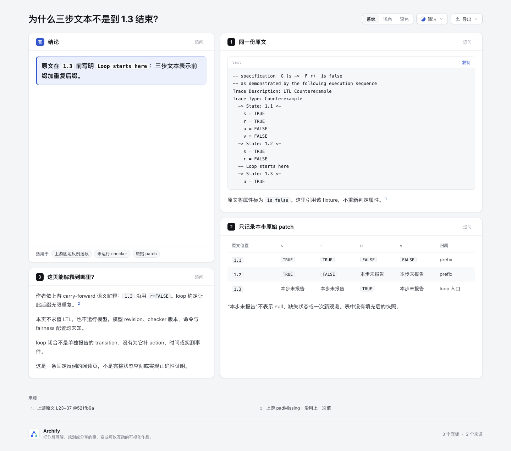
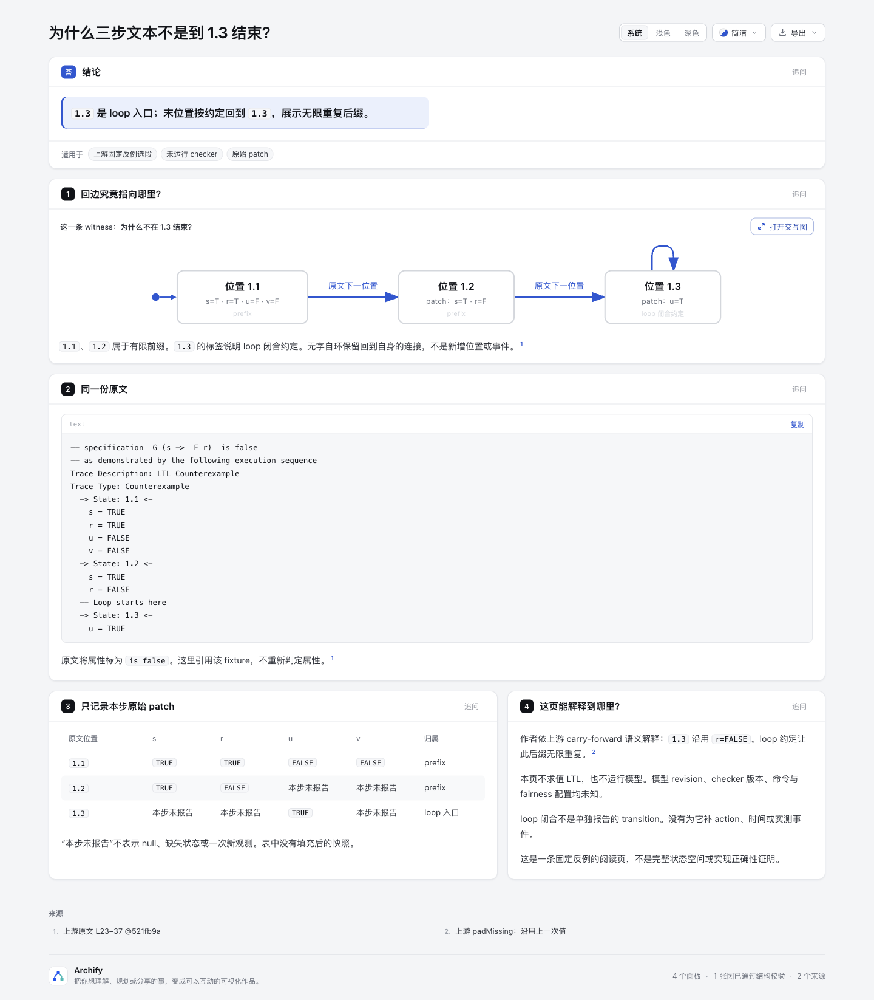

# Lasso witness：为什么三步文本不是到 1.3 结束？

零共享代码的内容实验。将同一份原文与原始patch表，和明确prefix/loop闭合的阅读页对照。没有通用parser、checker、LTL evaluator或变量fold。

- [原文与表](baseline.html)
- [带显式loop回边的解释页](candidate.html)
- [独立原生有向图](lasso.html) · [唯一图源](lasso.lifecycle.json)
- [公开派生验证摘要](evidence-summary.json)

## 来源、许可与固定范围

基线为Archify `82c7e0f089a02a4d514714adf37dc2061682da5f`，分支`codex/lab-lasso-witness`。只新增本目录，不改schema、Viewer、CLI、CI或依赖。

来源：[Igor Buzhinsky 的 NuSMV LTL counterexample visualizer](https://github.com/igor-buzhinsky/nusmv_counterexample_visualizer/tree/521fb9a1261c921519abb60a2b98c5c2cd5b321f)，固定revision `521fb9a1261c921519abb60a2b98c5c2cd5b321f`。[MIT](upstream/LICENSE)，Copyright (c) 2017 Igor Buzhinsky。完整原文件和语义参考源码按原字节保存在[upstream](upstream/)，许可随附；源码只作阅读证据，不执行。

选择[example-input.txt L23–37](https://github.com/igor-buzhinsky/nusmv_counterexample_visualizer/blob/521fb9a1261c921519abb60a2b98c5c2cd5b321f/example-input.txt#L23-L37)，第二条公式`G (s -> F r)`，三位置及`Loop starts here`。完整文件55,043 bytes，SHA-256 `449c0607d964769e503cd57628fb81edd660b2bfc65f89ed343e96b144dc19ee`；原字节选段337 bytes，SHA-256 `bbb08046f14913f5877c72147a69a729ec78b22e8aef63ade3dec4a19cde30fa`。各文件hash在[source-manifest.json](upstream/source-manifest.json)。

## 语义边界

三节点分别是轨迹位置1.1/1.2/1.3；不是三个唯一模型状态或完整状态空间。Lifecycle仅是现有renderer选择，自定义图例明确位置含义，不称通用Lifecycle。prefix为1.1/1.2；loop入口为原文标记的1.3。

末位置回1.3是lasso的无限后缀闭合约定。原文没有另报一条带action或时间的闭合transition，图没有虚构action、时间、投递或额外轨迹位置。Live动画关闭，避免把约定当实时事件。

两页表都只保留每步原patch。“本步未报告”不表示null，也不是填充后的快照。r在loop中持续FALSE的说明是作者依上游`padMissing` carry-forward约定作出的解释，并链接对应源码；本页不求值公式，不新增观测，不生成完整fold值。

fixture将公式标为false，但缺少绑定模型revision、checker版本、命令、fairness、run receipt。以上均未知，不填造；一条既有反例不是本次验证，更不是实现正确性或全称证明。

## 阅读对照与当前结论

两版使用逐字相同原文、逐格相同patch表和同样语义边界。candidate增加一个位置图，`@diagram lifecycle source=lasso.lifecycle.json`冻结独立原生图的同一份JSON，没有复制另一套ID或拓扑。baseline本身也说明loop，因此这不是人为把对照做错。

问题固定为“为什么三步文本不是到1.3结束？”待实际阅读对照判断回边是否减少理解成本。当前只有内容/来源审计及自动交付证据，没有人类阅读效率、用户收益、跨平台或远端CI结论。协调方持有截图与感知审阅；截图不能替代来源核对。

## 复现命令

从repo根目录执行，Node 22.13+；原始receipt写到checkout外的全新目录。finalize的delivery sidecar会默认写在HTML旁，它是本机原始receipt；归档到外部目录后不纳入公开实验文件。下列命令会重新生成现有HTML，勿并行修改源文件。

```sh
NODE22=/opt/homebrew/opt/node@22/bin/node
LASSO_EVIDENCE=$(mktemp -d)
"$NODE22" archify/bin/archify.mjs render lifecycle experiments/lasso-witness/lasso.lifecycle.json "$LASSO_EVIDENCE/public-native.html" --quality showcase
"$NODE22" archify/bin/archify.mjs render explainer experiments/lasso-witness/candidate.archify.md "$LASSO_EVIDENCE/public-candidate.html"
"$NODE22" archify/bin/archify.mjs finalize lifecycle experiments/lasso-witness/lasso.lifecycle.json experiments/lasso-witness/lasso.html --quality showcase --json --out-dir "$LASSO_EVIDENCE/native"
"$NODE22" archify/bin/archify.mjs finalize explainer experiments/lasso-witness/baseline.archify.md experiments/lasso-witness/baseline.html --browser-check --json --out-dir "$LASSO_EVIDENCE/baseline"
"$NODE22" archify/bin/archify.mjs finalize explainer experiments/lasso-witness/candidate.archify.md experiments/lasso-witness/candidate.html --browser-check --json --out-dir "$LASSO_EVIDENCE/candidate"
"$NODE22" experiments/lasso-witness/audit.mjs
```

`audit.mjs`是只读内容证据检查：上游hash、原文选段、两页相同raw patch、三位置/闭合含义、Explainer冻结spec字节一致、产物无本机路径。它不是parser、模型验证或通用测试框架。不为纯内容新增产品测试或跑fullsuite；实际public render和finalize覆盖本次交付。原文中两行末尾空格在两页code fence保留，以满足逐字复现；不对upstream、原文fence或生成HTML做whitespace改写。其余原创正文与代码的行尾空白已核查。

## 失败保留与选择

首轮Workflow自环失败：outside-right预设不满足bottom/right端点方向。第二轮手写via时误用对象坐标，schema要求数组；第三轮改数组后，末段进入同节点被识别为source-endpoint clearance冲突。三份失败输入、raw finalizes均归档在checkout外；公开摘要记录输入hash、诊断code和停止阶段，不抹掉失败。

曾尝试第四个“非位置”loop注解节点，原生图通过、Explainer browser因文字缩放失败；协调方拒绝增加概念实体，因此该候选弃用，不计为成功交付。最后改用现有Lifecycle三节点自环，首轮原生及Explainer均通过。实际截图发现label/note遮罩遮住自环横段，因此把文案移至1.3标签与已有card，self-loop本身不放字，保留3位置/3连接。旧HTML、截图及capture绑定在[before-loop-visibility](before-loop-visibility/)；修后重新检查受影响产物，baseline不变。未改任何validator或schema。Workflow行为是否值得独立修复由协调方另评，不在本实验扩范围。

## 图片

协调方和作者已实际查看新版candidate/native：回环弧线完整可见，回到1.3；baseline未变并复用。三张图都以[capture.json](screenshots/capture.json)绑定当前HTML hash。旧版遮罩失败的3HTML/3图及capture保留在[before-loop-visibility](before-loop-visibility/)，旧artifact与旧图hash匹配。此结论是agent视觉复核，不是人类验收或阅读收益测量。

| 原文与表 | 显式loop阅读页 |
| --- | --- |
|  |  |

[独立原生图实际截图](screenshots/lasso.png)。
