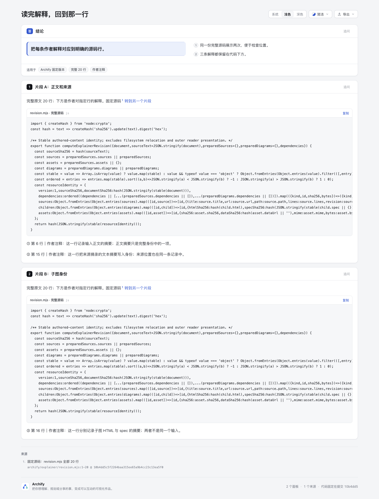
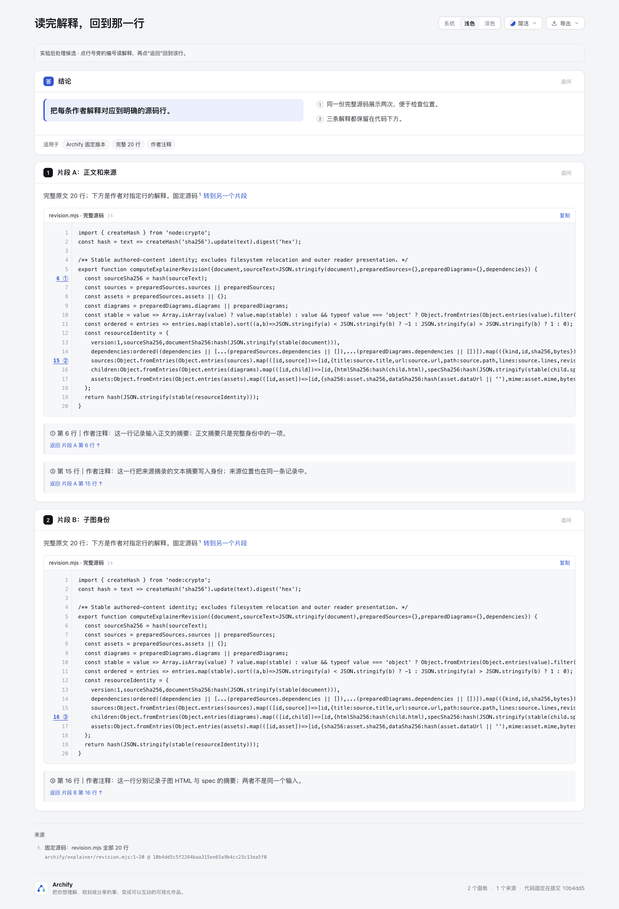

# 读完作者解释，回到那一行

这是一个独立阅读原型：**点源码行旁的编号看解释，再点“返回”回到该片段的原行。** 两处展示同一份完整源码，注释不会因文本相同而串到另一处。新增的是精确往返动作；不是新的代码图、注释平台或共享 Archify 功能。

## 对比与来源

- [基线](baseline.html)：正常 JSON Explainer CLI 产物，完整代码与普通作者解释。
- [候选](candidate.html)：在同一基线 HTML 上做明确标识的实验后处理，加行号 gutter、双向链接和实验提示。不是正常 finalize 的候选产物。
- [输入](input/explainer.json) 与[sidecar](input/notes.json)：同样的两份完整 snippet 和三条解释；源码、解释正文和原 reader/prepared JSON 不变。

固定源码是 `tt-a1i/archify@10b4dd5c5f2264baa315ee65a9b4cc23c13ea5f0` 的 [archify/explainer/revision.mjs](https://github.com/tt-a1i/archify/blob/10b4dd5c5f2264baa315ee65a9b4cc23c13ea5f0/archify/explainer/revision.mjs)，全部 20 行，含最后 LF；SHA-256 `29032cab30c03b2e4c48730f40175e0e59aa4794893c02e5ae38668776c18288`。两份 snippet 的复制原文均与此 Git blob 逐字相同。三条解释是本实验作者对第 6、15、16 行的阅读说明，不是上游注释、运行观察或身份函数正确性证明。

灵感来自 [onmax/comark-ui 的 code-notes](https://github.com/onmax/comark-ui/tree/ec5769238df1f8523f836317817c4076e376be42/packages/code-notes)：完整测试、owning consumer 和许可原件保存在 [inspiration](inspiration/COMARK-LICENSE)，完整绑定见 [source-manifest.json](source-manifest.json)。代码为 MIT；其包许可还包含 Lucide ISC / Feather MIT 通知。原型运行时不引入其 parser、框架或 icon；`inspiration/` 仅保存完整只读来源原件，原型脚本独立编写。

上游通过移除源码中的注释 marker 生成编号，多行同一编号又只回第一处。因此这里使用 sidecar，不在原文插入或剥离 marker。一条解释绑定一个 block occurrence、完整 source SHA 和 originalLine；相同源码的另一处拥有独立命名空间。越界行、错误摘要、重复 note / 同块同一行都保留解释、明确显示无效、不建立链接；不会模糊重绑。

## Root 的实际对照

Root 在 Ego 浏览器查看了下面五张原图。它们逐字复制、未裁剪或缩放；[capture 摘要](screenshots/root-capture-summary.json) 是 Root 编写的派生观察，绑定原始 PNG、HTML 和私有 raw JSON 摘要，不冒称原始 receipt。

| 正常 CLI 基线 | 实验后处理候选 |
| --- | --- |
|  |  |

Root 实际点击注释②，按 Tab 到返回链接，再按 Enter，焦点和 hash 回到片段 A 第15行；深色下从注释③返回片段 B 第16行，未跳到另一份相同文本。两处原复制按钮都实际点击过：受控 writeText stub 各收到完整 1965B，摘要与原 blob 相同并保留最终 LF，没有写 OS 剪贴板。

- [浅色：返回片段 A 第15行](screenshots/candidate-return-line15-light.png)
- [深色：返回片段 B 第16行](screenshots/candidate-return-line16-dark.png)
- [390px：横滚后返回片段 B 第16行](screenshots/candidate-mobile-line16-light-ready.png)

手机尺寸为390×844：Root 先用 DOM 设置代码区域 scrollLeft=500（不是触屏手势），再实际点击注释③并 Tab/Enter 返回，代码横滚仍为500，页面宽度390。长代码在两臂都需横滚，不声称1965B能同时显示。

Root 还通过 CDP 选择当前 session history 的前/后条目，在注释③与第16行间正确往返并聚焦；这属于程序调用真实浏览器历史，不是系统快捷键验收。此前派发 Meta+[ 后 URL 未变化、等待超时，该尝试留在私有 raw，不算通过。早一张手机图同样私下保留；公开只选 fonts.ready 后的最终图。

这些局部 pointer/Tab/Enter/复制/history 观察不冲抵下面四条整体键盘诊断；没有完整 Tab、AT、触屏、跨浏览器或真人理解收益接受。Root 未测试 SourceCard/外部源链接与原生子图；作者自动审计另有独立范围。

## 实际检查

公开 [evidence-summary.json](evidence-summary.json) 是派生摘要；原始 CLI、delivery、browser receipts 和真实失败材料都留在 `/tmp/archify-line-notes-20261025/`。

- 基线正常 CLI 的 validate / deliver / check 通过，零内容诊断。请求整体 browser-check 后 exit 1：在 1280/1440、浅/深色下各报告 footer Archify 链接未被 Tab 遍历到达，共四条键盘诊断。失败原样保留，不扩大范围修改共享 checker，也不将它写成完整 gate 通过。
- 独立 HTML 读回审计：两臂各两份完整代码、空行及末尾 LF 全部相同；gutter、链接和解释位于 code 外；原 reader、prepared JSON 和软件许可 JSON 不变；六条往返链接都有唯一正确目标，目标 `tabindex=-1` 不增加 Tab 停点。
- 五个负例通过：零行、越界、错误 source hash、重复 note、同块重复行。检查解释保留、无效状态可见，以及无效链接不存在；没有运行被研究项目或源码函数。
- 作者自己的 headless Chrome 审计，在 1440/390 × 浅/深色执行实际 CDP pointer 和 Enter 激活，核对行→注释→原行的 hash、焦点与可见位置；第二片段不串跳；Back/Forward 和直接 deep link 返回对应目标。390px 下代码可横滚，横滚后往返仍到正确行。
- 原有 SourceCard 仍能打开并以 Escape 关闭，原 panel 链接仍工作。复制使用受控 resolve stub，两处 payload 都等于完整 Git blob；没有写 OS 剪贴板。页面没有原生子图，不宣称测试了 iframe 的 focus/route 行为。键盘检查从聚焦普通链接后按 Enter 开始，不代表整页 Tab 或 AT 验收。

首次后处理使用第一个 `</body>` 插入点，误中 reader 内部字符串，被独立 script 保真审计抓到；已改用文档最后的闭合 body。首次 pointer 返行也发生过等待超时；原运行时同时在 hashchange 与 click timer 聚焦，存在重复操作竞争。现不同 hash 只由 hashchange 聚焦，同 hash 点击才排回调；最终 HTML 四种 viewport/theme 审计通过。旧失败与修前材料保留，不将重试通过写成首次成功或已证实浏览器底层原因。

## 复查与范围

仅 `experiments/line-notes/` 新增文件，没有修改共享 schema、renderer、reader、Viewer、测试或版本。`candidate.html` 沿用 baseline 的内嵌 prepared 数据用于现有 reader；它的最终 HTML 字节必须用实验摘要绑定，不能套用 baseline delivery receipt 作为候选的 strict provenance 证明。

```sh
# 固定 Node 22。基线 CLI 正常生成；raw receipts 放在公开目录外。
node archify/bin/archify.mjs finalize explainer experiments/line-notes/input/explainer.json experiments/line-notes/baseline.html --repo-root . --quality standard --browser-check --out-dir /tmp/line-notes-review --json
# 将自动产生的 baseline.delivery.json 保留到 /tmp，再生成实验候选。
node experiments/line-notes/build-candidate.mjs
python3 experiments/line-notes/audit.py
node --test experiments/line-notes/negative.test.mjs
node experiments/line-notes/browser-audit.mjs
```

未跟踪文件另用 `git diff --no-index --check /dev/null <file>` 检查七个 HTML/脚本/README：均 exit 1（文件有差异），零 whitespace 诊断；未为清理空白重写冻结 HTML 或上游原件。

没有全仓 suite、产品 CI、发布、安装、真人阅读效率或 AT 接受结论。Root 实际图片及观察见上文；作者自动审计与 Root 交互样本分别记账。AI assistance：Codex GPT-6.1-Sol编写原型与验证脚本，独立 agent 复查；个人确认不能由这些自动结果推断。
