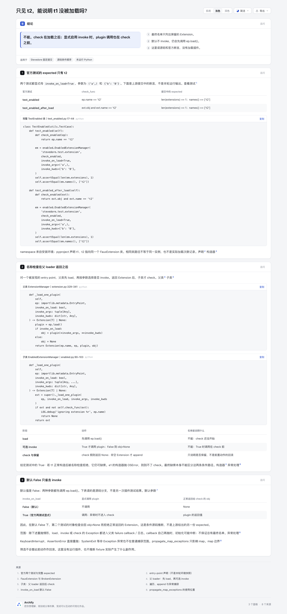

# 最终只见 t2，不等于 t1 未被加载

[阅读页](explainer.html)用正常 JSON Explainer CLI 生成，只含表格、原文源码选段与既有来源卡。问题是：**看到 enabled 名单只含 t2，能否断言 t1 从未 load 或构造？** 不能；固定实现先 load、按参数可选 invoke，之后才 check。名单没有撤回前置动作，也不是加载尝试日志。

这是一份有限内容实验，没有新 parser、注册表采集器、Workflow、共享 Viewer、插件执行器或产品变更。它与普通视图过滤的区别是：后置筛选的返回集合不能说明此前动作没发生；与 Static uses 的静态分支保留也不是同一问题。

## 固定完整来源

Stevedore 固定完整提交：`849be420e44d47218156adec6ccd9bfa77c4659e`，官方 GitHub mirror [openstack/stevedore](https://github.com/openstack/stevedore/tree/849be420e44d47218156adec6ccd9bfa77c4659e)。[source-manifest.json](source-manifest.json)记录六份完整原件的路径、SHA-256、字节及原始固定 URL；[source/LICENSE](source/LICENSE)是完整未改 Apache-2.0 文本。源码与测试的许可头原样保留。

- 完整 [test_enabled.py](source/stevedore/tests/test_enabled.py)提供两段 consumer；两者均显式传 `invoke_on_load=True`、`('a',)`及`{'b': 'B'}`，提交中的断言均为1个 Extension、names仅t2。第二个check读取`ext.obj`；第一个参数虽叫`ep`，实际接收Extension。
- 完整 [enabled.py](source/stevedore/enabled.py)的90–103行先调用super，再check；默认参数False在61–87行。
- 完整 [extension.py](source/stevedore/extension.py)的329–341行先`ep.load()`，True才调用plugin；290–324行负责遍历、append与异常处理。
- 完整 [test_extension.py](source/stevedore/tests/test_extension.py)保存FauxExtension与BrokenExtension定义；[pyproject.toml](source/pyproject.toml)保存entry-point声明。t1、t2声明同一class路径，不证明同一实例或实际加载次数。

这些是完整的所选源码文件，不是可复现安装环境。测试通过namespace读取安装环境的metadata；本轮没有安装、发现或加载这四个entry point，也不把pyproject文本次序当实际执行次序。

展示的三个snippet分别是完整TestEnabled类（17–44）、父loader方法（329–341）、子类方法（90–103）。它们是从完整文件按原行提取的literal文本，统一以LF连接；不是本轮运行stdout。全部完整原文件另行保留。来源卡为固定URL引用，不冒充Archify `--repo-root`验证过的外部Git excerpt。

## 解释范围

页面明确区分两层：官方两测试的显式True expected，和默认False分支的源码推断。False仍调用`ep.load()`，只是令`obj=None`而不显式调用plugin；第二个对象check因此拒绝正常返回的Extension。没有伪造False模式的另一份官方expected或运行记录。

异常边界仅作范围说明：load、invoke和check中受普通Exception分支处理的异常，都可进入failure callback／日志，不能把callback一律当ep.load失败。callback自己再抛可中断初始化；KeyboardInterrupt、AssertionError直接重抛，SystemExit等非Exception不被普通分支捕获。propagate_map_exceptions仅影响map。本页没有把callback构造为另一套异常协议或保证最终名单总能生成。

这不构成安全漏洞、沙箱或副作用实测结论。FauxExtension源码只保存参数；本轮没有运行它，也不推断真实插件实际产生了何种副作用。

## 实际证据与限制

[公开派生摘要](evidence-summary.json)和[字节／DOM审计摘要](facts-summary.json)不是原始receipt。原始finalize、delivery、审计输出保存在checkout外的`/tmp/archify-load-filter-20261025/`。

- 正常public finalize的validate / deliver / check通过，最终零诊断。首版有一条长段落warning，只拆成更短内容块后重新正常生成；历史receipt保留。未请求整体browser-check，不宣称完整键盘gate通过。
- 六份原件逐字摘要匹配固定来源。三段input源码和1440/390实际Chrome DOM读回均与指定原行相同；两条official expected、两条default参数表、八个固定来源URL和无码图均有核对。
- Chrome只用于读取已生成页面的DOM与页面宽度，未操作插件。两尺寸页面自身宽度分别为1440/390，console error为空。桌面三表均为1238px宽；390px时容器332px，官方expected／顺序／默认参数表分别337／332／384px，第一、第三表仍需局部横滚。源码长行也保留横滚。
- Root首轮实际查看桌面与手机图后，做了一轮有界内容压缩：官方表删共同的显式True列，完整前文与源码保留参数；默认表删共同的load列并在前文明说两种参数都先load；顺序表缩短heading。三段源码与八个来源卡逐值不变。随后正常fresh-out-dir生成并复核，不声称手机所有列同时可见。首版HTML、截图与raw私有保留，未用旧图冒充当前产物。
- 没有运行Python、Stevedore、插件、上游测试、包安装、真实metadata discovery、构造次数统计或性能测量。没有共享产品测试或全仓suite、CI、发布、live安装、真人理解效率与AT接受结论。

独立agent scout_code_maps已完成只读来源、语义、表格压缩差异与最终绑定复核：19份公开文件、四张PNG原字节及IHDR、四份raw观察摘要、HTML与finalize一致。reviewer没有运行浏览器、本人查看PNG或重跑审计；实图观察复用root已逐张查看的结果。此review不构成AT或真人阅读验收。

## 最终截图与局部横滚

下图绑定冻结HTML `3334dc29e32f26448d98946b0d34f306f9f3eee86f0298aeadb7b3a643f394d2`；root用Ego实际截图并逐张查看。[capture.json](screenshots/capture.json)是公开派生摘要，保存原图字节绑定及私有观察receipt的摘要，不冒充原始receipt。



[桌面深色默认参数段](screenshots/default-dark.png) · [390px浅色完整页](screenshots/mobile-light.png) · [手机默认参数表向右滚动后](screenshots/mobile-default-right-settled.png)

最终手机观察在同一次调用内实际横向wheel120并等待后读回：默认表scrollLeft从0变为52.5，clientWidth332／scrollWidth384，页面宽仍390；obj列可见，左侧invoke_on_load列局部裁掉。这只证明该次鼠标横滚与截图状态，不是触屏设备验收。官方表也有约5px局部横溢；三个源码pre保留原长行，手机scrollWidth为382／427／449，对clientWidth330。

较早的wheel后立即读数仍为0，旧right图以及跨调用等待timeout均私有保留，不算成功。Ego跨调用会复位viewport，不能用下一调用替旧scroll补等待。最终四图来自压缩后HTML；首版HTML与截图未发布为最终证据。没有AT、键盘、OS或上游执行验收，也没有真人阅读收益实测。

## 复查

使用固定dev `10b4dd5c5f2264baa315ee65a9b4cc23c13ea5f0` 的Archify和官方Node22.23.2，准备脚本只读本目录固定原件，不执行其中Python代码。

```sh
node experiments/load-filter/prepare.mjs
node archify/bin/archify.mjs finalize explainer experiments/load-filter/input.explainer.json experiments/load-filter/explainer.html --quality standard --out-dir /tmp/load-filter-review --json
# 将自动产生的 explainer.delivery.json 留在checkout外。
node experiments/load-filter/audit.mjs
```

audit仅核固定文件／source文本和实际Chrome DOM，不是执行Python算法或插件测试。事实审计的成本与此内容范围相称；没有为不变的共享renderer重新跑整套suite。

AI assistance：Codex GPT-6.1-Sol完成源码阅读、内容、正常CLI生成与事实审计；独立agent复查来源／语义与绑定。所有自动结果和agent观察均不等于用户个人确认。
