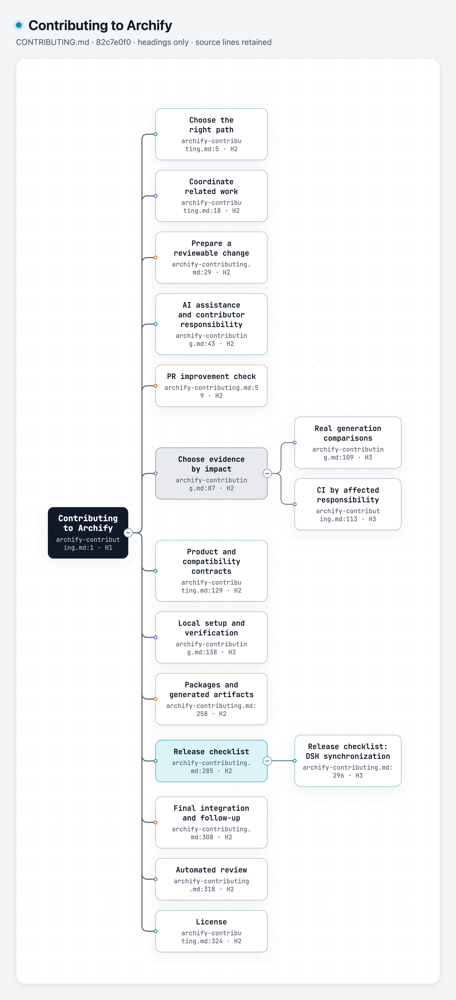

# Markdown 标题大纲 → Archify Tree 实验

把已有文档的标题层级转成可折叠的原生 Tree，保留顺序、重复标题和源行号，避免手动重写 `parent`。这是标题投影，不是完整 Markdown、CommonMark 或 Markmap 兼容实现。

实验基线：`82c7e0f089a02a4d514714adf37dc2061682da5f`，分支 `codex/lab-markdown-outline`。只新增本目录；未修改 Archify schema、renderer、Viewer、CI、package 或 ZIP，也未安装任何 live Skill。

## 来源与灵感

- [Markmap](https://github.com/markmap/markmap/tree/122bf0500ee7aca4f023c2465f7e26bf023eec52)：Markdown 作为脑图入口的产品思路。固定 commit `122bf0500ee7aca4f023c2465f7e26bf023eec52`，MIT。没有复制其 parser、布局器或算法。
- 实际公开样本：[该 commit 的 README](https://github.com/markmap/markmap/blob/122bf0500ee7aca4f023c2465f7e26bf023eec52/README.md)，原文保存在 `fixtures/markmap-readme.md`，对应 MIT 文本在 `fixtures/MARKMAP-LICENSE`。源码与许可均从官方仓库下载；没有执行上游脚本。
- 主展示样本：[Archify CONTRIBUTING.md @82c7e0f0](https://github.com/tt-a1i/archify/blob/82c7e0f089a02a4d514714adf37dc2061682da5f/CONTRIBUTING.md)，原文在 `fixtures/archify-contributing.md`，MIT 文本在 `fixtures/ARCHIFY-LICENSE`。它有17个标题，适合展示真实文档的层级浏览。
- `payment-outline.md` 是自编中文合成探针，不代表真实用户案例。

## 范围与失败行为

支持一个 H1 根、ATX H1–H6、最多三个前导空格、单行 Setext H1/H2、合法末尾 ATX hashes、CRLF/BOM。按声明顺序输出，自动 ID 为 `h1`、`h2` 等：重复标题保持独立节点；编辑前文会改变后续 ID，当前不承诺跨编辑稳定身份。

标题只能向下深入一级；跳级、多根、空标题、未闭合 fence、多行 Setext、HTML block/comment 或标题内 HTML 都报 JSON 错误与行号，不写出候选。反引号和波浪线 fence 内假标题被忽略，closer 必须同字符且不短于 opener。识别顶层标题；缩进代码、列表、blockquote 内容不进入图，出现标题形状时给 `container-omitted` 警告。普通正文、列表和代码被有意省略，receipt 列出所有被省略的非空行。

内联 Markdown、转义、实体保留为字面标签，并给 `literal-inline` 警告；不解析链接、图片、强调或公式。输出中直接显示源文件与行号，信息卡说明来源和范围。公开样本的 subtitle 显示来源文件与短 revision；完整固定来源 URL 在信息卡和 receipt，避免长 URL 挤占图的页头。receipt 的 source SHA-256 绑定解码后的 UTF-8 文本；行号是原始文件物理行号。

不支持 frontmatter、CommonMark HTML 块细节、容器 lazy continuation、完整 inline grammar、Setext 多行段落、文件包含、网络读取、脚本或任意插件。此输入合同适用于明确结构的文档大纲；不能把任意复杂 Markdown 的投影当作 CommonMark AST。遇到复杂容器请先提取为独立大纲，并保留来源说明。

CLI 用独占文件描述符拒绝覆盖已有 JSON 或 receipt，包括输入别名、普通文件、hardlink 和 symlink。后续失败只清理本次成功创建且 inode 身份仍匹配的文件；不会清理已有 receipt 或被替换的他人文件。真实 victim 测试覆盖输出别名/symlink、receipt 冲突及旧文件保留；不是跨两个文件的断电事务。输入 UTF-8 解码失败也退出非零。转换器不执行 renderer，输出可以手工编辑后走公共 CLI。

## 复现

从仓库根运行，Node 使用 `/opt/homebrew/opt/node@22/bin/node`。以下命令用新名字，不覆盖 checked-in evidence：

```sh
/opt/homebrew/opt/node@22/bin/node --test experiments/markdown-outline/outline.test.mjs
/opt/homebrew/opt/node@22/bin/node experiments/markdown-outline/outline-to-tree.mjs experiments/markdown-outline/fixtures/markmap-readme.md experiments/markdown-outline/evidence/repro-markmap.tree.json https://github.com/markmap/markmap/blob/122bf0500ee7aca4f023c2465f7e26bf023eec52/README.md
/opt/homebrew/opt/node@22/bin/node archify/bin/archify.mjs finalize tree experiments/markdown-outline/evidence/repro-markmap.tree.json experiments/markdown-outline/evidence/repro-markmap.html --json
/opt/homebrew/opt/node@22/bin/node experiments/markdown-outline/outline-to-tree.mjs experiments/markdown-outline/fixtures/payment-outline.md experiments/markdown-outline/evidence/repro-payment.tree.json
/opt/homebrew/opt/node@22/bin/node archify/bin/archify.mjs finalize tree experiments/markdown-outline/evidence/repro-payment.tree.json experiments/markdown-outline/evidence/repro-payment.html --json
```

主展示复现：

```sh
/opt/homebrew/opt/node@22/bin/node experiments/markdown-outline/outline-to-tree.mjs experiments/markdown-outline/fixtures/archify-contributing.md experiments/markdown-outline/evidence/repro-contributing.tree.json https://github.com/tt-a1i/archify/blob/82c7e0f089a02a4d514714adf37dc2061682da5f/CONTRIBUTING.md
/opt/homebrew/opt/node@22/bin/node archify/bin/archify.mjs finalize tree experiments/markdown-outline/evidence/repro-contributing.tree.json experiments/markdown-outline/evidence/repro-contributing.html --json
```

若要重新下载公开样本，使用上面固定 commit 的 raw URL；不要用 master 替代。CLI 只读本地文件，不会主动下载样本。

## 实际结果（2026-10-25）

- Node 22，实验测试 **8 pass、0 fail、0 skip**，见 `evidence/tests.tap`。覆盖关系/顺序/源行号、重复标签、ATX/Setext、fence 与假标题、closing hashes 后空标题、明确省略、失败诊断、CLI 拒绝覆盖和真实 victim 保护。不冻结坐标；现有 Tree renderer 自己拥有布局验证。
- 固定 Markmap README：**3 节点，2 条父子关系**，0 警告。`evidence/markmap.tree.json` 是实际转换结果；source mapping 在 `markmap.tree.json.receipt.json`；页面在 `evidence/markmap.html`。
- 主展示的公开 Archify CONTRIBUTING.md：**17 节点，16 条父子关系**；4条 container-omitted 警告记录被排除列表内容。`evidence/contributing.html` 与 JSON、源行号 receipt 均已生成。
- 合成中文支付大纲：**10 节点，9 条父子关系**；fence 内标题被正确排除。页面在 `evidence/payment.html`。
- 三个样本实际运行公共 `finalize tree`：validate、deliver、check、browser-check 全部 pass。原始 receipts 含个人绝对路径，已移至 checkout 外；`evidence/*.portable-summary.json` 明确标注为脱敏转录摘要，保留真实阶段结果、输入/HTML SHA-256、大小、命令和视觉状态，不冒充原始 receipts。源转换 receipt 本身使用相对路径，仍保存在 evidence。未跑全仓测试，因为没有修改产品路径或共享调用方。
- finalize 明确报告 `visualReview: not-requested`。浏览器自动检查通过不等于人工视觉验收。协调 Agent 已查看完整页面截图并通过原生 Export 菜单导出 PNG；独立 Codex 复核 8 项测试、输出保护与三组产物 hash 通过。**human review pending**。

截图建议：主展示用公开 CONTRIBUTING.md 的17节点结果；1440×1000、light、overview，用真实 Markdown 源展示作 before，native HTML 作 after；再拍支付树折叠“支付”与 Finder 查“钱包”后祖先展开。before 是原文形式、after 是同一标题关系的探索形式，不能宣称布局质量比 Markmap 更好，也不能把合成输入称作用户成功案例。

## 判断

当前价值是低成本确定性迁移入口；成本是一个受限输入合同和失败诊断，不是另养一套 Markdown 引擎。保留在实验目录，尚未提议接入公共 CLI/Skill。若真实文档广泛依赖复杂容器、正文或 inline 语义，应重新评估 parser 成本；不要通过静默忽略来扩大支持声明。

## 本轮实际图片



[完整页面截图](screenshots/contributing.png) · [捕获方法与文件 hash](screenshots/capture.json)。页面截图保留现有浮动控件在 DSH 分支附近的遮挡；原生 PNG 导出没有这些控件。源文件名在窄节点中会换行，此实验没有修改共享 Tree 布局。
