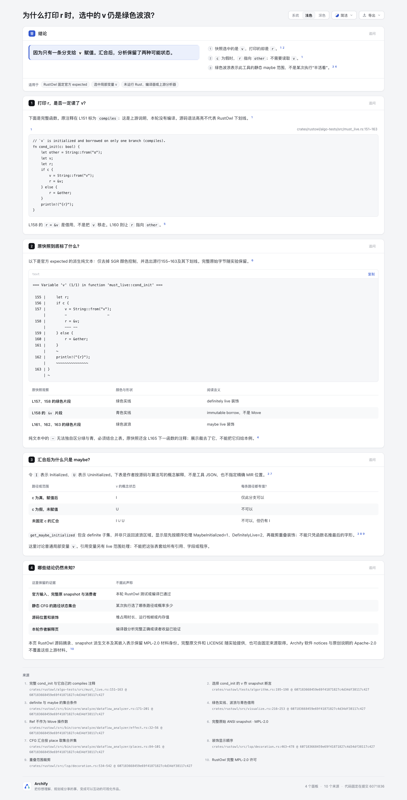

# Maybe initialized：为什么打印 r 时，选中的 v 仍是绿色波浪？

[中文解释页](output/explanation.html)用完整函数、官方 snapshot 的明确派生纯文本、颜色语义表和三行概念状态表回答这个问题。快照选中 `v`，`println!` 读取 `r`；`c` 为假时 `r` 指向 `other`。路径汇合后的分析信息可以包含 Initialized 与 Uninitialized，不能把绿色波浪理解成某次执行“半活着”。

这是有界内容试验。没有新增原生图、Workflow、编译器服务、ANSI viewer、IDE、后台、schema、产品CLI或ZIP改动。没有运行 Rust、编译器、RustOwl、Polonius 或上游测试，也没有验证读者收益。

## 固定输入、许可与显示变换

上游 [cordx56/rustowl](https://github.com/cordx56/rustowl/tree/607183668459e69f41871827c4d34df38117c427)，固定 revision `607183668459e69f41871827c4d34df38117c427`。完整 [MPL-2.0 LICENSE](upstream/LICENSE) 与十份完整 source/test/snapshot 文件保持原始字节，见 [manifest](upstream/manifest.json)。

- `must_live.rs` L151 是本例自己的 `compiles` 注释；完整 `cond_init` 实际是 **L152–163**。这是上游注释，不是本轮编译结论。
- 原 `algorithm__must_live_cond_init_v.snap` **1168B / fee579a7512a29b1cc118ffe8bb371b5ed102adac0f75462ad2e2540d1c8e5e6**，选择 `v`。原 snapshot 的源行只涵盖155–165，未含完整函数开头；L165是下一函数的 `does not compile` 注释，不能归给本例。
- [完整去SGR副本](derived/snapshot-without-sgr.txt)只移除颜色控制，仍保留原context和legend。[选定展示](derived/selected-snapshot.txt)另选原variable header、源行155–163和对应下划线，去除frontmatter/legend及164–165上下文；原 snapshot 不改。[transform.json](derived/transform.json)列每阶段hash/bytes与变换，明确都是derived。
- 去色后 `-` 不能区分绿色实线与青色借用；页面另列颜色表。L158 的 `&v` 对应青色immutable borrow，不是Move。源码语法高亮与上游装饰颜色分开说明。
- `get_maybe_initialized` 包含definite子集。`decoration.rs`顺序MaybeInitialized=1、DefinitelyLive=2，随后处理重叠/裁剪；不能直接把整个maybe函数输出称最终波浪区。完整decoration/effect文件均已保留。引用变量另有live范围覆盖，本页只解释普通局部变量 `v`。

[NOTICE.md](NOTICE.md)明确材料边界：上游Rust源码、原snapshot及派生文本、它们在草稿/HTML/JSON中的表示保留MPL-2.0，不被Archify软件notices或原创说明的Apache-2.0覆盖。完整Source Code Form随实验提供并有固定公开链接。新原创说明与独立审计代码按仓库许可，仅限未包含MPL材料的部分。

Archify软件基线固定 `10b4dd5c5f2264baa315ee65a9b4cc23c13ea5f0`，使用该版本软件许可/notices；没有安装或更新live Skill。

## 概念表与原expected分开

I/U/I∪U表是作者根据源函数及状态集合算法写的概念解释，**不是producer JSON或精确MIR位置状态**。不把静态CFG路径集合当本轮运行轨迹、概率或内存时长，也不把它说成分析器完整正确性保证。上游state.rs还说明fragment组合可能over-approximate；引用变量由另一路处理，不将本例外推给所有字段/引用。

与既有内容的区别是“同一位置的状态确定性”：Copy identity解释别名，Control-data解释静态使用关系；这里解释为何一个变量在汇合后只有“部分路径已初始化”的信息。内容试验不要求生产事故；它仍未证明学习/效率收益。

## 实际检查与限制

影响仅限本目录。按CONTRIBUTING/test-value选固定事实审计与公共CLI，不加产品测试，不跑全仓suite，不重建ZIP。

1. [audit-facts.py](audit-facts.py)实际通过，结果在 [fact-audit.json](fact-audit.json)。核完整11文件原bytes、原1168B ANSI、仅SGR移除、明确裁剪、原green92/cyan96下划线区别、完整函数范围/151与165注释分界、8个pinned源码SourceCard与2个固定URL全集合、range上界、fullfile SHA/bytes/excerpt、compiled snapshot全文、三行概念表、草稿sourceText、无native图、材料边界及公开路径扫描。
2. 正常 `finalize explainer --browser-check` 实际前三阶段 validate/deliver/check **pass**；browser-check **fail**，requested=true/ran=true。finalize与原始browser receipt均为 **48条 keyboard-traversal diagnostics**；stdout显示8条，另40条省略。readability与containment **pass**。
3. 没有删源、减少必要引用或修改共享checker清零。固定10b4的键盘预算问题另有独立研究；本页不混入其修复，也不据背景宣称48条全部无害。自动浏览器与root后续实际图/交互分别记录。
4. Root 首次查看旧 `3e7a40b6…13a3f` 页面后发现手机概念表需要横滚。仅把第三列表头缩成“每条路径都有值？”，新 HTML 为 `eab68129…74a24f`；独立 headless Chrome 同390×844/light实测，旧表容器332px／内容400px，新表332px／332px，页面宽均390px。原完整源码、ANSI、派生snapshot、算法与概念行未变。compiled document内容只变该表头，比较块与三行的自动ID随之更新；其余字段逐项相同。[header-repair.json](derived/header-repair.json)列实际差异。旧HTML、原机器收据和4张root首看图原字节保留在checkout外，不作为新终版图片。新fresh finalize结果仍为前三阶段pass、48条keyboard失败，readability/containment pass。
5. 原始收据含本机路径，完整留在checkout外。[portable-summary.json](portable-summary.json)是明确派生摘要，只用安全文件名/hash/bytes绑定原件；不冒充未脱敏receipt。[ledger.md](ledger.md)说明原件、派生输入、作者解释、产物与阶段区别。

复现时，先准备固定revision且有正确origin/HEAD的本地RustOwl Git仓库；它只供Git读取，不执行源码。Node版本22.23.2。尖括号为本地占位符：

```sh
node archify/bin/archify.mjs finalize explainer experiments/maybe-initialized/question.archify.md experiments/maybe-initialized/output/explanation.html --repo-root <fixed-upstream-repository> --browser-check --json --out-dir <private-receipts>
python3 experiments/maybe-initialized/audit-facts.py
```

审计在产物存在后运行，不是上游测试。delivery receipt含本机路径，复现后也应留在自己的私有收据目录。原始源/ANSI和生成HTML可能含其本来空白，保持字节以便复核，不以清理字节伪造原件。

## 实际图片与阅读边界

Root 操作 Ego/Chromium 并逐张查看以下4张终版图。作者只按原字节复制，核SHA256、bytes、PNG尺寸及冻结 `eab68129…74a24f` 绑定，没有代称自己运行Ego。[capture.json](screenshots/capture.json)是从root原始observations选必要字段的明确派生摘要；原observations继续留在checkout外。其DOM源码与snapshot文本已分别和当前prepared excerpt／派生文本逐字核对。



桌面viewport1440×1100，完整图1440×2829。三张table及父容器均1238px，两段pre均1236px且无横溢。[深色snapshot区域](screenshots/snapshot-dark.png)实际通过panel anchor定位 `#snapshot-reading`，保留纯文本去SGR与颜色文字表的区别。


手机viewport390×844，[整页图](screenshots/mobile-light.png)为390×4115。document宽390px，三张table、父容器和内容均332px；通过实际anchor click定位 `#state-sets` 后，路径身份／状态／结论三列同时可见，无须水平滚动。这与旧 `3e7` 的400px表、横滚68后左列移出边界不同；旧4图仅是保留历史，不当作终版图。

**代码块仍有横向内容未看。** 手机两段pre均330px client，对应498px／487px scrollWidth，长注释和snapshot header末端初始裁剪。Root未横滚这两段，不据整页截图声称完整源码在窄屏同时可见。代码完整字节与compiled内容由静态审计核对，这与实际可见范围是两层证据。

未验证Copy、OS clipboard、SourceCard hover、外链、完整keyboard、AT、跨浏览器或上游执行。这些root指针／视觉观察不能抵消当前eab版本48条机器keyboard失败，也不证明学习收益。图中上游摘录及snapshot表示仍受NOTICE所列MPL材料边界约束。
