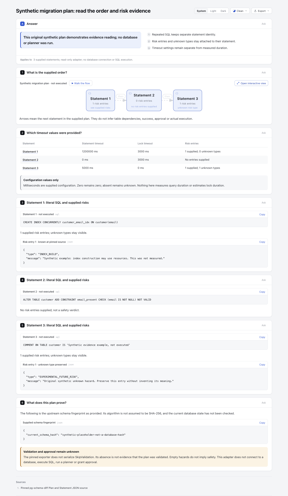
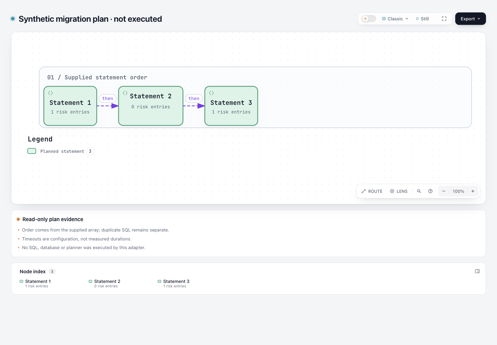

# 已有迁移计划 → 有序风险证据页

这个离线实验读取 `pg-schema-diff` 已有计划 JSON，保留原始 statement 顺序，在 Archify 原生 Workflow 中显示顺序链，并用 Explainer 展示每条 SQL、timeout 配置和风险条目。**当前 fixture 是原创 synthetic，未运行第三方 planner、连接数据库或执行 SQL。**

基准：Archify `82c7e0f0`；分支 `codex/lab-migration-plan`。仅新增本目录，不改 Archify runtime、schema、Viewer、CI、ZIP 或 live Skill。

## 查看产物

- [原生 Workflow 顺序图](output/plan.html)
- [逐条 SQL / timeout / hazard 证据页](output/explainer.html)
- [原生 Workflow JSON](output/plan.workflow.json) 与 [Explainer JSON](output/plan.explainer.json)
- [原始计划和归一化证据](output/evidence.json)
- [可移植验证摘要](output/portable-validation.json)，明确是选取阶段结果和 hash 后生成的 summary，不是原始 Archify receipt。
- [测试记录](output/tests.tap)

截图位置预留为 `screenshots/migration-plan.png`；浏览器截图和可读性验收由协调 agent 补充。这里没有把自动 finalize 的 browser-check 标为已运行。

## 语义边界

- 节点是 Statement 1、2、3；箭头只表示输入数组的下一项。重复 SQL 保持独立编号，绝不去重、排序或推断表依赖。
- timeout 和 lock timeout 是输入配置，以毫秒显示，**不是实测 SQL 耗时或锁持有时长**。数值 0 原样保留；缺失显示 unknown，不补默认值或自行解释为安全。
- `hazards: []` 显示“未提供风险条目 / No risk entries supplied”，不称 safe。缺失 hazards、null、空数组分开保存和显示。未来未知 hazard type 原样保留并标 unknown，不推断其含义或忽略。
- `current_schema_hash` 是上游提供的 schema 指纹。算法未假定为 SHA-256，也没有拿它验证数据库当前状态。`inputSha256` 才是本实验对实际输入文件字节计算的 SHA-256。
- 上游 `SkipValidation` 没有进入其 `Statement.MarshalJSON`；字段缺失不能说明计划已验证。这里不授予审批、不执行数据库动作，也不生成新的迁移计划。

Fixture 有三个原创虚构 statement：一个已知 `INDEX_BUILD` 类型、一个空风险数组、一个未知 `EXPERIMENTAL_FUTURE_RISK`，并含 statement timeout 和 lock timeout 为 0 的情况。它用于说明数据边界，不是迁移建议或真实测量。

## 来源与许可

格式和已知 hazard type 名称来自 Stripe 的 MIT 项目 [pg-schema-diff](https://github.com/stripe/pg-schema-diff)，固定 commit `9ada4710c28718312557c84cca1be4b2557eed54`。

一手结构依据：[pkg/diff/plan.go](https://github.com/stripe/pg-schema-diff/blob/9ada4710c28718312557c84cca1be4b2557eed54/pkg/diff/plan.go)，包括 Plan、Statement.MarshalJSON、MigrationHazard 和 SkipValidation 注释。本实验独立编写数据适配器，没有复制 planner、连库代码或引入 Go/数据库运行依赖；Archify 本身许可见根 LICENSE。

## 复现

从仓库根使用 Node 22 运行。本次 Node 22 执行；依赖仅为现有项目依赖，未改 lockfile：

```sh
npm ci --ignore-scripts
npm --prefix archify ci --ignore-scripts
node --test experiments/migration-plan/adapter.test.mjs
node experiments/migration-plan/build.mjs
```

`build.mjs` 每次用全新的 `run-<UUID>/` 目录，顺序执行适配器、公共 `render workflow --quality standard`、公共 `finalize explainer`。它打印该次目录和 checkout 外临时证据目录；原始 receipt 不改写，保存在外部临时目录。可提交的是明确标记的 portable summary（相对命令、阶段结果、产物 SHA-256），不冒充原始 receipt。当前 `output/` 是一次成功运行字节相同的分享副本，原始收据没有被重绑定到副本路径。

读取自己的已有计划：

```sh
node experiments/migration-plan/adapter.mjs supplied-plan.json provided-plan new-output-directory
node archify/bin/archify.mjs render workflow new-output-directory/plan.workflow.json new-output-directory/plan.html --quality standard
node archify/bin/archify.mjs finalize explainer new-output-directory/plan.explainer.json new-output-directory/explainer.html --json
```

第二、三条手动命令会产生含本机路径的原始 receipts，分享时请保留在本地并生成明确标识的 portable summary。`provided-plan` 仅声明输入由使用者提供，不验证 producer 运行、数据新鲜度或计划适用性。适配器不执行输入中的 SQL，也不解析 SQL 来猜对象依赖。

## 字面数据与文件边界

所有原始 DDL、hazard type、hazard message、schema 指纹只进入原生 Explainer 的 `snippet.text`，由 renderer HTML 转义显示为 code。**没有把它们拼进 Markdown、链接、图片、标题、表格或 directive。** timeout 表格只包含生成的 Statement 编号、数值和固定状态文字；类型名称仅用于判断“固定版本已知/未知”，原文在 JSON code snippet 中可核对。

既有目录、文件或输出 symlink 均被拒绝。有效输入校验完成后才建立全新目录，三个 JSON 文件用 `wx` 独占创建，因此不会跟随已有 `evidence.json` symlink 覆盖无关文件。三个文件写入不构成单一原子事务；磁盘故障可能留下当次新目录里的部分输出。原生 HTML 的交付检查仍由 Archify 负责。

CLI 最多读取 200001 字节来判定 200000 字节上限，拒绝非普通输入文件与非法 UTF-8；不会一次读入任意大文件。输入可以从用户明确提供的 symlink 指向普通文件读取，但输出路径必须不存在。

## 有意保留的小范围

- 最多 6 个 statements，复用 Workflow v2 的 0–5 列；超限明确报错，不静默截断。不是任意规模迁移系统。
- 每条 DDL 最多 8000 字符，最多 10 条 hazard；type 最多 300、message 最多 4000 字符。普通换行和 Unicode 保留，无法忠实显示的控制字符和孤立代理项拒绝。
- `statements` 必须存在，支持数组与 null；null 和空数组分别保留。不把空计划当作数据库无须变更的证据。
- `ddl` 必须是非空字符串；timeout 可缺失，有值时必须是非负安全整数。null/string/负数/小数/溢出均拒绝。
- 只接受固定源码列明的 root/statement/hazard 字段；未知属性拒绝。未来格式变更需明确评估，不能悄悄忽略可能影响执行语义的字段。未知 hazard **类型值**则保真接受。
- JSON 重复对象键沿用 JavaScript `JSON.parse` 的最后值语义；没有另写 JSON parser。原始输入字节有 digest，statement 数组中的重复项完整保留。
- 没有运行真实 planner 或数据库，尚无真实计划的实用性、执行效果、跨版本或数据库兼容性证据。

## 实际验证与失败记录

14/14 Node 测试通过，0 skipped。保护顺序/重复项、0 和 missing、hazard unknown/empty/null/absent、schema 指纹与 SkipValidation 边界、严格格式/数值/大小拒绝、CLI 无效输入不出版、输出 victim 文件与 symlink 保留。

另外通过真实公共 renderer 验证：恶意 SQL/hash/type/message 中的 Markdown 链接、图片、pipe、backtick、闭合 code/script 和 directive 都原样显示为代码字面量；parse5 检查没有攻击者链接、图片或 script 节点，timeout 表仍是固定数值内容。空/null 计划也经过真实公共 Workflow render。

最终示例公共 render 成功；finalize 的 validate、deliver、check 通过。browser-check 未请求，原始 visualReview 为 not-requested；视觉验收和截图仍单独记录，不据此声称自动浏览器 gate 通过。产物中未检出个人用户路径。

第一稿采用 Workflow v1，固定列容量拒绝相邻节点；随后改用已有 Workflow v2，并限制6条。首轮空计划测试失败于单元素 mainPath 不符合 schema；现在少于2条时省略可选 mainPath，空/null 真实渲染回归通过。portable summary 保留失败摘要；原始本机日志在 checkout 外。

按 test-value 选取局部语义/失败边界测试与真实产品渲染，不冻结布局坐标；未改共享产品实现，因此未重复全套 CI、Windows、安装或 runtime regression。静态检查/合成 fixture 不等于真实数据库场景验收。

## Actual browser images

The screenshot exposes the three supplied statements, configured timeouts including zero, empty risk entries and one unknown hazard. The arrows state supplied order only. Native browser-check was not requested; this image review is separate from that gate.





Capture settings and current HTML/image hashes are in [capture.json](screenshots/capture.json). These are agent-captured and agent-inspected images; human acceptance is pending. Original finalize visualReview fields remain unchanged.

AI assistance: Codex and GPT-6.1 Sol subagents performed investigation, implementation, focused validation, review and documentation. The repository owner has not yet accepted this experimental branch.
