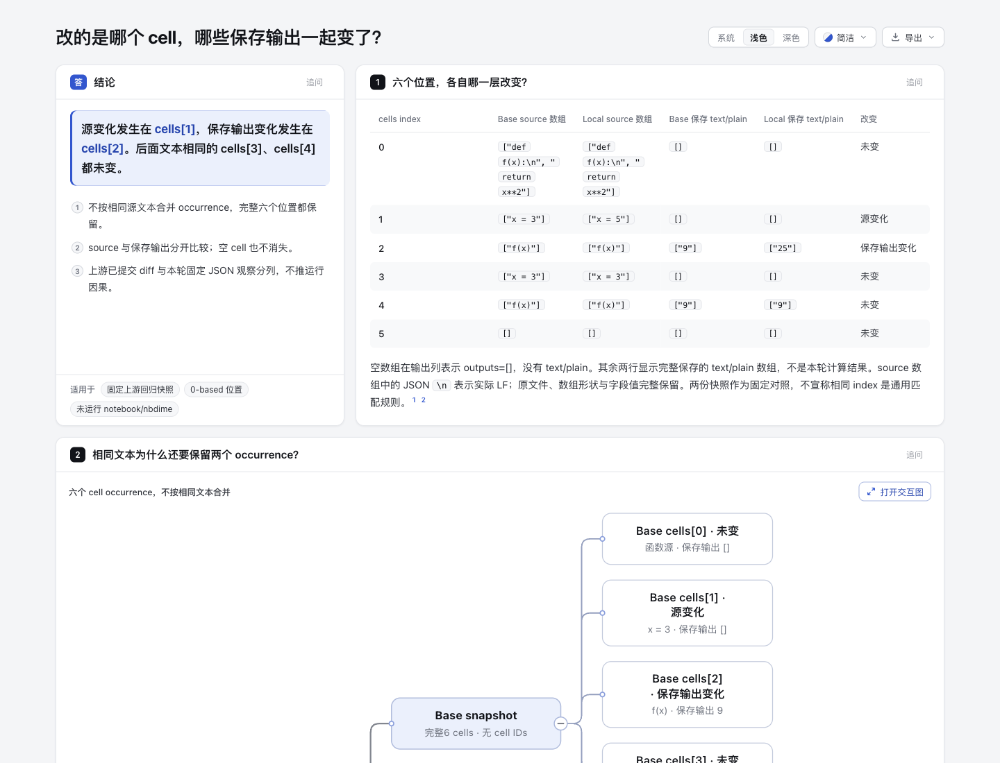
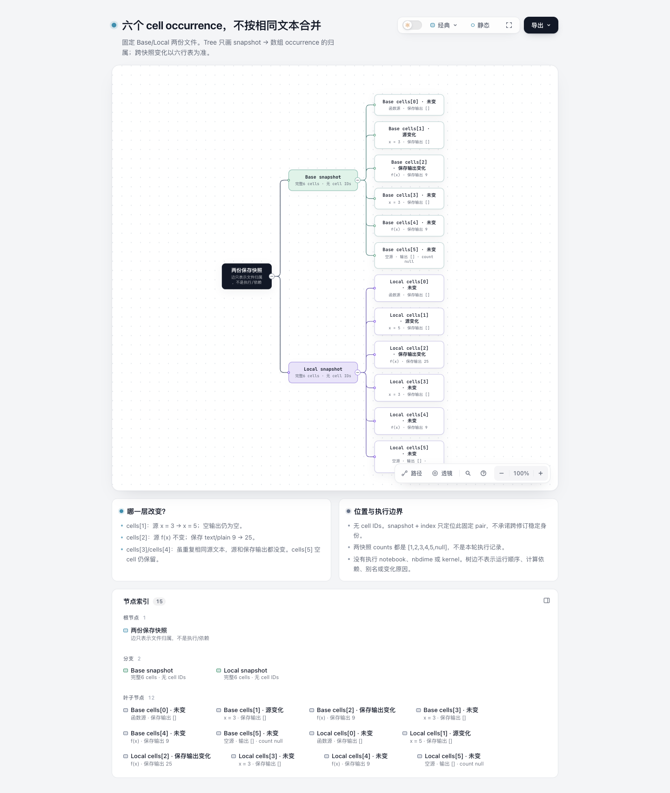

# notebook-occurrences：定位源变化与保存输出变化

一个固定内容实验，基于 Archify dev `10b4dd5c5f2264baa315ee65a9b4cc23c13ea5f0`。只新增本目录，复用现有 Tree/Explainer；没有产品代码、schema、通用 notebook importer、matcher、patcher、执行器或新依赖。AI 协助：Codex / gpt-6.1-sol 负责调研、内容、标准库观察、自动核验和文档；没有真人验收或学习收益声明。

## 读者任务与入口

**“这次保存修改涉及哪个 cell 的源、哪个 cell 的输出？后面看起来相同的 cell 有没有变？”**

- [解释页](explainer.html)：六行 before/after 表为主，分列源数组、保存 text/plain 与改变层次。
- [原生 Tree](notebook-occurrences.html)：只表示 snapshot→occurrence 归属，不画执行依赖或对齐算法。
- [单一模型](notebook-occurrences.tree.json)：由解释页 `@diagram` 引用；两页不是各手画一份图。

答案：0-based cells[1] 的 source 从 x = 3 改为 x = 5；cells[2] 的源 f(x) 没变，保存 text/plain 从 9 改为 25。后面同样源文本的 cells[3]/cells[4] 源和保存输出都未变，空 cells[5] 仍保留。六个 occurrence 不能按源码文本去重。两份文件没有 cell IDs；snapshot+index 只定位这对固定文件，不是跨修订稳定身份。

## 完整固定来源与许可

固定 [jupyter/nbdime@744c97897e2c33a1b3f04f5834ee6e70478219a2](https://github.com/jupyter/nbdime/tree/744c97897e2c33a1b3f04f5834ee6e70478219a2)。所有来源原字节与 SHA/bytes 见 [source manifest](upstream/source-manifest.json)。完整 [LICENSE.md](upstream/LICENSE.md) 是 BSD-3-Clause，2885B / SHA256 `e1f09fb826f2849211dd2e58d9541faf88fb3db04dee89c468f09a59dd00f8b9`。上游材料继续用 BSD；本目录原创脚本/内容遵循本仓 Apache-2.0。

| 完整 fixture，相对于 upstream/nbdime/tests/files/ | bytes | SHA256 |
| --- | --- | --- |
| multilevel-test-base.ipynb | 1706 | `13cd472a33d45987f715db064d51eb3f9fc26381f8aca876adb6a3d734446265` |
| multilevel-test-local.ipynb | 1707 | `2d88dbe05ac89d1b9617e97af4fd5c480c155edae6821cdd152e15816c13d6c2` |
| multilevel-test-base-local-diff.json | 1754 | `932b57033edbe76a4382ad1cd6a11d7e39f33939a5b648faeec18c748d98a2b3` |

另保留完整 owning `nbdime/diffing/notebooks.py`、`snakes.py` 与 `tests/test_cli_apps.py`：多级比较 predicate、source/output 分层 diff，以及测试对这三份文件的引用。它们不是本轮执行结果。上游材料是已提交的回归 fixture，不是自然用户工作负载或本轮 kernel capture。完整 expected diff 是上游 oracle，不是我们的 JSON 比较所生成。

## 本轮观察与保真边界

[observe.py](observe.py) 是原创标准库固定输入读取。只打开本目录指定的三份 JSON，先核 SHA/bytes，按固定六位置比较 cell 全字段，核非 cells 顶层字段相同、无 cell IDs、counts 未变，再检查 oracle 的已知嵌套 patch。它不计算通用 notebook 对齐、不应用 patch、不运行/导入上游。实际 stdout 原字节复制为 [observation.json](observation.json)，含六个 cell 的完整 base/local 字段与独立列出的上游 oracle 路径。

source 数组保持完整。cell 0 第一源元素末字符为 LF（ord=10），在 JSON 表示中显示为单反斜线加 n；这不是两个原始字面字符。数组边界、LF 与 JSON 转义不能混用。保存输出仍是原始数组值，不是本轮求值。表格按普通文本排版，视觉换行和连续空格可能折叠；精确缩进、数组转义与字段值以原文件和 DOM 文本 JSON 解码审计为准，不声称是代码编辑器级逐字符排版。两份 counts 都是 `[1,2,3,4,5,null]`，不是本轮执行顺序；counts 未变也不证明重跑、fresh/stale、计算正确或变化原因。

oracle 源叶 `/cells/1/source/0` 在字符位置4替换3→5；保存输出 MIME 路径 `/cells/2/outputs/0/data/text~1plain` 在字符位置0替换9→25。`~1` 是 JSON Pointer 对 `/` 的转义，不是源码行号。没有从相邻位置补 cells[1]→cells[2] 运行依赖箭头，也没有对象 alias 或内存身份推断。

初次检查曾误读工具 JSON 外层转义，把实际 LF 当成字面反斜线+n，前两版观察断言失败。随后用长度与字符 ord 核清并修正断言，第三版观察通过；原 fixture 始终原字节。失败两版源和原 stdout/stderr 已外置保留，公开摘要绑定其 hash。源码是否看似合法不影响本轮边界：没有运行 notebook、kernel 或 nbdime，也不宣称它不可执行。

## 命令与证据

从 repository root 执行：

```sh
PYTHONDONTWRITEBYTECODE=1 python3 experiments/notebook-occurrences/observe.py
PYTHONDONTWRITEBYTECODE=1 python3 experiments/notebook-occurrences/audit.py
/opt/homebrew/opt/node@22/bin/node archify/bin/archify.mjs render tree experiments/notebook-occurrences/notebook-occurrences.tree.json /tmp/notebook-occurrences-render.html
/opt/homebrew/opt/node@22/bin/node archify/bin/archify.mjs finalize tree experiments/notebook-occurrences/notebook-occurrences.tree.json experiments/notebook-occurrences/notebook-occurrences.html --json
/opt/homebrew/opt/node@22/bin/node archify/bin/archify.mjs finalize explainer experiments/notebook-occurrences/explainer.archify.md experiments/notebook-occurrences/explainer.html --json
```

观察/审计只写 stdout，不覆盖输入或产物。交付命令会替换明确指定的输出；已有 browser evidence 后重跑按 delivery contract 使用新的 `--out-dir`。Node 路径是本轮环境，不嵌入产物。

按 CONTRIBUTING / archify-tuning / test-value 选证据：只有固定 authored 内容，没有共享行为改变，不跑全仓测试或写镜像实现测试。[audit-result.json](audit-result.json) 的11项实际审计通过，核完整来源 hash、独立固定读取、两处变化和重复未变项、空 cell/ID/count、实际 HTML 六行表及 JSON 字段回读、LF/转义字符、纯归属 Tree、相同模型嵌入及私路径边界。不是 notebook 执行测试。

实际 public render 成功。Tree finalize validate/deliver/check/browser-check 四阶段 pass；Explainer validate/deliver/check pass，browser-check 为 not-run。完整原始 delivery/finalize receipts 外置，公开 [portable-summary.json](portable-summary.json) 是明确派生摘要，包含原 stdout hash，不伪装原始未脱敏 receipt。

## 视觉范围

root 已用 Ego / Chromium 在 1440 × 1100、light 条件下实际捕获并逐张目视四张 PNG，没有发现本内容任务的阅读阻塞。图片保持原字节；[capture-summary.json](screenshots/capture-summary.json) 是绑定输入、两 HTML、四 PNG 与三份外置 root 原始观察 JSON 的派生摘要。

- [解释页首屏](screenshots/explainer-overview.png)：1440 × 1100，显示六行对照表。
- [完整解释页](screenshots/explainer-full.png)：实际 PNG 1440 × 2743；工具显示时缩放不改变该文件尺寸。
- [来源卡](screenshots/source-card.png)：1440 × 1100，只显示 Base citation 元数据与固定 744c978 原文 URL；未打开外链。
- [完整原生 Tree](screenshots/native-full.png)：实际 PNG 1440 × 1705，15 个节点包含 12 个 occurrence，空 cell 未消失。





DOM 观察实际核了六行表、source JSON 解码后的 LF ord=10 与四个缩进空格；普通视觉排版仍可能折叠空格。原生图只表达归属，未添加运行依赖边。来源卡只是引用元数据，不是嵌入或已验证的代码片段。此次真实浏览器范围仅上述页面、字段与来源卡检查，不能冒充 Explainer 完整 browser gate；finalize 的 browser-check 仍为 not-run。提供的 raw 未记 preset/motion 状态，不补推。没有读屏、跨浏览器、真人、学习收益、kernel 或 nbdime 执行验收。

提交检查：原创 Markdown、Python 与 JSON 的空白检查通过；两份正常生成的 HTML 保留现有 renderer 输出的尾随空白，未手动清理生成物或上游原文件以改变其字节。
