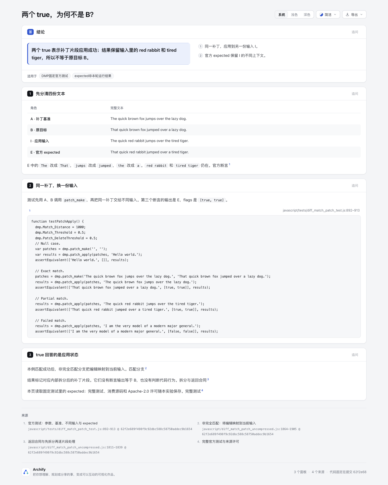
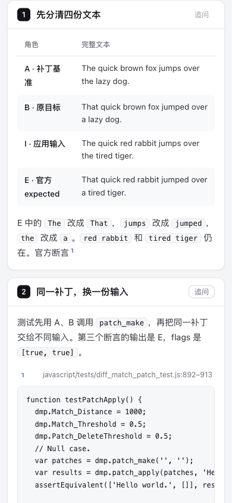

# Patch outcome：两个 true，为何不是 B？

[打开独立页面](explainer.html)。这是一个content-only阅读例：同一个补丁作用于不同输入时，官方测试期望它保留输入中的不同上下文。两个 `true` 表示补丁片段应用成功，未断言结果等于原目标B。

本实验基于Archify固定dev `10b4dd5c5f2264baa315ee65a9b4cc23c13ea5f0`，只增加本目录；未改产品、schema、比较模式、依赖或ZIP。没有运行第三方JS、`patch_make`、`patch_apply`、测试runner或任何补丁应用，没有安装依赖。页面默认无图：A/B/I/E是四个文本角色，不能画成真实编辑时间线。

## 来源与页面范围

固定上游 [google/diff-match-patch@62f2e689f498f9c92dbc588c58750addec9b1654](https://github.com/google/diff-match-patch/tree/62f2e689f498f9c92dbc588c58750addec9b1654)，实际许可为Apache-2.0。[完整许可](upstream/LICENSE)与原始版权头保持原字节；[source-manifest.json](source-manifest.json)记录6份完整文件的bytes、SHA-256与Git blob SHA-1：未压缩/压缩JS、测试JS、HTML runner、README及LICENSE。源码只作阅读材料保存，不被页面执行。

- [官方test L892–913](https://github.com/google/diff-match-patch/blob/62f2e689f498f9c92dbc588c58750addec9b1654/javascript/tests/diff_match_patch_test.js#L892-L913)包括3个参数、空case、`patch_make(A,B)`、exact/partial/failed匹配与expected。完整原test与runner也保存；runner注明后续测试依赖前序，不把这段摘录称为独立实测。
- `A/B/I/E`来自该原test内完整literal，字节长依次44/44/48/48，无末尾换行。它们不是四个上游独立文件。[facts.json](facts.json)记录实际sourceLine和columnBytes：行号1-based，字节列为0-based半开区间 `[start,end)`；facts不携带虚构Gitpath或中间revision。
- `[true,true]`来自L908的官方expected断言；不是本轮stdout。E保留 `red rabbit`、`tired tiger`，所以E不等于B；本例是上游构造测试，不冒称自然业务补丁或用户失败。
- [consumer L1811–1839](https://github.com/google/diff-match-patch/blob/62f2e689f498f9c92dbc588c58750addec9b1654/javascript/diff_match_patch_uncompressed.js#L1811-L1839)先复制、padding、split，再逐片段写results。一般不能把布尔下标直接映回原始用户hunk/文件；[成功的非完全匹配分支](https://github.com/google/diff-match-patch/blob/62f2e689f498f9c92dbc588c58750addec9b1654/javascript/diff_match_patch_uncompressed.js#L1864-L1905)把编辑映向当前输入，但不是所有非完全匹配都可接受。

页面仅有四角色表、完整测试摘录、两句机制与来源。省去另一test里的94B serialized expectedPatch；没有实现patch parser/evaluator、AST匹配、Workflow或新Delta模式。未推断代码行为、编译结果、重构等价或补丁安全性。与Hintful stages区分声明中间态S不同，本页回答的是“应用状态”与“最终文本身份”的区别；与Delta values实际receipt字段显示互不替代。

## 复现与实际证据

使用含上述固定commit对象且origin为该上游的只读Git仓（可无checkout）；来源解析只读Git对象，不执行上游文件：

```sh
node archify/bin/archify.mjs finalize explainer experiments/patch-outcome/explainer.json experiments/patch-outcome/explainer.html --quality standard --repo-root /path/to/read-only-source-repository --json
python3 experiments/patch-outcome/audit.py
```

实际用Node22.23.2（macOS arm64，zlib1.3.1-e00f703）调用仓库正常公共CLI；最后 `validate/deliver/check` 三阶段通过；保留1条 `writing-qualification` 建议（正文“本例”），没有error，`browser-check`未请求/未运行。它不等于完整浏览器gate、AT、外链打开、OS剪贴板或人类验收。`audit.py`只用Python标准库，不导入/运行JS；实际10项通过，核完整原bytes、四literal及源字节区间、原908 flags、E≠B、prepared完整input、3Git引用、DOM四行完整文本及全部代码摘录。审计保护的是内容/来源绑定，不复刻patch算法或另造其输出expected。

[portable-summary.json](portable-summary.json)保存输入、HTML、审计、来源、公开文件与外置raw收据的指纹。原始收据均在checkout外，公开文件为选取字段的派生摘要；hash不能替代未执行的阶段。产品源码未改，因此未跑全仓/renderer/browser测试套件，也未重打ZIP。

### 保留的失败与修订

1. 首次对裸Git对象仓调用finalize，来源位置校验失败，4阶段均not-run；原stdout/stderr及相同输入已保留。改用有origin的普通Git对象仓（无checkout）后正常通过；没有通过删除来源或降低校验掩盖失败。
2. 第一份成功HTML为 `3031f0ae7436a01003411c0a98516e051f9b202e96175f52930db86903ae2d11`。独立review建议将非完全匹配句限定为本例成功分支，并把“许可随页保留”精化为“随本实验保存”；两句改动后重新正常finalize，得到上述1条限定词建议；为准确限定成功匹配分支而保留句意。旧HTML/input与compact stdout原样保留，不借旧hash冒充最终页。
3. 首次事实审计误将 `preparedDiagrams` 包装对象 `{"diagrams":{}}` 当作有图，末项断言失败；原audit源/stdout/stderr保留。修正审计读取实际diagrams空映射后10项通过，未改HTML或放宽页面事实。

## 视觉检查

Root协调者实际浏览并逐张查看4张原PNG；[派生capture摘要](screenshots/capture-summary.json)绑定最终HTML `4304f311b4d19c246b5b619b9ad3314ec5f6210ad005189a530d282efea833ee` 与4份外置原观察指纹。图片为浏览器原字节，没有裁剪、编辑或重画。





[深色源码预览](screenshots/source-dark.png) · [完整手机长页](screenshots/mobile-light.png)。桌面viewport1440×1100、全页1440×1800，手机viewport390×844、全页390×2335；另两图分别1440×1100和390×844。

实际桌面浅色pageWidth1440，表1238/1238、完整页面代码1236/1236（client/scroll）；手机浅色pageWidth390，四角色表332/332，完整literal通过折行可读。手机代码pre为330/917，长行被当前视口裁切；本轮未横滚代码，不能称完整代码在窄屏同时可见或横滚已验证。

Root实际切深色、点击面板anchor，再pointer hover来源编号。弹卡只预览892–905附近，宽488/888、高278/292，不能称908的flags或全部22行在弹卡内可见；完整原测试可在桌面页面代码块中阅读。点击手机 `#four-texts` 面板导航后保留4行原文。没有执行上游、打开外链、键盘遍历、AT、触屏手势或OS剪贴板；这些视觉记录与normal finalize的browser-check未请求分列，不是完整gate或人类验收。

## 范围与责任

本例由Codex（gpt-6.1-sol，medium）研究、作者与事实审计，另一位agent独立复核；实际视觉由协调者另行记录。不是原项目作者声明，没有第三方执行或用户收益实测。本实验未合入dev、release或live安装。
