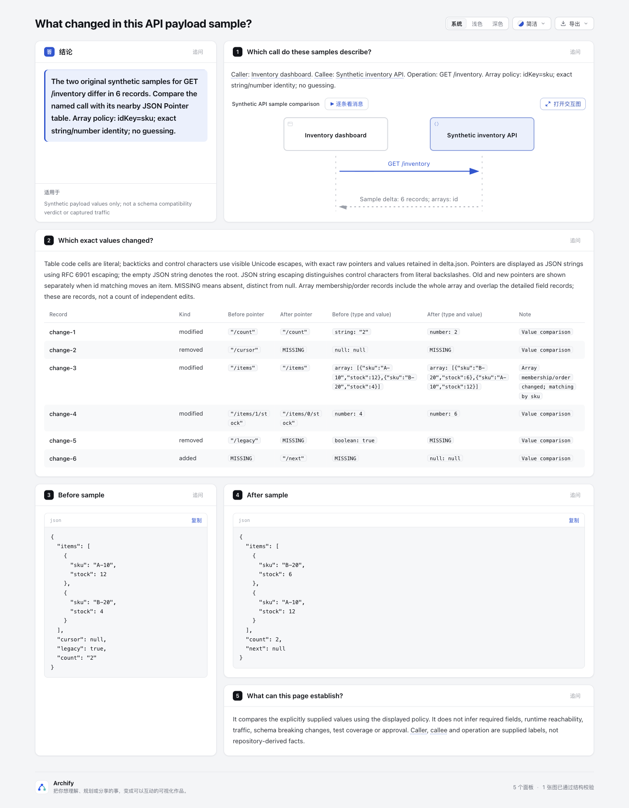

# Payload delta lab

A small, original experiment for reviewing **two explicitly supplied JSON sample values** next to their named API call. The example changes an inventory response: SKU rows reorder, stock changes from 4 to 6, a string becomes a number, a null field disappears, and a different null field appears. All labels and data are synthetic; no captured traffic or private transcript is used.

Open [the Explainer review](example/review.html) or [the native sequence](example/call.html). The review contains the native diagram, a JSON Pointer table and the complete before/after samples. Six records include an array order/membership record plus detailed values; records are not a count of independent edits. The diagram's return arrow is an illustrative comparison summary, not a measured API response.

## Scope and provenance

- Repository base: `82c7e0f0`. Isolated branch: `codex/lab-payload-delta`.
- Inspiration: [Coldtea PR Lens](https://github.com/coldteadotai/pr-lens/tree/39750d165efd824d1203df7793ecbfed35b6361e), commit `39750d165efd824d1203df7793ecbfed35b6361e`, [MIT](https://github.com/coldteadotai/pr-lens/blob/39750d165efd824d1203df7793ecbfed35b6361e/LICENSE). Its edge payload shapes/samples suggest putting values beside the named call. No upstream code or assets copied.
- Additional research: [JSON Semantic Diff](https://github.com/cchandurkar/json-semantic-diff/tree/6ef190d735cf67c57534f97299ea98022f8c7d0f), commit `6ef190d735cf67c57534f97299ea98022f8c7d0f`, MIT. This lab deliberately requires an explicit identity policy and does not infer identity.
- Uses the existing public Archify renderer/finalize commands. No schema, Viewer, renderer, product test, CI, dependency or package changes. Related existing work: [Git-ref Architecture comparison #1049](https://github.com/tt-a1i/archify/pull/1049), [Explainer source focus #1015](https://github.com/tt-a1i/archify/pull/1015); this experiment adds neither a Git-ref reader nor a new code-focus system.

## Run

Use Node 22. No experiment dependencies or installation are needed. From the repository root:

```sh
node --test experiments/payload-delta/compare.test.mjs
node experiments/payload-delta/compare.mjs experiments/payload-delta/sample.json experiments/payload-delta/new-example
node archify/bin/archify.mjs render sequence experiments/payload-delta/new-example/call.sequence.json experiments/payload-delta/new-example/call.render.html
node archify/bin/archify.mjs render explainer experiments/payload-delta/new-example/review.archify.md experiments/payload-delta/new-example/review.render.html
node archify/bin/archify.mjs finalize sequence experiments/payload-delta/new-example/call.sequence.json experiments/payload-delta/new-example/call.html --json --out-dir "$PAYLOAD_EVIDENCE_DIR/sequence"
node archify/bin/archify.mjs finalize explainer experiments/payload-delta/new-example/review.archify.md experiments/payload-delta/new-example/review.html --json --out-dir "$PAYLOAD_EVIDENCE_DIR/explainer"
```

Set `PAYLOAD_EVIDENCE_DIR` to a new directory outside the checkout. The generator requires an existing real parent and a **new, nonexistent output leaf**; use a new name on each run. It never overwrites generated files. Each file uses exclusive `wx` creation; input symlinks, existing destinations and symlink ancestors in the output path are refused. Do not use a symlink spelling such as macOS `/tmp` as an output ancestor; use its real path. This check is not a defense against a privileged/concurrent process swapping ancestor directories after validation.

Archify delivery sidecars are written beside HTML even with `--out-dir`; move those original sidecars outside the checkout after validation. Do not alter raw receipts to make them portable. Checked-in [evidence-summary.json](example/evidence-summary.json) records artifact hashes and gate outcomes without machine paths; it is a lab summary, not an original delivery receipt. Copied pages remain useful to read, but are not accompanied by current original provenance in this directory.

## Input and semantics

The input has exactly `caller`, `callee`, `operation`, `arrayMode`, optional `idKey`, `before`, and `after`. Labels use 1–70 ASCII letters/digits/spaces or `/_.:-`; they are supplied metadata, not facts extracted from source code. `before` and `after` may be any JSON values.

- `arrayMode: "index"`: compare positions; no inferred identity and no `idKey` allowed. A reorder may produce several field changes.
- `arrayMode: "id"` plus `idKey: "sku"`: every array, including nested arrays, must consist of objects with a unique own string/number key. Missing, duplicate, null or structured identities are rejected even for unchanged arrays. Numeric `1` differs from string `"1"`. Use index mode for primitive arrays; per-path mixed policies are outside this experiment.
- Object key order is ignored. Missing and null remain separate. Scalar types are preserved. Container additions/deletions and type replacements are recorded at their container pointer, not exploded into every descendant.
- Table cells use literal code spans. Backticks and control characters use visible Unicode escapes; JSON-string display of pointers distinguishes actual control characters from literal backslashes. Exact unencoded pointers and values remain in `delta.json`. Root pointer is the empty string. Keys use RFC 6901 escaping (`~` → `~0`, `/` → `~1`). With id matching, old and new pointers name the actual positions in each sample. Array membership/order changes receive a parent record with complete arrays; matching items also receive leaf records where values differ.
- No schema inference, breaking-change verdict, traffic claim, required-field inference or test/approval claim. Duplicate object keys follow JSON.parse's last-value behavior; inputs should use unique object keys.

Bounds: 64 KiB input file; 3,000 payload nodes total; depth 12; 100 items per array; 100 keys per object; 100-character keys; 1,000-character strings; 300 change records; 2 MiB per generated document. Non-finite numbers and integers outside JavaScript's safe range are rejected. Values retain JSON number semantics, not arbitrary decimal precision. Unsupported or oversized input fails explicitly before output creation.

## Evidence and limitations

Focused tests protect caller-visible semantics and existing-file victims: types and null/missing, pointer escaping/prototype-like keys, id reorder mapping, additions/removals, duplicate/missing identities, explicit index policy, hostile strings, bounds, fresh output and symlink refusal. No product-wide suite is needed for this isolated adapter; these tests do not establish renderer compatibility across Node versions or Windows filesystem behavior.

The repair round adds a public-render regression for literal web links, image syntax, javascript-looking links, backticks, pipes, newlines and control characters in keys and values. Negative controls establish that unencoded web links become anchors and unencoded image/javascript syntax is refused; no script execution was observed. All 10 focused tests pass.

Actual render/finalize/browser outcomes and artifact digests are in [the portable summary](example/evidence-summary.json). Initial rejected Explainer drafts exposed unsupported heading levels, empty cells and duplicate row identifiers; the experiment emits supported syntax and stable row IDs. The captured duplicate-identity failure receipt remains outside the checkout; earlier parse/schema failures were observed in terminal output. Product validation was not loosened. The refreshed Explainer finalize passes with one nonblocking `writing-paragraph-length` warning on the comparison-reading explanation; this remains recorded in the portable summary.

## Actual browser images

The named call, six delta records and full before/after code cards are visible. Null, MISSING and changed scalar types remain distinct. The pointer table wraps long values; narrow-screen use was not visually checked.



Capture settings and current HTML/image hashes are in [capture.json](screenshots/capture.json). These are agent-captured and agent-inspected images; human acceptance is pending. Original finalize visualReview fields remain unchanged.

AI assistance: Codex and GPT-6.1 Sol subagents performed investigation, implementation, focused validation, review and documentation. The repository owner has not yet accepted this experimental branch.
