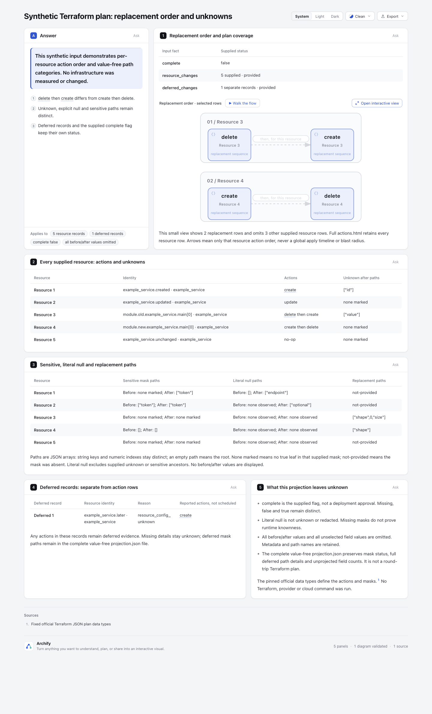
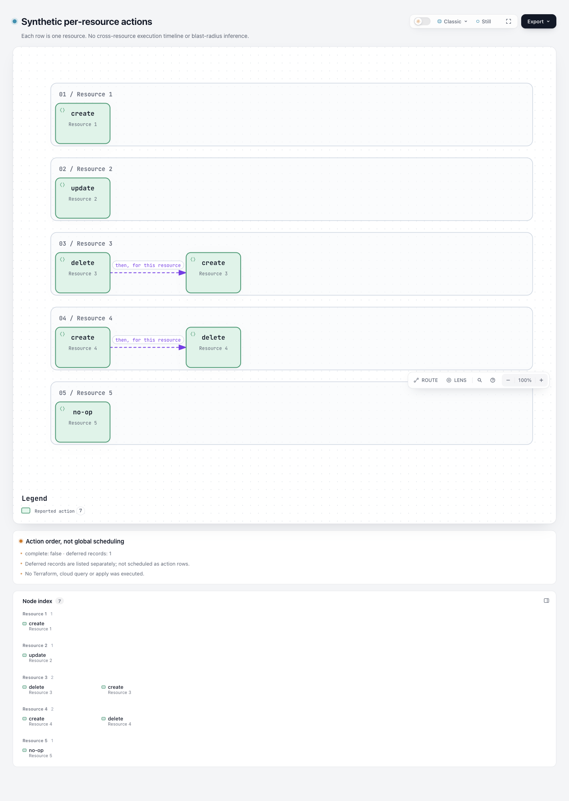

# Terraform plan：资源替换顺序与未知项解释

本实验只读已有 Terraform plan JSON，提取**资源自己的动作顺序**与属性路径类别，用 Archify 原生 Workflow 和 Explainer 展示。当前样例为原创 synthetic：5 个普通资源记录与 1 个 deferred 记录，**未运行 Terraform、provider、云查询、init、plan、show 或 apply**。

基准：`82c7e0f089a02a4d514714adf37dc2061682da5f`；分支 `codex/lab-plan-actions`。仅新增本目录，不改 runtime、schema、Viewer、CI、ZIP 或 live Skill。它是解释用的小投影，不是 plan 过滤器、往返 exporter、部署审批或故障影响分析器。

## 查看产物

- [原生资源动作图](output/actions.html)：每行一个资源；两种 replacement 保留 `delete → create` 与 `create → delete` 的不同顺序，没有跨资源连线。
- [unknown / sensitive / null 与 deferred 解释页](output/explainer.html)
- [安全小投影](output/projection.json)、[Workflow JSON](output/actions.workflow.json)、[Explainer JSON](output/actions.explainer.json)
- [可移植验证摘要](output/portable-validation.json)：明确标记为选择阶段结果与 hashes 后生成的 summary，**不是原始 Archify receipt**。
- [测试记录](output/tests.tap)

实际浏览器截图和协调 agent 的视觉观察见文末；自动 finalize 的 browser-check 仍是未运行，截图没有替代该 gate。

## 这张图能回答什么

replacement 不是一种无顺序的 changed 色块。一个资源先 delete 再 create，与先 create 再 delete 是不同动作序列；数组顺序原样进入该行。create、update、no-op 也保留，没有为了简洁删除 no-op 资源。图上的行排列不是 Terraform 全局调度，不能推导跨资源执行顺序、并发、时长、依赖、可用性或 blast radius。

`complete` 缺失时显示 `not-provided`，与 false、true 分开。false 或 true 都只是输入提供的值，本实验没有验证 plan 有效性或当前基础设施。deferred 独立计数、独立记录；即使 deferred 子记录报告了动作，也不会变成普通动作行。

属性路径保留以下类别：

- `unknownAfterPaths`：after_unknown 中的 true 路径。
- `sensitiveBeforePaths` / `sensitiveAfterPaths`：对应 sensitive mask 的 true 路径。
- `explicitNullBefore` / `explicitNullAfter`：before/after 中实际出现、且未被相应 supplied mask 覆盖的 null 路径。unknown 或 sensitive 祖先覆盖的 null 不会冒充已知 null。mask 缺失不证明运行时 knownness。
- `replacePaths`：上游提供的 replacement 原因属性路径；字符串键与数字索引不同，原样保留。

空路径 `[]` 表示 mask 覆盖根对象；非空路径如 `["shape", 0, "size"]` 表示结构化属性路径，不是文件路径。没有把 unknown、null、redacted 或 missing 合并成一个空值。

## 值抑制与覆盖边界

before/after **所有值**都不进入投影，不仅是被标 sensitive 的值。解析器只检查结构和 null 位置，不输出普通标量值；被 true sensitive 祖先覆盖的子树不会继续收集 null 路径。variables、planned_values、prior_state、配置、输出变化、identity、导入元数据等未选择字段的值也不复制。

为了不把未知扩展值悄悄当成完整覆盖，投影记录 root、resource、change 和 deferred 对象边界上未投影字段的数量；未知字段的名字和内容不复制。这里不是全 plan 的安全审计，也不是无损 round-trip。资源 address/type/deposed、deferred reason 与属性路径名称属于保留的元数据；本实验不承诺这些元数据天然匿名或没有识别信息。

源文件 SHA-256 只用于绑定本次读取字节，公开产物不包含原始 plan。原始输入应由使用者按既有权限保存；本实验不会再把它写成 raw receipt。不要把“只做投影”说成“检查完全部 Terraform plan”。

当前 fixture 中的 before/after 与 variables 含原创合成 sentinel；测试逐个检查这些原始值没有出现在生成 JSON/HTML 中。它们不是实际凭证，也不是部署数据。

## 官方格式来源与许可

固定资料来自 [hashicorp/terraform-json](https://github.com/hashicorp/terraform-json)，commit `8f4894d138d0fe71436cba6dbc8f16577e9a9e7d`，项目许可 MPL-2.0：

- [plan.go](https://github.com/hashicorp/terraform-json/blob/8f4894d138d0fe71436cba6dbc8f16577e9a9e7d/plan.go)：resource_changes、Change masks、replace_paths、Complete 指针和 DeferredResourceChange。
- [action.go](https://github.com/hashicorp/terraform-json/blob/8f4894d138d0fe71436cba6dbc8f16577e9a9e7d/action.go)：单动作与两种 replacement 的组合，不能只看动作集合。
- [README](https://github.com/hashicorp/terraform-json/blob/8f4894d138d0fe71436cba6dbc8f16577e9a9e7d/README.md)：官方明确其数据类型会丢未知字段，不适合过滤/往返。这里没有把它当 decoder 或引入 Go。
- [Terraform JSON format 官方说明](https://developer.hashicorp.com/terraform/internals/json-format)：格式 major/minor 语义、plan 与 change 结构。该在线说明会更新；本实验字段来源仍固定到上述 commit。

本实验独立实现小投影，没有复制 Terraform 引擎或 terraform-json decoder。官方数据类型库的 MPL-2.0 不能拿来推断 Terraform 引擎许可；Archify 原有代码许可见根 LICENSE。没有执行任何第三方 planner 或导出程序。

## 复现

从仓库根使用 Node 22。本次使用 Node 22；只安装现有仓库依赖，未修改 lockfile：

```sh
npm ci --ignore-scripts
npm --prefix archify ci --ignore-scripts
node --test experiments/plan-actions/adapter.test.mjs
node experiments/plan-actions/build.mjs
```

每次 build 使用新的 `run-<UUID>/` 目录，顺序运行适配器、公共 `render workflow --quality standard`、公共 `finalize explainer`。所有原始 delivery/finalize receipts 保存在 checkout 外临时目录；其路径只打印到本机终端。可分享目录仅有原生 JSON/HTML、小投影和明确命名的 portable summary。

当前 `output/` 是成功 fresh-run 的字节相同副本，summary 记录当时真正运行的相对命令与 hash。没有将原始 receipt 改写路径，或声称移动副本后重新建立了原始交付绑定。

读取自己已有的 plan：

```sh
node experiments/plan-actions/adapter.mjs supplied-plan.json provided-plan new-output-directory
node archify/bin/archify.mjs render workflow new-output-directory/actions.workflow.json new-output-directory/actions.html --quality standard
node archify/bin/archify.mjs finalize explainer new-output-directory/actions.explainer.json new-output-directory/explainer.html --json
```

手动 finalize 会产生原始 receipts，其中可能有本机路径；分享时保留在本地，另作明确标识的 portable summary。`provided-plan` 只是数据来源标签，不表示 Terraform 执行、provider 兼容或部署状态已验证。

## 有意限制与拒绝策略

- 只接受 `format_version` 为 `1.0`、`1.1`、`1.2`。虽然上游资料支持更广范围及 minor 前向兼容，本实验主动拒绝未检验版本，包括旧 `0.1` 与未来 `1.3`；这不是官方格式的通用兼容声明。state-only/没有任何支持的 plan 指示字段时拒绝。
- 接受单动作 no-op/create/read/update/delete/forget 与准确的两种 replacement 数组；未知动作、动作拼接字符串或其他组合拒绝，不猜成 update。
- 最多 6 个普通资源、6 个 deferred 记录；普通资源要求 address/type/change。deferred 可缺 reason/resource_change，缺失保留 unknown；已有 resource_change 可缺 change。缺失列表与已提供空列表分开；显式 null 列表、null mask、非布尔 complete 拒绝。
- mask 仅接受布尔、对象和数组，最大深度12、5000访问节点；replace_paths 最多30条，每条最多12段。字符串路径段原样保存；索引必须是非负安全整数。无法忠实显示的控制字符和孤立代理项拒绝。
- 输入最多500000字节；CLI 最多读取500001字节判断上限，要求普通文件，非法 UTF-8/JSON 拒绝。JSON 重复对象键沿用 `JSON.parse` 的最后值语义；没有另写通用 JSON parser。
- Explainer 使用原生 comparison 表格。字面元数据在进入每个 cell 前逐字符转义 inline 语言的全部特殊字符（包括反斜线、backtick、星号、方括号、括号、感叹号、尖括号、波浪线和 pipe）；不拼接 Markdown 链接、图片或 directive。真实公共 renderer 测试验证最终表格中的原文和无主动链接/图片/script。native 图标签仍为固定动作词/资源序号。
- 输出目录必须不存在，文件用 `wx` 独占创建。已存目录、文件或 symlink 被拒绝，避免跟随 `projection.json` symlink 覆盖无关文件。三个 JSON 文件不是单一原子事务；磁盘失败可能留下本次新目录里的部分产物。HTML 的交付原子性仍由原有 Archify 命令负责。

## 实际证据与未验证部分

16/16 focused tests 通过，0 skipped。覆盖两种 replacement 顺序、complete 缺省/false/true、deferred 隔离、no-op 保留、结构化路径、true 祖先抑制、unknown/null/sensitive 分类、未来字段计数和值不复制、非法格式/动作/mask/路径拒绝、fresh-output victim 保留。

真实公共 renderer 测试同时验证：fixture 所有原始值 sentinel 不出现在任何生成 JSON/HTML；恶意 address/type/path/reason 中的 HTML、Markdown 链接/图片、pipe、backtick 只是字面文本（路径显示为 JSON 数组），parse5 检查没有攻击者链接、图片或 script。空列表与未提供列表也真实渲染出覆盖边界，没有虚构 action 边。CLI 无效动作错误不会回显敏感输入值。

最终示例公共 render 成功；finalize validate、deliver、check 通过，browser-check 未请求，visualReview 为 not-requested。分享 output 文件已扫描无个人用户路径、无 fixture 原始值 sentinel。实际浏览器截图、深浅主题视觉验收和真实用户计划实用性仍单独记录。

可读性复核后做了一次限定展示改进：Explainer 首屏集中 complete/deferred 摘要与仅 replacement 的两行原生小图；明确该小图省略3条其他动作。后续两张紧凑表保留全部5条资源的动作、unknown、sensitive、literal null 和 replacement 路径，deferred 独立表格。完整安全投影仍在 projection.json，完整5行 native actions.html 的字节/hash未变。旧9405px长页面截图已过时，需协调 agent 重拍；这里不声称未测量的新页面高度。

compact 首稿有一处表格row/panel ID碰撞，被真实 renderer 拒绝；已修复并重跑通过。新增/扩充测试保护 compact视图省略说明、全部资源表格保留、真实表格恶意字面，以及空/missing资源的真实 Explainer render。

首次 focused test 发现把 action 数组 join 后比较，会误接受单个 `"create,delete"` 字符串为 replacement。已改为先验证每个原子动作，再验证组合，并保留该回归。历史失败写入 portable summary，没有把它隐藏为“首次全绿”。

按 test-value 只做本实验输入语义、安全边界与真实产品渲染验证，不冻结自动布局坐标。未改共享 runtime，没有重跑完整安装、Windows、CI 或 Terraform/cloud 验收。synthetic 演示不是生产 plan 有效性、部署安全或用户收益的证据。

## Actual browser images

The revised Explainer places both replacement orders and complete/deferred status at the top, with all five resource records in compact tables. Its captured height is 2376 pixels, compared with the earlier 9405-pixel JSON-heavy draft at the same 1440-pixel width. The complete native diagram remains separate; no cross-resource scheduling is inferred. This is an agent visual observation, not a reading-time study.





Capture settings and current HTML/image hashes are in [capture.json](screenshots/capture.json). Images were captured and inspected by the coordinating agent; human acceptance remains pending. No measured reader-efficiency benefit is claimed.

AI assistance: Codex and GPT-6.1 Sol subagents performed research, implementation, focused validation, independent review and documentation. This branch is an experiment awaiting repository-owner acceptance.
