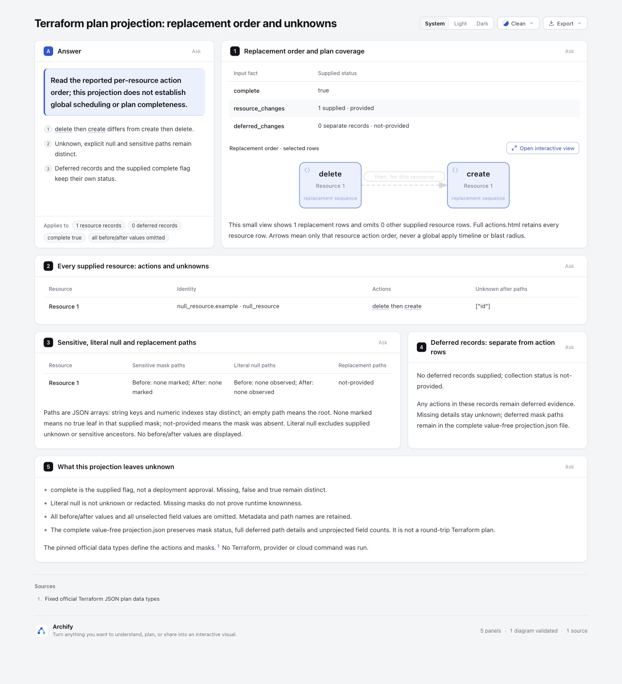
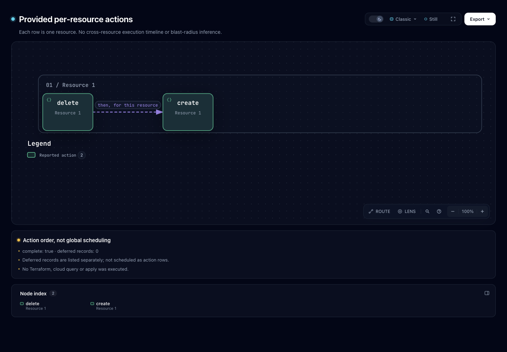

# 官方已提交fixture：一次 delete → create

本补充消费 `hashicorp/terraform-json` 的完整公开测试fixture，通过既有 adapter 原样转换。它展示**一项 delete → create 替换和 unknown id 路径**；没有运行Terraform、provider或云命令，也不代表生产计划、部署有效性或用户收益。





图片由协调agent实际打开产物后截图、查看，绑定信息见 `screenshots/capture.json`。截图与自动browser-check分开记录；人类验收未声明。

## 完整输入与固定许可

- 官方仓库：[hashicorp/terraform-json](https://github.com/hashicorp/terraform-json)，固定commit `8f4894d138d0fe71436cba6dbc8f16577e9a9e7d`，MPL-2.0。
- [source/plan.json](source/plan.json) 保留 [testdata/action_reason/plan.json](https://github.com/hashicorp/terraform-json/blob/8f4894d138d0fe71436cba6dbc8f16577e9a9e7d/testdata/action_reason/plan.json) 完整1630字节，SHA256 `582180f5f2a423d2e0f1f77348b0bc57af4e6b7d3a3580ec4c9c8bada2735bb5`，无裁切、脱敏或重排。
- 完整原始 [MPL-2.0 LICENSE](source/LICENSE) 与路径、SHA/bytes记录见 [source/manifest.json](source/manifest.json)。上游资料归属HashiCorp及原贡献者，未修改原文件。
- 官方 [plan_test.go](https://github.com/hashicorp/terraform-json/blob/8f4894d138d0fe71436cba6dbc8f16577e9a9e7d/plan_test.go#L140-L159) 读取此fixture并检查action reason；它证明该文件是官方已提交测试输入，不能证明生成过程。生成方式保持 **unknown**。

**此source目录另行保留公开原始plan，里面有原始测试值。** 主README“公开产物不包含原始plan”的承诺限定于adapter/renderer输出；不能理解为本补充整个目录不包含原plan。这里公开源fixture的授权与许可明确，用户私有plan并不因此获得公开授权。

输入声明 `terraform_version=1.15.0`、`format_version=1.2`。前者只是所提供字符串，不是本次执行或独立版本验证；adapter不复制其值到小投影，不伪造生成环境。

## 合同中实际保留与省略的事实

原始输入和投影均只有1个普通资源，没有删掉记录以迎合最多6资源的限制。

| 事实 | 原输入与输出解释 |
| --- | --- |
| actions | 准确保留 `delete` 然后 `create`，只表示这个资源自己的动作顺序 |
| after_unknown | `id=true` 对应 `unknownAfterPaths=[["id"]]`；没有把after中未给出的id当已知null |
| sensitive masks | before/after masks均已提供，但无true叶；输出保持provided与空paths，不宣称运行时没有敏感值 |
| complete | supplied true；不是部署批准或输入有效性验证 |
| deferred_changes | 原集合未提供，输出not-provided；0条投影记录不能称观测到没有deferred工作 |
| replace_paths | 未提供，保留not-provided；不从动作推断原因路径 |
| unprojectedRootFieldCount | 5个root字段未投影，数量与原输入核对一致 |
| unprojected resource fields | 4个资源字段未投影；`action_reason`在其中。没有把其值展示为已支持的替换原因 |

[projection.json](output/projection.json) 是value-free小投影，完整before/after树、planned_values、prior_state、configuration等内容不复制。[acceptance-evidence.json](acceptance-evidence.json) 明确标为派生验收记录，保留原source绑定、实际CLI exit0、未投影账目与原三个JSON的hash。

本例不覆盖 create → delete、true sensitive mask、deferred记录或其它状态组合；这些synthetic测试未因新fixture自动成为真实输入验收。没有修改adapter、测试或既有synthetic产物。

## 值抑制检查的准确边界

本fixture的before/after共有3处标量、2个不同字符串。三份输出JSON均逐值零命中，也没有before/after值树；Explainer HTML同样零命中。

Native `actions.html` 的全字节零命中断言**未通过**：一个4字符普通输入词与固定renderer JavaScript注释偶合，且同注释原本已在 `viewer/export.js:1397` 和旧synthetic HTML中。该位置不是输入传播；native可见文本与HTML属性扫描零命中。没有删注释、替换值或后处理HTML来让检查变绿。

细节见 [value-suppression.json](value-suppression.json)。此检查证明所选值没有被复制到投影、模型和显示数据，不承诺所有低熵普通词都不可能与静态JS子串重合，也不是全plan秘密审计。

## 沿用既有管线与复现

接续基线 `codex/lab-plan-actions@640fa6fff3285d35da814cedff6f0b75ae3d39ba`，Node `v22.23.3`。复用先前 `/tmp` 验收的三个JSON原字节；输入SHA与adapter源码SHA一致，无裁切、MD后处理或新布局框架。

从仓库根，在一个全新不存在的目标目录运行既有命令：

```sh
node experiments/plan-actions/adapter.mjs experiments/plan-actions/upstream-example/source/plan.json provided-plan /tmp/new-official-plan-actions-output
node archify/bin/archify.mjs render workflow /tmp/new-official-plan-actions-output/actions.workflow.json /tmp/new-official-plan-actions-output/actions.html --quality standard
node archify/bin/archify.mjs finalize explainer /tmp/new-official-plan-actions-output/actions.explainer.json /tmp/new-official-plan-actions-output/explainer.html --out-dir /tmp/new-official-plan-actions-receipts --json
```

目标目录必须全新；adapter拒绝复用目录和symlink。上面的命令只运行本仓adapter/renderer，不执行Terraform或provider。

实际workflow public render exit0，明确使用standard；没有声称workflow经过finalize。Explainer finalize validate/deliver/check均pass，零诊断，browser-check未请求、visualReview为not-requested。为了单独记录render exit code，workflow又执行了一次同命令，生成字节与首次完全相同。原始CLI/delivery/finalize receipts保留在checkout外的 `/tmp`；[portable-validation.json](portable-validation.json) 是选择阶段结果和hash后生成的可移植摘要，不冒充原始receipt。

没有重跑原16项focused tests或full suite；复用已有reader验收同字节结果，新增核对覆盖固定fixture原字节、mask/status/字段账目、原值抑制、输出与截图hash绑定。实际截图不替代自动browser gate。生成HTML保留renderer原字节，既有尾随空白不后处理；作者文档/JSON与生成HTML的whitespace结果分别记录。

AI协助：Codex挑选并核对固定官方来源、运行已有adapter/renderer、整理派生证据；协调agent实际截图并查看，另有独立agent只读复核。没有上游实跑、生产或人类验收结论。
