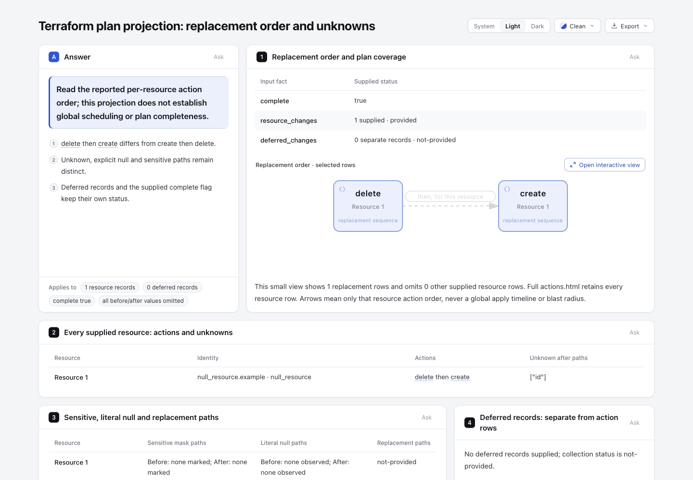
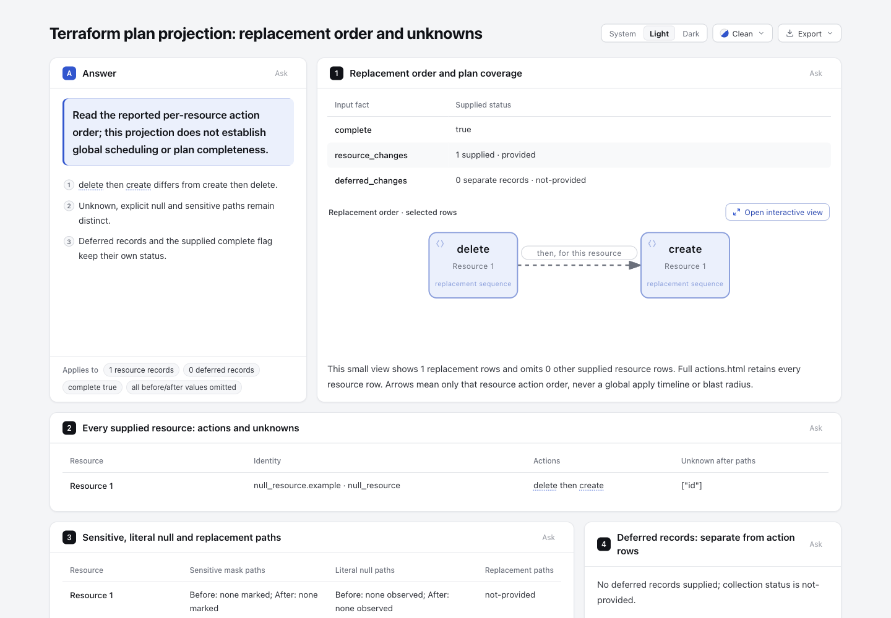

# Readable dashed relationships in Explainer previews

A reader could follow `delete → create` in the native Workflow but barely read “then, for this resource” in the light Explainer preview of the same supplied plan. The input explicitly requests a dashed relationship; it does not request muted or hidden text. This fix preserves the page's neutral, clean palette while giving that relationship's label, connector and arrowhead reading ink.

[Base page](base.html) and [candidate page](candidate.html) use the same [Explainer input](input.explainer.json). The base is the published Plan-actions experiment's exact HTML at [`729d3a0374189234e1bdfe5d6fc7f7190c894e0e`](https://github.com/tt-a1i/archify/tree/729d3a0374189234e1bdfe5d6fc7f7190c894e0e/experiments/plan-actions/upstream-example). The primary static SVG and frozen native child are byte-identical across this comparison; geometry, resource facts, action order and unknown/sensitive distinctions are unchanged.

| Base · light | Candidate · light |
| --- | --- |
|  |  |

[Dark base](screenshots/base-dark.png) · [Dark candidate](screenshots/candidate-dark.png) · [actual capture/computed-color ledger](screenshots/capture.json). Root agent captured and viewed all four at 1440×1000, same input and top-of-page state. Label/path/marker change together: light `rgb(211,215,221)` → `rgb(106,112,124)`; dark `rgb(52,57,67)` → `rgb(141,148,161)`. Masks and node appearance remain unchanged in those observations. This is agent visual review, not human or assistive-technology acceptance.

## Cause and narrow change

Shared native classes `.t-edge-dashed`, `.a-dashed` and `.m-dashed` use `--database-stroke`. Native Classic light resolves it to `#7c3aed`. Explainer deliberately remaps node palettes to the page palette; its preview maps `--database-stroke` to `--rule-strong`, which is `#d3d7dd` in Clean light. That border ink was also reaching relationship text and its arrow. This is an explicit preview-palette adaptation problem, not a lost theme stylesheet or an authored opacity setting.

Only three CSS mappings change in `archify/explainer/reader.css`:

```css
.diagram-preview text.t-edge-dashed { fill: var(--muted); }
.diagram-preview path.a-dashed { stroke: var(--muted); }
.diagram-preview polygon.m-dashed { fill: var(--muted); }
```

The existing `--muted` page text color keeps the neutral design. Node palettes, database borders, default/security/emphasis relationships, native Viewer source and schemas remain unchanged. The element/class selectors outrank later scoped native CSS without `!important`; explicit inline colors still win. Existing higher-priority highlight/Delta rules are not changed. No new palette, state, diagnostic gate, dependency or source-assertion framework is introduced.

The same shared classes occur in Architecture, Workflow, Sequence and Dataflow; the rule follows those exact classes rather than recoloring all SVG text or all database elements. No claim is made about an all-mode or all-style accessibility audit.

Related [#1017](https://github.com/tt-a1i/archify/issues/1017) and [#1042](https://github.com/tt-a1i/archify/pull/1042) concern default relationship labels. At investigation time #1042 was **OPEN, draft, unmerged**, and its description explicitly preserves colored variants. It does not cover this dashed-preview case. This experiment posts no issue or comment.

## Fixed upstream input and limits

The complete [official Plan fixture](source/plan.json) comes from `hashicorp/terraform-json@8f4894d138d0fe71436cba6dbc8f16577e9a9e7d`, `testdata/action_reason/plan.json`; [source manifest](source/manifest.json) retains its URL, 1,630-byte SHA binding and owning test reference. Its [MPL-2.0 license](source/LICENSE) is preserved. It is an upstream committed test fixture; how it was originally generated is unknown. This session did not run Terraform, a provider or a cloud workload.

The complete raw fixture is retained as source evidence. The native Workflow and Explainer JSON are reused byte-for-byte from the already published Plan-actions projection; this CSS experiment does not reimplement its adapter or claim that the view contains every raw plan value. The separate [Workflow input](input.workflow.json) is retained for comparison with the original native page. Archify's existing source license covers the CSS/test change; no external implementation was copied.

## Focused verification

The added real-browser regression uses the existing shipped `web-app.architecture.json`, which already has dashed, default, emphasis and security relationships plus database nodes. In light and dark it checks:

- Actual dashed-label fill against its actual SVG mask reaches **4.5:1**; connector and arrowhead use the same computed color. It does not require the implementation to use `--muted`.
- Database tokens retain the page border palette; database strokes are not changed to relationship ink. Other variants keep their existing mappings.
- Explicit inline color precedence survives, and rendering the static preview does not mutate its native child.

The final same test **fails on base** for the washed-out text and passes on candidate. Two browser cases pass with zero skips: the new regression plus the existing keyboard/static-reading/print case. Another 56 focused tests pass with zero skips across Explainer diagrams, renderer, core smoke and generated SVG/XML. This is scoped fixture evidence, not a new global contrast gate, benchmarked authoring benefit, human acceptance or assistive-technology certification.

```sh
ARCHIFY_EXPLAINER_BROWSER_TESTS=1 node scripts/run-tests.mjs --require-files \
  '--test-name-pattern=dashed preview relationships|formal renderer retains keyboard' \
  test/explainer-browser.test.mjs
node scripts/run-tests.mjs --require-files test/explainer-diagrams.test.mjs \
  test/explainer-renderer.test.mjs test/core-smoke.test.mjs test/generated-artifact-xml.test.mjs
node archify/bin/archify.mjs render explainer experiments/preview-dashed-ink/input.explainer.json /tmp/preview-dashed.html
node archify/bin/archify.mjs finalize explainer experiments/preview-dashed-ink/input.explainer.json \
  /tmp/preview-dashed.html --browser-check --json --receipt /tmp/preview-dashed.finalize.json \
  --out-dir /tmp/preview-dashed-checks
```

Public render and final explicit-browser finalize pass all four stages: validate, deliver, check and browser-check (`requested=true`, `ran=true`); the native original and full plan are not executed. Exact-archive smoke and canonical Node 22.23.2 / bundled-zlib double ZIP builds are recorded in the portable summaries. Raw logs/receipts remain outside the checkout; public summaries are explicitly derived projections, not rewritten originals.

## Generated freshness is a separate change

The four tracked `docs/cases/explainer/*.html` files were behind existing base Reader/native-CSS source. Their necessary rebuild propagates those already-existing updates too, including source-card/reader changes and earlier native accent CSS. It is **not** accurate to say those old-to-new HTML files differ only in three color rules.

Their document/source hashes and static SVG bytes stay unchanged. Native child HTML hashes can change because the stale artifacts predate existing native CSS. [Generated comparison](generated-summary.json) records that boundary. A separate [fresh-source comparison](fresh-source-summary.json) renders the same freshly prepared documents and children with base source and candidate source: removing only the five inserted CSS/comment lines makes all four fresh candidate pages byte-identical to fresh base. No unrelated manual artifact repair is included. Gallery and native Viewer source are unchanged.

[ZIP summary](zip-summary.json), [verification/source bindings](checks-summary.json), [artifact bindings](binding-summary.json), [candidate finalize projection](candidate-finalize-summary.json) and [archive smoke projection](archive-finalize-summary.json) make these claims independently inspectable. No full-repository suite, live installation or release was performed.
