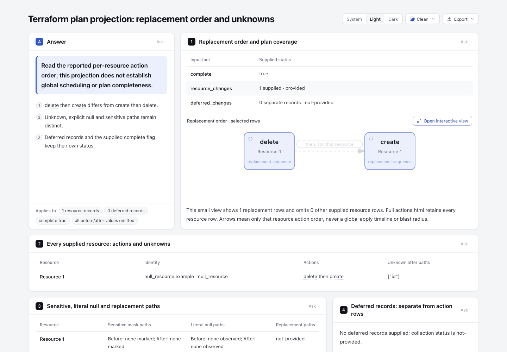
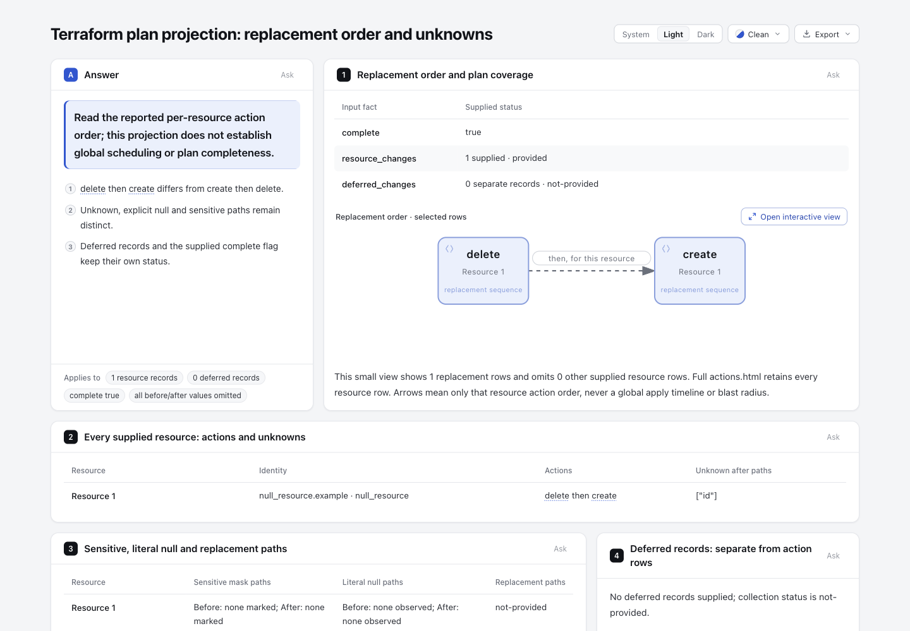

# Dashed preview ink on dev 10b4

This refresh merges fixed dev [`10b4dd5c5f2264baa315ee65a9b4cc23c13ea5f0`](https://github.com/tt-a1i/archify/commit/10b4dd5c5f2264baa315ee65a9b4cc23c13ea5f0) into the existing `codex/lab-preview-dashed-ink` experiment. The historical candidate was `36cc35fb446c697046d4f0522253fd7010b2303d`. Historical HTML, receipts, screenshots and source evidence remain unchanged and retain that earlier identity; this directory contains the new comparison.

Open the newly rendered [base](base.html) and [candidate](candidate.html). Both use the same complete [Explainer input](../input.explainer.json), SHA-256 `817929530bbb0a40560c47c20c501a83006d0a63329c3a4b1df8147efbfc65d2`. The input is the already published Plan-actions projection of the complete official [Terraform plan fixture](../source/plan.json); it is not a new planner run or a claim that the view contains every raw plan value.

| New dev · light | Refreshed candidate · light |
| --- | --- |
|  |  |

[New dev dark](screenshots/base-dark.png) · [candidate dark](screenshots/candidate-dark.png) · [actual capture and computed-color record](screenshots/capture.json). The coordinating agent captured and viewed all four images at 1440×1000, Clean style, scroll 0. Actual label/path/marker colors change together: light `rgb(211,215,221)` → `rgb(106,112,124)`; dark `rgb(52,57,67)` → `rgb(141,148,161)`. The recorded SVG viewBox, path and marker points remain equal; the node appearance is preserved in the comparison. These observations are separate from machine gates and do not establish human or assistive-technology acceptance.

The source remains `hashicorp/terraform-json@8f4894d138d0fe71436cba6dbc8f16577e9a9e7d`, `testdata/action_reason/plan.json`, 1,630 bytes, with the original [MPL-2.0 license](../source/LICENSE) and [manifest](../source/manifest.json). No Terraform/provider/cloud workload was executed. The refreshed Archify package preserves new dev's Apache-2.0 license and retained notices; no third-party implementation was copied.

## What changed and what stayed equal

The existing three precise CSS rules remain the only product behavior change above new dev: preview dashed relationship label, path and marker use readable neutral ink without recoloring database nodes, default/other variants or explicit inline colors. This refresh introduces no schema, geometry, new dependency or palette change. New dev's Viewer/drilldown, delivery protection, notices and dialog-close test handling remain intact.

Removing just the five inserted CSS/comment lines from `candidate.html` makes it **byte-identical to the new `base.html`**. Their complete prepared bundles are exactly equal, including the diagram specification, literal static SVG and compressed native child. This is a fresh comparison on 10b4, not reuse of the old Plan-actions HTML as the new base. [comparison.json](comparison.json) binds both outputs and the source files.

The baseline was rendered by an archived copy of the fixed dev product source. The candidate was rendered normally by the merged source. The existing final behavior regression was copied into the temporary base tree solely to test the old behavior; it did not alter the base product source. Both primary commands used `render explainer`, `--quality standard` and the same original input.

## Scoped verification

- The same real-browser dashed relationship test fails on new dev for actual low text contrast: **0 passed, 1 failed, 0 skipped**. This expected baseline failure is retained outside checkout.
- Candidate: **2 browser tests passed, 0 failed, 0 skipped**: dashed label contrast against its actual mask, path/marker consistency, unaffected node/variant/inline controls, and the existing formal keyboard/static-reading/print case. Equivalent readable colors are allowed; no assertion freezes the `--muted` token.
- **57 focused/core tests passed, 0 failed, 0 skipped** across Explainer diagrams, renderer, core smoke and generated SVG/XML. New dev's additional coverage explains the count change from historical evidence; no new test was added for this refresh.
- Viewer, brand marks, validators and release identity freshness commands all passed. These four commands **do not check `docs/cases/explainer/*.html` freshness**.
- The final candidate's explicit-browser finalize passed validate/deliver/check/browser-check, with zero diagnostics and `requested=true`, `ran=true`. Its bytes remain the screenshot-ready candidate bytes. [Selected receipt fields](candidate-finalize-summary.json) are explicitly derived, not a rewritten raw receipt.

The merge's only conflict was `archify.zip`; it was resolved by a normal final-source rebuild, not by selecting either old binary. Two canonical Node **22.23.2**, bundled zlib **1.3.1-e00f703** builds are byte-identical. The resulting 235-entry ZIP has valid CRCs and differs from the fixed dev ZIP in exactly **`archify/explainer/reader.css`**; packaged CSS equals source. Dev's other packaged bytes, licenses and notices are preserved. [ZIP summary](zip-summary.json) and an actual [exact-archive explicit-browser finalize](archive-finalize-summary.json) record the check. The archive smoke output has a different delivery location and artifact hash; it is not falsely labelled byte-identical to the public candidate.

## Historical generated pages remain historical

The four tracked `docs/cases/explainer/*.html` pages retain their exact historical **36cc** bytes. No additional repair of their inherited freshness gap is retained in this refresh. They are not new 10b4 renderings and must not be cited as refreshed examples of this candidate. Their historical difference from dev is not presented as a new three-rule-only generated diff.

The earlier experiment already records why its four old generated pages included base-source freshness changes. That record remains unchanged. New dev freshly generated output was inspected separately, but that inspection does not rewrite historical pages or establish that they now match current source. [checks-summary.json](checks-summary.json) records the preserved identities and the actual gate coverage.

## Reproduce the affected checks

Use the existing project dependencies and canonical Node; no live installation is needed. Put raw output in a fresh external directory and retain its original bytes before publishing a derived summary.

```sh
ARCHIFY_EXPLAINER_BROWSER_TESTS=1 node scripts/run-tests.mjs --require-files \
  '--test-name-pattern=dashed preview relationships|formal renderer retains keyboard' \
  test/explainer-browser.test.mjs
node scripts/run-tests.mjs --require-files test/explainer-diagrams.test.mjs \
  test/explainer-renderer.test.mjs test/core-smoke.test.mjs test/generated-artifact-xml.test.mjs
node archify/bin/archify.mjs render explainer \
  experiments/preview-dashed-ink/input.explainer.json '<fresh-output.html>' --quality standard
node archify/bin/archify.mjs finalize explainer \
  experiments/preview-dashed-ink/input.explainer.json '<fresh-output.html>' \
  --quality standard --browser-check --json --receipt '<raw-receipt.json>' --out-dir '<raw-checks>'
bash scripts/build-zip.sh '<first-fresh.zip>'
bash scripts/build-zip.sh '<second-fresh.zip>'
```

No full-repository suite, release, installation, upstream execution or human/assistive-technology acceptance is claimed. New dev's successful CI is separate from this uncommitted merged candidate's scoped local evidence. The contrast behavior test is distinct from finalize's automated browser stages and from the coordinator's perceptual image review. Raw logs and receipts remain outside checkout; the JSON summaries retain their real hashes and selected results without private paths.

[binding-summary.json](binding-summary.json) records the final public files, source/test/ZIP identities and screenshot summary. It is a derived ledger, not a raw receipt or an assertion that historical generated pages were refreshed.
