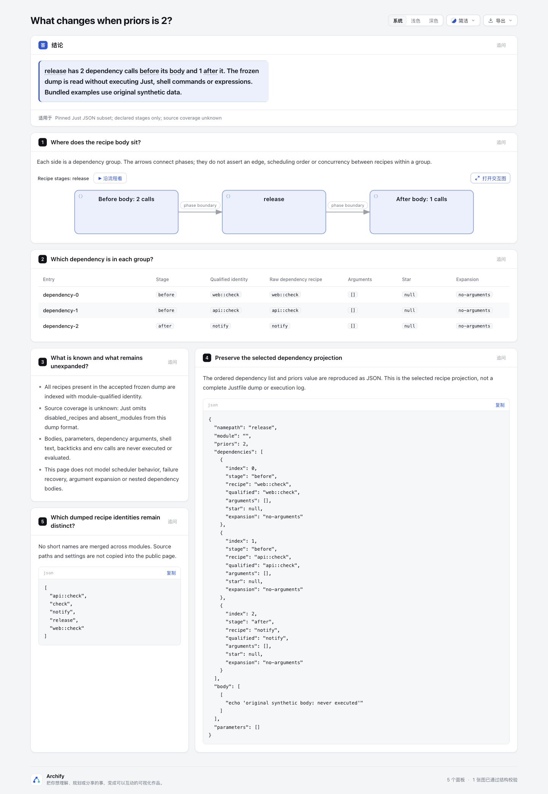

# Just recipe stages lab

Read an existing, frozen Just JSON dump and show one recipe's **before dependencies → body → after dependencies**. The `priors` field supplies the boundary; this experiment never starts Just or evaluates shell commands, backticks, env calls or interpolation.

Two original synthetic fixtures differ in exactly one value: `recipes.release.priors` is 2 versus 1. `api::check` therefore moves from before the body to after it. `web::check`, `api::check`, and root `check` remain distinct identities. The diagrams use three aggregate phase nodes and two phase-boundary arrows: **no edge or runtime order is invented between the two priors**. The grouping also makes no concurrency claim.

The original source and verification sections below describe the historical synthetic snapshot at `101648642a6ccae67b82a9a48bc4507c3b8a627a`; its inputs, generated source documents, HTML, summary and screenshots retain their exact bytes. A separate [measured supplement](measured/README.md) now records a real official Just dump and a complete natural-example refusal. That capture invokes Just only in dump mode; the adapter itself still only reads supplied JSON.

| Fixture | Native Workflow | Explainer |
| --- | --- | --- |
| priors = 2 | [stages](example-priors-2/stages.html) | [review](example-priors-2/review.html) |
| priors = 1 | [stages](example-priors-1/stages.html) | [review](example-priors-1/review.html) |

## Fixed source contract

Repository base: `82c7e0f089a02a4d514714adf37dc2061682da5f`; isolated branch `codex/lab-recipe-stages`. Only `experiments/recipe-stages/**` is added. Product code, tests, Viewer, schemas, dependency manifests and CI are unchanged.

Upstream contract: [casey/just](https://github.com/casey/just/tree/d6fee036379c531369dc37f67f8d4640f6bf1e2d), commit `d6fee036379c531369dc37f67f8d4640f6bf1e2d`, [CC0-1.0](https://github.com/casey/just/blob/d6fee036379c531369dc37f67f8d4640f6bf1e2d/LICENSE). No upstream code, fixtures, scripts or executables were copied or run. Fixture shapes were checked against source and official tests, then authored independently; they are **not a captured export produced by running Just**.

- [Official tests/json.rs](https://github.com/casey/just/blob/d6fee036379c531369dc37f67f8d4640f6bf1e2d/tests/json.rs) defines Module, Recipe, Dependency and Settings, invokes `--dump --dump-format json` in upstream tests, and checks body fragments, priors and module dependencies. Those upstream tests were read, not executed here.
- [recipe.rs](https://github.com/casey/just/blob/d6fee036379c531369dc37f67f8d4640f6bf1e2d/src/recipe.rs) splits dependencies at `priors`; Recipe serializes `name`, `namepath`, `body`, `parameters`, metadata and dependencies. The experiment keeps the list order in the audit projection without promoting it into a dependency edge.
- [dependency.rs](https://github.com/casey/just/blob/d6fee036379c531369dc37f67f8d4640f6bf1e2d/src/dependency.rs) serializes `arguments`, `recipe` from its path, and nullable `star`; [namepath.rs](https://github.com/casey/just/blob/d6fee036379c531369dc37f67f8d4640f6bf1e2d/src/namepath.rs) serializes the path as a string. This is not an embedded recipe object. Relative paths are resolved within the containing module; aliases are refused.
- [justfile.rs](https://github.com/casey/just/blob/d6fee036379c531369dc37f67f8d4640f6bf1e2d/src/justfile.rs) omits `disabled_recipes`, `absent_modules` and other internal data with serde skip. The exported recipe count is **not complete source coverage**. The page and projection say source recipes and absent modules are unknown.
- [line.rs](https://github.com/casey/just/blob/d6fee036379c531369dc37f67f8d4640f6bf1e2d/src/line.rs) and [fragment.rs](https://github.com/casey/just/blob/d6fee036379c531369dc37f67f8d4640f6bf1e2d/src/fragment.rs) serialize each body line as fragments: raw text strings or a single-element array wrapping an expression. [expression.rs](https://github.com/casey/just/blob/d6fee036379c531369dc37f67f8d4640f6bf1e2d/src/expression.rs) supplies the tagged expression shapes; this adapter validates a small subset without evaluation.

Relevant existing Archify scope: [#251](https://github.com/tt-a1i/archify/issues/251) discusses workflow gates and semantic coverage. This experiment does not implement a shared semantic-coverage schema or claim complete control flow. [#1049](https://github.com/tt-a1i/archify/pull/1049) is Git-ref Architecture snapshot comparison; these fixtures instead expose one recipe phase boundary and do not add snapshot extraction.

## Accepted subset and refusal behavior

Input is a complete fixed-version Module object, not the smaller explanatory projection from the research note. All serialized Module, Recipe, Dependency, Settings and Parameter fields must be present with no unknown fields. Module tables are objects and nesting must agree with `module_path`; recipe map keys, `name` and qualified `namepath` must agree. ASCII identifiers use letters/underscore followed by letters/digits/underscore/hyphen, up to 24 characters per component and 95 characters for a qualified name.

- Settings accept the known boolean fields, null optional settings and an empty `dotenv_command`. Settings are never evaluated; nonnull optional settings are refused. Empty aliases and assignments are required. Recipe attributes must be empty. Alternate versions or unsupported configuration produce a clear refusal, not an approximate diagram.
- Bodies must be arrays of line-fragment arrays. Arguments and interpolation support string literals and tagged `evaluate`, `variable`, `call`, `concatenate`, `list` expressions with checked structure. Other expression shapes are refused. Supported expression **syntax** is stored unchanged, never executed, interpolated or simplified.
- Nonempty dependency arguments or any `star` are labelled `not-expanded`; star must be a valid argument index. Parameter records use the fixed known shape, but parameter binding/default evaluation and dependency invocation compatibility are not modeled. A missing dependency target or any structural dependency cycle is refused across all dumped recipes.
- `priors` must be an integer in `[0, dependencies.length]`. Root and nested identities use qualified strings; duplicate identities or mismatched paths are refused. Nested dependency bodies remain unexpanded even when a recipe target is known.
- Input provenance is external. Bundled fixtures are explicitly original synthetic examples. Real dumps may contain commands, local paths or secrets: do not use private inputs for public artifacts without reviewing the selected body/argument text. Source paths and settings are not copied to the page or projection.

Bounds: 128 KiB input, 6,000 JSON nodes, depth 14, 2,000-character strings, 100 entries per generic object/array, 8 modules, 32 recipes, at most 4 dependencies per recipe, at most 20 body lines, and 1 MiB per generated document. Names and numbers are checked; unsupported shapes fail before output creation. The dump format has no version tag, so this adapter is pinned to the documented source shape rather than guessing compatibility from field similarity.

## Run without evaluating a recipe

Use Node 22 from the repository root. Set `RECIPE_EVIDENCE_DIR` to a new directory **outside the checkout**. The adapter accepts an already-existing JSON file; no Just invocation is needed.

```sh
node --test experiments/recipe-stages/convert.test.mjs
node experiments/recipe-stages/convert.mjs experiments/recipe-stages/fixtures/priors-2.json release experiments/recipe-stages/new-priors-2
node archify/bin/archify.mjs render workflow experiments/recipe-stages/new-priors-2/stages.workflow.json experiments/recipe-stages/new-priors-2/stages.render.html
node archify/bin/archify.mjs render explainer experiments/recipe-stages/new-priors-2/review.archify.md experiments/recipe-stages/new-priors-2/review.render.html
node archify/bin/archify.mjs finalize workflow experiments/recipe-stages/new-priors-2/stages.workflow.json experiments/recipe-stages/new-priors-2/stages.html --json --out-dir "$RECIPE_EVIDENCE_DIR/native"
node archify/bin/archify.mjs finalize explainer experiments/recipe-stages/new-priors-2/review.archify.md experiments/recipe-stages/new-priors-2/review.html --browser-check --json --out-dir "$RECIPE_EVIDENCE_DIR/explainer"
```

Repeat with `priors-1.json` and a different new output leaf. Outputs require an existing real parent, a nonexistent leaf directory and exclusive `wx` file creation. Existing destinations, input symlinks and symlink ancestors are refused; a bounded regular-file read precedes parsing. This is not a defense against a privileged process swapping ancestors after validation. No existing user files are replaced. If later output creation fails, a partial new directory may remain as evidence and is not silently reused.

## Evidence and review boundary

[Portable evidence summary](evidence-summary.json) binds current sources, fixtures and artifacts by SHA-256 and records actual public-render/finalize/browser outcomes. Raw Archify receipts, test logs and intermediate render HTML are kept outside the checkout because they contain machine paths. Original delivery sidecars are also moved outside: `--out-dir` does not relocate those sidecars. The portable lab summary is not an original delivery receipt, and copied HTML does not include current external sidecars in this directory.

Final local results on Node 22.23.3: 10/10 focused tests pass; both fixtures pass public Workflow and Explainer render; all four finalizes pass validate/deliver/check/browser-check, with browser explicitly requested for Explainers. All six generated JSON/Markdown source documents reproduce exactly in fresh directories.

The first wide diagram previews failed the Explainer reading floor (8.99px versus 10px). A narrower sublabel variant was also refused by showcase validation. The final authored diagram uses readable aggregate labels and keeps qualified call names in native cards and the adjacent dependency table. Original failures remain in the external evidence directory; no product rules or tests were relaxed.

Focused tests cover: the one-field priors contrast, no invented prior-to-prior edges, qualified identities, missing targets/cycles, priors/star bounds, unknown/unsupported serialization, explicit coverage unknowns, input bounds, unchanged output victims and symlink refusal. Public-render tests put link/image/javascript-looking strings, backticks, pipes and newlines in argument/body data; table content remains literal and a synthetic shell-effect victim is never created. This proves literal preservation and nonexecution in this adapter path, not that arbitrary commands are safe to run.

## Actual browser images

At the same viewport, changing only priors from 2 to 1 changes the before/after call counts and moves api::check to the after group in the table. Three phase nodes remain; there is no invented dependency or concurrency edge within either group. Qualified recipe identities and the unexecuted body remain visible.




Capture settings and current HTML/image hashes are in [capture.json](screenshots/capture.json). Images were captured and inspected by the coordinating agent; human acceptance remains pending. No measured reader-efficiency benefit is claimed.

AI assistance: Codex and GPT-6.1 Sol subagents performed research, implementation, focused validation, independent review and documentation. This branch is an experiment awaiting repository-owner acceptance.

## Actual tool-export supplement

[Measured evidence](measured/README.md) uses verified temporary Just **1.59.0**, release source `2638e9c0941edb1f409da7426fa7842887656973`, distinct from adapter contract commit `d6fee036379c531369dc37f67f8d4640f6bf1e2d`. The complete official test literal is preserved as 39 bytes; applying its owning harness's unindent yields the 16-byte effective input. Just dumped that input without running recipes; the unchanged parser accepts `b` with `a` before, an empty body, and `c` after. The complete natural `cross-platform.just` also dumped successfully but remains refused for assignments.

The published dump is explicitly a **location-removed derived copy**, not the original export: only `/source` changes. Raw/derived adapter Workflow and direct-review outputs are byte-identical; their projections differ only in the correct complete-input SHA. The new measured view uses a separate authored `Recipe phase` legend override; the direct adapter JSON/draft are retained. No default legend, parser, producer schema or old artifact was changed. Only the generic generated provenance paragraph was made source-neutral.

After merging dev `67f12389212c54b3122da60e2813c7f8dab7ab2f` at `52fc4fdc80aac291acb37e851176b926f3c99ae3`, the original 10 focused tests pass with zero skips; both measured finalizes pass all four stages, with Explainer browser-check explicitly requested. Actual coordinating-agent images and machine gates are recorded separately. No recipe, expression evaluation, global installation, shared-product change, ZIP rebuild or user-benefit claim is part of this supplement.
