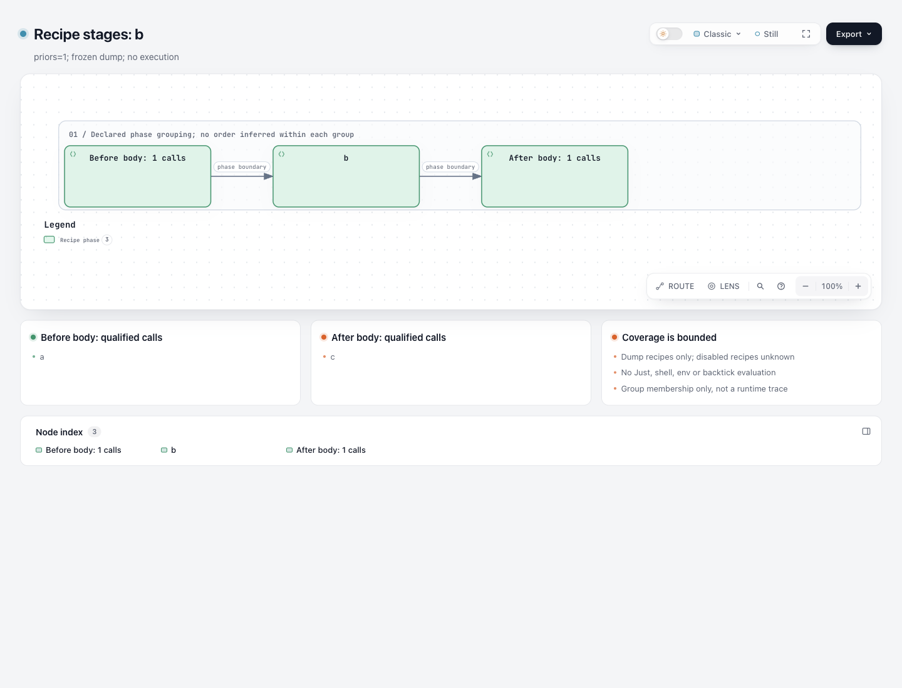

# Recipe stages: actual official dump, bounded projection

This supplements the two historical synthetic contrasts; it does not replace them. The actual producer is an isolated official **Just 1.59.0** binary. It only parsed/dumped fixed public inputs: no recipe body, shell payload or Just expression was executed.

Open the [measured Explainer](output/review.html) or [native Workflow](output/stages.html). For selected recipe `b`, the accepted dump declares `a` before its **empty body**, and `c` after. This is declared grouping, not a scheduler trace, successful recipe run or production-project acceptance.




[Full explanation image](screenshots/explainer-full.png) · [capture metadata](screenshots/capture.json). The coordinating agent captured and viewed all three unedited images. The viewport was 1440×1100, light; the full-page explanation PNG is 1440×2301. The native view used Classic, Still, 100%; the Explainer used Clean. These observations do not establish physical-device, assistive-technology or human acceptance, and do not prove database or recipe execution.

## Three source identities

| Role | Fixed identity |
| --- | --- |
| Actual producer | [Official release 1.59.0](https://github.com/casey/just/releases/tag/1.59.0), release source `2638e9c0941edb1f409da7426fa7842887656973` |
| Fixture and adapter contract | [casey/just @ d6fee036379c531369dc37f67f8d4640f6bf1e2d](https://github.com/casey/just/tree/d6fee036379c531369dc37f67f8d4640f6bf1e2d); this later commit is not the producer's source identity |
| Archify software | dev `67f12389212c54b3122da60e2813c7f8dab7ab2f`, merged into the existing lab at `52fc4fdc80aac291acb37e851176b926f3c99ae3`; uncommitted lab changes are separately bound by source SHA |

[producer.json](producer.json) records the exact official macOS arm64 asset, its checksum manifest and binary hash. Archive SHA-256 `6574cea774ed4cae12e24b6aa11857de33e80dab4667cf628fd5840df96a2a9d` matched both the official [SHA256SUMS](https://github.com/casey/just/releases/download/1.59.0/SHA256SUMS) and GitHub asset digest; the binary reported `just 1.59.0`. No executable is included here and nothing was globally installed.

Complete upstream files and their fixed URLs, Git blobs, SHA-256 and lengths are in [source/manifest.json](source/manifest.json). The original [CC0-1.0 LICENSE](source/upstream/LICENSE) is retained; the release and fixture commits have identical license bytes. Current Archify code follows its Apache-2.0 license and retained notices. New HTML retains the software notices emitted by the new software base; old HTML and historical evidence were not rewritten.

## Official test extraction, not an invented natural project

The full [tests/json.rs](source/upstream/tests/json.rs) contains `priors()`; [extraction.json](extraction.json) identifies the string content's half-open byte range **11548–11587**, from 601:6 to 605:5. The [39-byte literal](inputs/priors-original-literal.just) is preserved exactly, including its indentation.

The owning [tests/test.rs](source/upstream/tests/test.rs) applies [unindent](source/upstream/src/unindent.rs) before writing the Justfile. That removes the leading/trailing blank lines and common indentation, yielding the [16-byte official test effective input](source/priors-official-effective.just). Both files and the transformation are explicit; this is not a separate complete Justfile committed at that path upstream and not a production input.

The published [literal extractor](extract-official-literal.py) and [unindent reproducer](unindent-official-test.py) reproduce those bytes in fresh temporary files. The latter has the same input-content transform as the capture helper, with exclusive output creation for publication; their distinct script hashes are recorded. The original first attempt dumped the 39-byte literal directly and was rejected for leading indentation. It is retained as a pre-harness setup failure, not concealed or described as an adapter rejection of the actual effective input.

## Original dump versus location-removed derived copy

Just's actual stdout was 1,359 bytes, SHA-256 `1ae6e99a5a0add3eef22999a0c1243fd2f4c0a567ec3d92e906476e38e9ff0b9`. Even a relative `--justfile` argument produced an absolute machine location at `/source`; the complete unmodified original remains outside checkout.

[official-test-effective.derived-dump.json](inputs/official-test-effective.derived-dump.json) is **not the original export**. Only `/source` is replaced with the logical relative location `source/priors-official-effective.just`. Every other parsed value is equal, and no official code suffix or body fragment is sanitized. [derive-location-copy.py](derive-location-copy.py) reproduces the one-value substitution; [derivation-and-comparison.json](derivation-and-comparison.json) records the original/derived hashes and exact changed path.

The current adapter consumes both original and derived input directly, without preprocessing either output:

- `stages.workflow.json` and the direct `review.archify.md` are byte-identical across the two runs.
- `projection.json` differs only at `/inputSha256`, correctly retaining each complete input's actual SHA. Removing only that field leaves exactly equal projections. The original projection and its hash remain in the external evidence.
- The adapter checks that Module.source is a string, subject to general bounds; it does not use this field in the semantic projection. The field cannot simply be deleted because the fixed Module shape requires it.

No source hash was overwritten to force three identical outputs. The CLI's inspected dump inventory is still not complete Justfile source coverage: omitted disabled recipes and absent modules remain unknown.

## Display-label override, not an adapter change

[output/stages.workflow.json](output/stages.workflow.json) and [output/review.archify.md](output/review.archify.md) are retained direct adapter outputs. A first rendering used Workflow's default backend legend, “Agent logic”, even though the three nodes are recipe phases. The automatic gates passed; the coordinator found the semantic mismatch during actual reading.

Only the measured presentation copy [stages.measured.workflow.json](output/stages.measured.workflow.json) adds `/meta/legend/entries/backend/label = "Recipe phase"` through the existing legend contract. All other JSON fields, nodes, cards and two phase-boundary edges are unchanged. The final standalone and embedded native diagram use this same presentation JSON. This is an **authored display-label override**, not a semantic analysis result or an improved adapter default.

[review.measured.archify.md](output/review.measured.archify.md) retains the direct draft with just that diagram-source reference changed, then appends a short provenance panel explaining the real dump, effective test input, empty body and nonexecution. [presentation-proof.json](presentation-proof.json) records the exact scope. Original first-version HTML/receipts remain outside checkout; final HTML was generated normally, without byte editing.

## Complete natural example remains refused

The unchanged [cross-platform.just](source/upstream/examples/cross-platform.just), 796 bytes, has `upgrade-deps: && bootstrap`. Its full official dump succeeded, but the current adapter refused its three assignments and created no output. [natural-rejection.json](natural-rejection.json) records the separate dump/adapter statuses, original hashes and first refusal.

No assignment, recipe or expression was removed to make it fit. Literal `/python.exe`, `/python3`, `/pip-sync` and `/pip-compile --upgrade` fragments are official program suffixes, not machine locations; they were left untouched. There is no accepted native graph or failure mockup for this refused natural input. The real official-test export demonstrates a narrow tool-format path; it does not establish support for natural projects generally.

## Verification and reproduction

The unchanged original focused test file ran **10 tests: 10 passed, 0 failed, 0 skipped**. No mirrored source assertions or producer schema were added. The only adapter source edit replaces a synthetic-only paragraph with neutral provenance wording; parsing, phase projection, refusal rules and safety limits are unchanged. All historical synthetic inputs, source outputs, HTML, summary and screenshots retain their old byte identities and their old revision bindings.

Both final measured outputs passed validate, deliver, check and browser-check with zero diagnostics. Explainer explicitly requested `--browser-check`; native finalize's browser stage also actually ran. [workflow-finalize-summary.json](workflow-finalize-summary.json) and [explainer-finalize-summary.json](explainer-finalize-summary.json) are derived projections of the unchanged external receipts. These machine gates are distinct from the coordinator's three actual images.

For replay, obtain the fixed release separately and verify its official checksum. Use a fresh physical temporary directory: on macOS `/tmp` is a symlink, and the existing adapter refuses symlink output ancestors. Do not change that protection. Use no positional recipe argument on Just:

```sh
python3 experiments/recipe-stages/measured/extract-official-literal.py \
  experiments/recipe-stages/measured/source/upstream/tests/json.rs '<fresh-literal.just>'
python3 experiments/recipe-stages/measured/unindent-official-test.py \
  '<fresh-literal.just>' '<fresh-effective.just>'
# In the isolated directory containing fresh-effective.just:
'<verified temporary just 1.59.0>' --justfile fresh-effective.just --dump --dump-format json
# Retain that original stdout privately. Create an explicitly derived location copy if publishing.
python3 experiments/recipe-stages/measured/derive-location-copy.py '<raw-dump.json>' '<fresh-derived.json>'
node experiments/recipe-stages/convert.mjs '<fresh-derived.json>' b '<fresh-real-output-directory>'
node --test experiments/recipe-stages/convert.test.mjs
```

The observed capture used a different filename; its commands/cwd and exact source-location replacement are retained externally. The reproduction helpers do not imply that another capture's raw hash is identical. Root/publication may verify each newly captured raw input separately.

[evidence.json](evidence.json) selects real command/stage results and original-log hashes; [binding-summary.json](binding-summary.json) binds the public sources and outputs. They are explicitly derived records, not rewritten raw receipts or current provenance for moved sidecars. Temporary existing dependencies were reused for validation; no live Skill, global Just install, ZIP, shared renderer or full-repository suite was changed. No reader-efficiency, scheduler-execution, recipe-execution or user-benefit result is claimed.

Original literal whitespace and renderer-generated HTML bytes are preserved. Their source indentation or existing trailing spaces are evidence bytes, not manually repaired presentation files.
