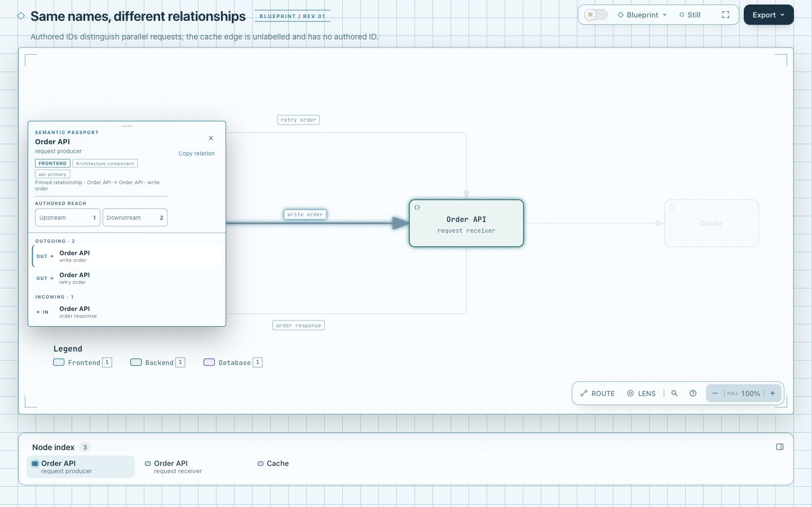
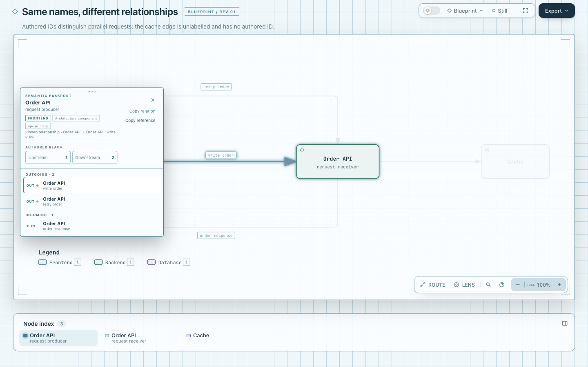

# Pinned relationship · Copy reference

本实验在已固定关系的现有 Passport 中增加 **Copy reference**，把“哪两个节点、什么关系”复制为可读纯文本。既有 Copy Link 保持不变。新动作只在存在有效 pinned relationship 时显示，复用 `copyReaderText`，没有新的索引、schema、库或 Clipboard fallback。

基准：`82c7e0f089a02a4d514714adf37dc2061682da5f`。这是独立实验分支，尚无合并、发布或真实用户接受结论。

## 固定产物

- [生产图 base](base.html)、[生产图 candidate](candidate.html)：相同的原有 [production-deployment](../../archify/examples/production-deployment.architecture.json)，没有修改 IR。
- [平行关系 base](parallel-base.html)、[平行关系 candidate](parallel-candidate.html)：同一份[原创 fixture](parallel.architecture.json)，含同名不同 ID 节点、正反向关系、平行请求，以及无 label/无 authored ID 的 cache 关系。
- [可移植证据](receipt.json)、[真实受控复制观察](observations.json)。[实际浏览器截图与捕获摘要](screenshots/capture.json)由协调 agent 补充，不以文件存在代替视觉接受。

Base HTML 由固定 Git archive 的原始 renderer/template 生成。Candidate 由本分支 renderer/template 生成；同一对产物保留相同 SVG/关系数据。原始命令日志与浏览器回执在 checkout 外，公开 JSON 仅投影实际结果，不包含本机路径。

## 文本合同

在平行 fixture 打开 `#relation=write-order`，再点新按钮，得到：

```text
From: "Order API" ["api-primary"]
Relationship: "write order"
To: "Order API" ["api-replica"]
Authored relationship ID: "write-order"
Parallel in this direction: 1/2 (artifact order; not a stable ID)
```

From/To 严格沿真实方向，不跟随当前 focus 倒置。同名节点保留 ID。`Relationship` 使用 raw authored label；没有 label 时显示 `Unlabelled (no authored label)`，不会复制 Viewer 的“connects to”fallback 冒充作者内容。标签和值用 JSON 引号保留换行、引号及空格。复制文本的字段名固定为英文，按钮/反馈使用当前 locale。

缺 authored ID 明写 `not provided`，不把 internal key 复制成稳定身份。Parallel 序号来自该产物当前同方向关系的记录顺序，只供识别当前 pin，明确不是跨版本 ID、作者指定的执行顺序或运行轨迹。反向关系单独计数；自环保留相同 From/To。无效重复 authored ID 不能形成可复制的 pin。

## 行为与范围

现代 Clipboard、拒绝/缺失后的既有 fallback、fallback false/throw 都走同一个 helper。成功才显示 Copied，失败显示 Copy failed；临时 textarea 清理。复制不改变 diagram selection、camera、hash 或 SVG；切换 pin 后，旧复制 Promise 的反馈不能冒充新关系。取消 pin/换成节点时按钮隐藏。

当前基准的 shared fallback 会在移除 textarea 后丢失控件焦点。该问题由仍开放的 [PR #862](https://github.com/tt-a1i/archify/pull/862) 负责；本实验未导入、重写或顺带修复它。观察中单列 focus，**不将焦点丢失断言成必须行为**。真实 OS Clipboard/权限交互尚未验证，浏览器测试控制的只是 clipboard 边界。

## 验证

适用的真实按钮浏览器测试扩展在现有 `test/focus-browser.test.mjs` 中，没有新测试框架或测试 API。保护文本方向/原始标签/身份、parallel/reverse/self-loop、无 authored ID、无效重复 ID、成功/拒绝/缺失/false/throw、反馈与 textarea 清理、selection/camera/hash/SVG 不变、pin 切换和 390px light/dark 动作边界。自环与异常标识来自明确标注的 DOM 合同 fixture；不宣称 Architecture schema 新支持 self-loop。

复现：

```sh
ARCHIFY_CHROME='<Chrome executable>' npm run test:focus -- \
  test/focus-browser.test.mjs test/reading-address-browser.test.mjs \
  test/export-cleanup-browser.test.mjs test/i18n.test.mjs
npm run test:generated
npm test
```

Focused 62/62 passed，0 skipped；独立 review 建议移除“必须丢焦”的反向断言后，重新执行 Focus 16/16 passed。其余套件代码与最终生产源码均未变，沿用同次 62-test 的结果。最终 generated checks、core smoke、canonical ZIP 二次构建结果见 receipt。SVG 导出仍先清理现有 pin/focus 临时状态；新按钮在 SVG 外，不进入 canonical 图像。没有运行完整跨平台包矩阵、完整 test:full 或远程 CI。

## 灵感与判断

灵感为 [nvim-navbuddy](https://github.com/SmiteshP/nvim-navbuddy/tree/a34786c77a528519f6b8a142db7609f6e387842d)（Apache-2.0，`a34786c77a528519f6b8a142db7609f6e387842d`） 的 yank_name/yank_scope 将导航与引用分开，以及 [drawio](https://github.com/jgraph/drawio/tree/84487b4891cbc0f32d7e30f34cf878c87cb1f414)（Apache-2.0，`84487b4891cbc0f32d7e30f34cf878c87cb1f414`） 按复制内容命名动作；未复制其代码、依赖或图标。更完整的一手调查在研究 hub 的 `interaction-smalltools.md` 实验 A。实现与这两项目的许可证没有新增派生依赖关系，本仓实验代码遵循 MIT。

本地机器证据说明按钮复制了正确引用，不能证明用户节省了多少时间。可读性与用户价值仍待实际审查；不把新增按钮本身当成成功。

## 实际产物图片

固定同一原创平行关系输入，打开 `#relation=write-order`。以下为实际 Viewer 截图，未用概念图替代产物；每张图片对应的 HTML hash、图片 hash 与尺寸见 [capture.json](screenshots/capture.json)。

| 原有关系动作 | 增加可读引用复制 |
| --- | --- |
|  |  |

[深色桌面](screenshots/candidate-dark.png) · [390px 浅色](screenshots/candidate-mobile-light.png) · [390px 深色](screenshots/candidate-mobile-dark.png)

协调 agent 实际检查了桌面与窄屏 Passport：新动作可见且留在卡片中。窄屏图片仍显示既有底部工具栏的横向溢出，不声明移动端整体体验已通过验收。截图只展示按钮与关系定位，不证明真实 OS Clipboard 已验收。

AI 协助：Codex / gpt-6.1-sol 负责实现、独立复核与截图；尚无人类代码或视觉接受结论。
