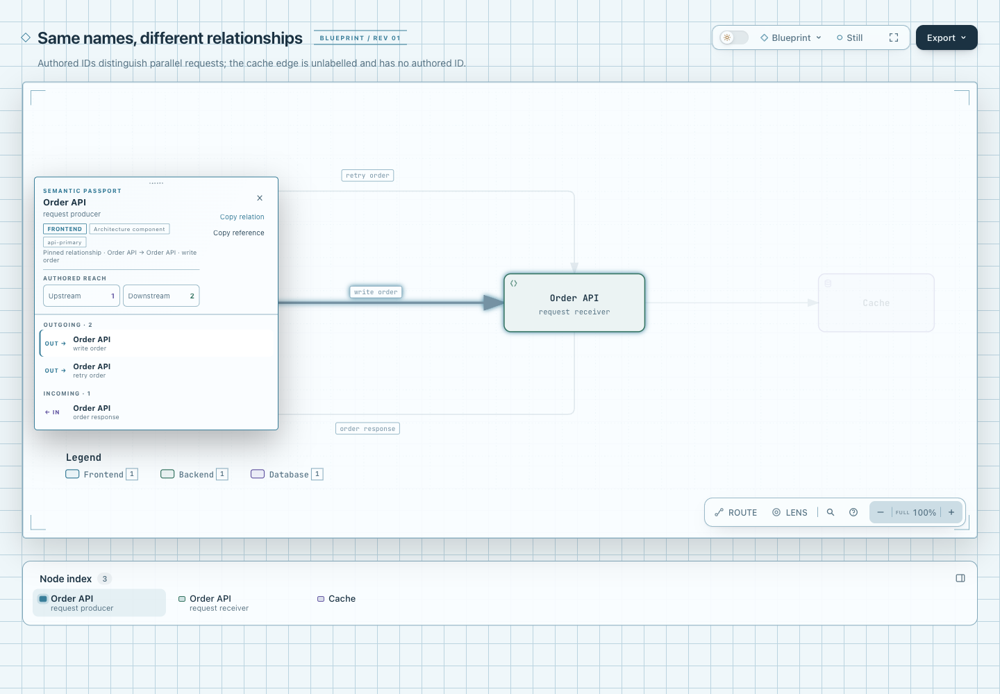
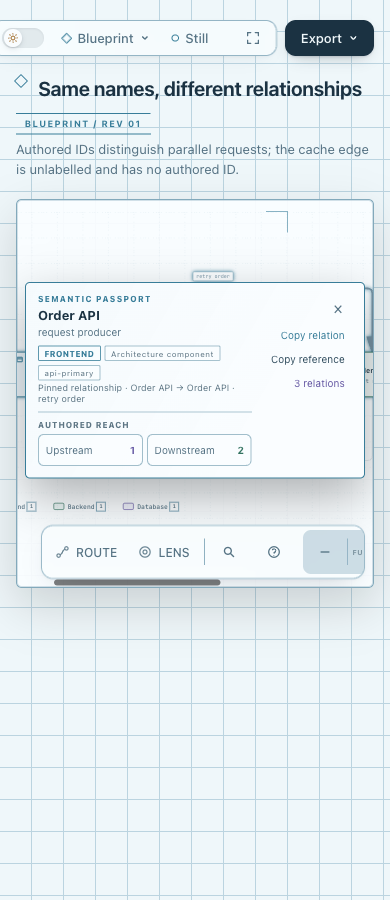

# Relation reference：保留新 Passport 的窄刷新

固定产品基线为 `10b4dd5c5f2264baa315ee65a9b4cc23c13ea5f0`。本轮采集时原分支 HEAD 为 `6d7cd59492240952c8ade422ec9014de76fb4164`，正常 merge 的输入为该固定 dev；采集候选由实际源码/HTML/ZIP SHA 标识，不冒充已发布新 head。最终提交与推送状态由协调者另外报告。只在本新目录记录本轮证据，旧实验14个文件（含 README、PNG 和 HTML）全部保留原字节。

## 价值、布局与保留边界

既有 Copy Link 提供关系/节点位置；Copy reference 提供可独立读的 from、原 label、to、authored ID 与当前产物内平行序号。新 dev 的 Explain/子图入口没有提供这段关系引用文本，所以仍有窄价值；没有证明用户阅读效率或常用频率。按钮仅有效 pin 显示，沿用动作列，不新增 CSS、状态模型、索引、schema、Clipboard fallback 或库。

本轮从 dev 的生成物起点解冲突，源码冲突同时保留新 Explain、explanation back、drilldown/parent back 和既有复制动作；没有把旧 template 覆盖新 Passport。原 pin/关系列表/Reach/URL/相机语义不变。新测试用真实 renderer 的最小 authored explanation 输入，验证 pin 与 Explain、返回、清空在 390×900 和 320×300 共存；短视口允许现有 Passport 内滚动，不要求所有内容同时挤入一屏。

旧 README 的 MIT / #862 fallback 焦点说明属于82c7历史。新 base 的软件声明为 Apache-2.0 并保留 LICENSE-MIT/NOTICE；共享 copyReaderText 已恢复 previousFocus，本轮直接继承且新增断言复制后回原按钮。旧文件没有回填成新基线证据。

## 同输入的新对照

| 对照 | 固定输入 | 新页面 |
| --- | --- | --- |
| 原仓库 production-deployment | 完整未改输入，SHA `610a5614667e8f108bdcf1769c9d7af5c3ce0fb62be3ea50550b10eb752e4bda` | [base](production-base.html) / [candidate](production-candidate.html) |
| 原原创 parallel fixture | [旧完整输入](../parallel.architecture.json)，SHA `5703dcaf86e2d61bce03768ff96599388c46c7578388f5b555501406b86006b4` | [base](parallel-base.html) / [candidate](parallel-candidate.html) |

base 来自固定 dev 的 git archive 原 CLI；candidate 来自本轮正常合并源码。四个产物各经 public `finalize architecture --quality standard`，validate/deliver/check/browser-check 均 pass、零诊断。每对静态 SVG 逐字相同；图、标签、几何、原输入不为候选改写。standard 通过不替代 showcase 或人类视觉验收。解包 ZIP 的同 parallel 输入也四阶段通过，HTML 与 parallel-candidate 逐字相同。

平行页可用 `#relation=write-order` 查看新按钮。复制值固定为：

```text
From: "Order API" ["api-primary"]
Relationship: "write order"
To: "Order API" ["api-replica"]
Authored relationship ID: "write-order"
Parallel in this direction: 1/2 (artifact order; not a stable ID)
```

原方向不跟当前 focus 翻转；反向关系单独计数。raw label 用 JSON 引号保留换行、引号、空格；未给 label 不复制“connects to”fallback，未给 ID 写 not provided。ordinal 只是本产物有效同方向记录的顺序，不是跨版本稳定身份、作者运行顺序或执行轨迹。production-deployment 没有 authored edge IDs，仍明确缺失，不补造 ID。

## 本轮执行证据

- Focus、Passport explanation、drilldown context、i18n 聚焦选择：**57 pass / 0 fail / 0 skip**。保护实际方向、正反/平行/自环、缺 ID/label、同名节点、字面文本、无效重复 ID、pin 切换后的延迟反馈，以及复制不改变选择/URL/相机/SVG。新补 pin+Explain/back/clear 的紧凑视口与新基线 fallback 焦点恢复；不维护旧丢焦行为。
- 真实受控复制观察的[派生选段](copy-observations.json)来自现有 focus-browser DOM 合同 fixture；raw 留 checkout 外。clipboard 与 execCommand 注入，未验证真实 OS 剪贴板、权限或跨浏览器行为。
- core **19 pass / 0 fail / 0 skip**。临时工具链使用已有依赖，root/Skill lock 的非根 package entries 与旧安装相同；仅 package 根 version/license 元数据迁移，未安装依赖或改 lock。
- 完整 `npm run test:generated` 首次真实报31个 stale；正常 renderer 重生 root/Skill 各15个例及 examples/web-app.html 后复跑通过，包含四项 check 与 golden。31份静态 SVG 均与固定 dev 对应产物相同，没有手修 HTML。
- canonical Node22.23.2 / zlib1.3.1-e00f703，两次 ZIP 逐字相同、235 members、CRC pass、包内 template 与当前 source 逐字相同；独立解包 package-smoke 通过。未作远程 CI、全仓或 Windows 通过声明。

生成责任之外的 docs/gallery 页面/manifest/16 artifacts、四份 docs/cases Explainer 和手工 Delta 页面/receipt 保留 dev10b tracked 字节，明确**不是本轮 fresh**。没有把 generated green 扩成所有站点/手工页面已再生，也没有顺带发布它们。

## 视觉与证据性质

Root 已用 Ego/Chromium 实际捕获并逐图查看六张原 PNG，原字节与安全的两份观察 JSON 复制到 [screenshots/](screenshots/capture.json)。作者没有操作 Ego/TaskSpace；capture 是明确派生绑定，两份观察是 root 原 JSON 字节，不是 CLI receipt。

- 四个 desktop arms 为 base/candidate × light/dark，各 PNG 1440×1000，固定 write-order。候选实际收集原方向及1/2；before/after 的 selected node、pin、hash、zoom、viewBox 均保持。反馈文案变为 Copied 不属于状态导航。
- [缺 authored ID](screenshots/production-candidate-no-authored-id.png)：实际 PNG **1237×838**，该 invocation 恢复后没有重设 viewport，不能标成1440×1000。输出明确 not provided 与同方向1/1。第一次 SVG group pointer 被 rect 拦截，观察未 pin 后，显式 focus 语义 target 再发送真实 Enter 成功；这不是 Tab 可达或 pointer 成功证明。原失败只保留于会话工具记录，不伪称另有 raw 文件。
- [移动窄屏](screenshots/parallel-candidate-mobile.png)：390×900，实际点击 retry-order 并复制，文本原方向2/2，page width390。

Root 注入 navigator.clipboard.writeText 只收字符串，未写 OS clipboard。这一轮 root **没有操作 Explain**（两个固定 fixture 都无 explanation）；pin 与新 Explain、back 和短视口共存的检查仅是上述独立自动测试，不冒充 root 人工操作。





[desktop 原观察](screenshots/desktop-observations.json) / [缺ID与mobile原观察](screenshots/identity-observations.json)。机器 browser-check、实际 root 截图/交互和真人/辅助技术接受分别记账；无真实剪贴板、设备、跨浏览器或用户效率验收结论。

[evidence.json](evidence.json) 是可移植派生摘要，保留原 stdout/receipt/log SHA 与公开文件绑定，不冒充原始 CLI receipt。含本机路径的 delivery sidecar 原字节已移到 checkout 外，HTML 保持生成字节；不宣称迁移后的副本具有 current physical provenance。原14文件与本次源码、产物、包、失败日志各自记账；本证据采集未执行提交、推送或安装 live Skill；最终仓库状态由协调者报告。

## 最小复现

在可信的固定 dev 比较 checkout 中使用同一完整输入；新候选用本分支源码。选择全新输出与私有receipt目录：

```sh
node archify/bin/archify.mjs finalize architecture <complete-input.json> <fresh-output.html> --quality standard --out-dir <private-receipts> --receipt <private-finalize.json> --json
ARCHIFY_CHROME='<Chrome executable>' node scripts/run-tests.mjs --require-files test/focus-browser.test.mjs test/passport-explanation-browser.test.mjs test/drilldown-context-browser.test.mjs test/i18n.test.mjs
node scripts/run-tests.mjs --require-files test/core-smoke.test.mjs
npm run test:generated
bash scripts/build-zip.sh <outside-archive.zip>
node scripts/package-smoke.mjs <outside-extracted-archive>/archify
```

生成过期时先按正常 `archify/scripts/render-examples.mjs` 更新两套15个例，另用原 Architecture renderer 更新 examples/web-app.html；不能手改HTML来隐藏freshness。固定旧实验无需重生。AI assistance：Codex / GPT-6.1-Sol medium整合、局部验证与证据整理；独立 agent 审查，Root 实际视觉另行记录，不声明个人 human-review confirmation。
