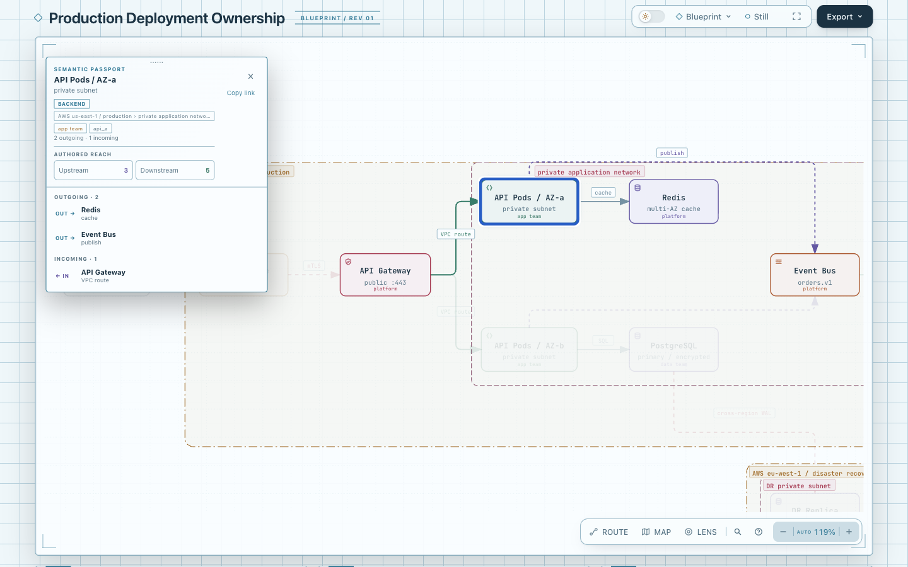
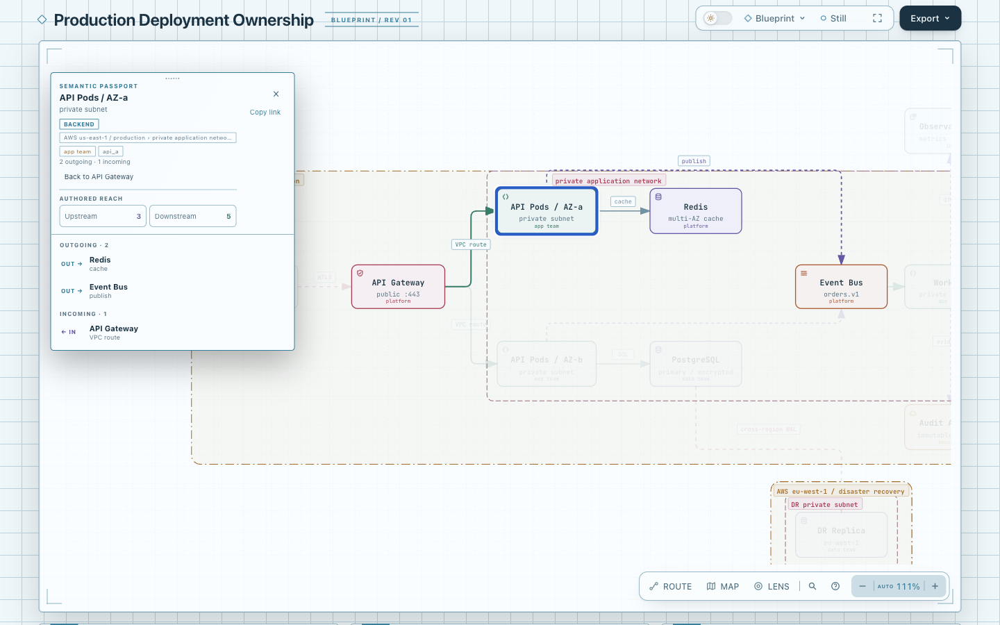

# Relationship return — deferred prototype

**Disposition: retain the prototype and defer runtime integration.** The fixed
production example already offers a one-click return through the target node's
Incoming relationship row. The additional `Back to API Gateway` button is also
one click. This comparison demonstrates a new control, not fewer actions or
better reading efficiency.

An independent review of existing representative Architecture inputs found
maximum node degree 5 among the example/case inputs it inspected. It did not
establish an existing long-list case where the source row is hidden by scrolling.
We did not construct an extreme diagram to create a reason for the button.
The benefit currently does not justify adopting another temporary Viewer state
and control. A concrete naturally occurring return/scroll problem would justify
revisiting this experiment.

## Compare the existing behavior

Open [base.html](base.html?theme=light) and
[candidate.html](candidate.html?theme=light) at 1440×900, 100% browser zoom,
Blueprint, Still, and the same camera. Repeat with `theme=dark`.

1. Select `API Gateway` (`gateway`).
2. In its Passport relationships, choose `API Pods / AZ-a` (`api_a`).
3. In the baseline, the Incoming `VPC route` row already returns to `API Gateway`
   in one action. In the candidate, the added `Back to API Gateway` button also
   returns in one action and disappears.

At 390px width, use the existing Relations button to expand the list before the
relationship jump. Both artifacts use the original
[`production-deployment.architecture.json`](../../archify/examples/production-deployment.architecture.json)
without edits. Their digests and source identity are in [receipt.json](receipt.json).
Actual screenshots and their source/image hashes are recorded in [capture.json](screenshots/capture.json).

## Prototype boundary

The Focus closure stores one source node ID only after a successful ordinary
single-node relationship-list jump. A subsequent jump replaces it; returning
consumes it. Preview and self-loops never record it. Other semantic selection,
Reach, Route, Lens, pinned relationships, multi-selection and hash restoration
clear it. Missing or unrevealable hidden nodes are refused before changing the
current selection. Collapsed tree ancestors expand through the existing tree
reveal contract; the prototype does not restore their previous collapse state.

The control is outside canonical SVG. No camera/scroll/mode snapshot, public
navigation API, global shortcut, history stack, storage or dependency was added.
This remains distinct from [Atlas navigation/history](https://github.com/tt-a1i/archify/pull/413)
and [sibling-HTML drilldown Back](https://github.com/tt-a1i/archify/pull/281).
The behavior idea came from the navigation examples in the research scout;
no editor/plugin implementation code was copied.

## Evidence and integration status

Focused checks cover actual pointer and keyboard relationship jumps/return,
preview exclusion, one-slot replacement, semantic cleanup, missing/hidden node
failure preservation, real collapsed-tree reveal, and production Passport
containment at 390 and 1440 pixels in both themes. Locale checks exercise the
existing message helper and catalogs. The frozen-source run passed **56/56** with
zero skips (Focus, real Tree and locale suites). An independent Focus browser
run passed **18/18**, including its parent test, with zero skips. These checks
establish compatibility boundaries, not user value. Final counts and tested
source hashes are recorded in [receipt.json](receipt.json).

The two HTML artifacts preserve the comparison. All authored runtime, test,
locale and CSS edits are retained in [candidate.patch](candidate.patch); their
tested bytes are listed in [candidate-sources.sha256](candidate-sources.sha256).
After verifying the patch against the fixed base, only this experiment's owned
tracked product edits were restored. This branch therefore changes no product
source. The generated candidate template remains embedded in `candidate.html`.
Packaged examples, Gallery and ZIP were deliberately **not** regenerated after
the candidate was deferred. This is a research prototype, not an
integration-ready PR. No core/full repository suite, remote CI,
cross-platform acceptance, merge, release, deployment or live installation is
claimed.

To reproduce the tested candidate, start at the repository root and choose a
new, unused checkout path. This applies the source patch only to that isolated
checkout; generating the template is an explicit second step.

```sh
experiment_dir="$PWD/experiments/relation-return"
comparison_dir="/tmp/archify-relation-return-replay"
git worktree add --detach "$comparison_dir" 82c7e0f089a02a4d514714adf37dc2061682da5f
cd "$comparison_dir"
git apply "$experiment_dir/candidate.patch"
npm ci --ignore-scripts
npm --prefix archify ci --ignore-scripts
node scripts/generate-viewer.mjs
# From this directory, compare the files listed in candidate-sources.sha256.
# Set ARCHIFY_CHROME to an executable Chrome/Chromium on this machine.
npm run test:focus -- test/focus-browser.test.mjs test/tree-branches-browser.test.mjs test/i18n.test.mjs
```

The recorded toolchain is Node 22.23.2 and Chrome 152.0.7977.169. The patch
excludes the generated template, examples, Gallery and ZIP. No live Skill
installation is needed to reproduce it.

Earlier experiment attempts exposed a test-harness mistake (clicking a desktop
Relations control that is intentionally hidden) and an over-broad hidden-node
guard. The harness now uses the visible desktop rows; the prototype preserves
the established tree reveal behavior. Raw attempt logs stay outside the repo.

## Actual comparison images

The parent agent selected `API Gateway`, followed its outgoing `VPC route` to
`API Pods / AZ-a`, and returned through each artifact's visible control. The
baseline Incoming row and candidate Back button each needed **one action**.
These images compare reading controls, not camera pixels: automatic framing
was not synchronized between the two artifacts.

| Baseline: existing Incoming row | Candidate: additional Back button |
| --- | --- |
|  |  |

The returned states are also retained: [baseline](screenshots/base-returned-light.png)
and [candidate](screenshots/candidate-returned-light.png). This observation supports
the deferred disposition; it is not evidence that the prototype improves efficiency.

AI assistance: Codex / gpt-6.1-sol implemented, independently reviewed, and captured
this prototype. Human code and visual acceptance remain pending.
