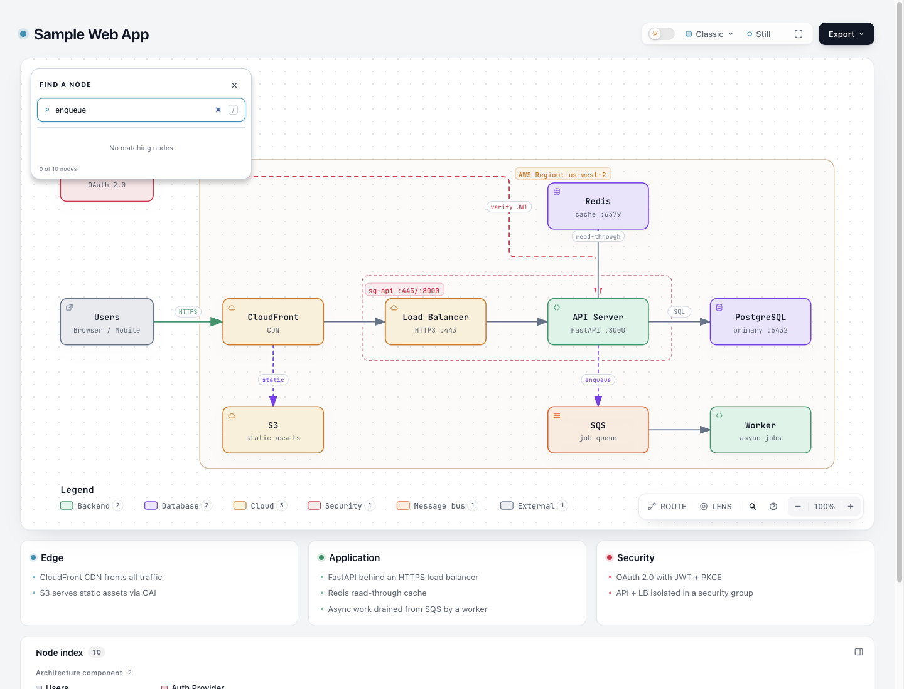
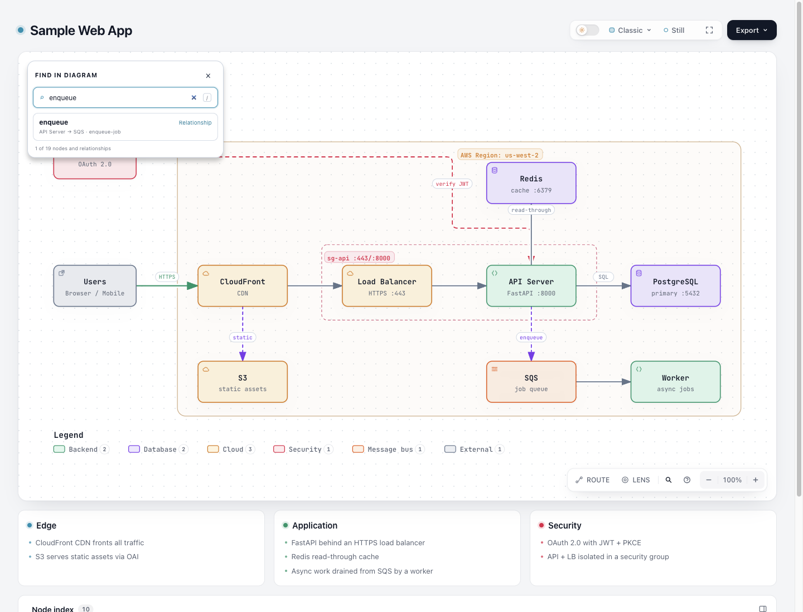

# Relationship search candidate

This candidate adds a text-search entrance to an existing exact relationship
inspection action. In the tracked Web App illustration, Finder on the comparison
base returns no nodes for `enqueue`, although `enqueue-job` (API Server → SQS)
is authored and directly inspectable. This is an illustrative reproduction,
not a naturally observed user failure or evidence of faster overall reading.
Small diagrams already allow reading the label and directly clicking the line;
that simpler alternative remains useful.

Base: `e837dc4cb83042d2b6c596e039692e25ec62c2da`.
Branch: `codex/lab-relation-search`. The frozen artifact identities are in
[identity.json](identity.json). This is an experimental candidate; no merge,
release, deployment, or live Skill installation is part of this change.

## Behavior and ownership

- Empty Finder queries retain the existing node browse list and node count.
- Non-empty default queries match existing node fields plus eligible authored
  relationship IDs and labels. Relationship rows show a distinct badge,
  direction/endpoints, and authored ID. Selecting a row pins that exact relation.
- Route endpoint and restricted contexts stay node-only. Existing public
  `finder.select(id)` and `finder.count` remain node contracts.
- Focus's installed relationship hit targets supply eligibility and identity.
  One authored-label DOM attribute supplies search metadata. Finder neither
  reconstructs connectivity nor repairs ambiguous or shapeless relationships.
  ID-less eligible relations use Focus's existing key-based inspection path.
- Six bundled locale catalogs describe mixed search. Existing custom translation
  override and fallback behavior is preserved.

The behavioral reference was [lambdasistemi/graph-browser](https://github.com/lambdasistemi/graph-browser/tree/e39706a22f5b66a0f61b14e1408d97f5d727f61d) at
`e39706a22f5b66a0f61b14e1408d97f5d727f61d` ([Search.purs 46–67](https://github.com/lambdasistemi/graph-browser/blob/e39706a22f5b66a0f61b14e1408d97f5d727f61d/src/Graph/Search.purs#L46-L67) and
Viewer.purs 293–350, 638–677). No source code was copied; the inspected repository
had no LICENSE. Archify's existing Focus identity contract owns selection here.

## Actual browser comparison

The coordinating agent operated the frozen pages in Ego/Chromium at 1440×1100
and viewed all five original PNGs. [browser-evidence.json](browser-evidence.json)
binds the artifact, original observations and PNG bytes; these are scoped
observations, not a delivery receipt or human acceptance.

| Existing node-only search | Candidate mixed search |
| --- | --- |
|  |  |

The base returns `0 of 10 nodes`; the candidate returns one relationship among
19 nodes and eligible relationships. Actual Enter selects `enqueue-job`,
preserves `API Server → SQS`, writes `#relation=enqueue-job`, closes Finder and
focuses the existing relationship button. [Selected result](screenshots/candidate-enqueue-pinned.png).
The base's [direct pointer selection](screenshots/baseline-direct-pin.png) already
works, so this is a new query entrance rather than a repair to relationship inspection.

In the existing RAG illustration, `ANN search`, `grounded answer`, and `parsed text`
each return zero baseline node results. On the candidate, actual Enter selects
`retriever-to-vectordb`, `llm-response`, and `loader-to-chunker`, respectively.
[Dark-theme grounded-answer result](screenshots/candidate-rag-grounded-answer-dark.png).
Actual Route start/target searches for `enqueue` still contain zero relationship
rows; selecting `API Server` and `SQS` resolves the original one-hop route.

An initial automation click on a zero-width SVG group could not resolve a pointer
target; a subsequent click on the observed vertical stroke succeeded. This was
not a product defect or candidate repair. Authored SVG equality is recorded below;
runtime camera/container pixels differ and are not claimed equivalent. No mobile,
AT, OS clipboard, external-link or full-mode browser acceptance is implied.

An independent agent reviewed the source, callers, tests and raw results and found
no blocker for this experimental branch. The outcome remains subject to maintainer
and reader judgment; the review does not establish improved reading speed.

## Evidence

The same added Finder browser regression runs against an isolated archive of the
base and the candidate. Base fails with `[]` for `enqueue`; candidate finds the
`enqueue-job` relationship and selects it through actual keyboard interaction.
Additional controlled DOM probes check same-label parallel relation identity,
existing ambiguous-ID/no-geometry exclusions, and Route node-only selection.
These probes establish interaction boundaries, not naturally occurring failures.

The existing Finder suite also protects IME, shortcuts, node metadata, contextual
selection, themes, constrained viewport, panel coordination, and export cleanup.
A now-obsolete exact `meta.title = ...` private-source assertion was removed from
Semantic Passport coverage; the Finder browser test checks actual metadata titles
instead. No supported capability was retired and no broader test audit was done.

Executed evidence (raw logs are local, outside the checkout):

| Check | Result | Raw log |
| --- | --- | --- |
| Same Finder regression on base | New relationship subtest fails; seven existing subtests pass | `/tmp/relation-baseline-regression.log` |
| Candidate Finder browser | 9 passed, 0 skipped | `/tmp/relation-finder-final.log` |
| Focus + Route browser | 22 passed, 0 skipped | `/tmp/relation-focus-route.log` |
| Architecture Delta | 40 passed in combined run; separate stale Semantic Passport assertion failed and was repaired | `/tmp/relation-focused.log` |
| Final Semantic Passport | 5 passed, 1 browser skip | `/tmp/relation-semantic-final.log` |
| Core CLI smoke | 19 passed, 0 skipped | `/tmp/relation-core.log` |
| Locale integration | 37 passed, 0 skipped | `/tmp/relation-i18n.log` |
| Generated checks | Passed | `/tmp/relation-generated.log` |
| Gallery rebuild | 16 artifacts, 144 checks | `/tmp/relation-gallery.log` |
| Canonical ZIP build | Passed, official Node 22.23.2 / bundled zlib | `/tmp/relation-zip.log` |
| Extracted ZIP package smoke | Passed on macOS outside checkout, without dependencies | `/tmp/relation-package.log` |

The first new browser-test attempt omitted native Enter text dispatch and tried
Route selection without starting Route. Those test-fixture errors were corrected;
no product workaround or skip was introduced. The original combined focused run
and failures remain in the raw logs.

Root owns the actual Ego browser comparison/screenshots and independent acceptance
observations. [candidate-rag.html](candidate-rag.html) renders the existing
`examples/rag-pipeline.architecture.json` unchanged. Shared Viewer generation also
refreshed delivered template, golden examples, Checkout compare/receipt, Gallery,
and ZIP; their freshness does not establish visual quality. The main authored
Web App SVG is byte-identical (29,943 serialized UTF-8 bytes) across tracked base,
freshly regenerated base, and candidate; see
[authored-svg-comparison.json](authored-svg-comparison.json). This comparison does
not claim runtime camera or container pixel equivalence. Full browser/WebM,
Windows, cross-platform package gates and remote CI were not run for this lab.

The full staged whitespace check reports 15 whitespace-only lines in the new
generated RAG HTML. Each line's adjacent context already exists in the recorded
base template; those generated bytes are retained. The scoped check for all other
changed files passes. This is not reported as a clean full whitespace check.

## Reproduce

From this checkout, with dependencies available:

```sh
ARCHIFY_CHROME='/Applications/Google Chrome.app/Contents/MacOS/Google Chrome' npm run test:focus -- test/finder-browser.test.mjs test/focus-browser.test.mjs test/route-probe-browser.test.mjs
npm run test:focus -- test/semantic-passport.test.mjs test/architecture-delta.test.mjs test/i18n.test.mjs
npm run test:generated
node archify/renderers/architecture/render-architecture.mjs examples/rag-pipeline.architecture.json /tmp/relation-search-rag.html
```

For the baseline failure, archive `archify/` and `test/helpers/` from the recorded
base to a temporary directory, copy the candidate Finder test into its `test/`,
and run that test with the same Chrome. Product source bytes stay untouched.
Canonical ZIP reproduction requires the official Node 22 toolchain documented in
CONTRIBUTING.md; package smoke runs against its extracted `archify/` directory.
